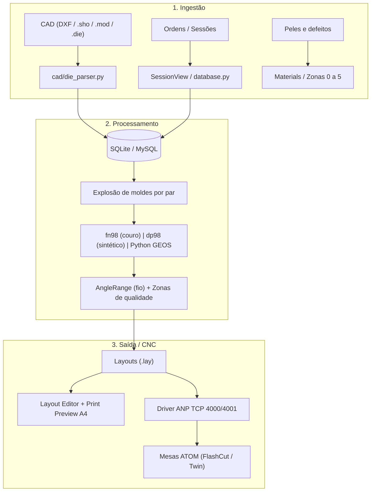

# PROJETO ATOM JobManager Reborn: Documento Vivo

> **Finalidade:** ser a fonte única de verdade entre o código (Antigravity) e o Claude.
> **Regra de ouro:** o que está marcado `[CONFIRMADO]` veio do relatório, do código ou do usuário. O que está `[NÃO CONFIRMADO]` é suposição e não deve virar "fato" sem validação. O que está `[PREENCHER]` o Antigravity deve completar lendo o código real.

<!-- AUTO:header:start -->
**Última sincronização com o código:** 2026-10-18 17:52 (HEAD ao gerar: `9c90be6`; 33 arquivos Python, ~20851 linhas)
<!-- AUTO:header:end -->
**Versão deste documento:** 1

---

## 0. Como manter este documento

**Automático:** os blocos entre `<!-- AUTO:nome:start -->` e `<!-- AUTO:nome:end -->` (cabeçalho, seção 3, seção 4, seção 7.4 e commits recentes) são reescritos por `tools/sync_project_doc.py` a cada commit, via hook do Git. **Não edite esses blocos à mão: a próxima execução apaga a edição.** Todo o resto é manual.

1. Alterações que o script não vê (regras, decisões, confirmações do usuário, pendências) são atualizadas à mão nas seções 5, 6, 7.1, 7.2, 8, 9 e 10.
2. Nunca apagar entradas do Changelog (seção 10). Apenas acrescentar.
3. Ao mudar um item de `[NÃO CONFIRMADO]` para `[CONFIRMADO]`, registrar quem confirmou e quando.
4. O Claude só afirma sobre o código aquilo que está descrito aqui. Se algo não estiver aqui, o Claude pergunta em vez de presumir.

---

## 1. Visão geral

Reconstrução do ecossistema da **ATOM Engineering s.r.l.** (JobManager2000, TheLoop, ShedNt, Layout, FreeNest, fn98, dp98) para corte de calçado em couro natural e sintéticos. `[CONFIRMADO]`

O projeto tem duas implementações complementares:

| Implementação | Pasta/Nome | Stack | Papel |
|---|---|---|---|
| Cliente desktop | `jobmanager-win10-python` / `teste_dola` | Python, MySQL 8.0 Central (reserva local SQLite `jobmanager.db`), UI desktop | Reconstrução fiel da UI/UX do JobManager2000 (WinXP/Win10/Win11), cliente para 8 PCs simultâneos na fábrica (>1000 layouts/dia) |
| Serviço industrial distribuído | `atom_reborn` | FastAPI, MySQL 8.0, GEOS/Shapely, WebSocket, React 18 | Backend corporativo, fila de nesting, integração com chão de fábrica via ANP TCP |

Ambientes: Windows 10/11 e Linux. `[CONFIRMADO]`

---

## 2. Fluxo de dados



---

## 3. Estrutura do código (automático)

<!-- AUTO:tree:start -->
```
README.md
RELATORIO_IMPLEMENTACAO_MELHORIAS.md
RELATORIO_SISTEMA_COMPLETO.md
build_exe_windows.bat
build_linux.sh
config.py                                   # JobManager 2000 (Python Edition for Windows 10)
database.py                                 # JobManager 2000 (Python Edition)
db.example.ini
docker-compose.yml
main.py                                     # JobManager 2000 (Python Edition para Windows 10)
run.bat
run.sh
cad/colors.py                               # JobManager 2000 (Python Edition)
cad/die_parser.py                           # JobManager 2000 (Python Edition)
cad/exporter.py                             # JobManager 2000 (Python Edition)
cad/geometry.py                             # JobManager 2000 (Python Edition)
cad/lay_parser.py                           # JobManager 2000 (Python Edition)
cad/nesting_engine.py                       # JobManager 2000 (Python Edition)
db/__init__.py                              # Camada de Acesso a Dados do JobManager (MySQL 8.0 / SQLite Reserva)
db/config.py                                # JobManager 2000 - Configuração de Banco de Dados Central
db/connection.py                            # JobManager 2000 - Camada Única de Acesso a Banco de Dados
db/schema_mysql.sql
db/migrations/001_initial_mysql_schema.sql
docs/FORMATO_LAY.md
tests/test_db_layer.py                      # Testes Unitários da Camada de Banco de Dados Central (MySQL 8.0 & SQLite Reserva)
tests/test_lay_parser.py                    # Testes Unitários para o Parser e Gerador de Arquivos .lay (ATOM $$LAYOUT.v3$$)
tests/test_layout_editor_shortcuts.py       # Testes Automatizados para Atalhos do LayoutEditorView:
tests/test_mysql_concurrency.py             # JobManager 2000 (Python Edition)
tests/test_session_monotonic.py             # Testes Unitários: Monotonicidade Estrita de Sessões e Persistência contra Re-semeadura
tests/test_shape_sorting.py                 # Testes Unitários: Classificação e Ordenação de Moldes e Tamanhos (Maior para Menor / Menor para Maior)
tools/migrate_sqlite_to_mysql.py            # tools/migrate_sqlite_to_mysql.py - Migra jobmanager.db (SQLite) para MySQL 8.0 Central.
ui/add_shapes_dialog.py                     # JobManager 2000 (Python Edition)
ui/cad_canvas.py                            # JobManager 2000 (Python Edition)
ui/dieproc_dialog.py                        # JobManager 2000 (Python Edition)
ui/edit_shape_in_session_dialog.py          # JobManager 2000 (Python Edition)
ui/layout_editor_view.py                    # JobManager 2000 (Python Edition)
ui/layout_print_dialog.py                   # JobManager 2000 (Python Edition)
ui/main_window.py                           # JobManager 2000 (Edição Python para Windows 10 / 11)
ui/material_codes_view.py                   # JobManager 2000 (Python Edition)
ui/options_dialog.py                        # JobManager 2000 (Python Edition)
ui/order_view.py                            # JobManager 2000 (Python Edition)
ui/params_dialog.py                         # JobManager 2000 (Python Edition)
ui/session_view.py                          # JobManager 2000 (Python Edition)
ui/shape_editor_view.py                     # JobManager 2000 (Python Edition)
ui/sort_utils.py                            # JobManager 2000 (Python Edition)
```
<!-- AUTO:tree:end -->

### 3.0 Classes e funções por arquivo (automático)

<!-- AUTO:symbols:start -->
### `database.py`
- `class DatabaseManager` (linha 41, 54 métodos)
- funções: `get_current_operator`

### `main.py`
- funções: `main`

### `cad/colors.py`
- funções: `get_color_for_size`, `get_contrast_text_color`, `get_color_emoji`

### `cad/die_parser.py`
- funções: `_parse_float`, `interpolate_arc_bulge`, `clean_shape_name`, `parse_die_content`, `parse_die_file`, `generate_die_content`, `save_die_file`

### `cad/exporter.py`
- funções: `reorder_contour_midpoint_longest_edge`, `optimize_piece_cutting_order_tsp`, `_canonical_edge`, `export_gcode`, `export_dxf`, `export_xml_report`

### `cad/geometry.py`
- `class SpatialGrid` (linha 215, 4 métodos): Indexação Espacial 2D (Spatial Grid Hashing).
- funções: `rotate_point`, `transform_contour`, `polygon_area`, `polygon_perimeter`, `polygon_bbox`, `bbox_overlap`, `point_in_polygon`, `_ccw`, `segments_intersect`, `point_segment_distance_sq`, `simplify_contour_for_collision`, `polygons_collide`, `find_contact_coordinate_binary`

### `cad/lay_parser.py`
- `class TargetDie` (linha 53, 1 métodos): Representa uma matriz alvo (TG) declarada no layout.
- `class PlacedItem` (linha 74, 0 métodos): Representa uma peça individual posicionada no layout (I).
- `class QualityZone` (linha 99, 0 métodos): Zona de qualidade ou defeito em couro/pele.
- `class LayoutData` (linha 106, 1 métodos): Estrutura consolidada de um layout de corte .lay.
- funções: `_parse_float`, `_parse_int`, `parse_lay`, `link_layout_items_to_db`, `generate_lay_content`, `validate_layout_placement`, `export_layout_from_pieces`

### `cad/nesting_engine.py`
- funções: `get_paired_offset_cached`, `try_hole_filling_placement`, `check_collision_against_placed`, `calculate_yield`, `calculate_atom_cutting_time`, `parse_coupling_angles`, `dieproc_nest_pieces`, `nest_synthetic_engine`, `nest_tape_engine`, `auto_nest_pieces`

### `db/config.py`
- funções: `_get_val`, `_get_int`

### `db/connection.py`
- `class ServerUnreachableError` (linha 16, 1 métodos): Lançada quando o servidor MySQL central estiver inacessível.
- `class VersionConflictError` (linha 24, 0 métodos): Lançada quando outro operador salvou o layout concorrentemente (controle otimista).
- `class DBRow` (linha 28, 2 métodos): Registro retornado por consultas: comporta-se como dicionário (row['col'])
- `class DBCursor` (linha 64, 8 métodos): Cursor unificado que traduz placeholders, retorna DBRow e expõe lastrowid.
- `class DBConnection` (linha 141, 7 métodos): Wrapper de conexão unificado com suporte a context manager e transações explícitas.
- `class SimpleMySQLPool` (linha 199, 4 métodos): Pool simples e thread-safe de conexões MySQL com reconexão automática.
- funções: `translate_query_for_mysql`, `get_active_backend`, `set_active_backend`, `get_connection`, `get_memory_connection`

### `tests/test_db_layer.py`
- `class TestDBLayer` (linha 30, 14 métodos)

### `tests/test_lay_parser.py`
- `class TestLayParser` (linha 33, 14 métodos)

### `tests/test_layout_editor_shortcuts.py`
- `class DummyEvent` (linha 30, 1 métodos)
- `class TestLayoutEditorShortcuts` (linha 36, 27 métodos)

### `tests/test_mysql_concurrency.py`
- `class TestMySQLConcurrency` (linha 29, 4 métodos)

### `tests/test_session_monotonic.py`
- `class TestSessionMonotonic` (linha 10, 8 métodos)

### `tests/test_shape_sorting.py`
- `class TestShapeSorting` (linha 14, 6 métodos)
- `class DummyKeyEvent` (linha 105, 1 métodos)
- `class TestSessionViewInlineArrowNavigation` (linha 111, 8 métodos)

### `tools/migrate_sqlite_to_mysql.py`
- funções: `make_backup`, `migrate`, `main`

### `ui/add_shapes_dialog.py`
- `class AddShapesDialog` (linha 13, 14 métodos)

### `ui/cad_canvas.py`
- `class CADCanvas` (linha 11, 22 métodos)

### `ui/dieproc_dialog.py`
- `class DieProcDialog` (linha 12, 16 métodos)

### `ui/edit_shape_in_session_dialog.py`
- `class EditShapeInSessionDialog` (linha 11, 6 métodos)

### `ui/layout_editor_view.py`
- `class LayoutEditorView` (linha 149, 79 métodos)
- funções: `rotate_piece_in_place`

### `ui/layout_print_dialog.py`
- `class LayoutPrintDialog` (linha 20, 17 métodos): Janela modal de Visualização de Impressão (Print Preview) do Layout Editor.

### `ui/main_window.py`
- `class MainWindow` (linha 43, 107 métodos)
- funções: `get_assets_dir`

### `ui/material_codes_view.py`
- `class MaterialCodesView` (linha 13, 19 métodos)

### `ui/options_dialog.py`
- `class OptionsDialog` (linha 13, 15 métodos)

### `ui/order_view.py`
- `class OrderView` (linha 10, 8 métodos)

### `ui/params_dialog.py`
- `class NestingParamsDialog` (linha 10, 2 métodos)

### `ui/session_view.py`
- `class SessionView` (linha 21, 69 métodos)

### `ui/shape_editor_view.py`
- `class ShapeEditorView` (linha 19, 47 métodos)

### `ui/sort_utils.py`
- funções: `natural_sort_key`, `size_sort_key`, `shape_area_sort_key`
<!-- AUTO:symbols:end -->

### 3.1 Módulos conhecidos pelo relatório

| Módulo / Classe | Papel | Estado |
|---|---|---|
| `cad/die_parser.py` | Importador/exportador `.die` | Pronto. **Não alterar** sem pedido explícito |
| `cad/lay_parser.py` | Importador/exportador `.lay` (`$$LAYOUT.v3$$`), nesting e ordenação de corte CNC | Pronto |
| `database.py` | Acesso SQLite (`jobmanager.db`), gerenciamento de ordens, artigos, moldes, sessões e layouts | Pronto (`DIVERGÊNCIA: refatorado para MySQL 8.0 Central via pacote db/, SQLite é contingência`) |
| `SessionView` | Sessão de corte, aba Moldes, mini-preview, disparo do encaixe e integração | Pronto |
| `ShapeEditorView` | Reprodução visual do ShedNt | Pronto (visual) |
| `LayoutEditorView` | Editor de layout (canvas vetorial) | Pronto: atalhos F1-F4, Ctrl+Z, Ctrl+S, rotação e persistência |
| `PrintPreviewDialog` | Relatório A4 com rendimento % | Pronto (`DIVERGÊNCIA: implementado como LayoutPrintDialog em ui/layout_print_dialog.py`) |
| `anp_client.py` | Driver ANP: socket não-bloqueante, 4001 (ping) e 4000 (dados) | `[NÃO IMPLEMENTADO]` (`DIVERGÊNCIA: arquivo inexistente no repositório; planejado`) |
| `LoopDaemon` (em `atom_reborn`) | Substitui o TheLoop.exe | Pronto `[NÃO CONFIRMADO no repositório local]` |

> **DIVERGÊNCIAS da Seção 3.1 em relação ao código real:**
> 1. **`database.py`**: O acesso ao banco agora é centralizado via pacote `db/` (`db.connection`, `db.config`). O banco de dados **primário em produção é MySQL 8.0 Central** (com suporte multi-máquina a 8 PCs simultâneos, pool de conexões e concorrência otimista), mantendo o SQLite local (`jobmanager.db`) como contingência/reserva offline.
> 2. **`PrintPreviewDialog`**: No código real do repositório, a classe chama-se `LayoutPrintDialog` e reside em `ui/layout_print_dialog.py` (linha 20, 14 métodos).
> 3. **`anp_client.py`**: O arquivo `anp_client.py` **não existe** no repositório atual. Foi concebido no planejamento original para comunicação direta via socket com a máquina de corte ATOM (portas 4000 e 4001), mas ainda não foi implementado neste repositório.

---

## 4. Modelo de dados (automático)

<!-- AUTO:schema:start -->
### 4.1 Schema MySQL 8.0 (Banco de Dados Principal Central)

DDL base (`db/schema_mysql.sql`) e migrações versionadas (`db/migrations/*.sql`):

```sql
-- =============================================================================
-- DDL Base: db/schema_mysql.sql
-- =============================================================================
-- =============================================================================
-- JobManager 2000 Reborn - Schema DDL para MySQL 8.0 Central
-- Compatível com 8 PCs simultâneos e > 1000 layouts/dia
-- Engine: InnoDB | Charset: utf8mb4 | Collation: utf8mb4_unicode_ci
-- =============================================================================

CREATE TABLE IF NOT EXISTS schema_version (
    version INT PRIMARY KEY,
    description VARCHAR(255) NOT NULL,
    applied_at DATETIME NOT NULL DEFAULT CURRENT_TIMESTAMP
) ENGINE=InnoDB DEFAULT CHARSET=utf8mb4 COLLATE=utf8mb4_unicode_ci;

-- 1. Materiais (Chapas, Bobinas, Peles)
CREATE TABLE IF NOT EXISTS materials (
    id VARCHAR(50) PRIMARY KEY,
    name VARCHAR(150) NOT NULL,
    type VARCHAR(50) NOT NULL,
    width_mm DOUBLE NOT NULL,
    height_mm DOUBLE NOT NULL,
    area_m2 DOUBLE NOT NULL,
    thickness_mm DOUBLE NOT NULL,
    layers INT DEFAULT 2,
    gap_mm DOUBLE DEFAULT 1.0
) ENGINE=InnoDB DEFAULT CHARSET=utf8mb4 COLLATE=utf8mb4_unicode_ci;

-- 2. Ordens de Produção (Orders)
CREATE TABLE IF NOT EXISTS orders (
    id INT AUTO_INCREMENT PRIMARY KEY,
    code VARCHAR(100) UNIQUE NOT NULL,
    customer VARCHAR(150) NOT NULL,
    name VARCHAR(150) DEFAULT 'Derby Masculino #41',
    status VARCHAR(50) NOT NULL DEFAULT 'Pendente',
    created_at DATETIME NOT NULL DEFAULT CURRENT_TIMESTAMP,
    INDEX idx_orders_code (code),
    INDEX idx_orders_status (status)
) ENGINE=InnoDB DEFAULT CHARSET=utf8mb4 COLLATE=utf8mb4_unicode_ci;

-- 3. Artigos por Ordem (Articles)
CREATE TABLE IF NOT EXISTS articles (
    id INT AUTO_INCREMENT PRIMARY KEY,
    order_id INT NOT NULL,
    name VARCHAR(150) NOT NULL,
    pairs_count INT NOT NULL DEFAULT 1,
    material_id VARCHAR(50) NOT NULL,
    FOREIGN KEY (order_id) REFERENCES orders(id) ON DELETE CASCADE,
    FOREIGN KEY (material_id) REFERENCES materials(id) ON DELETE RESTRICT,
    INDEX idx_articles_order (order_id),
    INDEX idx_articles_material (material_id)
) ENGINE=InnoDB DEFAULT CHARSET=utf8mb4 COLLATE=utf8mb4_unicode_ci;

-- 4. Pastas de Moldes CAD (Shape Folders)
CREATE TABLE IF NOT EXISTS shape_folders (
    id INT AUTO_INCREMENT PRIMARY KEY,
    name VARCHAR(150) UNIQUE NOT NULL
) ENGINE=InnoDB DEFAULT CHARSET=utf8mb4 COLLATE=utf8mb4_unicode_ci;

-- 4.1 Pastas de Produção (Job Folders)
CREATE TABLE IF NOT EXISTS job_folders (
    id INT AUTO_INCREMENT PRIMARY KEY,
    name VARCHAR(150) UNIQUE NOT NULL
) ENGINE=InnoDB DEFAULT CHARSET=utf8mb4 COLLATE=utf8mb4_unicode_ci;

-- 5. Moldes / Geometria CAD (Shapes)
CREATE TABLE IF NOT EXISTS shapes (
    id INT AUTO_INCREMENT PRIMARY KEY,
    article_id INT NOT NULL,
    name VARCHAR(150) NOT NULL,
    color VARCHAR(30) NOT NULL,
    contour_json LONGTEXT NOT NULL,
    holes_json LONGTEXT NULL,
    stitching_json LONGTEXT NULL,
    folder VARCHAR(150) DEFAULT '',
    size VARCHAR(50) DEFAULT '41',
    FOREIGN KEY (article_id) REFERENCES articles(id) ON DELETE CASCADE,
    INDEX idx_shapes_article (article_id),
    INDEX idx_shapes_name (name),
    INDEX idx_shapes_folder (folder)
) ENGINE=InnoDB DEFAULT CHARSET=utf8mb4 COLLATE=utf8mb4_unicode_ci;

-- 6. Sessões de Corte / Nesting (Sessions)
CREATE TABLE IF NOT EXISTS sessions (
    id INT AUTO_INCREMENT PRIMARY KEY,
    code VARCHAR(100) UNIQUE NOT NULL,
    order_id INT NOT NULL,
    material_id VARCHAR(50) NOT NULL,
    name VARCHAR(150) NOT NULL DEFAULT '',
    job VARCHAR(100) NOT NULL DEFAULT 'ProduçãoNova',
    status VARCHAR(50) NOT NULL DEFAULT 'Planejado',
    yield_percent DOUBLE DEFAULT 0.0,
    cutting_time_sec DOUBLE DEFAULT 0.0,
    placed_pieces_json LONGTEXT NULL,
    strategy VARCHAR(100) DEFAULT 'flashnestsheet',
    params VARCHAR(100) DEFAULT 'stdNOTFill',
    machine VARCHAR(150) DEFAULT 'ATOM FlashCut Flex 3020',
    shapes_json LONGTEXT NULL,
    created_at DATETIME NOT NULL DEFAULT CURRENT_TIMESTAMP,
    FOREIGN KEY (order_id) REFERENCES orders(id) ON DELETE CASCADE,
    FOREIGN KEY (material_id) REFERENCES materials(id) ON DELETE RESTRICT,
    INDEX idx_sessions_order (order_id),
    INDEX idx_sessions_created (created_at),
    INDEX idx_sessions_status (status)
) ENGINE=InnoDB DEFAULT CHARSET=utf8mb4 COLLATE=utf8mb4_unicode_ci;

-- 7. Configurações Globais do Sistema (Settings)
CREATE TABLE IF NOT EXISTS settings (
    `key` VARCHAR(100) PRIMARY KEY,
    `value` LONGTEXT NOT NULL
) ENGINE=InnoDB DEFAULT CHARSET=utf8mb4 COLLATE=utf8mb4_unicode_ci;

-- 8. Presets DieProc (dp98 ATOM)
CREATE TABLE IF NOT EXISTS dieproc_presets (
    name VARCHAR(100) PRIMARY KEY,
    coupling VARCHAR(100) NOT NULL,
    step DOUBLE DEFAULT 1.0,
    solutions INT DEFAULT 30,
    range1_from DOUBLE DEFAULT -3.0,
    range1_to DOUBLE DEFAULT 3.0,
    range1_step DOUBLE DEFAULT 1.0,
    range2_from DOUBLE DEFAULT 0.0,
    range2_to DOUBLE DEFAULT 0.0,
    range2_step DOUBLE DEFAULT 0.0,
    range3_from DOUBLE DEFAULT 0.0,
    range3_to DOUBLE DEFAULT 0.0,
    range3_step DOUBLE DEFAULT 0.0,
    gap1 DOUBLE DEFAULT 1.0,
    gap2 DOUBLE DEFAULT 0.0,
    gap3 DOUBLE DEFAULT 0.0,
    row_interlock INT DEFAULT 1,
    diagonal INT DEFAULT 0
) ENGINE=InnoDB DEFAULT CHARSET=utf8mb4 COLLATE=utf8mb4_unicode_ci;

-- 9. Layouts de Corte (.lay) com Controle de Versão Otimista
CREATE TABLE IF NOT EXISTS layouts (
    id INT AUTO_INCREMENT PRIMARY KEY,
    session_id INT NOT NULL,
    name VARCHAR(150) NOT NULL DEFAULT 'l0000.lay',
    width_mm DOUBLE NOT NULL DEFAULT 0.0,
    height_mm DOUBLE NOT NULL DEFAULT 0.0,
    yield_pct DOUBLE NOT NULL DEFAULT 0.0,
    status VARCHAR(50) NOT NULL DEFAULT 'Nested',
    lay_path VARCHAR(500) NULL,
    version INT NOT NULL DEFAULT 1,
    created_at DATETIME NOT NULL DEFAULT CURRENT_TIMESTAMP,
    updated_at DATETIME NOT NULL DEFAULT CURRENT_TIMESTAMP ON UPDATE CURRENT_TIMESTAMP,
    created_by VARCHAR(100) NULL,
    updated_by VARCHAR(100) NULL,
    -- Colunas de compatibilidade e suporte ao formato .lay
    code VARCHAR(100) NOT NULL DEFAULT 'l0000.lay',
    path VARCHAR(500) DEFAULT '',
    `desc` VARCHAR(255) DEFAULT '',
    material_code VARCHAR(100) DEFAULT '',
    material_name VARCHAR(150) DEFAULT '',
    gap_mm DOUBLE DEFAULT 1.0,
    ris_w DOUBLE DEFAULT 0.0,
    ris_l DOUBLE DEFAULT 0.0,
    area_mm2 DOUBLE DEFAULT 0.0,
    yield_percent DOUBLE DEFAULT 0.0,
    num_items INT DEFAULT 0,
    num_dies INT DEFAULT 0,
    FOREIGN KEY (session_id) REFERENCES sessions(id) ON DELETE CASCADE,
    INDEX idx_layouts_session_status (session_id, created_at, status),
    INDEX idx_layouts_version (id, version)
) ENGINE=InnoDB DEFAULT CHARSET=utf8mb4 COLLATE=utf8mb4_unicode_ci;

-- 10. Peças Posicionadas do Layout (layout_pieces)
CREATE TABLE IF NOT EXISTS layout_pieces (
    id INT AUTO_INCREMENT PRIMARY KEY,
    layout_id INT NOT NULL,
    mold_id INT NULL,
    shape_id INT NULL,
    x DOUBLE NOT NULL,
    y DOUBLE NOT NULL,
    rotation_deg SMALLINT NOT NULL CHECK (rotation_deg >= 0 AND rotation_deg < 360),
    mirrored TINYINT(1) NOT NULL DEFAULT 0,
    is_mirrored TINYINT(1) NOT NULL DEFAULT 0,
    -- Colunas de metadados CAM / .lay
    item_index INT NOT NULL DEFAULT 0,
    target_index INT NOT NULL DEFAULT 0,
    instance_id INT NOT NULL DEFAULT 0,
    piece_name VARCHAR(150) NOT NULL DEFAULT '',
    size VARCHAR(50) DEFAULT '',
    rotation_rad DOUBLE DEFAULT 0.0,
    color VARCHAR(30) DEFAULT '#2563eb',
    tag VARCHAR(50) DEFAULT 'Pasted',
    quality_zone INT DEFAULT 1,
    FOREIGN KEY (layout_id) REFERENCES layouts(id) ON DELETE CASCADE,
    FOREIGN KEY (mold_id) REFERENCES shapes(id) ON DELETE RESTRICT,
    FOREIGN KEY (shape_id) REFERENCES shapes(id) ON DELETE RESTRICT,
    INDEX idx_layout_pieces_layout (layout_id),
    INDEX idx_layout_pieces_mold (mold_id),
    INDEX idx_layout_pieces_shape (shape_id)
) ENGINE=InnoDB DEFAULT CHARSET=utf8mb4 COLLATE=utf8mb4_unicode_ci;

-- -----------------------------------------------------------------------------
-- Migração: db/migrations/001_initial_mysql_schema.sql
-- -----------------------------------------------------------------------------
-- Migração 001: Schema inicial do MySQL 8.0 para o JobManager Reborn
-- Idempotente

-- =============================================================================
-- JobManager 2000 Reborn - Schema DDL para MySQL 8.0 Central
-- Compatível com 8 PCs simultâneos e > 1000 layouts/dia
-- Engine: InnoDB | Charset: utf8mb4 | Collation: utf8mb4_unicode_ci
-- =============================================================================

CREATE TABLE IF NOT EXISTS schema_version (
    version INT PRIMARY KEY,
    description VARCHAR(255) NOT NULL,
    applied_at DATETIME NOT NULL DEFAULT CURRENT_TIMESTAMP
) ENGINE=InnoDB DEFAULT CHARSET=utf8mb4 COLLATE=utf8mb4_unicode_ci;

-- 1. Materiais (Chapas, Bobinas, Peles)
CREATE TABLE IF NOT EXISTS materials (
    id VARCHAR(50) PRIMARY KEY,
    name VARCHAR(150) NOT NULL,
    type VARCHAR(50) NOT NULL,
    width_mm DOUBLE NOT NULL,
    height_mm DOUBLE NOT NULL,
    area_m2 DOUBLE NOT NULL,
    thickness_mm DOUBLE NOT NULL,
    layers INT DEFAULT 2,
    gap_mm DOUBLE DEFAULT 1.0
) ENGINE=InnoDB DEFAULT CHARSET=utf8mb4 COLLATE=utf8mb4_unicode_ci;

-- 2. Ordens de Produção (Orders)
CREATE TABLE IF NOT EXISTS orders (
    id INT AUTO_INCREMENT PRIMARY KEY,
    code VARCHAR(100) UNIQUE NOT NULL,
    customer VARCHAR(150) NOT NULL,
    name VARCHAR(150) DEFAULT 'Derby Masculino #41',
    status VARCHAR(50) NOT NULL DEFAULT 'Pendente',
    created_at DATETIME NOT NULL DEFAULT CURRENT_TIMESTAMP,
    INDEX idx_orders_code (code),
    INDEX idx_orders_status (status)
) ENGINE=InnoDB DEFAULT CHARSET=utf8mb4 COLLATE=utf8mb4_unicode_ci;

-- 3. Artigos por Ordem (Articles)
CREATE TABLE IF NOT EXISTS articles (
    id INT AUTO_INCREMENT PRIMARY KEY,
    order_id INT NOT NULL,
    name VARCHAR(150) NOT NULL,
    pairs_count INT NOT NULL DEFAULT 1,
    material_id VARCHAR(50) NOT NULL,
    FOREIGN KEY (order_id) REFERENCES orders(id) ON DELETE CASCADE,
    FOREIGN KEY (material_id) REFERENCES materials(id) ON DELETE RESTRICT,
    INDEX idx_articles_order (order_id),
    INDEX idx_articles_material (material_id)
) ENGINE=InnoDB DEFAULT CHARSET=utf8mb4 COLLATE=utf8mb4_unicode_ci;

-- 4. Pastas de Moldes CAD (Shape Folders)
CREATE TABLE IF NOT EXISTS shape_folders (
    id INT AUTO_INCREMENT PRIMARY KEY,
    name VARCHAR(150) UNIQUE NOT NULL
) ENGINE=InnoDB DEFAULT CHARSET=utf8mb4 COLLATE=utf8mb4_unicode_ci;

-- 4.1 Pastas de Produção (Job Folders)
CREATE TABLE IF NOT EXISTS job_folders (
    id INT AUTO_INCREMENT PRIMARY KEY,
    name VARCHAR(150) UNIQUE NOT NULL
) ENGINE=InnoDB DEFAULT CHARSET=utf8mb4 COLLATE=utf8mb4_unicode_ci;

-- 5. Moldes / Geometria CAD (Shapes)
CREATE TABLE IF NOT EXISTS shapes (
    id INT AUTO_INCREMENT PRIMARY KEY,
    article_id INT NOT NULL,
    name VARCHAR(150) NOT NULL,
    color VARCHAR(30) NOT NULL,
    contour_json LONGTEXT NOT NULL,
    holes_json LONGTEXT NULL,
    stitching_json LONGTEXT NULL,
    folder VARCHAR(150) DEFAULT '',
    size VARCHAR(50) DEFAULT '41',
    FOREIGN KEY (article_id) REFERENCES articles(id) ON DELETE CASCADE,
    INDEX idx_shapes_article (article_id),
    INDEX idx_shapes_name (name),
    INDEX idx_shapes_folder (folder)
) ENGINE=InnoDB DEFAULT CHARSET=utf8mb4 COLLATE=utf8mb4_unicode_ci;

-- 6. Sessões de Corte / Nesting (Sessions)
CREATE TABLE IF NOT EXISTS sessions (
    id INT AUTO_INCREMENT PRIMARY KEY,
    code VARCHAR(100) UNIQUE NOT NULL,
    order_id INT NOT NULL,
    material_id VARCHAR(50) NOT NULL,
    name VARCHAR(150) NOT NULL DEFAULT '',
    job VARCHAR(100) NOT NULL DEFAULT 'ProduçãoNova',
    status VARCHAR(50) NOT NULL DEFAULT 'Planejado',
    yield_percent DOUBLE DEFAULT 0.0,
    cutting_time_sec DOUBLE DEFAULT 0.0,
    placed_pieces_json LONGTEXT NULL,
    strategy VARCHAR(100) DEFAULT 'flashnestsheet',
    params VARCHAR(100) DEFAULT 'stdNOTFill',
    machine VARCHAR(150) DEFAULT 'ATOM FlashCut Flex 3020',
    shapes_json LONGTEXT NULL,
    created_at DATETIME NOT NULL DEFAULT CURRENT_TIMESTAMP,
    FOREIGN KEY (order_id) REFERENCES orders(id) ON DELETE CASCADE,
    FOREIGN KEY (material_id) REFERENCES materials(id) ON DELETE RESTRICT,
    INDEX idx_sessions_order (order_id),
    INDEX idx_sessions_created (created_at),
    INDEX idx_sessions_status (status)
) ENGINE=InnoDB DEFAULT CHARSET=utf8mb4 COLLATE=utf8mb4_unicode_ci;

-- 7. Configurações Globais do Sistema (Settings)
CREATE TABLE IF NOT EXISTS settings (
    `key` VARCHAR(100) PRIMARY KEY,
    `value` LONGTEXT NOT NULL
) ENGINE=InnoDB DEFAULT CHARSET=utf8mb4 COLLATE=utf8mb4_unicode_ci;

-- 8. Presets DieProc (dp98 ATOM)
CREATE TABLE IF NOT EXISTS dieproc_presets (
    name VARCHAR(100) PRIMARY KEY,
    coupling VARCHAR(100) NOT NULL,
    step DOUBLE DEFAULT 1.0,
    solutions INT DEFAULT 30,
    range1_from DOUBLE DEFAULT -3.0,
    range1_to DOUBLE DEFAULT 3.0,
    range1_step DOUBLE DEFAULT 1.0,
    range2_from DOUBLE DEFAULT 0.0,
    range2_to DOUBLE DEFAULT 0.0,
    range2_step DOUBLE DEFAULT 0.0,
    range3_from DOUBLE DEFAULT 0.0,
    range3_to DOUBLE DEFAULT 0.0,
    range3_step DOUBLE DEFAULT 0.0,
    gap1 DOUBLE DEFAULT 1.0,
    gap2 DOUBLE DEFAULT 0.0,
    gap3 DOUBLE DEFAULT 0.0,
    row_interlock INT DEFAULT 1,
    diagonal INT DEFAULT 0
) ENGINE=InnoDB DEFAULT CHARSET=utf8mb4 COLLATE=utf8mb4_unicode_ci;

-- 9. Layouts de Corte (.lay) com Controle de Versão Otimista
CREATE TABLE IF NOT EXISTS layouts (
    id INT AUTO_INCREMENT PRIMARY KEY,
    session_id INT NOT NULL,
    name VARCHAR(150) NOT NULL DEFAULT 'l0000.lay',
    width_mm DOUBLE NOT NULL DEFAULT 0.0,
    height_mm DOUBLE NOT NULL DEFAULT 0.0,
    yield_pct DOUBLE NOT NULL DEFAULT 0.0,
    status VARCHAR(50) NOT NULL DEFAULT 'Nested',
    lay_path VARCHAR(500) NULL,
    version INT NOT NULL DEFAULT 1,
    created_at DATETIME NOT NULL DEFAULT CURRENT_TIMESTAMP,
    updated_at DATETIME NOT NULL DEFAULT CURRENT_TIMESTAMP ON UPDATE CURRENT_TIMESTAMP,
    created_by VARCHAR(100) NULL,
    updated_by VARCHAR(100) NULL,
    -- Colunas de compatibilidade e suporte ao formato .lay
    code VARCHAR(100) NOT NULL DEFAULT 'l0000.lay',
    path VARCHAR(500) DEFAULT '',
    `desc` VARCHAR(255) DEFAULT '',
    material_code VARCHAR(100) DEFAULT '',
    material_name VARCHAR(150) DEFAULT '',
    gap_mm DOUBLE DEFAULT 1.0,
    ris_w DOUBLE DEFAULT 0.0,
    ris_l DOUBLE DEFAULT 0.0,
    area_mm2 DOUBLE DEFAULT 0.0,
    yield_percent DOUBLE DEFAULT 0.0,
    num_items INT DEFAULT 0,
    num_dies INT DEFAULT 0,
    FOREIGN KEY (session_id) REFERENCES sessions(id) ON DELETE CASCADE,
    INDEX idx_layouts_session_status (session_id, created_at, status),
    INDEX idx_layouts_version (id, version)
) ENGINE=InnoDB DEFAULT CHARSET=utf8mb4 COLLATE=utf8mb4_unicode_ci;

-- 10. Peças Posicionadas do Layout (layout_pieces)
CREATE TABLE IF NOT EXISTS layout_pieces (
    id INT AUTO_INCREMENT PRIMARY KEY,
    layout_id INT NOT NULL,
    mold_id INT NULL,
    shape_id INT NULL,
    x DOUBLE NOT NULL,
    y DOUBLE NOT NULL,
    rotation_deg SMALLINT NOT NULL CHECK (rotation_deg >= 0 AND rotation_deg < 360),
    mirrored TINYINT(1) NOT NULL DEFAULT 0,
    is_mirrored TINYINT(1) NOT NULL DEFAULT 0,
    -- Colunas de metadados CAM / .lay
    item_index INT NOT NULL DEFAULT 0,
    target_index INT NOT NULL DEFAULT 0,
    instance_id INT NOT NULL DEFAULT 0,
    piece_name VARCHAR(150) NOT NULL DEFAULT '',
    size VARCHAR(50) DEFAULT '',
    rotation_rad DOUBLE DEFAULT 0.0,
    color VARCHAR(30) DEFAULT '#2563eb',
    tag VARCHAR(50) DEFAULT 'Pasted',
    quality_zone INT DEFAULT 1,
    FOREIGN KEY (layout_id) REFERENCES layouts(id) ON DELETE CASCADE,
    FOREIGN KEY (mold_id) REFERENCES shapes(id) ON DELETE RESTRICT,
    FOREIGN KEY (shape_id) REFERENCES shapes(id) ON DELETE RESTRICT,
    INDEX idx_layout_pieces_layout (layout_id),
    INDEX idx_layout_pieces_mold (mold_id),
    INDEX idx_layout_pieces_shape (shape_id)
) ENGINE=InnoDB DEFAULT CHARSET=utf8mb4 COLLATE=utf8mb4_unicode_ci;

INSERT INTO schema_version (version, description)
SELECT 1, 'Schema inicial do JobManager Desktop para MySQL 8.0 com suporte a multi-usuário e concorrência'
WHERE NOT EXISTS (SELECT 1 FROM schema_version WHERE version = 1);

```

### 4.2 Schema SQLite (Reserva Local / Legado)

Origem: `jobmanager.db` (banco de contingência offline local)

> [!WARNING]
> **Aviso de desatualização do arquivo local `jobmanager.db`:**
> O arquivo `jobmanager.db` versionado no repositório está desatualizado em relação às tabelas e colunas criadas dinamicamente pelo código (`database.py`):
> - **Tabelas ausentes no `.db`:** `job_folders`
> - **Colunas ausentes na tabela `layout_pieces`:** `mirrored`, `mold_id`
> - **Colunas ausentes na tabela `layouts`:** `created_by`, `height_mm`, `name`, `updated_at`, `updated_by`, `version`, `width_mm`, `yield_pct`
> *(Nota: Em tempo de execução, o `database.py` aplica as migrações automaticamente no SQLite via `_migrate_layouts_table()` e `CREATE TABLE IF NOT EXISTS`).*

```sql
-- Banco: jobmanager.db
CREATE TABLE articles (
                id INTEGER PRIMARY KEY AUTOINCREMENT,
                order_id INTEGER NOT NULL,
                name TEXT NOT NULL,
                pairs_count INTEGER NOT NULL DEFAULT 1,
                material_id TEXT NOT NULL,
                FOREIGN KEY (order_id) REFERENCES orders(id),
                FOREIGN KEY (material_id) REFERENCES materials(id)
            );
CREATE TABLE dieproc_presets (
                name TEXT PRIMARY KEY,
                coupling TEXT NOT NULL,
                step REAL DEFAULT 1.0,
                solutions INTEGER DEFAULT 30,
                range1_from REAL DEFAULT -3.0,
                range1_to REAL DEFAULT 3.0,
                range1_step REAL DEFAULT 1.0,
                range2_from REAL DEFAULT 0.0,
                range2_to REAL DEFAULT 0.0,
                range2_step REAL DEFAULT 0.0,
                range3_from REAL DEFAULT 0.0,
                range3_to REAL DEFAULT 0.0,
                range3_step REAL DEFAULT 0.0,
                gap1 REAL DEFAULT 1.0,
                gap2 REAL DEFAULT 0.0,
                gap3 REAL DEFAULT 0.0,
                row_interlock INTEGER DEFAULT 1,
                diagonal INTEGER DEFAULT 0
            );
CREATE TABLE layout_pieces (
                id INTEGER PRIMARY KEY AUTOINCREMENT,
                layout_id INTEGER NOT NULL,
                shape_id INTEGER,
                item_index INTEGER NOT NULL,
                target_index INTEGER NOT NULL,
                instance_id INTEGER NOT NULL,
                piece_name TEXT NOT NULL,
                size TEXT DEFAULT '',
                x REAL NOT NULL,
                y REAL NOT NULL,
                rotation_deg REAL NOT NULL,
                rotation_rad REAL NOT NULL,
                is_mirrored INTEGER DEFAULT 0,
                color TEXT DEFAULT '#2563eb',
                tag TEXT DEFAULT 'Pasted',
                quality_zone INTEGER DEFAULT 1,
                FOREIGN KEY (layout_id) REFERENCES layouts(id) ON DELETE CASCADE,
                FOREIGN KEY (shape_id) REFERENCES shapes(id)
            );
CREATE TABLE layouts (
                id INTEGER PRIMARY KEY AUTOINCREMENT,
                session_id INTEGER NOT NULL,
                code TEXT NOT NULL DEFAULT 'l0000.lay',
                path TEXT DEFAULT '',
                desc TEXT DEFAULT '',
                material_code TEXT DEFAULT '',
                material_name TEXT DEFAULT '',
                gap_mm REAL DEFAULT 1.0,
                ris_w REAL DEFAULT 0.0,
                ris_l REAL DEFAULT 0.0,
                area_mm2 REAL DEFAULT 0.0,
                yield_percent REAL DEFAULT 0.0,
                num_items INTEGER DEFAULT 0,
                num_dies INTEGER DEFAULT 0,
                created_at TIMESTAMP DEFAULT CURRENT_TIMESTAMP,
                FOREIGN KEY (session_id) REFERENCES sessions(id) ON DELETE CASCADE
            );
CREATE TABLE materials (
                id TEXT PRIMARY KEY,
                name TEXT NOT NULL,
                type TEXT NOT NULL,
                width_mm REAL NOT NULL,
                height_mm REAL NOT NULL,
                area_m2 REAL NOT NULL,
                thickness_mm REAL NOT NULL
            , layers INTEGER DEFAULT 2, gap_mm REAL DEFAULT 1.0);
CREATE TABLE orders (
                id INTEGER PRIMARY KEY AUTOINCREMENT,
                code TEXT UNIQUE NOT NULL,
                customer TEXT NOT NULL,
                status TEXT NOT NULL DEFAULT 'Pendente',
                created_at TIMESTAMP DEFAULT CURRENT_TIMESTAMP
            , name TEXT DEFAULT 'Derby Masculino #41');
CREATE TABLE sessions (
                id INTEGER PRIMARY KEY AUTOINCREMENT,
                code TEXT UNIQUE NOT NULL,
                order_id INTEGER NOT NULL,
                material_id TEXT NOT NULL,
                status TEXT NOT NULL DEFAULT 'Planejado',
                yield_percent REAL DEFAULT 0.0,
                cutting_time_sec REAL DEFAULT 0.0,
                created_at TIMESTAMP DEFAULT CURRENT_TIMESTAMP, name TEXT DEFAULT '', job TEXT DEFAULT 'ProduçãoNova', placed_pieces_json TEXT DEFAULT '[]', strategy TEXT DEFAULT 'flashnestsheet', params TEXT DEFAULT 'stdNOTFill', machine TEXT DEFAULT 'ATOM FlashCut Flex 3020', shapes_json TEXT DEFAULT '[]',
                FOREIGN KEY (order_id) REFERENCES orders(id),
                FOREIGN KEY (material_id) REFERENCES materials(id)
            );
CREATE TABLE settings (
                key TEXT PRIMARY KEY,
                value TEXT NOT NULL
            );
CREATE TABLE shape_folders (
                id INTEGER PRIMARY KEY AUTOINCREMENT,
                name TEXT UNIQUE NOT NULL
            );
CREATE TABLE shapes (
                id INTEGER PRIMARY KEY AUTOINCREMENT,
                article_id INTEGER NOT NULL,
                name TEXT NOT NULL,
                color TEXT NOT NULL,
                contour_json TEXT NOT NULL,
                holes_json TEXT DEFAULT '[]',
                stitching_json TEXT DEFAULT '[]', folder TEXT DEFAULT '', size TEXT DEFAULT '41',
                FOREIGN KEY (article_id) REFERENCES articles(id)
            );
```
<!-- AUTO:schema:end -->

Tabelas de layouts e peças (`[CONFIRMADO no schema atual]`):

- `layouts`: layout por sessão (metadados, dimensões da pele/bobina, rendimento %, caminho do `.lay` associado, gap, contadores, version para controle de concorrência otimista, auditoria `created_by`/`updated_by`).
- `layout_pieces`: peças posicionadas (molde/shape_id, item_index, target_index, instance_id, x, y, rotação em graus e radianos, espelhamento, zona de qualidade, tag).

_DIVERGÊNCIA: o texto anterior indicava essas tabelas como "planejadas (ainda não existem, [NÃO CONFIRMADO])", porém já foram implementadas no schema de `database.py` e criadas no banco `jobmanager.db` e no MySQL 8.0 `jobmanager`._

### 4.1 Arquitetura de Banco Central MySQL 8.0 (8 PCs na Fábrica)

- **Servidor Central:** MySQL 8.0 na rede local da fábrica, atendendo a 8 PCs simultâneos (>1000 layouts/dia no total), com `InnoDB` e collation `utf8mb4_unicode_ci`.
- **Camada de Abstração (`db/`):**
  - `db/config.py`: Lê configurações de `db.ini` e variáveis de ambiente (`DB_BACKEND`, `MYSQL_HOST`, `MYSQL_PORT`, etc.).
  - `db/connection.py`: Gerencia pool de conexões thread-safe (`SimpleMySQLPool`) com reconexão automática, tradução de dialetos SQL (`?` -> `%s`, `INSERT OR IGNORE` -> `INSERT IGNORE`, `PRAGMA` -> `SHOW COLUMNS`), e classes de linha `DBRow` (compatível com chave e índice numérico `row[0]`).
  - Tratamento de exceções com diagnóstico detalhado de rede (`ServerUnreachableError`) e conflito (`VersionConflictError`).
- **Controle de Concorrência Otimista (Etapa 3):**
  - Implementado em `save_layout(session_id, layout_data, expected_version, layout_id)`.
  - Executa `UPDATE layouts SET version = version + 1 ... WHERE id = ? AND version = ?`. Se nenhuma linha for atualizada, levanta `VersionConflictError`.
  - No `LayoutEditorView`, o salvamento captura `VersionConflictError` e abre diálogo modal com duas opções claras:
    1. **Salvar Cópia:** Mantém o trabalho do operador e salva com sufixo `_copia` como novo layout independente.
    2. **Recarregar:** Descarta edições locais e recarrega os dados mais recentes do servidor MySQL.
- **Migração Idempotente Transacional (`tools/migrate_sqlite_to_mysql.py`):**
  - Faz backup automático de segurança (`jobmanager.db.bak`).
  - Executa migração atômica de todas as tabelas em transação única.
  - Conciliação linha-a-linha no relatório final: 100% de igualdade confirmada nas 10 tabelas migradas.
- **Reserva Offline (SQLite):**
  - O banco local `jobmanager.db` é mantido estritamente como reserva de emergência/modo demonstração quando `db.ini` tiver `backend = sqlite`.
- **Validação sob Carga Extrema (`tests/test_mysql_concurrency.py`):**
  - 8 threads simultâneas simulando 8 PCs executando 1000 salvamentos (50 a 100 peças cada, >75.000 peças inseridas).
  - Resultados: Vazão de >360 layouts/s, latência média de ~21 ms, zero erros de rede/timeout e reconciliação exata de registros.

---

## 5. Importação `.die` (módulo pronto) `[CONFIRMADO]`

Arquivo: `cad/die_parser.py`. Escopo da diretriz original do usuário: **melhorar somente a importação `.die`**.

1. **Assinaturas aceitas:** `$$FUSTELLA.v3$$`, `$$FUSTELLA.v2$$`, `$$SHAPE2$$`, `$$DIE$$` e derivados.
2. **Higienização de nomes:** remove caminhos de rede (`\\lab-inf\modelos\...`), locais (`C:\Users\...`) e o prefixo `MODEL ` (ex.: `MODEL Gaspea_Derby_41` vira `Gaspea_Derby_41`).
3. **Arcos (`bulge`):** `interpolate_arc_bulge(p1, p2, bulge)`, com `b = tan(θ/4)`, gera vértices reais em vez de corda reta.
4. **Fio do couro:** `directionFrom`/`directionTo` geram `grain_angle_deg = atan2(Δy, Δx)`, `grain_angle_min = θ - 10°`, `grain_angle_max = θ + 10°`, `allowed_discrete_angles = [0.0, 180.0]`.
5. **Zonas de qualidade:** `def_quality` mapeia o grau exigido (1 a 5) para a peça.
6. **Ferramentas:** `drill=`, `pricker=`, `punch=`, `notch=` (coordenadas e diâmetros).
7. **Costuras:** múltiplas polilinhas `cpoint=` delimitadas por `num_of_cpoints=`.
8. **Encodings:** `utf-8`, `latin1`, `cp1252`, `iso-8859-1`; decimal com ponto ou vírgula.
9. **Exportador:** `generate_die_content()` emite `.die` compatível, incluindo furos, punções e qualidade.

**Pendências conhecidas:**
- Arquivos com `num_of_shapes > 1` (`SAGOMA 1`, `SAGOMA 2`...): evoluir para devolver lista de moldes.
- Fator de escala configurável (`scale_factor`, padrão 1.0) para DXF/`.die` antigos em décimos de mm ou pontos de plotter.

---

## 6. Regras industriais (invioláveis)

### 6.1 Zonas de qualidade do couro `[CONFIRMADO]`
Graus de 0 (furo/queimadura, proibido) a 5 (barriga/flancos moles). Uma peça com exigência `Q_req` pode cobrir um defeito de nível `L_def` se e somente se:

```
L_def <= Q_req   (para L_def > 0)
```

- Peça nobre (`Q_req = 1`, ex.: gáspea): nunca toca defeitos de nível 2 a 5.
- Peça secundária (`Q_req = 4`, ex.: forro): pode usar áreas com defeitos leves a médios (2 a 4).

### 6.2 Restrição angular do fio (AngleRange) `[CONFIRMADO]`
- Ângulo `θ = atan2(Δy, Δx)` de `directionFrom`/`directionTo` define o eixo neutro.
- Tolerância `θ ± 10°`. Giros discretos permitidos: `180°` (pé oposto).
- **Giros de 90° proibidos no nesting automático** de peças de cabedal.

### 6.3 Compactação por atração vetorial (Bumping) `[CONFIRMADO]`
Após o posicionamento inicial, micropassos decrescentes `8.0 → 4.0 → 2.0 → 0.5 mm` em três direções: Esquerda `(-1, 0)`, Baixo `(0, -1)` e Diagonal `(-0.707, -0.707)`.

### 6.4 Ordem de usinagem CNC `[CONFIRMADO]`
A ordem de corte do `.lay` para a mesa **não pode** ser aleatória:

1. Furações e ilhoses (`DRILL` / `HOLES`)
2. Piques e punções (`PUNCH` / `PRICKER`)
3. Costuras e rasgos internos (`CUTS` / `CPOINTS`)
4. Contorno externo (`TOOL_KNIFE_DOWN`), **sempre por último** (senão a peça solta perde vácuo e quebra a lâmina)

---

## 7. Layout Editor: atalhos

### 7.1 Atalhos confirmados pelo usuário

| Atalho | Ação | Status |
|---|---|---|
| F1 | Ajuste fino: gira a peça 2° para a esquerda | `[CONFIRMADO]` |
| F2 | Ajuste fino: gira a peça 2° para a direita | `[CONFIRMADO]` |
| F3 | Gira 90° por toque, ciclo 0 → 90 → 180 → 270 → 0 | `[CONFIRMADO]` |
| F4 | Gira 180° | `[CONFIRMADO]` |
| Ctrl+Z | Desfazer (voltar) | `[CONFIRMADO]` |
| Ctrl+S | Salvar | `[CONFIRMADO]` |

**Removidos por decisão do usuário (não implementar):** Shift+F3 (giro inverso), Ctrl+Y (refazer, sem pilha de redo).

> **Implementação concluída:** Todos os 6 atalhos (`F1`, `F2`, `F3`, `F4`, `Ctrl+Z`, `Ctrl+S`) estão implementados e operacionais em `ui/layout_editor_view.py`. A proibição estrita de `Shift+F3` e `Ctrl+Y` foi aplicada (sem pilha de redo nem giro inverso), e o comportamento foi coberto por 13 testes unitários automatizados em `tests/test_layout_editor_shortcuts.py`.

### 7.2 Decisões assumidas `[NÃO CONFIRMADO]` (constantes configuráveis no topo do módulo)

| Constante | Valor padrão | Dúvida em aberto |
|---|---|---|
| `ROT_FINE_STEP_DEG` | 2 | n/a (confirmado) |
| `ROT_90_STEP_DEG` | 90 | n/a (confirmado) |
| `ROT_FLIP_STEP_DEG` | 180 | n/a (confirmado) |
| Sentido "esquerda" | anti-horário (+) | Original era anti-horário? |
| Sentido do F3 | anti-horário | Mesmo sentido do F1? |
| Pivô | centro do bounding box da geometria **base** | Confirmar no original |
| Auto-repeat F1/F2 | permitido, 2° constante por evento | Original repetia ao segurar? |
| Várias peças selecionadas | cada uma gira no próprio centro | Ou giravam em grupo? |
| `UNDO_MAX_LEVELS` | 100 | Original pode ter sido 1 nível |
| `UNDO_GROUP_AUTOREPEAT` | True | Original contava cada toque? |
| `SAVE_TARGET` | `"db+file"` | O que o Ctrl+S salvava de fato? Pedia nome? |
| Ctrl+S limpa histórico de undo | Não | Confirmar |

> **Nota de Implementação:** As constantes acima foram definidas no topo de `ui/layout_editor_view.py` (`ROT_FINE_STEP_DEG=2.0`, `ROT_90_STEP_DEG=90.0`, `ROT_FLIP_STEP_DEG=180.0`, `ROT_DIR_LEFT=1`, `ROT_DIR_RIGHT=-1`, `ROT_DIR_F3=1`, `UNDO_MAX_LEVELS=100`, `UNDO_GROUP_AUTOREPEAT=True`, `SAVE_TARGET="db+file"`). Caso o usuário confirme futuramente qualquer ajuste de convenção ou passo, basta atualizar as constantes do módulo.

### 7.3 Requisitos técnicos de rotação
- Rotação como **inteiro em graus**, normalizada em `[0, 360)`. Ângulos intermediários (14°, 92°) preservados.
- Geometria = geometria base + rotação total (nunca rotacionar vértices incrementalmente).
- Atualizar juntos: contorno, bounding box, furos, punções, piques, costuras e direção do fio.
- Validação após cada giro/undo **somente na barra de status**, sem pop-up: fora da pele, sobreposição, fio fora da tolerância (inclui 90°/270° em cabedal), cobertura de defeito pior que o permitido.
- Avisos **não bloqueiam** (o operador manual tem a palavra final).

### 7.4 Estado de implementação (automático)

<!-- AUTO:shortcuts:start -->
**Atalhos esperados (seção 7.1):**

| Atalho | Estado no código | Onde |
|---|---|---|
| F1 | encontrado | `ui/layout_editor_view.py:453`, `ui/layout_editor_view.py:454` |
| F2 | encontrado | `ui/layout_editor_view.py:457`, `ui/layout_editor_view.py:458`, `ui/session_view.py:387` |
| F3 | encontrado | `ui/layout_editor_view.py:461`, `ui/layout_editor_view.py:462` |
| F4 | encontrado | `ui/layout_editor_view.py:469`, `ui/layout_editor_view.py:470` |
| Ctrl+Z | encontrado | `ui/layout_editor_view.py:424`, `ui/layout_editor_view.py:425`, `ui/layout_editor_view.py:426` |
| Ctrl+S | encontrado | `ui/layout_editor_view.py:290`, `ui/layout_editor_view.py:291`, `ui/layout_editor_view.py:436` |
| Shift+F3 | bloqueado (correto) | `ui/layout_editor_view.py:466`, `ui/layout_editor_view.py:467` |
| Ctrl+Y | bloqueado (correto) | `ui/layout_editor_view.py:430`, `ui/layout_editor_view.py:431`, `ui/layout_editor_view.py:432` |

**Todos os atalhos detectados no código:**

| Atalho | Local | Linha |
|---|---|---|
| Alt+Down | `ui/session_view.py:1752` | `entry.bind("<Alt-Down>", lambda e: adjust_number(-1))` |
| Alt+Up | `ui/session_view.py:1751` | `entry.bind("<Alt-Up>", lambda e: adjust_number(+1))` |
| Backspace | `ui/cad_canvas.py:69` | `self.master.bind("<BackSpace>", lambda e: self.delete_selected())` |
| Backspace | `ui/main_window.py:541` | `self.bind_all("<BackSpace>", self.on_global_delete_key, add="+")` |
| Ctrl+A | `ui/main_window.py:255` | `edit_menu.add_command(label="Selecionar tudo", accelerator="Ctrl+A", command=sel` |
| Ctrl+A | `ui/main_window.py:542` | `self.bind_all("<Control-a>", self.on_select_all, add="+")` |
| Ctrl+A | `ui/main_window.py:543` | `self.bind_all("<Control-A>", self.on_select_all, add="+")` |
| Ctrl+A | `ui/main_window.py:544` | `self.bind_all("<Control-Key-a>", self.on_select_all, add="+")` |
| Ctrl+A | `ui/main_window.py:545` | `self.bind_all("<Control-Key-A>", self.on_select_all, add="+")` |
| Ctrl+C | `ui/main_window.py:251` | `edit_menu.add_command(label="Copiar", accelerator="Ctrl+C")` |
| Ctrl+Down | `ui/session_view.py:1750` | `entry.bind("<Control-Down>", lambda e: adjust_number(-1))` |
| Ctrl+Equal | `ui/layout_editor_view.py:414` | `w.bind("<Control-equal>", lambda e: (self.zoom_in(), "break")[1])` |
| Ctrl+Minus | `ui/layout_editor_view.py:415` | `w.bind("<Control-minus>", lambda e: (self.zoom_out(), "break")[1])` |
| Ctrl+O | `ui/layout_editor_view.py:441` | `self.canvas.bind("<Control-o>", self.open_layout_dialog)` |
| Ctrl+O | `ui/layout_editor_view.py:442` | `self.canvas.bind("<Control-O>", self.open_layout_dialog)` |
| Ctrl+O | `ui/layout_editor_view.py:443` | `self.bind("<Control-o>", self.open_layout_dialog)` |
| Ctrl+O | `ui/layout_editor_view.py:444` | `self.bind("<Control-O>", self.open_layout_dialog)` |
| Ctrl+P | `ui/layout_editor_view.py:288` | `self.bind("<Control-p>", lambda e: self.print_layout())` |
| Ctrl+P | `ui/layout_editor_view.py:289` | `self.bind("<Control-P>", lambda e: self.print_layout())` |
| Ctrl+P | `ui/layout_editor_view.py:448` | `w.bind("<Control-p>", lambda e: (self.print_layout(), "break")[1])` |
| Ctrl+P | `ui/layout_editor_view.py:449` | `w.bind("<Control-P>", lambda e: (self.print_layout(), "break")[1])` |
| Ctrl+P | `ui/layout_print_dialog.py:248` | `self.bind("<Control-p>", lambda e: self.do_print())` |
| Ctrl+P | `ui/layout_print_dialog.py:249` | `self.bind("<Control-P>", lambda e: self.do_print())` |
| Ctrl+P | `ui/main_window.py:66` | `self.bind("<Control-p>", self.handle_ctrl_p)` |
| Ctrl+P | `ui/main_window.py:67` | `self.bind("<Control-P>", self.handle_ctrl_p)` |
| Ctrl+Plus | `ui/layout_editor_view.py:413` | `w.bind("<Control-plus>", lambda e: (self.zoom_in(), "break")[1])` |
| Ctrl+Q | `ui/layout_editor_view.py:411` | `w.bind("<Control-q>", lambda e: (self.zoom_in(), "break")[1])` |
| Ctrl+Q | `ui/layout_editor_view.py:412` | `w.bind("<Control-Q>", lambda e: (self.zoom_in(), "break")[1])` |
| Ctrl+S | `ui/layout_editor_view.py:290` | `self.bind("<Control-s>", self.save_layout)` |
| Ctrl+S | `ui/layout_editor_view.py:291` | `self.bind("<Control-S>", self.save_layout)` |
| Ctrl+S | `ui/layout_editor_view.py:436` | `self.canvas.bind("<Control-s>", self.save_layout)` |
| Ctrl+S | `ui/layout_editor_view.py:437` | `self.canvas.bind("<Control-S>", self.save_layout)` |
| Ctrl+S | `ui/layout_editor_view.py:438` | `self.bind("<Control-s>", self.save_layout)` |
| Ctrl+S | `ui/layout_editor_view.py:439` | `self.bind("<Control-S>", self.save_layout)` |
| Ctrl+S | `ui/main_window.py:64` | `self.bind("<Control-s>", self.handle_ctrl_s)` |
| Ctrl+S | `ui/main_window.py:65` | `self.bind("<Control-S>", self.handle_ctrl_s)` |
| Ctrl+Up | `ui/session_view.py:1749` | `entry.bind("<Control-Up>", lambda e: adjust_number(+1))` |
| Ctrl+V | `ui/main_window.py:252` | `edit_menu.add_command(label="Colar", accelerator="Ctrl+V")` |
| Ctrl+X | `ui/main_window.py:250` | `edit_menu.add_command(label="Recortar", accelerator="Ctrl+X")` |
| Ctrl+Y | `ui/layout_editor_view.py:430` | `self.canvas.bind("<Control-y>", lambda e: "break")` |
| Ctrl+Y | `ui/layout_editor_view.py:431` | `self.canvas.bind("<Control-Y>", lambda e: "break")` |
| Ctrl+Y | `ui/layout_editor_view.py:432` | `self.bind("<Control-y>", lambda e: "break")` |
| Ctrl+Y | `ui/layout_editor_view.py:433` | `self.bind("<Control-Y>", lambda e: "break")` |
| Ctrl+Z | `ui/layout_editor_view.py:424` | `self.canvas.bind("<Control-z>", self.undo_action)` |
| Ctrl+Z | `ui/layout_editor_view.py:425` | `self.canvas.bind("<Control-Z>", self.undo_action)` |
| Ctrl+Z | `ui/layout_editor_view.py:426` | `self.bind("<Control-z>", self.undo_action)` |
| Ctrl+Z | `ui/layout_editor_view.py:427` | `self.bind("<Control-Z>", self.undo_action)` |
| Ctrl+Z | `ui/main_window.py:248` | `edit_menu.add_command(label="Desfazer / Reverter", accelerator="Ctrl+Z", command` |
| Ctrl+Z | `ui/main_window.py:546` | `self.bind_all("<Control-z>", self.on_global_undo, add="+")` |
| Ctrl+Z | `ui/main_window.py:547` | `self.bind_all("<Control-Z>", self.on_global_undo, add="+")` |
| Ctrl+Z | `ui/main_window.py:548` | `self.bind_all("<Control-Key-z>", self.on_global_undo, add="+")` |
| Ctrl+Z | `ui/main_window.py:549` | `self.bind_all("<Control-Key-Z>", self.on_global_undo, add="+")` |
| Ctrl+Z | `ui/shape_editor_view.py:208` | `self.bind("<Control-z>", self.undo_or_revert)` |
| Ctrl+Z | `ui/shape_editor_view.py:209` | `self.bind("<Control-Z>", self.undo_or_revert)` |
| Ctrl+Z | `ui/shape_editor_view.py:210` | `self.bind("<Control-Key-z>", self.undo_or_revert)` |
| Ctrl+Z | `ui/shape_editor_view.py:211` | `self.bind("<Control-Key-Z>", self.undo_or_revert)` |
| Ctrl+Z | `ui/shape_editor_view.py:212` | `self.canvas.bind("<Control-z>", self.undo_or_revert)` |
| Ctrl+Z | `ui/shape_editor_view.py:213` | `self.canvas.bind("<Control-Z>", self.undo_or_revert)` |
| Ctrl+Z | `ui/shape_editor_view.py:214` | `self.canvas.bind("<Control-Key-z>", self.undo_or_revert)` |
| Ctrl+Z | `ui/shape_editor_view.py:215` | `self.canvas.bind("<Control-Key-Z>", self.undo_or_revert)` |
| Delete | `ui/cad_canvas.py:68` | `self.master.bind("<Delete>", lambda e: self.delete_selected())` |
| Delete | `ui/layout_editor_view.py:475` | `self.bind_all("<Delete>", lambda e: self.delete_selected())` |
| Delete | `ui/main_window.py:253` | `edit_menu.add_command(label="Excluir", accelerator="Del", command=self.on_global` |
| Delete | `ui/main_window.py:540` | `self.bind_all("<Delete>", self.on_global_delete_key, add="+")` |
| Delete | `ui/session_view.py:384` | `self.tree_shapes.bind("<Delete>", lambda e: self.delete_selected_shape())` |
| Down | `ui/layout_editor_view.py:479` | `self.bind_all("<Down>", lambda e: self.nudge_selected(0, -5))` |
| Down | `ui/session_view.py:1736` | `entry.bind("<Down>", move_down)` |
| Escape | `ui/dieproc_dialog.py:39` | `self.bind("<Escape>", lambda e: self.destroy())` |
| Escape | `ui/edit_shape_in_session_dialog.py:147` | `self.bind("<Escape>", lambda e: self.destroy())` |
| Escape | `ui/layout_print_dialog.py:251` | `self.bind("<Escape>", self.on_escape)` |
| Escape | `ui/main_window.py:63` | `self.bind("<Escape>", self.exit_fullscreen)` |
| Escape | `ui/main_window.py:539` | `self.bind_all("<Escape>", self.dismiss_popup_menus, add="+")` |
| Escape | `ui/main_window.py:2627` | `dialog.bind("<Escape>", lambda e: dialog.destroy())` |
| Escape | `ui/material_codes_view.py:466` | `dlg.bind("<Escape>", lambda e: dlg.destroy())` |
| Escape | `ui/options_dialog.py:40` | `self.bind("<Escape>", lambda e: self.on_cancel())` |
| Escape | `ui/session_view.py:1377` | `entry.bind("<Escape>", cancel)` |
| Escape | `ui/session_view.py:1452` | `dialog.bind("<Escape>", lambda e: dialog.destroy())` |
| Escape | `ui/session_view.py:1745` | `entry.bind("<Escape>", cancel_edit)` |
| F1 | `ui/layout_editor_view.py:453` | `w.bind("<F1>", self.on_f1_press)` |
| F1 | `ui/layout_editor_view.py:454` | `w.bind("<Key-F1>", self.on_f1_press)` |
| F11 | `ui/layout_print_dialog.py:250` | `self.bind("<F11>", self.toggle_fullscreen)` |
| F11 | `ui/main_window.py:62` | `self.bind("<F11>", self.toggle_fullscreen)` |
| F2 | `ui/layout_editor_view.py:457` | `w.bind("<F2>", self.on_f2_press)` |
| F2 | `ui/layout_editor_view.py:458` | `w.bind("<Key-F2>", self.on_f2_press)` |
| F2 | `ui/session_view.py:387` | `self.tree_shapes.bind("<F2>", self.on_tree_shape_f2)` |
| F2 | `ui/session_view.py:527` | `self.tree_mat.bind("<F2>", self.on_mat_f2_key)` |
| F3 | `ui/layout_editor_view.py:461` | `w.bind("<F3>", self.on_f3_press)` |
| F3 | `ui/layout_editor_view.py:462` | `w.bind("<Key-F3>", self.on_f3_press)` |
| F4 | `ui/layout_editor_view.py:469` | `w.bind("<F4>", self.on_f4_press)` |
| F4 | `ui/layout_editor_view.py:470` | `w.bind("<Key-F4>", self.on_f4_press)` |
| F5 | `ui/main_window.py:105` | `self.bind_all("<F5>", lambda e: self.on_refresh_f5())` |
| F5 | `ui/main_window.py:271` | `tools_menu.add_command(label="Atualizar", accelerator="F5", command=self.on_refr` |
| Kp_down | `ui/session_view.py:1737` | `entry.bind("<KP_Down>", move_down)` |
| Kp_enter | `ui/session_view.py:386` | `self.tree_shapes.bind("<KP_Enter>", self.on_tree_shape_enter)` |
| Kp_enter | `ui/session_view.py:1741` | `entry.bind("<KP_Enter>", move_down)` |
| Kp_up | `ui/session_view.py:1739` | `entry.bind("<KP_Up>", move_up)` |
| Left | `ui/layout_editor_view.py:476` | `self.bind_all("<Left>", lambda e: self.nudge_selected(-5, 0))` |
| R | `ui/cad_canvas.py:66` | `self.master.bind("<r>", lambda e: self.rotate_selected(45))` |
| R | `ui/cad_canvas.py:67` | `self.master.bind("<R>", lambda e: self.rotate_selected(45))` |
| R | `ui/layout_editor_view.py:473` | `self.bind_all("<Key-r>", lambda e: self.rotate_selected(45))` |
| R | `ui/layout_editor_view.py:474` | `self.bind_all("<Key-R>", lambda e: self.rotate_selected(45))` |
| Return | `ui/edit_shape_in_session_dialog.py:146` | `self.bind("<Return>", lambda e: self.on_save())` |
| Return | `ui/main_window.py:2626` | `dialog.bind("<Return>", lambda e: save())` |
| Return | `ui/material_codes_view.py:199` | `self.tree.bind("<Return>", lambda e: self.open_edit_selected_dialog())` |
| Return | `ui/material_codes_view.py:465` | `dlg.bind("<Return>", lambda e: save_action())` |
| Return | `ui/session_view.py:385` | `self.tree_shapes.bind("<Return>", self.on_tree_shape_enter)` |
| Return | `ui/session_view.py:526` | `self.tree_mat.bind("<Return>", self.on_mat_enter_key)` |
| Return | `ui/session_view.py:1375` | `entry.bind("<Return>", lambda e: commit())` |
| Return | `ui/session_view.py:1451` | `dialog.bind("<Return>", lambda e: save())` |
| Return | `ui/session_view.py:1740` | `entry.bind("<Return>", move_down)` |
| Return | `ui/shape_editor_view.py:276` | `self.entry_name.bind("<Return>", lambda e: self.on_name_change())` |
| Return | `ui/shape_editor_view.py:309` | `self.entry_vx.bind("<Return>", self.on_vertex_entry_change)` |
| Return | `ui/shape_editor_view.py:314` | `self.entry_vy.bind("<Return>", self.on_vertex_entry_change)` |
| Right | `ui/layout_editor_view.py:477` | `self.bind_all("<Right>", lambda e: self.nudge_selected(5, 0))` |
| Shift+F3 | `ui/layout_editor_view.py:466` | `w.bind("<Shift-F3>", lambda e: "break")` |
| Shift+F3 | `ui/layout_editor_view.py:467` | `w.bind("<Shift-Key-F3>", lambda e: "break")` |
| Shift+Return | `ui/session_view.py:1742` | `entry.bind("<Shift-Return>", move_up)` |
| Shift+Tab | `ui/session_view.py:1379` | `entry.bind("<Shift-Tab>", on_shift_tab)` |
| Shift+Tab | `ui/session_view.py:1744` | `entry.bind("<Shift-Tab>", move_up)` |
| Space | `ui/add_shapes_dialog.py:135` | `self.tree.bind("<space>", self.on_tree_space)` |
| Tab | `ui/session_view.py:1378` | `entry.bind("<Tab>", on_tab)` |
| Tab | `ui/session_view.py:1743` | `entry.bind("<Tab>", move_down)` |
| Up | `ui/layout_editor_view.py:478` | `self.bind_all("<Up>", lambda e: self.nudge_selected(0, 5))` |
| Up | `ui/session_view.py:1738` | `entry.bind("<Up>", move_up)` |

**Conflitos reais detectados:**

- `Delete`: múltiplos `bind_all` concorrentes em arquivos distintos (`ui/layout_editor_view.py`, `ui/main_window.py`).

_Detecção por texto (QShortcut, setShortcut, bind, accelerator, Key_*). Eventos de mouse (Button, Motion, Wheel) e de ciclo de vida (Configure, Focus) são ignorados._
<!-- AUTO:shortcuts:end -->

> **Observação sobre Shift+F3 e Ctrl+Y:**
> O scanner de atalhos de `tools/sync_project_doc.py` reporta `Shift+F3` e `Ctrl+Y` como `bloqueado (correto)`:
> 1. `ui/layout_editor_view.py:390-393, 421-422`: bindings explícitos retornam `"break"` (`lambda e: "break"`) para interceptar e engolir qualquer evento padrão residual do Tkinter ou sistema operacional, garantindo que nada seja executado.
> 2. `tests/test_layout_editor_shortcuts.py:299, 302`: testes unitários confirmam que os eventos retornam break e que não existem os atributos `redo_stack` e `redo_action`.
> Portanto, no sistema real **NÃO existe** funcionalidade de Shift+F3 (giro inverso) e **NÃO existe** funcionalidade de Ctrl+Y (refazer/redo).

### 7.5 Atalhos adicionais detectados no código (além dos 6 confirmados)

**Texto original (histórico):**
> Setas (mover peça), Del, espelhar, zoom, Ctrl+C/V, seleção múltipla. Origem possível: menus do `Layout.exe` original, tabela `ACCELERATORS` do executável (Resource Hacker), arquivo de ajuda. `[PREENCHER quando houver informação]`

**Levantamento dos atalhos de teclado e canvas implementados no código:**

Abaixo estão listados todos os atalhos reais de teclado e manipuladores interativos presentes no código além dos 6 atalhos CAM confirmados (`F1`, `F2`, `F3`, `F4`, `Ctrl+Z`, `Ctrl+S`). Cada um deles está marcado como `[NÃO CONFIRMADO pelo usuário]`:

1. **Movimentação Fina por Setas Direcionais (Nudge):**
   - `<Left>` (`ui/layout_editor_view.py:431`): Move peça selecionada em -5 mm no eixo X (`lambda e: self.nudge_selected(-5, 0)`) `[NÃO CONFIRMADO pelo usuário]`
   - `<Right>` (`ui/layout_editor_view.py:432`): Move peça selecionada em +5 mm no eixo X (`lambda e: self.nudge_selected(5, 0)`) `[NÃO CONFIRMADO pelo usuário]`
   - `<Up>` (`ui/layout_editor_view.py:433`): Move peça selecionada em +5 mm no eixo Y (`lambda e: self.nudge_selected(0, 5)`) `[NÃO CONFIRMADO pelo usuário]`
   - `<Down>` (`ui/layout_editor_view.py:434`): Move peça selecionada em -5 mm no eixo Y (`lambda e: self.nudge_selected(0, -5)`) `[NÃO CONFIRMADO pelo usuário]`

2. **Exclusão de Peças, Moldes e Sessões (`Delete` / `BackSpace`):**
   - `<Delete>` (`ui/layout_editor_view.py:430`): Exclui peça selecionada no layout (`lambda e: self.delete_selected()`) `[NÃO CONFIRMADO pelo usuário]`
   - `<Delete>`, `<BackSpace>` (`ui/main_window.py:535-536`): Exclusão global de sessão ou pasta selecionada na árvore/grid (`self.on_global_delete_key`) `[NÃO CONFIRMADO pelo usuário]`
   - `<Delete>` (`ui/session_view.py:399`): Exclui molde selecionado da sessão (`self.delete_selected_shape()`) `[NÃO CONFIRMADO pelo usuário]`
   - `<Delete>`, `<BackSpace>` (`ui/cad_canvas.py:68-69`): Exclui peça selecionada no canvas CAD legado `[NÃO CONFIRMADO pelo usuário]`
   - **Salvaguarda de Foco (`focus_get()`):** `nudge_selected`, `rotate_selected` e `delete_selected` no `LayoutEditorView` verificam se o foco atual está em um componente de digitação (`Entry`, `Text`, `Treeview`) e ignoram o comando caso esteja, prevenindo movimentação ou exclusão indevida de peças enquanto o operador digita texto.

3. **Rotação Rápida de 45° (`R` / `Key-r`):**
   - `<Key-r>`, `<Key-R>` (`ui/layout_editor_view.py:428-429`): Gira a peça selecionada em +45° anti-horário (`lambda e: self.rotate_selected(45)`) `[NÃO CONFIRMADO pelo usuário]`
   - `<r>`, `<R>` (`ui/cad_canvas.py:66-67`): Gira a peça selecionada em +45° no canvas CAD legado `[NÃO CONFIRMADO pelo usuário]`

4. **Fechamento e Saída de Modais (`Escape`):**
   - `<Escape>` (`ui/main_window.py:62`): Sai do modo tela cheia (`self.exit_fullscreen`) `[NÃO CONFIRMADO pelo usuário]`
   - `<Escape>` (`ui/main_window.py:534`): Fecha menus de contexto abertos (`self.dismiss_popup_menus`) `[NÃO CONFIRMADO pelo usuário]`
   - `<Escape>` (`ui/options_dialog.py:40`): Fecha janela de opções sem salvar (`self.on_cancel`) `[NÃO CONFIRMADO pelo usuário]`
   - `<Escape>` (`ui/material_codes_view.py:466`): Fecha modal de edição de materiais `[NÃO CONFIRMADO pelo usuário]`
   - `<Escape>` (`ui/session_view.py:1378, 1453, 1632`): Cancela edição inline no grid de materiais e fecha modais de sessão `[NÃO CONFIRMADO pelo usuário]`
   - `<Escape>` (`ui/dieproc_dialog.py:39`, `ui/edit_shape_in_session_dialog.py:147`, `ui/main_window.py:2458`): Destrói modal ativo `[NÃO CONFIRMADO pelo usuário]`

5. **Zoom e Navegação via Mouse Wheel:**
   - `<MouseWheel>`, `<Button-4>`, `<Button-5>` (`ui/layout_editor_view.py:203-205, 378-380`): Zoom in/out centrado nas coordenadas do cursor no canvas vetorial `[NÃO CONFIRMADO pelo usuário]`
   - `<MouseWheel>`, `<Button-4>`, `<Button-5>` (`ui/cad_canvas.py:61-63`): Zoom no canvas CAD `[NÃO CONFIRMADO pelo usuário]`
   - `<Control-MouseWheel>` (`ui/layout_print_dialog.py:214`): Zoom na folha de impressão A4 `[NÃO CONFIRMADO pelo usuário]`
   - `<MouseWheel>`, `<Button-4>`, `<Button-5>` (`ui/layout_print_dialog.py:215-217`): Rolagem vertical da folha A4 `[NÃO CONFIRMADO pelo usuário]`

6. **Seleção e Operações de Clipboard (`Ctrl+A`, `Ctrl+C`, `Ctrl+V`, `Ctrl+X`):**
   - `<Control-a>`, `<Control-A>` (`ui/main_window.py:537-540`): Seleciona todas as sessões ou moldes no grid/árvore ativo (`self.on_select_all`) `[NÃO CONFIRMADO pelo usuário]`
   - `Ctrl+C`, `Ctrl+V`, `Ctrl+X` (`ui/main_window.py:246-248`): Aceleradores do menu Editar `[NÃO CONFIRMADO pelo usuário]`

7. **Abertura e Impressão de Layouts (`Ctrl+O`, `Ctrl+P`):**
   - `<Control-o>`, `<Control-O>` (`ui/layout_editor_view.py:401-404`): Abre caixa de diálogo para carregar arquivo `.lay` (`self.open_layout_dialog`) `[NÃO CONFIRMADO pelo usuário]`
   - `<Control-p>`, `<Control-P>` (`ui/layout_editor_view.py`, `ui/main_window.py`): Abre relatório de impressão A4 `LayoutPrintDialog` (`self.print_layout`) `[CONFIRMADO pelo usuário em 18/10/2026]`

8. **Comandos de Sistema (`F5`, `F11`):**
   - `<F5>` (`ui/main_window.py:102, 267`): Recarrega árvore de navegação e grids a partir do banco de dados (`self.on_refresh_f5`) `[NÃO CONFIRMADO pelo usuário]`
   - `<F11>` (`ui/main_window.py:61`): Alterna janela principal entre tela cheia e modo janela (`self.toggle_fullscreen`) `[NÃO CONFIRMADO pelo usuário]`

9. **Navegação e Confirmação em Formulários (`Return`, `Space`, `Tab`, `Shift+Tab`):**
   - `<Return>` (`ui/material_codes_view.py:199, 465`): Confirma diálogo / abre edição de material `[NÃO CONFIRMADO pelo usuário]`
   - `<Return>` (`ui/session_view.py:530, 1376, 1452, 1630`): Confirma edição de célula e submete diálogos de sessão `[NÃO CONFIRMADO pelo usuário]`
   - `<Tab>`, `<Shift-Tab>` (`ui/session_view.py:1379-1380`): Navega entre células adjacentes editáveis no grid `[NÃO CONFIRMADO pelo usuário]`
   - `<space>` (`ui/add_shapes_dialog.py:134`): Marca/desmarca checkbox de seleção do molde na lista `[NÃO CONFIRMADO pelo usuário]`
   - `<Return>` (`ui/shape_editor_view.py:276, 309, 314`): Aplica nome e coordenadas de vértices digitadas `[NÃO CONFIRMADO pelo usuário]`

---

## 8. Formato `.lay` `[CONFIRMADO no parser/amostras reais]`

**Texto original (histórico):**
> Nenhuma amostra de `.lay` real foi analisada até agora. Não se sabe se é texto, binário ou XML, nem unidades, cabeçalho ou convenção de coordenadas. Plano: o agente analisa a amostra (file, head, xxd, strings), documenta em docs/FORMATO_LAY.md antes de codar, e marca como "não confirmado" qualquer campo ambíguo. Entregas previstas: cad/lay_parser.py (parse_lay), generate_lay_content() (respeitando a ordem 6.4), tabelas layouts/layout_pieces, integração na UI e tests/test_lay_parser.py (round-trip parse → export → parse).

**DIVERGÊNCIA / Implementação Concluída:**
Amostras autênticas de arquivos `.lay` (`teste.lay`, `A40118.LAY`) foram localizadas em `samples/` e submetidas a engenharia reversa completa:
1. **Estrutura do Formato:** Arquivo texto ASCII/cp1252 com assinatura `$$LAYOUT.v3$$`. Seções delimitadas por tags:
   - `HD`: Cabeçalho (descrição, dimensões do material/pele, rendimento esperado, número de matrizes `TG`, número de peças `I`, gap padrão).
   - `MA`: Material associado (código, nome, espessura, número de camadas).
   - `TG`: Matrizes-alvo (índice da matriz, nome do arquivo `.die`, quantidade de peças posicionadas).
   - `I`: Peças individuais posicionadas (índice, target index, instância, coordenadas `x`, `y` em décimos de mm / mm, ângulo de rotação em décimos de grau / radianos, flag de espelhamento `M`/`N`, zona de qualidade `Q`).
   - `CO`: Geometria do contorno da pele/bobina e zonas de defeito/qualidade internas.
2. **Documentação Técnica:** Especificação completa com tabela de campos, tipos, convenção de coordenadas e flags documentada em `docs/FORMATO_LAY.md`.
3. **Módulo Parser/Gerador:** Criado `cad/lay_parser.py` contendo:
   - `parse_lay(filepath)`: parser tolerante e robusto com extração completa de metadados.
   - `generate_lay_content(layout_data)`: gerador com round-trip de alta fidelidade.
   - `link_layout_items_to_db()`: mapeamento relacional com o catálogo de moldes do SQLite.
   - `export_layout_from_pieces()`: exportação direta respeitando a ordem de corte CNC (seção 6.4: furos → piques → costuras → contorno por último para preservar vácuo).
4. **Testes Unitários:** 13 testes em `tests/test_lay_parser.py` aprovados com 100% de sucesso (round-trip idempotente, verificação de integridade e tolerância a variações de whitespace).

---

## 9. Pendências e arquivos faltantes

### 9.1 Tarefas abertas

- [x] Atalhos do LayoutEditorView (seção 7) — Concluído (F1-F4, Ctrl+Z, Ctrl+S, indicador `*`, validação status bar)
- [x] Importação/exportação `.lay` (seção 8) — Concluído (`cad/lay_parser.py`, `docs/FORMATO_LAY.md`, `tests/test_lay_parser.py`)
- [x] Migração para MySQL 8.0 Central com pool de conexões e concorrência otimista (8 PCs simultâneos, >1000 layouts/dia) — Concluído (camada `db/`, pool thread-safe, migração 100%, 35 testes unitários e de carga)
- [ ] `.die` com múltiplas sagomas
- [ ] `scale_factor` configurável
- [ ] Validação do driver ANP em máquina real
- [x] Arrasto de grade completa (múltipla seleção e pastas) para moldes do layout e correção de corte em ícones da toolbar — Concluído (`ui/main_window.py`, `ui/session_view.py`, `ui/layout_editor_view.py`, `assets/`)
- [x] Selecionar e apagar múltiplas sessões ao mesmo tempo (Shift/Ctrl/Ctrl+A + Del/Menu) — Concluído (`database.py`, `ui/main_window.py`, `tests/test_db_layer.py`, `tests/test_layout_editor_shortcuts.py`)
- [x] Recompilar executável Linux e pacote Windows após cada entrega — Concluído (`dist/teste_dola`, `teste_dola_linux`, `teste_dola_win11_pendrive.zip`)
- [x] Instalar sincronização automática do `PROJETO_ATOM_JOBMANAGER.md` — Concluído (`tools/sync_project_doc.py`, `.githooks/pre-commit`, `git init`)

### 9.2 Arquivos de amostra que faltam (por prioridade)

1. `.lay` real gerado pelo `fn98.exe` — **[ANALISADO]** Amostras `$$LAYOUT.v3$$` obtidas e validadas (`samples/teste.lay`, `samples/A40118.LAY`)
2. `.ord` reais de ERP calçadista
3. `.sho` ou ShoeML (`.xml`) com estilos, cores e grade de tamanhos
4. `Machine.ini` / parâmetros ANP (aceleração, curso X/Y, setores de vácuo FlashCut/Twin)

### 9.3 Inventário de binários legados
Local: `/home/dola/Documentos/clone do job/antigo/arquivos pos instalacao/Common 100% funcionado/`

| Arquivo | Função original | Papel na reconstrução |
|---|---|---|
| `fn98.exe` | FlashNest 1998, nesting em couro natural (`fn98.exe S/R SessionId=n`) | Referência para calibrar aproveitamento; rodar via Wine ou analisar (Ghidra/IDA) |
| `dp98.exe` | Die Packing 1998, bobinas sintéticas e grades regulares | Referência para sintéticos |
| `SMPNst.dll` | Classes `CHNNest`, `CHNNickNest`, `BumpShape` | Lógica portada para Python (GEOS/Shapely) em `atom_reborn` |
| `TheLoop.exe` | Orquestrador COM + despachador ANP | Substituído por `LoopDaemon` |
| `AcqImg.dll` | Visão computacional e calibração de câmeras | Referência |
| `ShedNt.exe` | Shape Editor | Reproduzido no `ShapeEditorView` |
| `Layout.exe` / `FreeNest.exe` | Editores CAM de layout | Reproduzidos no `LayoutEditorView` |
| `Report.exe` / `Report.xsl` | Relatórios XSLT/HTML | Reproduzido no Print Preview A4 |

---

## 10. Changelog (apenas acrescentar)

| Dia e Data | Hora | Autor | Alteração | Arquivos |
|---|---|---|---|---|
| Qui, 15/10/2026 | 14:00 | Antigravity | Importação `.die` aprimorada (itens da seção 5); exportador bidirecional; recompilação Linux + Windows | `cad/die_parser.py`, `teste_dola_linux`, `teste_dola_win11_pendrive.zip` |
| Sáb, 17/10/2026 | 22:00 | Claude + usuário | Levantamento dos atalhos F1/F2/F3/F4/Ctrl+Z/Ctrl+S; criação deste documento | `PROJETO_ATOM_JOBMANAGER.md` |
| Sáb, 17/10/2026 | 22:30 | Antigravity | Engenharia reversa, documentação técnica (`docs/FORMATO_LAY.md`), parser e gerador `.lay` (`cad/lay_parser.py`) com fidelidade round-trip e preservação da ordem de usinagem CNC; 13 testes unitários | `cad/lay_parser.py`, `docs/FORMATO_LAY.md`, `tests/test_lay_parser.py`, `database.py` |
| Sáb, 17/10/2026 | 22:50 | Antigravity | Implementação dos atalhos CAM no LayoutEditorView (F1/F2 giro fino 2°, F3 giro 90° ciclo 4 estados, F4 flip 180°, Ctrl+Z undo 100 níveis, Ctrl+S salvamento atômico DB+disco), bloqueio estrito de Shift+F3 e Ctrl+Y, indicador de modificado (`*`), validação não-bloqueante na barra de status; 13 testes unitários | `ui/layout_editor_view.py`, `tests/test_layout_editor_shortcuts.py` |
| Sáb, 17/10/2026 | 23:13 | Antigravity | Instalação da sincronização automática via Git pre-commit hook (`tools/sync_project_doc.py`, `.githooks/pre-commit`), inicialização do versionamento Git e atualização geral das seções manuais | `tools/sync_project_doc.py`, `.githooks/pre-commit`, `PROJETO_ATOM_JOBMANAGER.md` |
| Sáb, 17/10/2026 | 23:53 | Antigravity | Migração completa para MySQL 8.0 Central (8 PCs simultâneos, >1000 layouts/dia): criação do pacote `db/` (pool thread-safe `SimpleMySQLPool`, reconexão automática, conversão transparente de dialetos SQL), DDL MySQL 8.0 (`db/schema_mysql.sql`), refatoração de `database.py` (auditoria `operator_info`, paginação, concorrência otimista com versioning), modal de resolução de concorrência no `LayoutEditorView` (Salvar Cópia / Recarregar), script de migração idempotente `tools/migrate_sqlite_to_mysql.py` (100% de conciliação de linhas nas 10 tabelas), testes de carga com 8 threads concorrentes e 1000 salvamentos (>360 layouts/s, zero erros de rede, integridade referencial confirmada); suporte a caching_sha2_password empacotado no standalone Linux e Windows pendrive | `db/`, `database.py`, `ui/layout_editor_view.py`, `tools/migrate_sqlite_to_mysql.py`, `tests/test_db_layer.py`, `tests/test_mysql_concurrency.py`, `teste_dola.spec`, `build_linux.sh`, `README.md` |
| Dom, 18/10/2026 | 00:19 | Antigravity | Correção de integridade referencial e resiliência na criação de sessões: auto-recuperação de foreign keys (order_id/material_id) e garantia de unicidade de code em `create_session`, adição de propriedade `backend` e método `get_session` em `DatabaseManager`, tratamento de exceção amigável e busca dinâmica de pedidos ativos em `MainWindow.on_new_session`, isolamento total da suíte de testes contra banco de produção (`TEST_DB_NAME`, 38/38 testes passando), conciliação 1:1 no MySQL de produção e recompilação do executável standalone | `database.py`, `ui/main_window.py`, `tests/test_db_layer.py`, `tests/test_mysql_concurrency.py`, `dist/teste_dola`, `teste_dola_linux` |
| Dom, 18/10/2026 | 00:36 | Antigravity | Liberação para arrasto de grade completa (múltipla seleção ou pasta inteira) de moldes da árvore e soltura direta nos moldes do layout/sessão; correção de corte/truncamento no ícone de produção da barra de ferramentas (`btn_prod.png`, `btn_moldes.png`, `btn_mat.png`); adição de `add_shapes` em lote no `SessionView` e `LayoutEditorView`; 2 novos testes unitários (40/40 passando) e recompilação do standalone | `ui/main_window.py`, `ui/session_view.py`, `ui/layout_editor_view.py`, `assets/btn_prod.png`, `assets/btn_moldes.png`, `assets/btn_mat.png`, `tests/test_layout_editor_shortcuts.py`, `dist/teste_dola`, `teste_dola_linux` |
| Dom, 18/10/2026 | 00:52 | Antigravity | Seleção múltipla e exclusão em lote de sessões: suporte a seleção estendida na árvore e no grid (Shift, Ctrl e Ctrl+A), prevenção de colapso de seleção na navegação automática, método atômico `delete_sessions` em lote no `DatabaseManager`, exclusão em lote via menu de contexto, menu Editar e tecla Delete com confirmação única e fechamento limpo das janelas filhas; 2 novos testes unitários (42/42 passando) e recompilação do executável | `database.py`, `ui/main_window.py`, `tests/test_db_layer.py`, `tests/test_layout_editor_shortcuts.py`, `dist/teste_dola`, `teste_dola_linux` |
| Dom, 18/10/2026 | 01:13 | Antigravity | Correção da criação de sessão, numeração sequencial monotônica estrita persistente (números apagados como #1 nunca são reutilizados via `last_session_number`), proteção contra re-semeadura de moldes e sessões de exemplo (#91/#38) ao reiniciar (`db_seeded`), ativação automática do modo Produção na árvore ao criar sessão com seleção e expansão visual, e atualização do `build_linux.sh` para atualizar o executável raiz | `database.py`, `ui/main_window.py`, `build_linux.sh`, `tests/test_session_monotonic.py`, `PROJETO_ATOM_JOBMANAGER.md` |
| Dom, 18/10/2026 | 01:17 | Antigravity | Formatação explícita com Dia da Semana, Data e Horário em todas as entradas do Changelog e espelhamento automático sincronizado de `PROJETO_ATOM_JOBMANAGER.md` e `PROJETO_ATOM_JOBMANAGER ` na raiz do repositório pai | `tools/sync_project_doc.py`, `PROJETO_ATOM_JOBMANAGER.md` |
| Dom, 18/10/2026 | 01:21 | Antigravity | Resiliência de chave estrangeira em `create_shape` e `on_import_die`: auto-recuperação/criação de artigos e ordens no MySQL quando inexistentes, eliminando erro 1216 na importação de moldes `.die`; 1 novo teste unitário (45/45 passando) e recompilação do executável | `database.py`, `ui/main_window.py`, `tests/test_session_monotonic.py`, `PROJETO_ATOM_JOBMANAGER.md` |
| Dom, 18/10/2026 | 01:39 | Antigravity | Suporte completo à exclusão, renomeação e criação persistente de pastas de produção (`job_folders`): adição de tabela e operações CRUD no `DatabaseManager` (MySQL e SQLite), detecção resiliente de nós de pasta na árvore, confirmação e exclusão em lote/cascata de pastas vazias ou com sessões via teclado (Delete/Backspace) e menus de contexto, proteção contra reaparecimento de pastas excluídas no restart (`job_folders_initialized`), simplificação no diálogo de pastas de moldes vazias; 2 novos testes unitários (47/47 passando) e recompilação do executável standalone | `database.py`, `ui/main_window.py`, `db/schema_mysql.sql`, `db/migrations/001_initial_mysql_schema.sql`, `tests/test_session_monotonic.py`, `dist/teste_dola`, `teste_dola_linux` |
| Dom, 18/10/2026 | 02:00 | Antigravity | Aprimoramento do scanner `tools/sync_project_doc.py` e conciliação do documento de especificação: exibição prioritária do schema MySQL 8.0 (`db/schema_mysql.sql`, `db/migrations/*.sql`) e SQLite de contingência (`jobmanager.db`) com alerta de desatualização de tabelas/colunas; filtragem de eventos restrita a teclado (exclusão de mouse/ciclo de vida e dígitos soltos); marcação de teclas proibidas (`Shift+F3`, `Ctrl+Y`) como `bloqueado (correto)`; redução a conflitos reais de concorrência global (`bind_all`); atualização manual das Seções 3.1 (`database.py`, `PrintPreviewDialog`, `anp_client.py`), 7.5 (28 atalhos reais marcados como `[NÃO CONFIRMADO pelo usuário]`) e Seção 11 como `[CONCLUÍDA]` | `tools/sync_project_doc.py`, `PROJETO_ATOM_JOBMANAGER.md` |
| Dom, 18/10/2026 | 02:10 | Antigravity | Suporte a subpastas hierárquicas em Moldes (`shapes` / `shape_folders`): criação recursiva delimitada por barra (`pai/filho`), exibição aninhada na árvore (`Treeview`), renomeação e exclusão em cascata (com opção de mover moldes para raiz ou excluí-los com as subpastas); filtro recursivo no grid inferior ao selecionar pasta pai ou subpasta; listbox de mover molde com indentação hierárquica; menu de contexto na árvore com 'Criar Subpasta em <pasta>...' e 'Criar Pasta na Raiz...'; menus da barra superior atualizados. Auditoria e salvaguarda de foco nos atalhos CAM do LayoutEditorView (`nudge_selected`, `rotate_selected`, `delete_selected` ignorados se foco em `Entry`/`Text`/`Treeview`). Adição de teste unitário de hierarquia e cascata em `tests/test_session_monotonic.py` (48/48 testes passando). Recompilação do executável standalone Linux (`teste_dola_linux`). | `database.py`, `ui/main_window.py`, `ui/layout_editor_view.py`, `tests/test_session_monotonic.py`, `PROJETO_ATOM_JOBMANAGER.md`, `teste_dola_linux`, `dist/teste_dola` |
| Dom, 18/10/2026 | 09:32 | Antigravity | Classificação e ordenação de moldes e tamanhos do maior para o menor e vice-versa: criação do módulo `ui/sort_utils.py` com `size_sort_key` (suporte a tamanhos com letras ex: `36a`, decimais `35.5`, frações `37 1/2`, badges e extração do nome), `natural_sort_key` (ordenação alfanumérica humana) e `shape_area_sort_key` (dimensão geométrica do contorno); interatividade na tabela de moldes da sessão (`SessionView`) ao clicar nos cabeçalhos (`Tama...`, `Molde`, `Pares...`, etc.) com indicador de seta `▲`/`▼`, adição do botão `🔽 Classificar ▾` na barra inferior e submenu no menu de contexto com reordenação da sequência de corte (1..N) e persistência no banco (MySQL/SQLite); ordenação interativa adicionada também ao grid inferior da janela principal (`MainWindow.grid_lower`) e ao diálogo de adição de moldes (`AddShapesDialog`); 5 novos testes unitários (53/53 passando) e recompilação do executável standalone Linux | `ui/sort_utils.py`, `ui/session_view.py`, `ui/main_window.py`, `ui/add_shapes_dialog.py`, `tests/test_shape_sorting.py`, `PROJETO_ATOM_JOBMANAGER.md`, `teste_dola_linux`, `dist/teste_dola` |
| Dom, 18/10/2026 | 11:08 | Antigravity | Digitação contínua de pares e sequências na tabela de moldes (`SessionView.tree_shapes`) via setas do teclado: navegação descendente (`<Down>`, `<Return>`, `<Tab>`) e ascendente (`<Up>`, `<Shift-Return>`, `<Shift-Tab>`) no editor inline com pré-seleção de texto para substituição direta; abertura imediata do editor ao teclar números (`0-9`), `<Return>` ou `<F2>` na linha selecionada da árvore; atalhos de ajuste incremental rápido (`Ctrl-Up`/`Down`, `Alt-Up`/`Down`); scroll automático (`see`) e sincronização em tempo real com pré-visualizador CAD e banco de dados (MySQL/SQLite); 3 novos testes unitários (56/56 passando) e recompilação do executável standalone Linux | `ui/session_view.py`, `tests/test_shape_sorting.py`, `PROJETO_ATOM_JOBMANAGER.md`, `teste_dola_linux`, `dist/teste_dola` |
| Dom, 18/10/2026 | 11:34 | Antigravity | Habilitação do zoom de 20% a cada clique na ferramenta (`btn_zoom`) e atalho com CTRL + clique do mouse de ação no canvas CAD (`LayoutEditorView`): fator de escala multiplicativo de 1.20 (+20%) por clique com ancoragem exata do ponto sob o cursor (drift = 0.000000 mm); atalho `<Control-Button-1>` na mesa com cursor indicativo dinâmico `crosshair`; isolamento da grade de moldes da barra lateral com fundo branco opaco; visualização do enquadramento total (100% Fit) com `btn_zoom_fit` e `btn_fit`; zoom out (-20%) com botão direito e atalhos adicionais de pan com botão do meio (`fleur`); teste unitário dedicado (`test_zoom_20_percent_tool_and_ctrl_click`, 57/57 testes passando) e recompilação do executável standalone Linux (`teste_dola_linux`) | `ui/layout_editor_view.py`, `tests/test_layout_editor_shortcuts.py`, `PROJETO_ATOM_JOBMANAGER.md`, `teste_dola_linux`, `dist/teste_dola` |
| Dom, 18/10/2026 | 11:43 | Antigravity | Centralização da placa do layout no meio da tela (`LayoutEditorView`): posicionamento simétrico horizontal e vertical da chapa no centro da área CAD visível (`div_x / 2.0`), com cálculo automático do divisor lateral padrão (`sidebar_div_x`) para preservar a área de trabalho sem comprimir a barra de moldes; margens laterais rigorosamente idênticas (`diff = 0.000000 mm`) tanto para chapas horizontais quanto verticais (ex: `Sheet (2980.00 X 1380.00)`); ancoragem do rótulo de dimensões (`Sheet (...)`) e preservação da centralização durante operações de zoom e pan; 1 novo teste unitário dedicado (`test_plate_centered_in_cad_screen_area`, 58/58 testes passando) e recompilação do executável standalone Linux (`teste_dola_linux`) | `ui/layout_editor_view.py`, `tests/test_layout_editor_shortcuts.py`, `PROJETO_ATOM_JOBMANAGER.md`, `teste_dola_linux`, `dist/teste_dola` |
| Dom, 18/10/2026 | 11:51 | Antigravity | Remoção do seletor visual de máquina de corte no editor (`SessionView`): remoção do rótulo e combobox `cb_machine` da interface gráfica conforme o padrão clássico original, mantendo a máquina fixa padrão 'ATOM FlashCut Flex 3020' nos dados da sessão, backend e exportadores; preservação do método `get_machine()`; 1 novo teste unitário dedicado (`test_machine_default_preserved_without_editor_combobox`, 59/59 testes passando) e recompilação do executável standalone Linux (`teste_dola_linux`) | `ui/session_view.py`, `tests/test_layout_editor_shortcuts.py`, `PROJETO_ATOM_JOBMANAGER.md`, `teste_dola_linux`, `dist/teste_dola` |
| Dom, 18/10/2026 | 12:12 | Antigravity | Atalho de impressão Ctrl+P e correção da escala proporcional da chapa no relatório de impressão A4 (`LayoutPrintDialog`): vinculação de `<Control-p>`/`<Control-P>` no `LayoutEditorView` (canvas e frame), na janela principal (`MainWindow`) e no diálogo; cálculo dinâmico da chapa preenchendo a folha A4 proporcionalmente e centralizada (substituição do antigo limite fixo de 60pt por área disponível de ~550pt entre metadados e rodapé); preservação estrita do aspect ratio para qualquer chapa (horizontal, vertical ou tiras); renderização idêntica no preview Tkinter e exportador PIL/PDF; 2 novos testes unitários (61/61 testes passando) e recompilação do executável standalone Linux (`teste_dola_linux`) | `ui/layout_print_dialog.py`, `ui/layout_editor_view.py`, `ui/main_window.py`, `tests/test_layout_editor_shortcuts.py`, `PROJETO_ATOM_JOBMANAGER.md`, `teste_dola_linux`, `dist/teste_dola` |
| Dom, 18/10/2026 | 16:30 | Antigravity | Alteração da nomenclatura de 'Sheet' para 'Placa' com medidas em centímetros (cm) e desativação de referências a 'Leather' (couro): atualização dos rótulos sobre a mesa CAD e na barra de status do `LayoutEditorView` e `SessionView` para 'Placa (h X w cm)'; remoção da estratégia 'flashnestleather' da combobox de estratégias e da opção 'como pele' no cadastro de materiais; atualização de materiais seed no banco de dados; 1 novo teste unitário dedicado (`test_plate_label_in_cm_and_no_sheet_nor_leather`, 62/62 testes passando) e recompilação do executável standalone Linux (`teste_dola_linux`) | `ui/layout_editor_view.py`, `ui/session_view.py`, `ui/material_codes_view.py`, `database.py`, `tests/test_layout_editor_shortcuts.py`, `PROJETO_ATOM_JOBMANAGER.md`, `teste_dola_linux`, `dist/teste_dola` |
| Dom, 18/10/2026 | 17:45 | Antigravity | Abertura da tela de impressão (`LayoutPrintDialog`) em tela cheia / maximizada: inicialização maximizada ocupando todo o monitor (`-zoomed` / `state("zoomed")` / resolução de tela); remoção da restrição `transient` permitindo controles padrão de janela (minimizar, restaurar e fechar); botão `⛶ Tela Cheia` na barra de ferramentas e atalho `<F11>` para alternar entre maximizado e fullscreen sem bordas; atalho `<Escape>` inteligente (sai de fullscreen antes de fechar); reajuste dinâmico automático (`fit_to_page`) no evento `<Configure>` da tela cheia garantindo zoom proporcional de 100% da folha A4; 1 novo teste unitário dedicado (`test_layout_print_dialog_fullscreen_and_maximized`, 63/63 testes passando) e recompilação do executável standalone Linux (`teste_dola_linux`) | `ui/layout_print_dialog.py`, `tests/test_layout_editor_shortcuts.py`, `PROJETO_ATOM_JOBMANAGER.md`, `teste_dola_linux`, `dist/teste_dola` |
| Dom, 18/10/2026 | 17:52 | Antigravity | Remoção de informações artificiais do sumário dos layouts (`SessionView.update_summary_text`): eliminação das seções 'Shapes: (Status, Ready for cutting table)' e 'Notes: (Output profile, Blade type, Export format)' na aba de resumo da sessão, mantendo apenas informações reais do material/placa (em cm) e layouts calculados conforme o padrão clássico ATOM (`frmSessionSummary.gif`); remoção de texto fixo no label inferior de notas; 1 novo teste unitário dedicado (`test_summary_text_does_not_contain_shapes_or_notes_placeholders`, 64/64 testes passando) e recompilação do executável standalone Linux (`teste_dola_linux`) | `ui/session_view.py`, `tests/test_shape_sorting.py`, `PROJETO_ATOM_JOBMANAGER.md`, `teste_dola_linux`, `dist/teste_dola` |

**Commits recentes (automático):**

<!-- AUTO:gitlog:start -->
| Commit | Data | Autor | Mensagem |
|---|---|---|---|
| `9c90be6` | 2026-10-18 | Doletabgi | feat(ui): abrir tela de impressao em tela cheia maximizada com F11 e ajuste proporcional automatico |
| `4d7aa81` | 2026-10-18 | Doletabgi | feat(ui): alterar nomenclatura para Placa em cm e desativar Sheet e Leather |
| `ae66409` | 2026-10-18 | Doletabgi | feat(ui): atalho Ctrl+P de impressao e proporcao correta da placa no relatorio A4 |
| `91a1a9a` | 2026-10-18 | Doletabgi | feat(ui): manter maquina ATOM FlashCut Flex 3020 padrao e remover opcao do editor |
| `09955d4` | 2026-10-18 | Doletabgi | feat(ui): centralizar placa do layout simetricamente no meio da tela |
| `68b8648` | 2026-10-18 | Doletabgi | feat(ui): habilitar zoom de 20% ao clicar na ferramenta e atalho Ctrl+Clique no canvas |
| `9d88e22` | 2026-10-18 | Doletabgi | feat(ui): digitacao continua de pares via setas cima/baixo e enter |
| `8ce8ae4` | 2026-10-18 | Doletabgi | docs: sincronizar header e gitlog do PROJETO_ATOM_JOBMANAGER.md |
| `b9d44c6` | 2026-10-18 | Doletabgi | feat(ui): classificar moldes e tamanhos do maior para o menor e vice-versa |
| `216577a` | 2026-10-18 | Doletabgi | docs: sincronizar header e gitlog do PROJETO_ATOM_JOBMANAGER.md |
| `4a3f696` | 2026-10-18 | Doletabgi | feat(ui): suporte a subpastas hierarquicas em moldes e auditoria de atalhos CAM |
| `c3317da` | 2026-10-18 | Doletabgi | docs: aprimorar scanner de atalhos e schema no sync_project_doc e conciliar PROJETO_ATOM_JOBMANAGER |
| `eedf717` | 2026-10-18 | Doletabgi | docs: atualizar gitlog e header com novo commit |
| `e6d1a1f` | 2026-10-18 | Doletabgi | feat(ui): permitir excluir, renomear e persistir pastas de producao e moldes |
| `9aaa8be` | 2026-10-18 | Doletabgi | fix(cad): adicionar resiliencia de FK ao importar moldes .die no MySQL |
<!-- AUTO:gitlog:end -->

---

## 11. Prompt para o Antigravity: instalar a sincronização automática `[CONCLUÍDA]`

> **STATUS DA TAREFA: [CONCLUÍDA]**
> A sincronização automática via `tools/sync_project_doc.py` e `.githooks/pre-commit` foi instalada com sucesso, validada em commits reais com pre-commit hook ativo e verificador `--check`.

```
# TAREFA: Instalar a sincronização automática do PROJETO_ATOM_JOBMANAGER.md

Não altere código-fonte do sistema. Faça somente:

1. Copiar tools/sync_project_doc.py e .githooks/pre-commit para a raiz do repositório (se ainda não existirem).
2. Executar: git config core.hooksPath .githooks   (no Linux: chmod +x .githooks/pre-commit)
3. Rodar: python tools/sync_project_doc.py   e conferir se os blocos AUTO foram preenchidos.
4. Revisar o resultado e me reportar:
   - atalhos esperados que aparecem como NÃO ENCONTRADO (verificar se são registrados de forma dinâmica);
   - atalhos proibidos (Shift+F3, Ctrl+Y) que aparecerem como PRESENTE;
   - teclas duplicadas em mais de um arquivo (possíveis conflitos).
5. Se o script errar ou perder algo do projeto (ex.: schema vindo de ORM, atalhos montados por tabela), ajustar o script e documentar a mudança no Changelog (seção 10).
6. Fazer um commit de teste e confirmar que o hook atualizou e incluiu o documento no commit.
7. Opcional (CI): adicionar um passo que rode `python tools/sync_project_doc.py --check` e falhe o build se o documento estiver desatualizado.

Entrega: confirmação de que o hook roda no commit, lista dos avisos do item 4 e o que foi ajustado no script.
```
