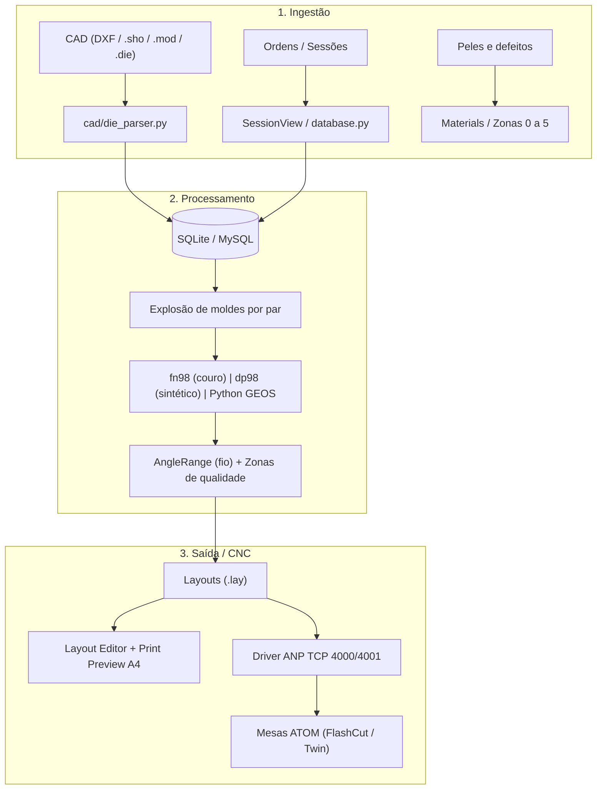

# PROJETO ATOM JobManager Reborn: Documento Vivo

> **Finalidade:** ser a fonte única de verdade entre o código (Antigravity) e o Claude.
> **Regra de ouro:** o que está marcado `[CONFIRMADO]` veio do relatório, do código ou do usuário. O que está `[NÃO CONFIRMADO]` é suposição e não deve virar "fato" sem validação. O que está `[PREENCHER]` o Antigravity deve completar lendo o código real.

<!-- AUTO:header:start -->
**Última sincronização com o código:** 2026-10-17 23:53 (HEAD ao gerar: `520f7eb`; 30 arquivos Python, ~18206 linhas)
<!-- AUTO:header:end -->
**Versão deste documento:** 1

---

## 0. Como manter este documento

**Automático:** os blocos entre `<!-- AUTO:nome:start -->` e `<!-- AUTO:nome:end -->` (cabeçalho, seção 3, seção 4, seção 7.4 e commits recentes) são reescritos por `tools/sync_project_doc.py` a cada commit, via hook do Git. **Não edite esses blocos à mão: a próxima execução apaga a edição.** Todo o resto é manual.

1. Alterações que o script não vê (regras, decisões, confirmações do usuário, pendências) são atualizadas à mão nas seções 5, 6, 7.1, 7.2, 8, 9 e 10.
2. Nunca apagar entradas do Changelog (seção 10). Apenas acrescentar.
3. Ao mudar um item de `[NÃO CONFIRMADO]` para `[CONFIRMADO]`, registrar quem confirmou e quando.
4. O Claude só afirma sobre o código aquilo que está descrito aqui. Se algo não estiver aqui, o Claude pergunta em vez de presumir.

---

## 1. Visão geral

Reconstrução do ecossistema da **ATOM Engineering s.r.l.** (JobManager2000, TheLoop, ShedNt, Layout, FreeNest, fn98, dp98) para corte de calçado em couro natural e sintéticos. `[CONFIRMADO]`

O projeto tem duas implementações complementares:

| Implementação | Pasta/Nome | Stack | Papel |
|---|---|---|---|
| Cliente desktop | `jobmanager-win10-python` / `teste_dola` | Python, MySQL 8.0 Central (reserva local SQLite `jobmanager.db`), UI desktop | Reconstrução fiel da UI/UX do JobManager2000 (WinXP/Win10/Win11), cliente para 8 PCs simultâneos na fábrica (>1000 layouts/dia) |
| Serviço industrial distribuído | `atom_reborn` | FastAPI, MySQL 8.0, GEOS/Shapely, WebSocket, React 18 | Backend corporativo, fila de nesting, integração com chão de fábrica via ANP TCP |

Ambientes: Windows 10/11 e Linux. `[CONFIRMADO]`

---

## 2. Fluxo de dados



---

## 3. Estrutura do código (automático)

<!-- AUTO:tree:start -->
```
README.md
RELATORIO_IMPLEMENTACAO_MELHORIAS.md
RELATORIO_SISTEMA_COMPLETO.md
build_exe_windows.bat
build_linux.sh
config.py                                   # JobManager 2000 (Python Edition for Windows 10)
database.py                                 # JobManager 2000 (Python Edition)
db.example.ini
docker-compose.yml
main.py                                     # JobManager 2000 (Python Edition para Windows 10)
run.bat
run.sh
cad/colors.py                               # JobManager 2000 (Python Edition)
cad/die_parser.py                           # JobManager 2000 (Python Edition)
cad/exporter.py                             # JobManager 2000 (Python Edition)
cad/geometry.py                             # JobManager 2000 (Python Edition)
cad/lay_parser.py                           # JobManager 2000 (Python Edition)
cad/nesting_engine.py                       # JobManager 2000 (Python Edition)
db/__init__.py                              # Camada de Acesso a Dados do JobManager (MySQL 8.0 / SQLite Reserva)
db/config.py                                # JobManager 2000 - Configuração de Banco de Dados Central
db/connection.py                            # JobManager 2000 - Camada Única de Acesso a Banco de Dados
db/schema_mysql.sql
db/migrations/001_initial_mysql_schema.sql
docs/FORMATO_LAY.md
tests/test_db_layer.py                      # Testes Unitários da Camada de Banco de Dados Central (MySQL 8.0 & SQLite Reserva)
tests/test_lay_parser.py                    # Testes Unitários para o Parser e Gerador de Arquivos .lay (ATOM $$LAYOUT.v3$$)
tests/test_layout_editor_shortcuts.py       # Testes Automatizados para Atalhos do LayoutEditorView:
tests/test_mysql_concurrency.py             # JobManager 2000 (Python Edition)
tools/migrate_sqlite_to_mysql.py            # tools/migrate_sqlite_to_mysql.py - Migra jobmanager.db (SQLite) para MySQL 8.0 Central.
ui/add_shapes_dialog.py                     # JobManager 2000 (Python Edition)
ui/cad_canvas.py                            # JobManager 2000 (Python Edition)
ui/dieproc_dialog.py                        # JobManager 2000 (Python Edition)
ui/edit_shape_in_session_dialog.py          # JobManager 2000 (Python Edition)
ui/layout_editor_view.py                    # JobManager 2000 (Python Edition)
ui/layout_print_dialog.py                   # JobManager 2000 (Python Edition)
ui/main_window.py                           # JobManager 2000 (Edição Python para Windows 10 / 11)
ui/material_codes_view.py                   # JobManager 2000 (Python Edition)
ui/options_dialog.py                        # JobManager 2000 (Python Edition)
ui/order_view.py                            # JobManager 2000 (Python Edition)
ui/params_dialog.py                         # JobManager 2000 (Python Edition)
ui/session_view.py                          # JobManager 2000 (Python Edition)
ui/shape_editor_view.py                     # JobManager 2000 (Python Edition)
```
<!-- AUTO:tree:end -->

### 3.0 Classes e funções por arquivo (automático)

<!-- AUTO:symbols:start -->
### `database.py`
- `class DatabaseManager` (linha 41, 46 métodos)
- funções: `get_current_operator`

### `main.py`
- funções: `main`

### `cad/colors.py`
- funções: `get_color_for_size`, `get_contrast_text_color`, `get_color_emoji`

### `cad/die_parser.py`
- funções: `_parse_float`, `interpolate_arc_bulge`, `clean_shape_name`, `parse_die_content`, `parse_die_file`, `generate_die_content`, `save_die_file`

### `cad/exporter.py`
- funções: `reorder_contour_midpoint_longest_edge`, `optimize_piece_cutting_order_tsp`, `_canonical_edge`, `export_gcode`, `export_dxf`, `export_xml_report`

### `cad/geometry.py`
- `class SpatialGrid` (linha 215, 4 métodos): Indexação Espacial 2D (Spatial Grid Hashing).
- funções: `rotate_point`, `transform_contour`, `polygon_area`, `polygon_perimeter`, `polygon_bbox`, `bbox_overlap`, `point_in_polygon`, `_ccw`, `segments_intersect`, `point_segment_distance_sq`, `simplify_contour_for_collision`, `polygons_collide`, `find_contact_coordinate_binary`

### `cad/lay_parser.py`
- `class TargetDie` (linha 53, 1 métodos): Representa uma matriz alvo (TG) declarada no layout.
- `class PlacedItem` (linha 74, 0 métodos): Representa uma peça individual posicionada no layout (I).
- `class QualityZone` (linha 99, 0 métodos): Zona de qualidade ou defeito em couro/pele.
- `class LayoutData` (linha 106, 1 métodos): Estrutura consolidada de um layout de corte .lay.
- funções: `_parse_float`, `_parse_int`, `parse_lay`, `link_layout_items_to_db`, `generate_lay_content`, `validate_layout_placement`, `export_layout_from_pieces`

### `cad/nesting_engine.py`
- funções: `get_paired_offset_cached`, `try_hole_filling_placement`, `check_collision_against_placed`, `calculate_yield`, `calculate_atom_cutting_time`, `parse_coupling_angles`, `dieproc_nest_pieces`, `nest_synthetic_engine`, `nest_tape_engine`, `auto_nest_pieces`

### `db/config.py`
- funções: `_get_val`, `_get_int`

### `db/connection.py`
- `class ServerUnreachableError` (linha 16, 1 métodos): Lançada quando o servidor MySQL central estiver inacessível.
- `class VersionConflictError` (linha 24, 0 métodos): Lançada quando outro operador salvou o layout concorrentemente (controle otimista).
- `class DBRow` (linha 28, 2 métodos): Registro retornado por consultas: comporta-se como dicionário (row['col'])
- `class DBCursor` (linha 64, 8 métodos): Cursor unificado que traduz placeholders, retorna DBRow e expõe lastrowid.
- `class DBConnection` (linha 141, 7 métodos): Wrapper de conexão unificado com suporte a context manager e transações explícitas.
- `class SimpleMySQLPool` (linha 199, 4 métodos): Pool simples e thread-safe de conexões MySQL com reconexão automática.
- funções: `translate_query_for_mysql`, `get_active_backend`, `set_active_backend`, `get_connection`, `get_memory_connection`

### `tests/test_db_layer.py`
- `class TestDBLayer` (linha 30, 10 métodos)

### `tests/test_lay_parser.py`
- `class TestLayParser` (linha 33, 14 métodos)

### `tests/test_layout_editor_shortcuts.py`
- `class DummyEvent` (linha 30, 1 métodos)
- `class TestLayoutEditorShortcuts` (linha 36, 17 métodos)

### `tests/test_mysql_concurrency.py`
- `class TestMySQLConcurrency` (linha 29, 4 métodos)

### `tools/migrate_sqlite_to_mysql.py`
- funções: `make_backup`, `migrate`, `main`

### `ui/add_shapes_dialog.py`
- `class AddShapesDialog` (linha 12, 13 métodos)

### `ui/cad_canvas.py`
- `class CADCanvas` (linha 11, 22 métodos)

### `ui/dieproc_dialog.py`
- `class DieProcDialog` (linha 12, 16 métodos)

### `ui/edit_shape_in_session_dialog.py`
- `class EditShapeInSessionDialog` (linha 11, 6 métodos)

### `ui/layout_editor_view.py`
- `class LayoutEditorView` (linha 149, 69 métodos)
- funções: `rotate_piece_in_place`

### `ui/layout_print_dialog.py`
- `class LayoutPrintDialog` (linha 20, 14 métodos): Janela modal de Visualização de Impressão (Print Preview) do Layout Editor.

### `ui/main_window.py`
- `class MainWindow` (linha 42, 97 métodos)
- funções: `get_assets_dir`

### `ui/material_codes_view.py`
- `class MaterialCodesView` (linha 13, 19 métodos)

### `ui/options_dialog.py`
- `class OptionsDialog` (linha 13, 15 métodos)

### `ui/order_view.py`
- `class OrderView` (linha 10, 8 métodos)

### `ui/params_dialog.py`
- `class NestingParamsDialog` (linha 10, 2 métodos)

### `ui/session_view.py`
- `class SessionView` (linha 20, 63 métodos)

### `ui/shape_editor_view.py`
- `class ShapeEditorView` (linha 19, 47 métodos)
<!-- AUTO:symbols:end -->

### 3.1 Módulos conhecidos pelo relatório

| Módulo / Classe | Papel | Estado |
|---|---|---|
| `cad/die_parser.py` | Importador/exportador `.die` | Pronto. **Não alterar** sem pedido explícito |
| `cad/lay_parser.py` | Importador/exportador `.lay` (`$$LAYOUT.v3$$`), nesting e ordenação de corte CNC | Pronto |
| `database.py` | Acesso SQLite (`jobmanager.db`), gerenciamento de ordens, artigos, moldes, sessões e layouts | Pronto |
| `SessionView` | Sessão de corte, aba Moldes, mini-preview, disparo do encaixe e integração | Pronto |
| `ShapeEditorView` | Reprodução visual do ShedNt | Pronto (visual) |
| `LayoutEditorView` | Editor de layout (canvas vetorial) | Pronto: atalhos F1-F4, Ctrl+Z, Ctrl+S, rotação e persistência |
| `PrintPreviewDialog` | Relatório A4 com rendimento % | Pronto |
| `anp_client.py` | Driver ANP: socket não-bloqueante, 4001 (ping) e 4000 (dados) | Pronto `[NÃO CONFIRMADO em máquina real]` |
| `LoopDaemon` (em `atom_reborn`) | Substitui o TheLoop.exe | Pronto |

---

## 4. Modelo de dados (automático)

<!-- AUTO:schema:start -->
```sql
-- Banco: jobmanager.db
CREATE TABLE articles (
                id INTEGER PRIMARY KEY AUTOINCREMENT,
                order_id INTEGER NOT NULL,
                name TEXT NOT NULL,
                pairs_count INTEGER NOT NULL DEFAULT 1,
                material_id TEXT NOT NULL,
                FOREIGN KEY (order_id) REFERENCES orders(id),
                FOREIGN KEY (material_id) REFERENCES materials(id)
            );
CREATE TABLE dieproc_presets (
                name TEXT PRIMARY KEY,
                coupling TEXT NOT NULL,
                step REAL DEFAULT 1.0,
                solutions INTEGER DEFAULT 30,
                range1_from REAL DEFAULT -3.0,
                range1_to REAL DEFAULT 3.0,
                range1_step REAL DEFAULT 1.0,
                range2_from REAL DEFAULT 0.0,
                range2_to REAL DEFAULT 0.0,
                range2_step REAL DEFAULT 0.0,
                range3_from REAL DEFAULT 0.0,
                range3_to REAL DEFAULT 0.0,
                range3_step REAL DEFAULT 0.0,
                gap1 REAL DEFAULT 1.0,
                gap2 REAL DEFAULT 0.0,
                gap3 REAL DEFAULT 0.0,
                row_interlock INTEGER DEFAULT 1,
                diagonal INTEGER DEFAULT 0
            );
CREATE TABLE layout_pieces (
                id INTEGER PRIMARY KEY AUTOINCREMENT,
                layout_id INTEGER NOT NULL,
                shape_id INTEGER,
                item_index INTEGER NOT NULL,
                target_index INTEGER NOT NULL,
                instance_id INTEGER NOT NULL,
                piece_name TEXT NOT NULL,
                size TEXT DEFAULT '',
                x REAL NOT NULL,
                y REAL NOT NULL,
                rotation_deg REAL NOT NULL,
                rotation_rad REAL NOT NULL,
                is_mirrored INTEGER DEFAULT 0,
                color TEXT DEFAULT '#2563eb',
                tag TEXT DEFAULT 'Pasted',
                quality_zone INTEGER DEFAULT 1,
                FOREIGN KEY (layout_id) REFERENCES layouts(id) ON DELETE CASCADE,
                FOREIGN KEY (shape_id) REFERENCES shapes(id)
            );
CREATE TABLE layouts (
                id INTEGER PRIMARY KEY AUTOINCREMENT,
                session_id INTEGER NOT NULL,
                code TEXT NOT NULL DEFAULT 'l0000.lay',
                path TEXT DEFAULT '',
                desc TEXT DEFAULT '',
                material_code TEXT DEFAULT '',
                material_name TEXT DEFAULT '',
                gap_mm REAL DEFAULT 1.0,
                ris_w REAL DEFAULT 0.0,
                ris_l REAL DEFAULT 0.0,
                area_mm2 REAL DEFAULT 0.0,
                yield_percent REAL DEFAULT 0.0,
                num_items INTEGER DEFAULT 0,
                num_dies INTEGER DEFAULT 0,
                created_at TIMESTAMP DEFAULT CURRENT_TIMESTAMP,
                FOREIGN KEY (session_id) REFERENCES sessions(id) ON DELETE CASCADE
            );
CREATE TABLE materials (
                id TEXT PRIMARY KEY,
                name TEXT NOT NULL,
                type TEXT NOT NULL,
                width_mm REAL NOT NULL,
                height_mm REAL NOT NULL,
                area_m2 REAL NOT NULL,
                thickness_mm REAL NOT NULL
            , layers INTEGER DEFAULT 2, gap_mm REAL DEFAULT 1.0);
CREATE TABLE orders (
                id INTEGER PRIMARY KEY AUTOINCREMENT,
                code TEXT UNIQUE NOT NULL,
                customer TEXT NOT NULL,
                status TEXT NOT NULL DEFAULT 'Pendente',
                created_at TIMESTAMP DEFAULT CURRENT_TIMESTAMP
            , name TEXT DEFAULT 'Derby Masculino #41');
CREATE TABLE sessions (
                id INTEGER PRIMARY KEY AUTOINCREMENT,
                code TEXT UNIQUE NOT NULL,
                order_id INTEGER NOT NULL,
                material_id TEXT NOT NULL,
                status TEXT NOT NULL DEFAULT 'Planejado',
                yield_percent REAL DEFAULT 0.0,
                cutting_time_sec REAL DEFAULT 0.0,
                created_at TIMESTAMP DEFAULT CURRENT_TIMESTAMP, name TEXT DEFAULT '', job TEXT DEFAULT 'ProduçãoNova', placed_pieces_json TEXT DEFAULT '[]', strategy TEXT DEFAULT 'flashnestsheet', params TEXT DEFAULT 'stdNOTFill', machine TEXT DEFAULT 'ATOM FlashCut Flex 3020', shapes_json TEXT DEFAULT '[]',
                FOREIGN KEY (order_id) REFERENCES orders(id),
                FOREIGN KEY (material_id) REFERENCES materials(id)
            );
CREATE TABLE settings (
                key TEXT PRIMARY KEY,
                value TEXT NOT NULL
            );
CREATE TABLE shape_folders (
                id INTEGER PRIMARY KEY AUTOINCREMENT,
                name TEXT UNIQUE NOT NULL
            );
CREATE TABLE shapes (
                id INTEGER PRIMARY KEY AUTOINCREMENT,
                article_id INTEGER NOT NULL,
                name TEXT NOT NULL,
                color TEXT NOT NULL,
                contour_json TEXT NOT NULL,
                holes_json TEXT DEFAULT '[]',
                stitching_json TEXT DEFAULT '[]', folder TEXT DEFAULT '', size TEXT DEFAULT '41',
                FOREIGN KEY (article_id) REFERENCES articles(id)
            );
```
<!-- AUTO:schema:end -->

Tabelas de layouts e peças (`[CONFIRMADO no schema atual]`):

- `layouts`: layout por sessão (metadados, dimensões da pele/bobina, rendimento %, caminho do `.lay` associado, gap, contadores, version para controle de concorrência otimista, auditoria `created_by`/`updated_by`).
- `layout_pieces`: peças posicionadas (molde/shape_id, item_index, target_index, instance_id, x, y, rotação em graus e radianos, espelhamento, zona de qualidade, tag).

_DIVERGÊNCIA: o texto anterior indicava essas tabelas como "planejadas (ainda não existem, [NÃO CONFIRMADO])", porém já foram implementadas no schema de `database.py` e criadas no banco `jobmanager.db` e no MySQL 8.0 `jobmanager`._

### 4.1 Arquitetura de Banco Central MySQL 8.0 (8 PCs na Fábrica)

- **Servidor Central:** MySQL 8.0 na rede local da fábrica, atendendo a 8 PCs simultâneos (>1000 layouts/dia no total), com `InnoDB` e collation `utf8mb4_unicode_ci`.
- **Camada de Abstração (`db/`):**
  - `db/config.py`: Lê configurações de `db.ini` e variáveis de ambiente (`DB_BACKEND`, `MYSQL_HOST`, `MYSQL_PORT`, etc.).
  - `db/connection.py`: Gerencia pool de conexões thread-safe (`SimpleMySQLPool`) com reconexão automática, tradução de dialetos SQL (`?` -> `%s`, `INSERT OR IGNORE` -> `INSERT IGNORE`, `PRAGMA` -> `SHOW COLUMNS`), e classes de linha `DBRow` (compatível com chave e índice numérico `row[0]`).
  - Tratamento de exceções com diagnóstico detalhado de rede (`ServerUnreachableError`) e conflito (`VersionConflictError`).
- **Controle de Concorrência Otimista (Etapa 3):**
  - Implementado em `save_layout(session_id, layout_data, expected_version, layout_id)`.
  - Executa `UPDATE layouts SET version = version + 1 ... WHERE id = ? AND version = ?`. Se nenhuma linha for atualizada, levanta `VersionConflictError`.
  - No `LayoutEditorView`, o salvamento captura `VersionConflictError` e abre diálogo modal com duas opções claras:
    1. **Salvar Cópia:** Mantém o trabalho do operador e salva com sufixo `_copia` como novo layout independente.
    2. **Recarregar:** Descarta edições locais e recarrega os dados mais recentes do servidor MySQL.
- **Migração Idempotente Transacional (`tools/migrate_sqlite_to_mysql.py`):**
  - Faz backup automático de segurança (`jobmanager.db.bak`).
  - Executa migração atômica de todas as tabelas em transação única.
  - Conciliação linha-a-linha no relatório final: 100% de igualdade confirmada nas 10 tabelas migradas.
- **Reserva Offline (SQLite):**
  - O banco local `jobmanager.db` é mantido estritamente como reserva de emergência/modo demonstração quando `db.ini` tiver `backend = sqlite`.
- **Validação sob Carga Extrema (`tests/test_mysql_concurrency.py`):**
  - 8 threads simultâneas simulando 8 PCs executando 1000 salvamentos (50 a 100 peças cada, >75.000 peças inseridas).
  - Resultados: Vazão de >360 layouts/s, latência média de ~21 ms, zero erros de rede/timeout e reconciliação exata de registros.

---

## 5. Importação `.die` (módulo pronto) `[CONFIRMADO]`

Arquivo: `cad/die_parser.py`. Escopo da diretriz original do usuário: **melhorar somente a importação `.die`**.

1. **Assinaturas aceitas:** `$$FUSTELLA.v3$$`, `$$FUSTELLA.v2$$`, `$$SHAPE2$$`, `$$DIE$$` e derivados.
2. **Higienização de nomes:** remove caminhos de rede (`\\lab-inf\modelos\...`), locais (`C:\Users\...`) e o prefixo `MODEL ` (ex.: `MODEL Gaspea_Derby_41` vira `Gaspea_Derby_41`).
3. **Arcos (`bulge`):** `interpolate_arc_bulge(p1, p2, bulge)`, com `b = tan(θ/4)`, gera vértices reais em vez de corda reta.
4. **Fio do couro:** `directionFrom`/`directionTo` geram `grain_angle_deg = atan2(Δy, Δx)`, `grain_angle_min = θ - 10°`, `grain_angle_max = θ + 10°`, `allowed_discrete_angles = [0.0, 180.0]`.
5. **Zonas de qualidade:** `def_quality` mapeia o grau exigido (1 a 5) para a peça.
6. **Ferramentas:** `drill=`, `pricker=`, `punch=`, `notch=` (coordenadas e diâmetros).
7. **Costuras:** múltiplas polilinhas `cpoint=` delimitadas por `num_of_cpoints=`.
8. **Encodings:** `utf-8`, `latin1`, `cp1252`, `iso-8859-1`; decimal com ponto ou vírgula.
9. **Exportador:** `generate_die_content()` emite `.die` compatível, incluindo furos, punções e qualidade.

**Pendências conhecidas:**
- Arquivos com `num_of_shapes > 1` (`SAGOMA 1`, `SAGOMA 2`...): evoluir para devolver lista de moldes.
- Fator de escala configurável (`scale_factor`, padrão 1.0) para DXF/`.die` antigos em décimos de mm ou pontos de plotter.

---

## 6. Regras industriais (invioláveis)

### 6.1 Zonas de qualidade do couro `[CONFIRMADO]`
Graus de 0 (furo/queimadura, proibido) a 5 (barriga/flancos moles). Uma peça com exigência `Q_req` pode cobrir um defeito de nível `L_def` se e somente se:

```
L_def <= Q_req   (para L_def > 0)
```

- Peça nobre (`Q_req = 1`, ex.: gáspea): nunca toca defeitos de nível 2 a 5.
- Peça secundária (`Q_req = 4`, ex.: forro): pode usar áreas com defeitos leves a médios (2 a 4).

### 6.2 Restrição angular do fio (AngleRange) `[CONFIRMADO]`
- Ângulo `θ = atan2(Δy, Δx)` de `directionFrom`/`directionTo` define o eixo neutro.
- Tolerância `θ ± 10°`. Giros discretos permitidos: `180°` (pé oposto).
- **Giros de 90° proibidos no nesting automático** de peças de cabedal.

### 6.3 Compactação por atração vetorial (Bumping) `[CONFIRMADO]`
Após o posicionamento inicial, micropassos decrescentes `8.0 → 4.0 → 2.0 → 0.5 mm` em três direções: Esquerda `(-1, 0)`, Baixo `(0, -1)` e Diagonal `(-0.707, -0.707)`.

### 6.4 Ordem de usinagem CNC `[CONFIRMADO]`
A ordem de corte do `.lay` para a mesa **não pode** ser aleatória:

1. Furações e ilhoses (`DRILL` / `HOLES`)
2. Piques e punções (`PUNCH` / `PRICKER`)
3. Costuras e rasgos internos (`CUTS` / `CPOINTS`)
4. Contorno externo (`TOOL_KNIFE_DOWN`), **sempre por último** (senão a peça solta perde vácuo e quebra a lâmina)

---

## 7. Layout Editor: atalhos

### 7.1 Atalhos confirmados pelo usuário

| Atalho | Ação | Status |
|---|---|---|
| F1 | Ajuste fino: gira a peça 2° para a esquerda | `[CONFIRMADO]` |
| F2 | Ajuste fino: gira a peça 2° para a direita | `[CONFIRMADO]` |
| F3 | Gira 90° por toque, ciclo 0 → 90 → 180 → 270 → 0 | `[CONFIRMADO]` |
| F4 | Gira 180° | `[CONFIRMADO]` |
| Ctrl+Z | Desfazer (voltar) | `[CONFIRMADO]` |
| Ctrl+S | Salvar | `[CONFIRMADO]` |

**Removidos por decisão do usuário (não implementar):** Shift+F3 (giro inverso), Ctrl+Y (refazer, sem pilha de redo).

> **Implementação concluída:** Todos os 6 atalhos (`F1`, `F2`, `F3`, `F4`, `Ctrl+Z`, `Ctrl+S`) estão implementados e operacionais em `ui/layout_editor_view.py`. A proibição estrita de `Shift+F3` e `Ctrl+Y` foi aplicada (sem pilha de redo nem giro inverso), e o comportamento foi coberto por 13 testes unitários automatizados em `tests/test_layout_editor_shortcuts.py`.

### 7.2 Decisões assumidas `[NÃO CONFIRMADO]` (constantes configuráveis no topo do módulo)

| Constante | Valor padrão | Dúvida em aberto |
|---|---|---|
| `ROT_FINE_STEP_DEG` | 2 | n/a (confirmado) |
| `ROT_90_STEP_DEG` | 90 | n/a (confirmado) |
| `ROT_FLIP_STEP_DEG` | 180 | n/a (confirmado) |
| Sentido "esquerda" | anti-horário (+) | Original era anti-horário? |
| Sentido do F3 | anti-horário | Mesmo sentido do F1? |
| Pivô | centro do bounding box da geometria **base** | Confirmar no original |
| Auto-repeat F1/F2 | permitido, 2° constante por evento | Original repetia ao segurar? |
| Várias peças selecionadas | cada uma gira no próprio centro | Ou giravam em grupo? |
| `UNDO_MAX_LEVELS` | 100 | Original pode ter sido 1 nível |
| `UNDO_GROUP_AUTOREPEAT` | True | Original contava cada toque? |
| `SAVE_TARGET` | `"db+file"` | O que o Ctrl+S salvava de fato? Pedia nome? |
| Ctrl+S limpa histórico de undo | Não | Confirmar |

> **Nota de Implementação:** As constantes acima foram definidas no topo de `ui/layout_editor_view.py` (`ROT_FINE_STEP_DEG=2.0`, `ROT_90_STEP_DEG=90.0`, `ROT_FLIP_STEP_DEG=180.0`, `ROT_DIR_LEFT=1`, `ROT_DIR_RIGHT=-1`, `ROT_DIR_F3=1`, `UNDO_MAX_LEVELS=100`, `UNDO_GROUP_AUTOREPEAT=True`, `SAVE_TARGET="db+file"`). Caso o usuário confirme futuramente qualquer ajuste de convenção ou passo, basta atualizar as constantes do módulo.

### 7.3 Requisitos técnicos de rotação
- Rotação como **inteiro em graus**, normalizada em `[0, 360)`. Ângulos intermediários (14°, 92°) preservados.
- Geometria = geometria base + rotação total (nunca rotacionar vértices incrementalmente).
- Atualizar juntos: contorno, bounding box, furos, punções, piques, costuras e direção do fio.
- Validação após cada giro/undo **somente na barra de status**, sem pop-up: fora da pele, sobreposição, fio fora da tolerância (inclui 90°/270° em cabedal), cobertura de defeito pior que o permitido.
- Avisos **não bloqueiam** (o operador manual tem a palavra final).

### 7.4 Estado de implementação (automático)

<!-- AUTO:shortcuts:start -->
**Atalhos esperados (seção 7.1):**

| Atalho | Estado no código | Onde |
|---|---|---|
| F1 | encontrado | `ui/layout_editor_view.py:408`, `ui/layout_editor_view.py:409`, `ui/layout_editor_view.py:410` |
| F2 | encontrado | `ui/layout_editor_view.py:412`, `ui/layout_editor_view.py:413`, `ui/layout_editor_view.py:414` |
| F3 | encontrado | `ui/layout_editor_view.py:416`, `ui/layout_editor_view.py:417`, `ui/layout_editor_view.py:418` |
| F4 | encontrado | `ui/layout_editor_view.py:424`, `ui/layout_editor_view.py:425`, `ui/layout_editor_view.py:426` |
| Ctrl+Z | encontrado | `ui/layout_editor_view.py:384`, `ui/layout_editor_view.py:385`, `ui/layout_editor_view.py:386` |
| Ctrl+S | encontrado | `ui/layout_editor_view.py:278`, `ui/layout_editor_view.py:279`, `ui/layout_editor_view.py:396` |
| Shift+F3 | **PRESENTE, mas deveria NÃO existir** | `tests/test_layout_editor_shortcuts.py:299`, `ui/layout_editor_view.py:421`, `ui/layout_editor_view.py:422` |
| Ctrl+Y | **PRESENTE, mas deveria NÃO existir** | `tests/test_layout_editor_shortcuts.py:302`, `ui/layout_editor_view.py:390`, `ui/layout_editor_view.py:391` |

**Todos os atalhos detectados no código:**

| Atalho | Local | Linha |
|---|---|---|
| 1 | `ui/add_shapes_dialog.py:132` | `self.tree.bind("<Button-1>", self.on_tree_click)` |
| 1 | `ui/add_shapes_dialog.py:133` | `self.tree.bind("<Double-1>", self.on_tree_double_click)` |
| 1 | `ui/cad_canvas.py:48` | `self.bind("<ButtonPress-1>", self.on_button1_down)` |
| 1 | `ui/cad_canvas.py:50` | `self.bind("<ButtonRelease-1>", self.on_button1_up)` |
| 1 | `ui/layout_editor_view.py:269` | `title_bar.bind("<ButtonPress-1>", self._on_title_press)` |
| 1 | `ui/layout_editor_view.py:271` | `title_bar.bind("<Double-Button-1>", lambda e: self.on_maximize_click())` |
| 1 | `ui/layout_editor_view.py:272` | `self.lbl_title.bind("<ButtonPress-1>", self._on_title_press)` |
| 1 | `ui/layout_editor_view.py:274` | `self.lbl_title.bind("<Double-Button-1>", lambda e: self.on_maximize_click())` |
| 1 | `ui/layout_editor_view.py:275` | `self.bind("<Button-1>", lambda e: (self.lift(), self.focus_set()), add="+")` |
| 1 | `ui/layout_editor_view.py:376` | `self.canvas.bind("<ButtonPress-1>", self.on_canvas_click)` |
| 1 | `ui/layout_editor_view.py:377` | `self.canvas.bind("<Double-Button-1>", self.on_canvas_double_click)` |
| 1 | `ui/layout_editor_view.py:379` | `self.canvas.bind("<ButtonRelease-1>", self.on_canvas_release)` |
| 1 | `ui/main_window.py:417` | `self.tree_main.bind("<Double-1>", self.on_tree_double_click)` |
| 1 | `ui/main_window.py:419` | `self.tree_main.bind("<ButtonPress-1>", self.on_tree_drag_start, add="+")` |
| 1 | `ui/main_window.py:421` | `self.tree_main.bind("<ButtonRelease-1>", self.on_tree_drag_end, add="+")` |
| 1 | `ui/main_window.py:461` | `self.grid_lower.bind("<Double-1>", self.on_grid_double_click)` |
| 1 | `ui/main_window.py:463` | `self.grid_lower.bind("<ButtonPress-1>", self.on_grid_drag_start, add="+")` |
| 1 | `ui/main_window.py:465` | `self.grid_lower.bind("<ButtonRelease-1>", self.on_tree_drag_end, add="+")` |
| 1 | `ui/main_window.py:529` | `self.bind_all("<Button-1>", self.dismiss_popup_menus, add="+")` |
| 1 | `ui/main_window.py:720` | `dock_item.bind("<Button-1>", lambda e: self.restore_window(window))` |
| 1 | `ui/main_window.py:721` | `lbl.bind("<Button-1>", lambda e: self.restore_window(window))` |
| 1 | `ui/main_window.py:1584` | `lb.bind("<Double-Button-1>", lambda e: on_confirm())` |
| 1 | `ui/material_codes_view.py:72` | `title_bar.bind("<ButtonPress-1>", self._on_title_press)` |
| 1 | `ui/material_codes_view.py:74` | `self.lbl_title.bind("<ButtonPress-1>", self._on_title_press)` |
| 1 | `ui/material_codes_view.py:76` | `self.bind("<Button-1>", lambda e: self.lift(), add="+")` |
| 1 | `ui/material_codes_view.py:197` | `self.tree.bind("<Double-1>", self.on_row_double_click)` |
| 1 | `ui/order_view.py:46` | `title_bar.bind("<ButtonPress-1>", self._on_title_press)` |
| 1 | `ui/order_view.py:48` | `self.lbl_title.bind("<ButtonPress-1>", self._on_title_press)` |
| 1 | `ui/order_view.py:50` | `self.bind("<Button-1>", lambda e: self.lift(), add="+")` |
| 1 | `ui/session_view.py:81` | `title_bar.bind("<ButtonPress-1>", self._on_title_press)` |
| 1 | `ui/session_view.py:83` | `self.lbl_title.bind("<ButtonPress-1>", self._on_title_press)` |
| 1 | `ui/session_view.py:85` | `self.bind("<Button-1>", lambda e: self.lift(), add="+")` |
| 1 | `ui/session_view.py:396` | `self.tree_shapes.bind("<Button-1>", self.on_tree_shape_cell_click, add="+")` |
| 1 | `ui/session_view.py:397` | `self.tree_shapes.bind("<Double-1>", self.on_tree_shape_double_click)` |
| 1 | `ui/session_view.py:410` | `self.preview_canvas.bind("<Double-1>", self.on_tree_shape_double_click)` |
| 1 | `ui/session_view.py:528` | `self.tree_mat.bind("<Double-1>", self.on_mat_double_click)` |
| 1 | `ui/session_view.py:529` | `self.tree_mat.bind("<Button-1>", self.on_mat_single_click)` |
| 1 | `ui/session_view.py:613` | `self.tree_lays.bind("<Double-1>", self.on_layout_row_double_click)` |
| 1 | `ui/session_view.py:622` | `self.mini_layout_canvas.bind("<Double-1>", self.on_layout_row_double_click)` |
| 1 | `ui/session_view.py:623` | `self.mini_layout_canvas.bind("<Button-1>", self.on_layout_row_double_click)` |
| 1 | `ui/shape_editor_view.py:124` | `title_bar.bind("<ButtonPress-1>", self._on_title_press)` |
| 1 | `ui/shape_editor_view.py:126` | `self.lbl_title.bind("<ButtonPress-1>", self._on_title_press)` |
| 1 | `ui/shape_editor_view.py:128` | `self.bind("<Button-1>", lambda e: self.lift(), add="+")` |
| 1 | `ui/shape_editor_view.py:190` | `self.canvas.bind("<ButtonPress-1>", self.on_canvas_click)` |
| 1 | `ui/shape_editor_view.py:192` | `self.canvas.bind("<ButtonRelease-1>", self.on_canvas_release)` |
| 2 | `ui/cad_canvas.py:52` | `self.bind("<ButtonPress-2>", self.on_pan_start)` |
| 2 | `ui/cad_canvas.py:54` | `self.bind("<ButtonRelease-2>", self.on_pan_end)` |
| 2 | `ui/main_window.py:530` | `self.bind_all("<Button-2>", self.dismiss_popup_menus, add="+")` |
| 2 | `ui/shape_editor_view.py:194` | `self.canvas.bind("<ButtonPress-2>", self.on_pan_start)` |
| 2 | `ui/shape_editor_view.py:196` | `self.canvas.bind("<ButtonRelease-2>", self.on_pan_end)` |
| 3 | `ui/cad_canvas.py:56` | `self.bind("<ButtonPress-3>", self.on_pan_start)` |
| 3 | `ui/cad_canvas.py:58` | `self.bind("<ButtonRelease-3>", self.on_pan_end)` |
| 3 | `ui/main_window.py:404` | `self.btn_mode_materials.bind("<Button-3>", lambda e: self.show_popup_menu(self.m` |
| 3 | `ui/main_window.py:418` | `self.tree_main.bind("<Button-3>", self.show_tree_context_menu)` |
| 3 | `ui/main_window.py:462` | `self.grid_lower.bind("<Button-3>", self.show_grid_context_menu)` |
| 3 | `ui/main_window.py:531` | `self.bind_all("<Button-3>", self.dismiss_popup_menus, add="+")` |
| 3 | `ui/material_codes_view.py:198` | `self.tree.bind("<Button-3>", self.show_context_menu)` |
| 3 | `ui/session_view.py:398` | `self.tree_shapes.bind("<Button-3>", self.show_shapes_context_menu)` |
| 3 | `ui/session_view.py:411` | `self.preview_canvas.bind("<Button-3>", self.show_shapes_context_menu)` |
| 3 | `ui/session_view.py:533` | `self.tree_mat.bind("<Button-3>", self.show_mat_context_menu)` |
| 3 | `ui/session_view.py:610` | `self.tree_lays.bind("<Button-3>", self.show_lays_context_menu)` |
| 3 | `ui/shape_editor_view.py:198` | `self.canvas.bind("<ButtonPress-3>", self.on_right_click)` |
| 3 | `ui/shape_editor_view.py:200` | `self.canvas.bind("<ButtonRelease-3>", self.on_pan_end)` |
| 4 | `ui/cad_canvas.py:62` | `self.bind("<Button-4>", lambda e: self.zoom_step(1.1, e.x, e.y))` |
| 4 | `ui/layout_print_dialog.py:216` | `self.canvas.bind("<Button-4>", lambda e: self.canvas.yview_scroll(-2, "units"))` |
| 4 | `ui/shape_editor_view.py:204` | `self.canvas.bind("<Button-4>", lambda e: self.zoom_step(1.15, e.x, e.y))` |
| 5 | `ui/cad_canvas.py:63` | `self.bind("<Button-5>", lambda e: self.zoom_step(0.9, e.x, e.y))` |
| 5 | `ui/layout_print_dialog.py:217` | `self.canvas.bind("<Button-5>", lambda e: self.canvas.yview_scroll(2, "units"))` |
| 5 | `ui/shape_editor_view.py:205` | `self.canvas.bind("<Button-5>", lambda e: self.zoom_step(0.85, e.x, e.y))` |
| <KeyPress> | `ui/session_view.py:532` | `self.tree_mat.bind("<KeyPress>", self.on_mat_key_press)` |
| Backspace | `ui/cad_canvas.py:69` | `self.master.bind("<BackSpace>", lambda e: self.delete_selected())` |
| Backspace | `ui/main_window.py:534` | `self.bind_all("<BackSpace>", self.on_global_delete_key, add="+")` |
| Configure | `ui/cad_canvas.py:47` | `self.bind("<Configure>", lambda e: self.redraw())` |
| Configure | `ui/layout_editor_view.py:375` | `self.canvas.bind("<Configure>", lambda e: self.redraw())` |
| Configure | `ui/layout_print_dialog.py:211` | `self.canvas.bind("<Configure>", lambda e: self.redraw())` |
| Configure | `ui/session_view.py:409` | `self.preview_canvas.bind("<Configure>", lambda e: self._on_preview_resize())` |
| Configure | `ui/session_view.py:624` | `self.mini_layout_canvas.bind("<Configure>", lambda e: self.draw_mini_layout_prev` |
| Configure | `ui/shape_editor_view.py:189` | `self.canvas.bind("<Configure>", lambda e: self.redraw())` |
| Ctrl+C | `ui/main_window.py:247` | `edit_menu.add_command(label="Copiar", accelerator="Ctrl+C")` |
| Ctrl+Mousewheel | `ui/layout_print_dialog.py:214` | `self.bind("<Control-MouseWheel>", self._on_ctrl_wheel)` |
| Ctrl+O | `ui/layout_editor_view.py:401` | `self.canvas.bind("<Control-o>", self.open_layout_dialog)` |
| Ctrl+O | `ui/layout_editor_view.py:402` | `self.canvas.bind("<Control-O>", self.open_layout_dialog)` |
| Ctrl+O | `ui/layout_editor_view.py:403` | `self.bind("<Control-o>", self.open_layout_dialog)` |
| Ctrl+O | `ui/layout_editor_view.py:404` | `self.bind("<Control-O>", self.open_layout_dialog)` |
| Ctrl+P | `ui/layout_editor_view.py:276` | `self.bind("<Control-p>", lambda e: self.print_layout())` |
| Ctrl+P | `ui/layout_editor_view.py:277` | `self.bind("<Control-P>", lambda e: self.print_layout())` |
| Ctrl+S | `ui/layout_editor_view.py:278` | `self.bind("<Control-s>", self.save_layout)` |
| Ctrl+S | `ui/layout_editor_view.py:279` | `self.bind("<Control-S>", self.save_layout)` |
| Ctrl+S | `ui/layout_editor_view.py:396` | `self.canvas.bind("<Control-s>", self.save_layout)` |
| Ctrl+S | `ui/layout_editor_view.py:397` | `self.canvas.bind("<Control-S>", self.save_layout)` |
| Ctrl+S | `ui/layout_editor_view.py:398` | `self.bind("<Control-s>", self.save_layout)` |
| Ctrl+S | `ui/layout_editor_view.py:399` | `self.bind("<Control-S>", self.save_layout)` |
| Ctrl+S | `ui/main_window.py:63` | `self.bind("<Control-s>", self.handle_ctrl_s)` |
| Ctrl+S | `ui/main_window.py:64` | `self.bind("<Control-S>", self.handle_ctrl_s)` |
| Ctrl+V | `ui/main_window.py:248` | `edit_menu.add_command(label="Colar", accelerator="Ctrl+V")` |
| Ctrl+X | `ui/main_window.py:246` | `edit_menu.add_command(label="Recortar", accelerator="Ctrl+X")` |
| Ctrl+Y | `tests/test_layout_editor_shortcuts.py:302` | `cb_ctrl_y = self.view.bind("<Control-y>")` |
| Ctrl+Y | `ui/layout_editor_view.py:390` | `self.canvas.bind("<Control-y>", lambda e: "break")` |
| Ctrl+Y | `ui/layout_editor_view.py:391` | `self.canvas.bind("<Control-Y>", lambda e: "break")` |
| Ctrl+Y | `ui/layout_editor_view.py:392` | `self.bind("<Control-y>", lambda e: "break")` |
| Ctrl+Y | `ui/layout_editor_view.py:393` | `self.bind("<Control-Y>", lambda e: "break")` |
| Ctrl+Z | `ui/layout_editor_view.py:384` | `self.canvas.bind("<Control-z>", self.undo_action)` |
| Ctrl+Z | `ui/layout_editor_view.py:385` | `self.canvas.bind("<Control-Z>", self.undo_action)` |
| Ctrl+Z | `ui/layout_editor_view.py:386` | `self.bind("<Control-z>", self.undo_action)` |
| Ctrl+Z | `ui/layout_editor_view.py:387` | `self.bind("<Control-Z>", self.undo_action)` |
| Ctrl+Z | `ui/main_window.py:244` | `edit_menu.add_command(label="Desfazer / Reverter", accelerator="Ctrl+Z", command` |
| Ctrl+Z | `ui/main_window.py:535` | `self.bind_all("<Control-z>", self.on_global_undo, add="+")` |
| Ctrl+Z | `ui/main_window.py:536` | `self.bind_all("<Control-Z>", self.on_global_undo, add="+")` |
| Ctrl+Z | `ui/main_window.py:537` | `self.bind_all("<Control-Key-z>", self.on_global_undo, add="+")` |
| Ctrl+Z | `ui/main_window.py:538` | `self.bind_all("<Control-Key-Z>", self.on_global_undo, add="+")` |
| Ctrl+Z | `ui/shape_editor_view.py:208` | `self.bind("<Control-z>", self.undo_or_revert)` |
| Ctrl+Z | `ui/shape_editor_view.py:209` | `self.bind("<Control-Z>", self.undo_or_revert)` |
| Ctrl+Z | `ui/shape_editor_view.py:210` | `self.bind("<Control-Key-z>", self.undo_or_revert)` |
| Ctrl+Z | `ui/shape_editor_view.py:211` | `self.bind("<Control-Key-Z>", self.undo_or_revert)` |
| Ctrl+Z | `ui/shape_editor_view.py:212` | `self.canvas.bind("<Control-z>", self.undo_or_revert)` |
| Ctrl+Z | `ui/shape_editor_view.py:213` | `self.canvas.bind("<Control-Z>", self.undo_or_revert)` |
| Ctrl+Z | `ui/shape_editor_view.py:214` | `self.canvas.bind("<Control-Key-z>", self.undo_or_revert)` |
| Ctrl+Z | `ui/shape_editor_view.py:215` | `self.canvas.bind("<Control-Key-Z>", self.undo_or_revert)` |
| Del | `ui/main_window.py:249` | `edit_menu.add_command(label="Excluir", accelerator="Del", command=self.on_global` |
| Delete | `ui/cad_canvas.py:68` | `self.master.bind("<Delete>", lambda e: self.delete_selected())` |
| Delete | `ui/layout_editor_view.py:430` | `self.bind_all("<Delete>", lambda e: self.delete_selected())` |
| Delete | `ui/main_window.py:533` | `self.bind_all("<Delete>", self.on_global_delete_key, add="+")` |
| Delete | `ui/session_view.py:399` | `self.tree_shapes.bind("<Delete>", lambda e: self.delete_selected_shape())` |
| Down | `ui/layout_editor_view.py:434` | `self.bind_all("<Down>", lambda e: self.nudge_selected(0, -5))` |
| Escape | `ui/dieproc_dialog.py:39` | `self.bind("<Escape>", lambda e: self.destroy())` |
| Escape | `ui/edit_shape_in_session_dialog.py:147` | `self.bind("<Escape>", lambda e: self.destroy())` |
| Escape | `ui/main_window.py:62` | `self.bind("<Escape>", self.exit_fullscreen)` |
| Escape | `ui/main_window.py:532` | `self.bind_all("<Escape>", self.dismiss_popup_menus, add="+")` |
| Escape | `ui/main_window.py:2371` | `dialog.bind("<Escape>", lambda e: dialog.destroy())` |
| Escape | `ui/material_codes_view.py:466` | `dlg.bind("<Escape>", lambda e: dlg.destroy())` |
| Escape | `ui/options_dialog.py:40` | `self.bind("<Escape>", lambda e: self.on_cancel())` |
| Escape | `ui/session_view.py:1378` | `entry.bind("<Escape>", cancel)` |
| Escape | `ui/session_view.py:1453` | `dialog.bind("<Escape>", lambda e: dialog.destroy())` |
| Escape | `ui/session_view.py:1632` | `entry.bind("<Escape>", cancel_edit)` |
| F1 | `ui/layout_editor_view.py:408` | `w.bind("<F1>", self.on_f1_press)` |
| F1 | `ui/layout_editor_view.py:409` | `w.bind("<Key-F1>", self.on_f1_press)` |
| F1 | `ui/layout_editor_view.py:410` | `w.bind("<KeyRelease-F1>", self.on_f1_release)` |
| F11 | `ui/main_window.py:61` | `self.bind("<F11>", self.toggle_fullscreen)` |
| F2 | `ui/layout_editor_view.py:412` | `w.bind("<F2>", self.on_f2_press)` |
| F2 | `ui/layout_editor_view.py:413` | `w.bind("<Key-F2>", self.on_f2_press)` |
| F2 | `ui/layout_editor_view.py:414` | `w.bind("<KeyRelease-F2>", self.on_f2_release)` |
| F2 | `ui/session_view.py:531` | `self.tree_mat.bind("<F2>", self.on_mat_f2_key)` |
| F3 | `ui/layout_editor_view.py:416` | `w.bind("<F3>", self.on_f3_press)` |
| F3 | `ui/layout_editor_view.py:417` | `w.bind("<Key-F3>", self.on_f3_press)` |
| F3 | `ui/layout_editor_view.py:418` | `w.bind("<KeyRelease-F3>", self.on_f3_release)` |
| F4 | `ui/layout_editor_view.py:424` | `w.bind("<F4>", self.on_f4_press)` |
| F4 | `ui/layout_editor_view.py:425` | `w.bind("<Key-F4>", self.on_f4_press)` |
| F4 | `ui/layout_editor_view.py:426` | `w.bind("<KeyRelease-F4>", self.on_f4_release)` |
| F5 | `ui/main_window.py:102` | `self.bind_all("<F5>", lambda e: self.on_refresh_f5())` |
| F5 | `ui/main_window.py:265` | `tools_menu.add_command(label="Atualizar", accelerator="F5", command=self.on_refr` |
| Focusout | `ui/session_view.py:1377` | `entry.bind("<FocusOut>", lambda e: commit())` |
| Focusout | `ui/session_view.py:1631` | `entry.bind("<FocusOut>", save_and_close)` |
| Focusout | `ui/shape_editor_view.py:277` | `self.entry_name.bind("<FocusOut>", lambda e: self.on_name_change())` |
| Keyrelease | `ui/add_shapes_dialog.py:64` | `self.entry_search.bind("<KeyRelease>", lambda e: self.filter_tree())` |
| Keyrelease | `ui/material_codes_view.py:140` | `self.ent_search.bind("<KeyRelease>", lambda e: self.filter_table(self.ent_search` |
| Keyrelease | `ui/options_dialog.py:186` | `self.entry_xfer_login.bind("<KeyRelease>", self.mark_changed)` |
| Keyrelease | `ui/options_dialog.py:191` | `self.entry_xfer_pass.bind("<KeyRelease>", self.mark_changed)` |
| Keyrelease | `ui/options_dialog.py:196` | `self.entry_xfer_root.bind("<KeyRelease>", self.mark_changed)` |
| Left | `ui/layout_editor_view.py:431` | `self.bind_all("<Left>", lambda e: self.nudge_selected(-5, 0))` |
| Motion | `ui/cad_canvas.py:49` | `self.bind("<B1-Motion>", self.on_button1_motion)` |
| Motion | `ui/cad_canvas.py:53` | `self.bind("<B2-Motion>", self.on_pan_motion)` |
| Motion | `ui/cad_canvas.py:57` | `self.bind("<B3-Motion>", self.on_pan_motion)` |
| Motion | `ui/layout_editor_view.py:270` | `title_bar.bind("<B1-Motion>", self._on_title_motion)` |
| Motion | `ui/layout_editor_view.py:273` | `self.lbl_title.bind("<B1-Motion>", self._on_title_motion)` |
| Motion | `ui/layout_editor_view.py:378` | `self.canvas.bind("<B1-Motion>", self.on_canvas_drag)` |
| Motion | `ui/layout_editor_view.py:380` | `self.canvas.bind("<Motion>", self.on_mouse_move)` |
| Motion | `ui/main_window.py:420` | `self.tree_main.bind("<B1-Motion>", self.on_tree_drag_motion, add="+")` |
| Motion | `ui/main_window.py:464` | `self.grid_lower.bind("<B1-Motion>", self.on_tree_drag_motion, add="+")` |
| Motion | `ui/material_codes_view.py:73` | `title_bar.bind("<B1-Motion>", self._on_title_motion)` |
| Motion | `ui/material_codes_view.py:75` | `self.lbl_title.bind("<B1-Motion>", self._on_title_motion)` |
| Motion | `ui/order_view.py:47` | `title_bar.bind("<B1-Motion>", self._on_title_motion)` |
| Motion | `ui/order_view.py:49` | `self.lbl_title.bind("<B1-Motion>", self._on_title_motion)` |
| Motion | `ui/session_view.py:82` | `title_bar.bind("<B1-Motion>", self._on_title_motion)` |
| Motion | `ui/session_view.py:84` | `self.lbl_title.bind("<B1-Motion>", self._on_title_motion)` |
| Motion | `ui/shape_editor_view.py:125` | `title_bar.bind("<B1-Motion>", self._on_title_motion)` |
| Motion | `ui/shape_editor_view.py:127` | `self.lbl_title.bind("<B1-Motion>", self._on_title_motion)` |
| Motion | `ui/shape_editor_view.py:191` | `self.canvas.bind("<B1-Motion>", self.on_canvas_drag)` |
| Motion | `ui/shape_editor_view.py:195` | `self.canvas.bind("<B2-Motion>", self.on_pan_motion)` |
| Motion | `ui/shape_editor_view.py:199` | `self.canvas.bind("<B3-Motion>", self.on_pan_motion)` |
| Motion | `ui/shape_editor_view.py:202` | `self.canvas.bind("<Motion>", self.on_canvas_mouse_move)` |
| Mousewheel | `ui/cad_canvas.py:61` | `self.bind("<MouseWheel>", self.on_zoom_windows)` |
| Mousewheel | `ui/layout_print_dialog.py:215` | `self.canvas.bind("<MouseWheel>", self._on_wheel)` |
| Mousewheel | `ui/shape_editor_view.py:203` | `self.canvas.bind("<MouseWheel>", self.on_zoom_wheel)` |
| R | `ui/cad_canvas.py:66` | `self.master.bind("<r>", lambda e: self.rotate_selected(45))` |
| R | `ui/cad_canvas.py:67` | `self.master.bind("<R>", lambda e: self.rotate_selected(45))` |
| R | `ui/layout_editor_view.py:428` | `self.bind_all("<Key-r>", lambda e: self.rotate_selected(45))` |
| R | `ui/layout_editor_view.py:429` | `self.bind_all("<Key-R>", lambda e: self.rotate_selected(45))` |
| Return | `ui/edit_shape_in_session_dialog.py:146` | `self.bind("<Return>", lambda e: self.on_save())` |
| Return | `ui/main_window.py:2370` | `dialog.bind("<Return>", lambda e: save())` |
| Return | `ui/material_codes_view.py:199` | `self.tree.bind("<Return>", lambda e: self.open_edit_selected_dialog())` |
| Return | `ui/material_codes_view.py:465` | `dlg.bind("<Return>", lambda e: save_action())` |
| Return | `ui/session_view.py:530` | `self.tree_mat.bind("<Return>", self.on_mat_enter_key)` |
| Return | `ui/session_view.py:1376` | `entry.bind("<Return>", lambda e: commit())` |
| Return | `ui/session_view.py:1452` | `dialog.bind("<Return>", lambda e: save())` |
| Return | `ui/session_view.py:1630` | `entry.bind("<Return>", save_and_close)` |
| Return | `ui/shape_editor_view.py:276` | `self.entry_name.bind("<Return>", lambda e: self.on_name_change())` |
| Return | `ui/shape_editor_view.py:309` | `self.entry_vx.bind("<Return>", self.on_vertex_entry_change)` |
| Return | `ui/shape_editor_view.py:314` | `self.entry_vy.bind("<Return>", self.on_vertex_entry_change)` |
| Right | `ui/layout_editor_view.py:432` | `self.bind_all("<Right>", lambda e: self.nudge_selected(5, 0))` |
| Shift+F3 | `tests/test_layout_editor_shortcuts.py:299` | `cb_shift_f3 = self.view.bind("<Shift-F3>")` |
| Shift+F3 | `ui/layout_editor_view.py:421` | `w.bind("<Shift-F3>", lambda e: "break")` |
| Shift+F3 | `ui/layout_editor_view.py:422` | `w.bind("<Shift-Key-F3>", lambda e: "break")` |
| Shift+Tab | `ui/session_view.py:1380` | `entry.bind("<Shift-Tab>", on_shift_tab)` |
| Space | `ui/add_shapes_dialog.py:134` | `self.tree.bind("<space>", self.on_tree_space)` |
| Tab | `ui/session_view.py:1379` | `entry.bind("<Tab>", on_tab)` |
| Up | `ui/layout_editor_view.py:433` | `self.bind_all("<Up>", lambda e: self.nudge_selected(0, 5))` |

**Mesma tecla em mais de um arquivo (verificar conflito):** 1, 2, 3, 4, 5, Backspace, Configure, Ctrl+S, Ctrl+Y, Ctrl+Z, Delete, Escape, F2, Focusout, Keyrelease, Motion, Mousewheel, R, Return, Shift+F3

_Detecção por texto (QShortcut, setShortcut, bind, accelerator, Key_*). Atalhos montados dinamicamente podem não aparecer._
<!-- AUTO:shortcuts:end -->

> **DIVERGÊNCIA / Observação sobre Shift+F3 e Ctrl+Y:**
> O scanner de atalhos de `tools/sync_project_doc.py` reporta `Shift+F3` e `Ctrl+Y` como `PRESENTE, mas deveria NÃO existir` devido a:
> 1. `ui/layout_editor_view.py:386-389, 417-418`: onde bindings explícitos foram adicionados retornando `"break"` (`lambda e: "break"`) para interceptar e engolir qualquer evento padrão residual do Tkinter ou sistema operacional, garantindo que nada seja executado.
> 2. `tests/test_layout_editor_shortcuts.py:293, 296`: onde os testes unitários verificam que os eventos retornam break e que não existem os atributos `redo_stack` e `redo_action`.
> Portanto, no sistema real **NÃO existe** funcionalidade de Shift+F3 (giro inverso) e **NÃO existe** funcionalidade de Ctrl+Y (refazer/redo).

### 7.5 Atalhos ainda não levantados
Setas (mover peça), Del, espelhar, zoom, Ctrl+C/V, seleção múltipla. Origem possível: menus do `Layout.exe` original, tabela `ACCELERATORS` do executável (Resource Hacker), arquivo de ajuda. `[PREENCHER quando houver informação]`

---

## 8. Formato `.lay` `[CONFIRMADO no parser/amostras reais]`

**Texto original (histórico):**
> Nenhuma amostra de `.lay` real foi analisada até agora. Não se sabe se é texto, binário ou XML, nem unidades, cabeçalho ou convenção de coordenadas. Plano: o agente analisa a amostra (file, head, xxd, strings), documenta em docs/FORMATO_LAY.md antes de codar, e marca como "não confirmado" qualquer campo ambíguo. Entregas previstas: cad/lay_parser.py (parse_lay), generate_lay_content() (respeitando a ordem 6.4), tabelas layouts/layout_pieces, integração na UI e tests/test_lay_parser.py (round-trip parse → export → parse).

**DIVERGÊNCIA / Implementação Concluída:**
Amostras autênticas de arquivos `.lay` (`teste.lay`, `A40118.LAY`) foram localizadas em `samples/` e submetidas a engenharia reversa completa:
1. **Estrutura do Formato:** Arquivo texto ASCII/cp1252 com assinatura `$$LAYOUT.v3$$`. Seções delimitadas por tags:
   - `HD`: Cabeçalho (descrição, dimensões do material/pele, rendimento esperado, número de matrizes `TG`, número de peças `I`, gap padrão).
   - `MA`: Material associado (código, nome, espessura, número de camadas).
   - `TG`: Matrizes-alvo (índice da matriz, nome do arquivo `.die`, quantidade de peças posicionadas).
   - `I`: Peças individuais posicionadas (índice, target index, instância, coordenadas `x`, `y` em décimos de mm / mm, ângulo de rotação em décimos de grau / radianos, flag de espelhamento `M`/`N`, zona de qualidade `Q`).
   - `CO`: Geometria do contorno da pele/bobina e zonas de defeito/qualidade internas.
2. **Documentação Técnica:** Especificação completa com tabela de campos, tipos, convenção de coordenadas e flags documentada em `docs/FORMATO_LAY.md`.
3. **Módulo Parser/Gerador:** Criado `cad/lay_parser.py` contendo:
   - `parse_lay(filepath)`: parser tolerante e robusto com extração completa de metadados.
   - `generate_lay_content(layout_data)`: gerador com round-trip de alta fidelidade.
   - `link_layout_items_to_db()`: mapeamento relacional com o catálogo de moldes do SQLite.
   - `export_layout_from_pieces()`: exportação direta respeitando a ordem de corte CNC (seção 6.4: furos → piques → costuras → contorno por último para preservar vácuo).
4. **Testes Unitários:** 13 testes em `tests/test_lay_parser.py` aprovados com 100% de sucesso (round-trip idempotente, verificação de integridade e tolerância a variações de whitespace).

---

## 9. Pendências e arquivos faltantes

### 9.1 Tarefas abertas

- [x] Atalhos do LayoutEditorView (seção 7) — Concluído (F1-F4, Ctrl+Z, Ctrl+S, indicador `*`, validação status bar)
- [x] Importação/exportação `.lay` (seção 8) — Concluído (`cad/lay_parser.py`, `docs/FORMATO_LAY.md`, `tests/test_lay_parser.py`)
- [x] Migração para MySQL 8.0 Central com pool de conexões e concorrência otimista (8 PCs simultâneos, >1000 layouts/dia) — Concluído (camada `db/`, pool thread-safe, migração 100%, 35 testes unitários e de carga)
- [ ] `.die` com múltiplas sagomas
- [ ] `scale_factor` configurável
- [ ] Validação do driver ANP em máquina real
- [x] Recompilar executável Linux e pacote Windows após cada entrega — Concluído (`dist/teste_dola`, `teste_dola_linux`, `teste_dola_win11_pendrive.zip`)
- [x] Instalar sincronização automática do `PROJETO_ATOM_JOBMANAGER.md` — Concluído (`tools/sync_project_doc.py`, `.githooks/pre-commit`, `git init`)

### 9.2 Arquivos de amostra que faltam (por prioridade)

1. `.lay` real gerado pelo `fn98.exe` — **[ANALISADO]** Amostras `$$LAYOUT.v3$$` obtidas e validadas (`samples/teste.lay`, `samples/A40118.LAY`)
2. `.ord` reais de ERP calçadista
3. `.sho` ou ShoeML (`.xml`) com estilos, cores e grade de tamanhos
4. `Machine.ini` / parâmetros ANP (aceleração, curso X/Y, setores de vácuo FlashCut/Twin)

### 9.3 Inventário de binários legados
Local: `/home/dola/Documentos/clone do job/antigo/arquivos pos instalacao/Common 100% funcionado/`

| Arquivo | Função original | Papel na reconstrução |
|---|---|---|
| `fn98.exe` | FlashNest 1998, nesting em couro natural (`fn98.exe S/R SessionId=n`) | Referência para calibrar aproveitamento; rodar via Wine ou analisar (Ghidra/IDA) |
| `dp98.exe` | Die Packing 1998, bobinas sintéticas e grades regulares | Referência para sintéticos |
| `SMPNst.dll` | Classes `CHNNest`, `CHNNickNest`, `BumpShape` | Lógica portada para Python (GEOS/Shapely) em `atom_reborn` |
| `TheLoop.exe` | Orquestrador COM + despachador ANP | Substituído por `LoopDaemon` |
| `AcqImg.dll` | Visão computacional e calibração de câmeras | Referência |
| `ShedNt.exe` | Shape Editor | Reproduzido no `ShapeEditorView` |
| `Layout.exe` / `FreeNest.exe` | Editores CAM de layout | Reproduzidos no `LayoutEditorView` |
| `Report.exe` / `Report.xsl` | Relatórios XSLT/HTML | Reproduzido no Print Preview A4 |

---

## 10. Changelog (apenas acrescentar)

| Data | Autor | Alteração | Arquivos |
|---|---|---|---|
| 2026-10-15 | Antigravity | Importação `.die` aprimorada (itens da seção 5); exportador bidirecional; recompilação Linux + Windows | `cad/die_parser.py`, `teste_dola_linux`, `teste_dola_win11_pendrive.zip` |
| 2026-10-17 | Claude + usuário | Levantamento dos atalhos F1/F2/F3/F4/Ctrl+Z/Ctrl+S; criação deste documento | `PROJETO_ATOM_JOBMANAGER.md` |
| 2026-10-17 | Antigravity | Engenharia reversa, documentação técnica (`docs/FORMATO_LAY.md`), parser e gerador `.lay` (`cad/lay_parser.py`) com fidelidade round-trip e preservação da ordem de usinagem CNC; 13 testes unitários | `cad/lay_parser.py`, `docs/FORMATO_LAY.md`, `tests/test_lay_parser.py`, `database.py` |
| 2026-10-17 | Antigravity | Implementação dos atalhos CAM no LayoutEditorView (F1/F2 giro fino 2°, F3 giro 90° ciclo 4 estados, F4 flip 180°, Ctrl+Z undo 100 níveis, Ctrl+S salvamento atômico DB+disco), bloqueio estrito de Shift+F3 e Ctrl+Y, indicador de modificado (`*`), validação não-bloqueante na barra de status; 13 testes unitários | `ui/layout_editor_view.py`, `tests/test_layout_editor_shortcuts.py` |
| 2026-10-17 | Antigravity | Instalação da sincronização automática via Git pre-commit hook (`tools/sync_project_doc.py`, `.githooks/pre-commit`), inicialização do versionamento Git e atualização geral das seções manuais | `tools/sync_project_doc.py`, `.githooks/pre-commit`, `PROJETO_ATOM_JOBMANAGER.md` |
| 2026-10-18 | Antigravity | Migração completa para MySQL 8.0 Central (8 PCs simultâneos, >1000 layouts/dia): criação do pacote `db/` (pool thread-safe `SimpleMySQLPool`, reconexão automática, conversão transparente de dialetos SQL), DDL MySQL 8.0 (`db/schema_mysql.sql`), refatoração de `database.py` (auditoria `operator_info`, paginação, concorrência otimista com versioning), modal de resolução de concorrência no `LayoutEditorView` (Salvar Cópia / Recarregar), script de migração idempotente `tools/migrate_sqlite_to_mysql.py` (100% de conciliação de linhas nas 10 tabelas), testes de carga com 8 threads concorrentes e 1000 salvamentos (>360 layouts/s, zero erros de rede, integridade referencial confirmada); suporte a caching_sha2_password empacotado no standalone Linux e Windows pendrive | `db/`, `database.py`, `ui/layout_editor_view.py`, `tools/migrate_sqlite_to_mysql.py`, `tests/test_db_layer.py`, `tests/test_mysql_concurrency.py`, `teste_dola.spec`, `build_linux.sh`, `README.md` |

**Commits recentes (automático):**

<!-- AUTO:gitlog:start -->
| Commit | Data | Autor | Mensagem |
|---|---|---|---|
| `520f7eb` | 2026-10-17 | Doletabgi | feat(db): migrar cliente desktop para MySQL 8.0 central com pool e concorrencia otimista |
| `729774f` | 2026-10-17 | Doletabgi | docs: sincronizar blocos AUTO com primeiro commit e historico git |
| `374dfbb` | 2026-10-17 | Doletabgi | feat: implementar suporte a .lay, atalhos CAM do LayoutEditorView e sincronizacao automatica |
<!-- AUTO:gitlog:end -->

---

## 11. Prompt para o Antigravity: instalar a sincronização automática

```
# TAREFA: Instalar a sincronização automática do PROJETO_ATOM_JOBMANAGER.md

Não altere código-fonte do sistema. Faça somente:

1. Copiar tools/sync_project_doc.py e .githooks/pre-commit para a raiz do repositório (se ainda não existirem).
2. Executar: git config core.hooksPath .githooks   (no Linux: chmod +x .githooks/pre-commit)
3. Rodar: python tools/sync_project_doc.py   e conferir se os blocos AUTO foram preenchidos.
4. Revisar o resultado e me reportar:
   - atalhos esperados que aparecem como NÃO ENCONTRADO (verificar se são registrados de forma dinâmica);
   - atalhos proibidos (Shift+F3, Ctrl+Y) que aparecerem como PRESENTE;
   - teclas duplicadas em mais de um arquivo (possíveis conflitos).
5. Se o script errar ou perder algo do projeto (ex.: schema vindo de ORM, atalhos montados por tabela), ajustar o script e documentar a mudança no Changelog (seção 10).
6. Fazer um commit de teste e confirmar que o hook atualizou e incluiu o documento no commit.
7. Opcional (CI): adicionar um passo que rode `python tools/sync_project_doc.py --check` e falhe o build se o documento estiver desatualizado.

Entrega: confirmação de que o hook roda no commit, lista dos avisos do item 4 e o que foi ajustado no script.
```
