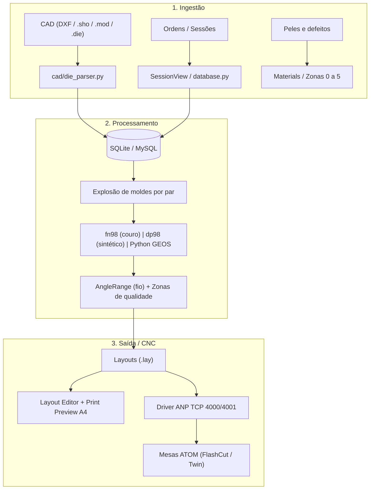
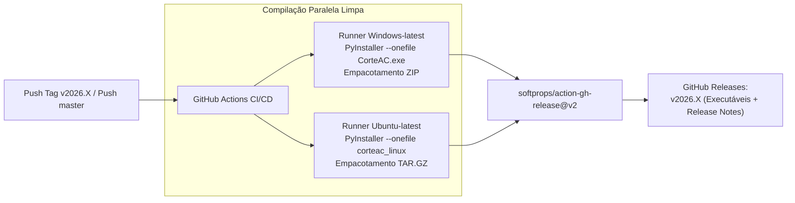

# PROJETO ATOM JobManager Reborn: Documento Vivo

> **Finalidade:** Documento mestre estruturado e autocontido projetado para alimentar e contextualizar qualquer Inteligência Artificial (Antigravity, Claude, ChatGPT, etc.) ou engenheiro sobre 100% do projeto — regras de negócio de calçados/couro (ATOM), arquitetura técnica, schemas de banco (MySQL/SQLite), formatos proprietários (.LAY, .ONX/CZLIB), algoritmos de nesting/CAM, UI/UX e histórico — em um único arquivo de referência imediata.
> **Regra de ouro:** o que está marcado `[CONFIRMADO]` veio do relatório, do código ou do usuário. O que está `[NÃO CONFIRMADO]` é suposição e não deve virar "fato" sem validação. O que está `[PREENCHER]` a IA deve completar lendo o código real.

<!-- AUTO:header:start -->
**Última sincronização com o código:** 2026-10-30 15:25 (HEAD ao gerar: `5b1c06d`; 105 arquivos Python, ~52651 linhas)
<!-- AUTO:header:end -->
**Versão deste documento:** 1

---

## 0. Como manter este documento

**Automático:** os blocos entre `<!-- AUTO:nome:start -->` e `<!-- AUTO:nome:end -->` (cabeçalho, seção 3, seção 4, seção 7.4 e commits recentes) são reescritos por `tools/sync_project_doc.py` a cada commit, via hook do Git. **Não edite esses blocos à mão: a próxima execução apaga a edição.** Todo o resto é manual.

1. Alterações que o script não vê (regras, decisões, confirmações do usuário, pendências) são atualizadas à mão nas seções 5, 6, 7.1, 7.2, 8, 9 e 10.
2. Nunca apagar entradas do Changelog (seção 10). Apenas acrescentar.
3. Ao mudar um item de `[NÃO CONFIRMADO]` para `[CONFIRMADO]`, registrar quem confirmou e quando.
4. O Claude só afirma sobre o código aquilo que está descrito aqui. Se algo não estiver aqui, o Claude pergunta em vez de presumir.
5. **Publicação Automática de Releases a Cada 5 Commits (`v2026.X`) (seção 12)**: a cada 5 commits acumulados no repositório (medidos e monitorados via `tools/check_release_cadence.py`), uma nova release oficial deve ser publicada automaticamente via GitHub Actions gerando binários portáteis Windows (`CorteAC.exe`) e Linux (`corteac_linux`) atualizados, incrementando rigorosamente a sequência de versões em `config.py`, `.github/workflows/release.yml` e tags do Git.
6. **Centralização Total de Relatórios e Especificações**: A partir de 30/10/2026, **todo e qualquer relatório de fase, diagnóstico técnico, benchmark, especificação de arquitetura ou decisão de projeto deve ser documentado DIRETAMENTE neste arquivo (`docs/PROJETO_ATOM_JOBMANAGER.md`)**. É expressamente proibido criar novos arquivos `.md` avulsos na pasta `docs/`, mantendo a pasta limpa e este arquivo como a fonte única de verdade absoluta.

---

## 1. Visão geral

Reconstrução do ecossistema da **ATOM Engineering s.r.l.** (JobManager2000, TheLoop, ShedNt, Layout, FreeNest, fn98, dp98) para corte de calçado em couro natural e sintéticos. `[CONFIRMADO]`

O projeto tem duas implementações complementares:

| Implementação | Pasta/Nome | Stack | Papel |
|---|---|---|---|
| Cliente desktop | `jobmanager-win10-python` / `teste_dola` | Python, MySQL 8.0 Central (reserva local SQLite `jobmanager.db`), UI desktop | Reconstrução fiel da UI/UX do JobManager2000 (WinXP/Win10/Win11), cliente para 8 PCs simultâneos na fábrica (>1000 layouts/dia) |
| Serviço industrial distribuído | `atom_reborn` | FastAPI, MySQL 8.0, GEOS/Shapely, WebSocket, React 18 | Backend corporativo, fila de nesting, integração com chão de fábrica via ANP TCP |

Ambientes: Windows 10/11 e Linux. `[CONFIRMADO]`

---

## 2. Fluxo de dados



---

## 3. Estrutura do código (automático)

<!-- AUTO:tree:start -->
```
README.md
README_WINDOWS.md
build_exe_windows.bat
build_linux.sh
config.py                                            # CorteAC (Python Edition)
database.py                                          # JobManager 2000 (Python Edition)
db.example.ini
docker-compose.yml
executar_windows.bat
main.py                                              # CorteAC (Python Edition para Windows 10 / 11)
run.bat
run.sh
cad/ai_learner.py                                    # JobManager 2000 (Python Edition)
cad/colors.py                                        # JobManager 2000 (Python Edition)
cad/czlib.py                                         # JobManager 2000 (Python Edition)
cad/die_parser.py                                    # JobManager 2000 (Python Edition)
cad/dual_exporter.py                                 # JobManager 2000 (Python Edition)
cad/exporter.py                                      # JobManager 2000 (Python Edition)
cad/fill_engine.py                                   # JobManager 2000 (Python Edition)
cad/geometry.py                                      # JobManager 2000 (Python Edition)
cad/lay_parser.py                                    # JobManager 2000 (Python Edition)
cad/layers_rule.py                                   # JobManager 2000 (Python Edition)
cad/macro_engine.py                                  # JobManager 2000 (Python Edition)
cad/material_importer.py                             # JobManager 2000 (Python Edition)
cad/nesting_backend.py                               # cad/nesting_backend.py - Abstração e Gerenciamento de Backends de Nesting para CorteAC
cad/nesting_engine.py                                # JobManager 2000 (Python Edition)
cad/nfp.py                                           # cad/nfp.py - Motor No-Fit Polygon (NFP) em Python Puro para CorteAC / JobManager 2000
cad/onx_exporter.py                                  # JobManager 2000 (Python Edition)
cad/semver.py                                        # Sistema de Versionamento SemVer (Semantic Versioning 2.0.0)
db/__init__.py                                       # Camada de Acesso a Dados do JobManager (MySQL 8.0 / SQLite Reserva)
db/config.py                                         # JobManager 2000 - Configuração de Banco de Dados Central
db/connection.py                                     # JobManager 2000 - Camada Única de Acesso a Banco de Dados
db/schema_mysql.sql
db/migrations/001_initial_mysql_schema.sql
db/migrations/002_add_layout_multisheet_columns.sql
db/migrations/003_add_session_nesting_mode.sql
db/migrations/004_add_shapes_index.sql
docs/fases/FASE4_RELATORIO_PRODUCAO.md
docs/fases/FASE5B_FRESH_LEARNING.md
docs/fases/FASE5_1_OTIMIZACAO_IA_TESTE.md
docs/fases/FASE5_2_ARQUITETURA_4CAMADAS.md
docs/fases/FASE5_DIAGNOSTICO_IA_TESTE.md
docs/fases/FASE6_0_DECISOES.md
docs/fases/FASE6_0_DIAGNOSTICO_SHAPE_EDITOR.md
docs/fases/FASE6_0_MOCKUP.md
docs/fases/FASE6_1_1_STITCHING_EDITOR.md
docs/fases/FASE6_1_SHAPE_CATALOG_VIEW.md
docs/fases/FASE6_2_1_WARNING_FINAL.md
docs/fases/FASE6_2_2_PERF_CONFTEST.md
docs/fases/FASE6_2_POLIMENTO_CATALOGO.md
docs/fases/FASE6_2_WARNING_ANALYSIS.md
docs/fases/FASE6_4_ROTACAO_INTERATIVA.md
docs/fases/FORMATO_LAY.md
docs/fases/LAYOUT_EDITOR_RE.md
docs/fases/MOTORES_NESTING_PARAMETROS.md
docs/fases/RELATORIO_IMPLEMENTACAO_MELHORIAS.md
docs/fases/RELATORIO_REVERSA_COMELZ_ONX.md
docs/fases/RELATORIO_SISTEMA_COMPLETO.md
docs/ref/layout_re/help_topics.json
tests/conftest.py                                    # tests/conftest.py
tests/test_company_logo_print.py                     # Testes Automatizados para a Remoção do Logotipo ATOM e Suporte a Logotipo Personalizado da Empresa
tests/test_db_layer.py                               # Testes Unitários da Camada de Banco de Dados Central (MySQL 8.0 & SQLite Reserva)
tests/test_dual_exporter.py                          # JobManager 2000 (Python Edition)
tests/test_exporter_tsp.py                           # tests/test_exporter_tsp.py
tests/test_lay_parser.py                             # Testes Unitários para o Parser e Gerador de Arquivos .lay (ATOM $$LAYOUT.v3$$)
tests/test_layers_pairs_nesting.py                   # Testes unitários para validação da regra de camadas (layers) no cálculo de peças
tests/test_layout_editor_fill.py                     # JobManager 2000 (Python Edition)
tests/test_layout_editor_shortcuts.py                # Testes Automatizados para Atalhos do LayoutEditorView:
tests/test_layout_editor_trim.py                     # Testes Automatizados para a Funcionalidade de Refilar Layout (Corte Automático CAM):
tests/test_layout_editor_visual_regression.py        # tests/test_layout_editor_visual_regression.py
tests/test_layout_print_legend.py                    # Testes unitários automatizados para a Legenda de Moldes na Impressão A4 (LayoutPrintDialog).
tests/test_layout_print_material.py                  # Testes unitários para validação da sincronização e formatação automática
tests/test_macro_engine_ia_teste.py                  # Testes de Homologação para o Motor de Cálculo "IA-teste":
tests/test_macro_engine_ia_teste_optimized.py        # JobManager 2000 (Python Edition)
tests/test_material_import.py                        # JobManager 2000 (Python Edition)
tests/test_multisheet_nesting.py                     # Testes automatizados completos para Nesting em Múltiplas Placas (Multi-Sheet Nesting).
tests/test_multisheet_progress.py                    # tests/test_multisheet_progress.py - Suíte de testes para a Fase 6.6 (Multi-sheet e Progresso Determinado)
tests/test_mysql_concurrency.py                      # JobManager 2000 (Python Edition)
tests/test_nesting_backend.py                        # tests/test_nesting_backend.py - Testes unitários para a arquitetura de backends de Nesting
tests/test_nesting_contour_gap.py
tests/test_nesting_mode_architecture.py              # JobManager 2000 (Python Edition)
tests/test_nfp.py                                    # tests/test_nfp.py
tests/test_semver.py                                 # Testes Automatizados para o Sistema de Versionamento SemVer (MAJOR.MINOR.PATCH)
tests/test_session_material_delete.py                # Testes automatizados para remoção de material na sessão via tecla Delete / botão / menu:
tests/test_session_monotonic.py                      # Testes Unitários: Monotonicidade Estrita de Sessões e Persistência contra Re-semeadura
tests/test_session_shapes_multidelete.py             # JobManager 2000 (Python Edition)
tests/test_session_view_progress.py                  # JobManager 2000 (Python Edition)
tests/test_shape_catalog_border_cases.py             # tests/test_shape_catalog_border_cases.py
tests/test_shape_catalog_polish.py                   # tests/test_shape_catalog_polish.py
tests/test_shape_catalog_view.py                     # Testes Unitários: ShapeCatalogView (Catálogo de Moldes - Grid View Matrix)
tests/test_shape_editor_fullscreen.py                # tests/test_shape_editor_fullscreen.py
tests/test_shape_editor_security.py                  # tests/test_shape_editor_security.py
tests/test_shape_editor_stitching.py
tests/test_shape_sorting.py                          # Testes Unitários: Classificação e Ordenação de Moldes e Tamanhos (Maior para Menor / Menor para Maior)
tests/test_shapes_resto.py                           # Testes unitários e de integração para a coluna 'Resto' na grade de Moldes da SessionView.
tests/test_strategy_removal.py                       # Testes automatizados para validação da remoção da estratégia flashnestroll (bobinas contínuas):
tests/fixtures/ia_teste_baseline.json
tools/bench_10k_pieces.py                            # tools/bench_10k_pieces.py
tools/bench_ia_teste.py                              # tools/bench_ia_teste.py
tools/bench_ia_teste_optimized.py                    # tools/bench_ia_teste_optimized.py
tools/bench_layout_drag.py                           # tools/bench_layout_drag.py
tools/bench_multi_sheet.py                           # tools/bench_multi_sheet.py
tools/bench_nest.py                                  # tools/bench_nest.py
tools/bench_tsp.py                                   # tools/bench_tsp.py
tools/capture_catalog_screenshots.py                 # tools/capture_catalog_screenshots.py
tools/capture_editor_screenshots.py                  # Ferramenta para captura e comparação de screenshots do ShapeEditorView
tools/capture_layout_screenshots.py                  # tools/capture_layout_screenshots.py
tools/check_release_cadence.py                       # Verificador de Cadência de Release (Regra dos 5 Commits)
tools/compare_ia_teste_yield.py                      # tools/compare_ia_teste_yield.py
tools/compare_learning_states.py                     # tools/compare_learning_states.py
tools/generate_modern_icons.py                       # tools/generate_modern_icons.py
tools/migrate_sqlite_to_mysql.py                     # tools/migrate_sqlite_to_mysql.py - Migra jobmanager.db (SQLite) para MySQL 8.0 Central.
tools/profile_drag.py                                # tools/profile_drag.py
tools/profile_ia_teste.py                            # tools/profile_ia_teste.py
tools/profile_nest.py                                # tools/profile_nest.py
tools/semver.py                                      # Sistema de Versionamento SemVer (Semantic Versioning 2.0.0)
tools/verify_fresh_learning.py                       # tools/verify_fresh_learning.py
tools/fresh_test/settings_snapshot.json
tools/re_dump/build_layout_inventory.py              # tools/re_dump/build_layout_inventory.py
tools/re_dump/extract_help_docs.py                   # tools/re_dump/extract_help_docs.py
tools/re_dump/extract_pe_resources.py                # tools/re_dump/extract_pe_resources.py
tools/re_dump/generate_layout_editor_re_md.py        # generate_layout_editor_re_md.py
tools/re_dump/layout_inventory.json
ui/add_shapes_dialog.py                              # JobManager 2000 (Python Edition)
ui/cad_canvas.py                                     # JobManager 2000 (Python Edition)
ui/debug_panel.py                                    # JobManager 2000 (Python Edition)
ui/dieproc_dialog.py                                 # JobManager 2000 (Python Edition)
ui/edit_shape_in_session_dialog.py                   # JobManager 2000 (Python Edition)
ui/fill_user_dialog.py                               # JobManager 2000 (Python Edition)
ui/import_materials_dialog.py                        # JobManager 2000 (Python Edition)
ui/layout_editor_view.py                             # JobManager 2000 (Python Edition)
ui/layout_print_dialog.py                            # JobManager 2000 (Python Edition)
ui/macro_panel.py                                    # JobManager 2000 (Python Edition)
ui/main_window.py                                    # CorteAC (Edição Python para Windows 10 / 11)
ui/material_codes_view.py                            # JobManager 2000 (Python Edition)
ui/nesting_mode_widget.py                            # JobManager 2000 (Python Edition)
ui/options_dialog.py                                 # JobManager 2000 (Python Edition)
ui/order_view.py                                     # JobManager 2000 (Python Edition)
ui/params_dialog.py                                  # JobManager 2000 (Python Edition)
ui/session_view.py                                   # JobManager 2000 (Python Edition)
ui/shape_catalog_view.py                             # JobManager 2000 (Python Edition)
ui/shape_editor_view.py                              # JobManager 2000 (Python Edition)
ui/sort_utils.py                                     # JobManager 2000 (Python Edition)
ui/trim_layout_dialog.py                             # JobManager 2000 (Python Edition)
```
<!-- AUTO:tree:end -->

### 3.0 Classes e funções por arquivo (automático)

<!-- AUTO:symbols:start -->
### `database.py`
- `class DatabaseManager` (linha 44, 59 métodos)
- funções: `get_current_operator`

### `main.py`
- funções: `main`

### `cad/ai_learner.py`
- `class ShapeFeatures` (linha 24, 1 métodos)
- `class ShapeFeatureExtractor` (linha 43, 3 métodos): Extrai características geométricas normalizadas e invariantes a escala/rotação
- `class NestingAIBrain` (linha 189, 8 métodos): Cérebro de Inteligência Artificial Local Embarcada.

### `cad/colors.py`
- funções: `get_color_for_size`, `get_contrast_text_color`, `get_color_emoji`

### `cad/czlib.py`
- `class CZLIBError` (linha 22, 0 métodos): Erro de validação ou processamento do container CZLIB.
- funções: `decompress_czlib`, `compress_czlib`

### `cad/die_parser.py`
- funções: `_parse_float`, `interpolate_arc_bulge`, `clean_shape_name`, `parse_die_content`, `parse_die_file`, `generate_die_content`, `save_die_file`

### `cad/dual_exporter.py`
- `class DualLayoutExporter` (linha 16, 4 métodos): Exportador unificado para máquinas de corte ATOM (FlashCut .lay)

### `cad/exporter.py`
- funções: `reorder_contour_midpoint_longest_edge`, `two_opt_pass`, `or_opt`, `optimize_piece_cutting_order_tsp`, `_canonical_edge`, `export_gcode`, `export_dxf`, `export_xml_report`

### `cad/fill_engine.py`
- funções: `rotate_piece_in_place_math`, `_parse_margins`, `fill_row_pieces`, `fill_row_alternate_pieces`, `fill_column_pieces`, `find_piece_vertical_contact_y`, `find_row_vertical_contact_y`, `fill_sheet_pieces`, `fill_sheet_alternate_pieces`, `fill_user_pieces`

### `cad/geometry.py`
- `class SpatialGrid` (linha 291, 5 métodos): Indexação Espacial 2D (Spatial Grid Hashing).
- funções: `rotate_point`, `clear_transform_cache`, `get_transform_cache_stats`, `_get_contour_hash`, `transform_contour`, `polygon_area`, `polygon_perimeter`, `polygon_bbox`, `bbox_overlap`, `point_in_polygon`, `_ccw`, `segments_intersect`, `point_segment_distance_sq`, `simplify_contour_for_collision`, `polygons_collide` (+1)

### `cad/lay_parser.py`
- `class TargetDie` (linha 53, 1 métodos): Representa uma matriz alvo (TG) declarada no layout.
- `class PlacedItem` (linha 74, 0 métodos): Representa uma peça individual posicionada no layout (I).
- `class QualityZone` (linha 99, 0 métodos): Zona de qualidade ou defeito em couro/pele.
- `class LayoutData` (linha 106, 1 métodos): Estrutura consolidada de um layout de corte .lay.
- funções: `_parse_float`, `_parse_int`, `parse_lay`, `link_layout_items_to_db`, `generate_lay_content`, `validate_layout_placement`, `export_layout_from_pieces`

### `cad/layers_rule.py`
- funções: `calc_resto`

### `cad/macro_engine.py`
- `class SafeFormulaEvaluator` (linha 214, 4 métodos): Avaliador de expressões matemáticas e lógicas estritamente seguro.
- `class MacroConfig` (linha 358, 1 métodos): Configuração intermediária resultante da compilação de uma macro.
- `class MacroCompiler` (linha 380, 1 métodos): Compila o texto da macro declarativa em um objeto MacroConfig executável.
- `class OmniNestMacroEngine` (linha 504, 7 métodos): Executa a macro declarativa sobre a geometria real dos moldes,
- funções: `clear_macro_caches`, `ramer_douglas_peucker`, `_find_best_horizontal_slot_nfp`, `check_collision_against_placed`, `nest_ia_teste_engine`

### `cad/material_importer.py`
- funções: `_decode_bytes`, `_parse_float`, `_parse_int`, `_normalize_dimension`, `_match_header_key`, `detect_delimiter`, `parse_material_file`, `_parse_json_materials`, `_parse_csv_materials`, `_build_material_record`, `_build_response_payload`, `generate_csv_template`

### `cad/nesting_backend.py`
- `class NestingBackend` (linha 41, 1 métodos): Protocolo formal para motores de nesting 2D intercambiáveis.
- `class PythonBackend` (linha 60, 1 métodos): Backend legado padrão: executa o motor clássico em cad/nesting_engine.py.
- `class NfpBackend` (linha 94, 2 métodos): Backend analítico de alta performance baseado em No-Fit Polygon (NFP).
- funções: `get_nesting_backend`

### `cad/nesting_engine.py`
- funções: `parse_sequence_num`, `sort_shapes_by_sequence`, `get_paired_offset_cached`, `try_hole_filling_placement`, `check_collision_against_placed`, `calculate_yield`, `calculate_atom_cutting_time`, `parse_coupling_angles`, `dieproc_nest_pieces`, `nest_synthetic_engine`, `nest_tape_engine`, `auto_nest_pieces`, `_auto_nest_pieces_core`, `piece_matches_shape`, `nest_multi_sheet`

### `cad/nfp.py`
- funções: `_normalize_points`, `polygon_signed_area`, `_point_in_triangle`, `_is_strictly_convex`, `decompose_convex`, `minkowski_sum_convex`, `clear_nfp_cache`, `compute_nfp`, `contact_placement_x`, `contact_placement_y`, `find_lowest_point_in_nfp`, `contact_placement`

### `cad/onx_exporter.py`
- funções: `_format_num`, `build_onx_xml`, `export_onx_from_pieces`, `save_onx_file`, `parse_onx`

### `cad/semver.py`
- `class SemVer` (linha 24, 8 métodos)

### `db/config.py`
- funções: `_get_val`, `_get_int`

### `db/connection.py`
- `class ServerUnreachableError` (linha 16, 1 métodos): Lançada quando o servidor MySQL central estiver inacessível.
- `class VersionConflictError` (linha 24, 0 métodos): Lançada quando outro operador salvou o layout concorrentemente (controle otimista).
- `class DBRow` (linha 28, 2 métodos): Registro retornado por consultas: comporta-se como dicionário (row['col'])
- `class DBCursor` (linha 64, 8 métodos): Cursor unificado que traduz placeholders, retorna DBRow e expõe lastrowid.
- `class DBConnection` (linha 141, 7 métodos): Wrapper de conexão unificado com suporte a context manager e transações explícitas.
- `class SimpleMySQLPool` (linha 199, 4 métodos): Pool simples e thread-safe de conexões MySQL com reconexão automática.
- funções: `translate_query_for_mysql`, `get_active_backend`, `set_active_backend`, `get_connection`, `get_memory_connection`

### `tests/conftest.py`
- funções: `pytest_sessionstart`, `pytest_runtest_setup`

### `tests/test_company_logo_print.py`
- `class TestCompanyLogoPrint` (linha 20, 6 métodos)

### `tests/test_db_layer.py`
- `class TestDBLayer` (linha 30, 15 métodos)

### `tests/test_dual_exporter.py`
- `class TestCZLIB` (linha 22, 4 métodos): Validação do container de compressão CZLIB da Comelz.
- `class TestONXExporter` (linha 62, 4 métodos): Validação do gerador de XML e empacotamento .ONX.
- `class TestDualExporter` (linha 142, 3 métodos): Validação do orquestrador de exportação dupla (ATOM + Comelz).

### `tests/test_exporter_tsp.py`
- `class TestExporterTSP` (linha 38, 13 métodos)
- funções: `calculate_tour_distance`

### `tests/test_lay_parser.py`
- `class TestLayParser` (linha 33, 14 métodos)

### `tests/test_layers_pairs_nesting.py`
- `class TestLayersPairsNesting` (linha 11, 6 métodos)

### `tests/test_layout_editor_fill.py`
- `class DummyMouseEvent` (linha 25, 1 métodos)
- `class TestLayoutEditorFill` (linha 35, 29 métodos)

### `tests/test_layout_editor_shortcuts.py`
- `class DummyEvent` (linha 32, 1 métodos)
- `class DummyMouseEvent` (linha 38, 1 métodos)
- `class TestLayoutEditorShortcuts` (linha 46, 67 métodos)

### `tests/test_layout_editor_trim.py`
- `class TestLayoutEditorTrim` (linha 16, 9 métodos)

### `tests/test_layout_editor_visual_regression.py`
- `class TestLayoutEditorVisualRegression` (linha 16, 1 métodos)

### `tests/test_layout_print_legend.py`
- `class TestLayoutPrintLegend` (linha 22, 13 métodos)

### `tests/test_layout_print_material.py`
- `class TestLayoutPrintMaterial` (linha 12, 4 métodos)

### `tests/test_macro_engine_ia_teste.py`
- `class TestMacroEngineIATeste` (linha 50, 15 métodos)
- funções: `make_realistic_shoe_sole_contour`

### `tests/test_macro_engine_ia_teste_optimized.py`
- `class TestMacroEngineIATesteOptimized` (linha 45, 9 métodos)

### `tests/test_material_import.py`
- `class TestMaterialImporter` (linha 29, 11 métodos)
- `class TestImportMaterialsDialogUI` (linha 212, 4 métodos)

### `tests/test_multisheet_nesting.py`
- `class DummyEvent` (linha 44, 1 métodos)
- `class TestMultiSheetNesting` (linha 50, 30 métodos)

### `tests/test_multisheet_progress.py`
- `class TestMultiSheetProgress` (linha 16, 7 métodos)

### `tests/test_mysql_concurrency.py`
- `class TestMySQLConcurrency` (linha 29, 4 métodos)

### `tests/test_nesting_backend.py`
- funções: `test_python_backend_reference`, `test_nfp_backend_zero_collision_50_pieces`, `test_backend_coordinate_agreement`, `test_get_nesting_backend_env_var`, `test_nfp_backend_automatic_fallback`, `test_nfp_backend_sanity_flag`, `test_nfp_backend_zero_collision_300_pieces`, `test_nfp_backend_zero_collision_500_pieces`

### `tests/test_nesting_contour_gap.py`
- `class TestNestingContourGap` (linha 8, 9 métodos)

### `tests/test_nesting_mode_architecture.py`
- `class TestNestingModeArchitecture` (linha 31, 12 métodos)

### `tests/test_nfp.py`
- `class TestNFP` (linha 38, 7 métodos)

### `tests/test_semver.py`
- `class TestSemVer` (linha 12, 7 métodos)

### `tests/test_session_material_delete.py`
- `class TestSessionMaterialDelete` (linha 17, 10 métodos)

### `tests/test_session_monotonic.py`
- `class TestSessionMonotonic` (linha 10, 9 métodos)

### `tests/test_session_shapes_multidelete.py`
- `class TestSessionShapesMultiDelete` (linha 23, 8 métodos)

### `tests/test_session_view_progress.py`
- `class TestSessionViewProgress` (linha 23, 8 métodos)

### `tests/test_shape_catalog_border_cases.py`
- `class TestShapeCatalogBorderCases` (linha 21, 7 métodos)

### `tests/test_shape_catalog_polish.py`
- `class TestShapeCatalogPolish` (linha 19, 15 métodos)

### `tests/test_shape_catalog_view.py`
- `class TestShapeCatalogView` (linha 18, 13 métodos)

### `tests/test_shape_editor_fullscreen.py`
- `class TestShapeEditorFullscreen` (linha 19, 11 métodos)

### `tests/test_shape_editor_security.py`
- `class DummyEvent` (linha 24, 1 métodos)
- `class TestShapeEditorSecurity` (linha 33, 9 métodos)

### `tests/test_shape_editor_stitching.py`
- `class TestShapeEditorStitching` (linha 6, 11 métodos)

### `tests/test_shape_sorting.py`
- `class TestShapeSorting` (linha 14, 6 métodos)
- `class DummyKeyEvent` (linha 105, 1 métodos)
- `class TestSessionViewInlineArrowNavigation` (linha 111, 8 métodos)

### `tests/test_shapes_resto.py`
- `class TestCalcRestoPure` (linha 21, 5 métodos)
- `class TestSessionViewShapesRestoGrid` (linha 64, 9 métodos)

### `tests/test_strategy_removal.py`
- `class TestStrategyRemoval` (linha 19, 9 métodos)

### `tools/bench_10k_pieces.py`
- funções: `get_current_rss_mb`, `get_peak_rss_mb`, `generate_10k_shapes`, `run_stress_test`, `main`

### `tools/bench_ia_teste.py`
- funções: `calculate_sheet_g00`, `run_ia_teste_benchmark`, `main`

### `tools/bench_ia_teste_optimized.py`
- funções: `calculate_sheet_g00`, `run_optimized_benchmark`, `main`

### `tools/bench_layout_drag.py`
- funções: `build_pieces`, `screen_of`, `run_single_benchmark`, `main`

### `tools/bench_multi_sheet.py`
- funções: `generate_benchmark_shapes`, `run_benchmark`, `main`

### `tools/bench_nest.py`
- funções: `load_benchmark_shapes`, `run_benchmark`, `main`

### `tools/bench_tsp.py`
- funções: `generate_tsp_pieces`, `calculate_tour_distance`, `run_tsp_benchmark`, `main`

### `tools/capture_catalog_screenshots.py`
- funções: `capture_catalog_state`, `compare_catalog_states`, `main`

### `tools/capture_editor_screenshots.py`
- funções: `capture_canvas_image`, `capture_before`, `capture_after`, `compare_images`

### `tools/capture_layout_screenshots.py`
- funções: `build_test_pieces`, `render_scenario`, `run_scenarios`, `main`

### `tools/check_release_cadence.py`
- funções: `run_git`, `check_cadence`

### `tools/compare_ia_teste_yield.py`
- funções: `calculate_sheet_g00`, `load_scenario_shapes`, `evaluate_engine`, `compare_scenario`, `main`

### `tools/compare_learning_states.py`
- funções: `calculate_sheet_g00`, `get_all_settings`, `restore_snapshot`, `setup_state_in_db`, `evaluate_state`, `determine_learning_curve_verdict`, `run_comparison`, `main`

### `tools/generate_modern_icons.py`
- funções: `create_supersampled`, `finish_icon`, `make_cut_icon`, `make_copy_icon`, `make_paste_icon`, `make_details_icon`, `make_layout_icon`, `make_shed_icon`, `make_mode_prod_icon`, `make_mode_moldes_icon`, `make_mode_mat_icon`, `make_tree_prod_node_icon`, `make_tree_folder_icon`, `make_tree_order_icon`, `make_tree_session_icon` (+3)

### `tools/migrate_sqlite_to_mysql.py`
- funções: `make_backup`, `migrate`, `main`

### `tools/profile_ia_teste.py`
- funções: `run_profile_ia_teste`, `main`

### `tools/profile_nest.py`
- funções: `run_profiled_nest`, `main`

### `tools/semver.py`
- `class SemVer` (linha 28, 8 métodos)
- funções: `get_repo_root`, `get_current_version`, `update_config_py`, `update_release_workflow`, `set_version`, `analyze_commits_for_bump`, `main`

### `tools/verify_fresh_learning.py`
- funções: `get_ai_settings_from_db`, `get_all_settings_from_db`, `remove_ai_settings`, `restore_settings_from_snapshot`, `run_verification`, `main`

### `tools/re_dump/build_layout_inventory.py`
- funções: `load_text_lines`, `main`

### `tools/re_dump/extract_help_docs.py`
- `class HTMLTextExtractor` (linha 26, 5 métodos)
- funções: `extract_file`, `main`

### `tools/re_dump/extract_pe_resources.py`
- funções: `get_resources`, `get_string_table`, `parse_menu`, `format_menu_tree`, `parse_dialog`, `main`

### `tools/re_dump/generate_layout_editor_re_md.py`
- funções: `main`

### `ui/add_shapes_dialog.py`
- `class AddShapesDialog` (linha 13, 14 métodos)

### `ui/cad_canvas.py`
- `class CADCanvas` (linha 12, 24 métodos)

### `ui/debug_panel.py`
- `class DebugPanel` (linha 24, 9 métodos): Camada 4: Debug / Diagnóstico.

### `ui/dieproc_dialog.py`
- `class DieProcDialog` (linha 12, 19 métodos)

### `ui/edit_shape_in_session_dialog.py`
- `class EditShapeInSessionDialog` (linha 11, 6 métodos)

### `ui/fill_user_dialog.py`
- `class FillUserConstraints` (linha 26, 0 métodos): Parâmetros validados do diálogo 'Set User constraints'.
- `class FillUserDialog` (linha 112, 5 métodos): Diálogo Modal 'Set User constraints' (Dialog 159 original, Win32 ID 50003).
- funções: `validate_fill_user_params`

### `ui/import_materials_dialog.py`
- `class ImportMaterialsDialog` (linha 18, 7 métodos): Diálogo autêntico Windows XP para importação de lista de materiais.

### `ui/layout_editor_view.py`
- `class LayoutEditorView` (linha 172, 129 métodos)
- funções: `rotate_piece_in_place`

### `ui/layout_print_dialog.py`
- `class LayoutPrintDialog` (linha 252, 22 métodos): Janela modal de Visualização de Impressão (Print Preview) do Layout Editor.
- funções: `get_company_logo_path`, `open_company_logo_dialog`, `format_size`, `extract_molde_base_name`

### `ui/macro_panel.py`
- `class MacroPanel` (linha 23, 12 métodos): Camada 3: Macro / Aprendizado.

### `ui/main_window.py`
- `class MainWindow` (linha 46, 118 métodos)
- funções: `get_assets_dir`

### `ui/material_codes_view.py`
- `class MaterialCodesView` (linha 13, 21 métodos)

### `ui/nesting_mode_widget.py`
- `class NestingModeWidget` (linha 70, 6 métodos): Widget de seleção de modo de encaixe industrial (Camada 1 de UX).

### `ui/options_dialog.py`
- `class OptionsDialog` (linha 13, 15 métodos)

### `ui/order_view.py`
- `class OrderView` (linha 10, 8 métodos)

### `ui/params_dialog.py`
- `class NestingParamsDialog` (linha 10, 2 métodos)

### `ui/session_view.py`
- `class SessionView` (linha 79, 103 métodos)

### `ui/shape_catalog_view.py`
- `class ShapeCatalogView` (linha 38, 44 métodos): Visão MDI em Matriz Grid (Peças × Tamanhos) para exibição e gerenciamento
- funções: `extract_piece_base_name`

### `ui/shape_editor_view.py`
- `class ShapeEditorView` (linha 19, 55 métodos)

### `ui/sort_utils.py`
- funções: `natural_sort_key`, `size_sort_key`, `shape_area_sort_key`, `clean_session_display_name`, `resto_sort_key`

### `ui/trim_layout_dialog.py`
- `class TrimLayoutDialog` (linha 16, 15 métodos)
<!-- AUTO:symbols:end -->

### 3.1 Módulos conhecidos pelo relatório

| Módulo / Classe | Papel | Estado |
|---|---|---|
| `cad/die_parser.py` | Importador/exportador `.die` | Pronto. **Não alterar** sem pedido explícito |
| `cad/lay_parser.py` | Importador/exportador `.lay` (`$$LAYOUT.v3$$`), nesting e ordenação de corte CNC | Pronto |
| `database.py` | Acesso SQLite (`jobmanager.db`), gerenciamento de ordens, artigos, moldes, sessões e layouts | Pronto (`DIVERGÊNCIA: refatorado para MySQL 8.0 Central via pacote db/, SQLite é contingência`) |
| `SessionView` | Sessão de corte, aba Moldes, mini-preview, disparo do encaixe e integração | Pronto |
| `ShapeEditorView` | Reprodução visual do ShedNt | Pronto (visual) |
| `LayoutEditorView` | Editor de layout (canvas vetorial) | Pronto: atalhos F1-F4, Ctrl+Z, Ctrl+S, rotação e persistência |
| `PrintPreviewDialog` | Relatório A4 com rendimento % | Pronto (`DIVERGÊNCIA: implementado como LayoutPrintDialog em ui/layout_print_dialog.py`) |
| `anp_client.py` | Driver ANP: socket não-bloqueante, 4001 (ping) e 4000 (dados) | `[NÃO IMPLEMENTADO]` (`DIVERGÊNCIA: arquivo inexistente no repositório; planejado`) |
| `LoopDaemon` (em `atom_reborn`) | Substitui o TheLoop.exe | Pronto `[NÃO CONFIRMADO no repositório local]` |

> **DIVERGÊNCIAS da Seção 3.1 em relação ao código real:**
> 1. **`database.py`**: O acesso ao banco agora é centralizado via pacote `db/` (`db.connection`, `db.config`). O banco de dados **primário em produção é MySQL 8.0 Central** (com suporte multi-máquina a 8 PCs simultâneos, pool de conexões e concorrência otimista), mantendo o SQLite local (`jobmanager.db`) como contingência/reserva offline.
> 2. **`PrintPreviewDialog`**: No código real do repositório, a classe chama-se `LayoutPrintDialog` e reside em `ui/layout_print_dialog.py` (linha 20, 14 métodos).
> 3. **`anp_client.py`**: O arquivo `anp_client.py` **não existe** no repositório atual. Foi concebido no planejamento original para comunicação direta via socket com a máquina de corte ATOM (portas 4000 e 4001), mas ainda não foi implementado neste repositório.

---

## 4. Modelo de dados (automático)

<!-- AUTO:schema:start -->
### 4.1 Schema MySQL 8.0 (Banco de Dados Principal Central)

DDL base (`db/schema_mysql.sql`) e migrações versionadas (`db/migrations/*.sql`):

```sql
-- =============================================================================
-- DDL Base: db/schema_mysql.sql
-- =============================================================================
-- =============================================================================
-- JobManager 2000 Reborn - Schema DDL para MySQL 8.0 Central
-- Compatível com 8 PCs simultâneos e > 1000 layouts/dia
-- Engine: InnoDB | Charset: utf8mb4 | Collation: utf8mb4_unicode_ci
-- =============================================================================

CREATE TABLE IF NOT EXISTS schema_version (
    version INT PRIMARY KEY,
    description VARCHAR(255) NOT NULL,
    applied_at DATETIME NOT NULL DEFAULT CURRENT_TIMESTAMP
) ENGINE=InnoDB DEFAULT CHARSET=utf8mb4 COLLATE=utf8mb4_unicode_ci;

-- 1. Materiais (Chapas, Bobinas, Peles)
CREATE TABLE IF NOT EXISTS materials (
    id VARCHAR(50) PRIMARY KEY,
    name VARCHAR(150) NOT NULL,
    type VARCHAR(50) NOT NULL,
    width_mm DOUBLE NOT NULL,
    height_mm DOUBLE NOT NULL,
    area_m2 DOUBLE NOT NULL,
    thickness_mm DOUBLE NOT NULL,
    layers INT DEFAULT 2,
    gap_mm DOUBLE DEFAULT 1.0
) ENGINE=InnoDB DEFAULT CHARSET=utf8mb4 COLLATE=utf8mb4_unicode_ci;

-- 2. Ordens de Produção (Orders)
CREATE TABLE IF NOT EXISTS orders (
    id INT AUTO_INCREMENT PRIMARY KEY,
    code VARCHAR(100) UNIQUE NOT NULL,
    customer VARCHAR(150) NOT NULL,
    name VARCHAR(150) DEFAULT 'Derby Masculino #41',
    status VARCHAR(50) NOT NULL DEFAULT 'Pendente',
    created_at DATETIME NOT NULL DEFAULT CURRENT_TIMESTAMP,
    INDEX idx_orders_code (code),
    INDEX idx_orders_status (status)
) ENGINE=InnoDB DEFAULT CHARSET=utf8mb4 COLLATE=utf8mb4_unicode_ci;

-- 3. Artigos por Ordem (Articles)
CREATE TABLE IF NOT EXISTS articles (
    id INT AUTO_INCREMENT PRIMARY KEY,
    order_id INT NOT NULL,
    name VARCHAR(150) NOT NULL,
    pairs_count INT NOT NULL DEFAULT 1,
    material_id VARCHAR(50) NULL DEFAULT NULL,
    FOREIGN KEY (order_id) REFERENCES orders(id) ON DELETE CASCADE,
    FOREIGN KEY (material_id) REFERENCES materials(id) ON DELETE SET NULL,
    INDEX idx_articles_order (order_id),
    INDEX idx_articles_material (material_id)
) ENGINE=InnoDB DEFAULT CHARSET=utf8mb4 COLLATE=utf8mb4_unicode_ci;

-- 4. Pastas de Moldes CAD (Shape Folders)
CREATE TABLE IF NOT EXISTS shape_folders (
    id INT AUTO_INCREMENT PRIMARY KEY,
    name VARCHAR(150) UNIQUE NOT NULL
) ENGINE=InnoDB DEFAULT CHARSET=utf8mb4 COLLATE=utf8mb4_unicode_ci;

-- 4.1 Pastas de Produção (Job Folders)
CREATE TABLE IF NOT EXISTS job_folders (
    id INT AUTO_INCREMENT PRIMARY KEY,
    name VARCHAR(150) UNIQUE NOT NULL
) ENGINE=InnoDB DEFAULT CHARSET=utf8mb4 COLLATE=utf8mb4_unicode_ci;

-- 5. Moldes / Geometria CAD (Shapes)
CREATE TABLE IF NOT EXISTS shapes (
    id INT AUTO_INCREMENT PRIMARY KEY,
    article_id INT NULL DEFAULT NULL,
    name VARCHAR(150) NOT NULL,
    color VARCHAR(30) NOT NULL,
    contour_json LONGTEXT NOT NULL,
    holes_json LONGTEXT NULL,
    stitching_json LONGTEXT NULL,
    folder VARCHAR(150) DEFAULT '',
    size VARCHAR(50) DEFAULT '41',
    FOREIGN KEY (article_id) REFERENCES articles(id) ON DELETE SET NULL,
    INDEX idx_shapes_article (article_id),
    INDEX idx_shapes_name (name),
    INDEX idx_shapes_folder (folder),
    INDEX idx_shapes_article_size_name (article_id, size, name)
) ENGINE=InnoDB DEFAULT CHARSET=utf8mb4 COLLATE=utf8mb4_unicode_ci;

-- 6. Sessões de Corte / Nesting (Sessions)
CREATE TABLE IF NOT EXISTS sessions (
    id INT AUTO_INCREMENT PRIMARY KEY,
    code VARCHAR(100) UNIQUE NOT NULL,
    order_id INT NULL DEFAULT NULL,
    material_id VARCHAR(50) NULL DEFAULT NULL,
    name VARCHAR(150) NOT NULL DEFAULT '',
    job VARCHAR(100) NOT NULL DEFAULT 'ProduçãoNova',
    status VARCHAR(50) NOT NULL DEFAULT 'Planejado',
    yield_percent DOUBLE DEFAULT 0.0,
    cutting_time_sec DOUBLE DEFAULT 0.0,
    placed_pieces_json LONGTEXT NULL,
    strategy VARCHAR(100) DEFAULT 'flashnestsheet',
    params VARCHAR(100) DEFAULT 'stdNOTFill',
    machine VARCHAR(150) DEFAULT 'ATOM FlashCut Flex 3020',
    shapes_json LONGTEXT NULL,
    gap_mm DOUBLE DEFAULT 1.0,
    margin_left DOUBLE DEFAULT 10.0,
    margin_right DOUBLE DEFAULT 10.0,
    margin_top DOUBLE DEFAULT 10.0,
    margin_bottom DOUBLE DEFAULT 10.0,
    nesting_mode VARCHAR(50) DEFAULT 'auto',
    created_at DATETIME NOT NULL DEFAULT CURRENT_TIMESTAMP,
    FOREIGN KEY (order_id) REFERENCES orders(id) ON DELETE SET NULL,
    FOREIGN KEY (material_id) REFERENCES materials(id) ON DELETE SET NULL,
    INDEX idx_sessions_order (order_id),
    INDEX idx_sessions_created (created_at),
    INDEX idx_sessions_status (status)
) ENGINE=InnoDB DEFAULT CHARSET=utf8mb4 COLLATE=utf8mb4_unicode_ci;

-- 7. Configurações Globais do Sistema (Settings)
CREATE TABLE IF NOT EXISTS settings (
    `key` VARCHAR(100) PRIMARY KEY,
    `value` LONGTEXT NOT NULL
) ENGINE=InnoDB DEFAULT CHARSET=utf8mb4 COLLATE=utf8mb4_unicode_ci;

-- 8. Presets DieProc (dp98 ATOM)
CREATE TABLE IF NOT EXISTS dieproc_presets (
    name VARCHAR(100) PRIMARY KEY,
    coupling VARCHAR(100) NOT NULL,
    step DOUBLE DEFAULT 1.0,
    solutions INT DEFAULT 30,
    range1_from DOUBLE DEFAULT -3.0,
    range1_to DOUBLE DEFAULT 3.0,
    range1_step DOUBLE DEFAULT 1.0,
    range2_from DOUBLE DEFAULT 0.0,
    range2_to DOUBLE DEFAULT 0.0,
    range2_step DOUBLE DEFAULT 0.0,
    range3_from DOUBLE DEFAULT 0.0,
    range3_to DOUBLE DEFAULT 0.0,
    range3_step DOUBLE DEFAULT 0.0,
    gap1 DOUBLE DEFAULT 1.0,
    gap2 DOUBLE DEFAULT 0.0,
    gap3 DOUBLE DEFAULT 0.0,
    row_interlock INT DEFAULT 1,
    diagonal INT DEFAULT 0,
    macro_script LONGTEXT NULL
) ENGINE=InnoDB DEFAULT CHARSET=utf8mb4 COLLATE=utf8mb4_unicode_ci;

-- 9. Layouts de Corte (.lay) com Controle de Versão Otimista
CREATE TABLE IF NOT EXISTS layouts (
    id INT AUTO_INCREMENT PRIMARY KEY,
    session_id INT NOT NULL,
    name VARCHAR(150) NOT NULL DEFAULT 'l0000.lay',
    width_mm DOUBLE NOT NULL DEFAULT 0.0,
    height_mm DOUBLE NOT NULL DEFAULT 0.0,
    yield_pct DOUBLE NOT NULL DEFAULT 0.0,
    status VARCHAR(50) NOT NULL DEFAULT 'Nested',
    lay_path VARCHAR(500) NULL,
    version INT NOT NULL DEFAULT 1,
    created_at DATETIME NOT NULL DEFAULT CURRENT_TIMESTAMP,
    updated_at DATETIME NOT NULL DEFAULT CURRENT_TIMESTAMP ON UPDATE CURRENT_TIMESTAMP,
    created_by VARCHAR(100) NULL,
    updated_by VARCHAR(100) NULL,
    -- Colunas de compatibilidade e suporte ao formato .lay
    layout_index INT NOT NULL DEFAULT 0,
    code VARCHAR(100) NOT NULL DEFAULT 'l0000.lay',
    path VARCHAR(500) DEFAULT '',
    `desc` VARCHAR(255) DEFAULT '',
    material_code VARCHAR(100) DEFAULT '',
    material_name VARCHAR(150) DEFAULT '',
    gap_mm DOUBLE DEFAULT 1.0,
    ris_w DOUBLE DEFAULT 0.0,
    ris_l DOUBLE DEFAULT 0.0,
    area_mm2 DOUBLE DEFAULT 0.0,
    yield_percent DOUBLE DEFAULT 0.0,
    num_items INT DEFAULT 0,
    num_dies INT DEFAULT 0,
    margin_left DOUBLE DEFAULT 10.0,
    margin_right DOUBLE DEFAULT 10.0,
    margin_top DOUBLE DEFAULT 10.0,
    margin_bottom DOUBLE DEFAULT 10.0,
    placed_pieces_json LONGTEXT NULL,
    FOREIGN KEY (session_id) REFERENCES sessions(id) ON DELETE CASCADE,
    INDEX idx_layouts_session_status (session_id, created_at, status),
    INDEX idx_layouts_version (id, version),
    INDEX idx_layouts_session_index (session_id, layout_index)
) ENGINE=InnoDB DEFAULT CHARSET=utf8mb4 COLLATE=utf8mb4_unicode_ci;

-- 10. Peças Posicionadas do Layout (layout_pieces)
CREATE TABLE IF NOT EXISTS layout_pieces (
    id INT AUTO_INCREMENT PRIMARY KEY,
    layout_id INT NOT NULL,
    mold_id INT NULL,
    shape_id INT NULL,
    x DOUBLE NOT NULL,
    y DOUBLE NOT NULL,
    rotation_deg SMALLINT NOT NULL CHECK (rotation_deg >= 0 AND rotation_deg < 360),
    mirrored TINYINT(1) NOT NULL DEFAULT 0,
    is_mirrored TINYINT(1) NOT NULL DEFAULT 0,
    -- Colunas de metadados CAM / .lay
    item_index INT NOT NULL DEFAULT 0,
    target_index INT NOT NULL DEFAULT 0,
    instance_id INT NOT NULL DEFAULT 0,
    piece_name VARCHAR(150) NOT NULL DEFAULT '',
    size VARCHAR(50) DEFAULT '',
    rotation_rad DOUBLE DEFAULT 0.0,
    color VARCHAR(30) DEFAULT '#2563eb',
    tag VARCHAR(50) DEFAULT 'Pasted',
    quality_zone INT DEFAULT 1,
    FOREIGN KEY (layout_id) REFERENCES layouts(id) ON DELETE CASCADE,
    FOREIGN KEY (mold_id) REFERENCES shapes(id) ON DELETE RESTRICT,
    FOREIGN KEY (shape_id) REFERENCES shapes(id) ON DELETE RESTRICT,
    INDEX idx_layout_pieces_layout (layout_id),
    INDEX idx_layout_pieces_mold (mold_id),
    INDEX idx_layout_pieces_shape (shape_id)
) ENGINE=InnoDB DEFAULT CHARSET=utf8mb4 COLLATE=utf8mb4_unicode_ci;

-- -----------------------------------------------------------------------------
-- Migração: db/migrations/001_initial_mysql_schema.sql
-- -----------------------------------------------------------------------------
-- Migração 001: Schema inicial do MySQL 8.0 para o JobManager Reborn
-- Idempotente

-- =============================================================================
-- JobManager 2000 Reborn - Schema DDL para MySQL 8.0 Central
-- Compatível com 8 PCs simultâneos e > 1000 layouts/dia
-- Engine: InnoDB | Charset: utf8mb4 | Collation: utf8mb4_unicode_ci
-- =============================================================================

CREATE TABLE IF NOT EXISTS schema_version (
    version INT PRIMARY KEY,
    description VARCHAR(255) NOT NULL,
    applied_at DATETIME NOT NULL DEFAULT CURRENT_TIMESTAMP
) ENGINE=InnoDB DEFAULT CHARSET=utf8mb4 COLLATE=utf8mb4_unicode_ci;

-- 1. Materiais (Chapas, Bobinas, Peles)
CREATE TABLE IF NOT EXISTS materials (
    id VARCHAR(50) PRIMARY KEY,
    name VARCHAR(150) NOT NULL,
    type VARCHAR(50) NOT NULL,
    width_mm DOUBLE NOT NULL,
    height_mm DOUBLE NOT NULL,
    area_m2 DOUBLE NOT NULL,
    thickness_mm DOUBLE NOT NULL,
    layers INT DEFAULT 2,
    gap_mm DOUBLE DEFAULT 1.0
) ENGINE=InnoDB DEFAULT CHARSET=utf8mb4 COLLATE=utf8mb4_unicode_ci;

-- 2. Ordens de Produção (Orders)
CREATE TABLE IF NOT EXISTS orders (
    id INT AUTO_INCREMENT PRIMARY KEY,
    code VARCHAR(100) UNIQUE NOT NULL,
    customer VARCHAR(150) NOT NULL,
    name VARCHAR(150) DEFAULT 'Derby Masculino #41',
    status VARCHAR(50) NOT NULL DEFAULT 'Pendente',
    created_at DATETIME NOT NULL DEFAULT CURRENT_TIMESTAMP,
    INDEX idx_orders_code (code),
    INDEX idx_orders_status (status)
) ENGINE=InnoDB DEFAULT CHARSET=utf8mb4 COLLATE=utf8mb4_unicode_ci;

-- 3. Artigos por Ordem (Articles)
CREATE TABLE IF NOT EXISTS articles (
    id INT AUTO_INCREMENT PRIMARY KEY,
    order_id INT NOT NULL,
    name VARCHAR(150) NOT NULL,
    pairs_count INT NOT NULL DEFAULT 1,
    material_id VARCHAR(50) NULL DEFAULT NULL,
    FOREIGN KEY (order_id) REFERENCES orders(id) ON DELETE CASCADE,
    FOREIGN KEY (material_id) REFERENCES materials(id) ON DELETE SET NULL,
    INDEX idx_articles_order (order_id),
    INDEX idx_articles_material (material_id)
) ENGINE=InnoDB DEFAULT CHARSET=utf8mb4 COLLATE=utf8mb4_unicode_ci;

-- 4. Pastas de Moldes CAD (Shape Folders)
CREATE TABLE IF NOT EXISTS shape_folders (
    id INT AUTO_INCREMENT PRIMARY KEY,
    name VARCHAR(150) UNIQUE NOT NULL
) ENGINE=InnoDB DEFAULT CHARSET=utf8mb4 COLLATE=utf8mb4_unicode_ci;

-- 4.1 Pastas de Produção (Job Folders)
CREATE TABLE IF NOT EXISTS job_folders (
    id INT AUTO_INCREMENT PRIMARY KEY,
    name VARCHAR(150) UNIQUE NOT NULL
) ENGINE=InnoDB DEFAULT CHARSET=utf8mb4 COLLATE=utf8mb4_unicode_ci;

-- 5. Moldes / Geometria CAD (Shapes)
CREATE TABLE IF NOT EXISTS shapes (
    id INT AUTO_INCREMENT PRIMARY KEY,
    article_id INT NULL DEFAULT NULL,
    name VARCHAR(150) NOT NULL,
    color VARCHAR(30) NOT NULL,
    contour_json LONGTEXT NOT NULL,
    holes_json LONGTEXT NULL,
    stitching_json LONGTEXT NULL,
    folder VARCHAR(150) DEFAULT '',
    size VARCHAR(50) DEFAULT '41',
    FOREIGN KEY (article_id) REFERENCES articles(id) ON DELETE SET NULL,
    INDEX idx_shapes_article (article_id),
    INDEX idx_shapes_name (name),
    INDEX idx_shapes_folder (folder)
) ENGINE=InnoDB DEFAULT CHARSET=utf8mb4 COLLATE=utf8mb4_unicode_ci;

-- 6. Sessões de Corte / Nesting (Sessions)
CREATE TABLE IF NOT EXISTS sessions (
    id INT AUTO_INCREMENT PRIMARY KEY,
    code VARCHAR(100) UNIQUE NOT NULL,
    order_id INT NULL DEFAULT NULL,
    material_id VARCHAR(50) NULL DEFAULT NULL,
    name VARCHAR(150) NOT NULL DEFAULT '',
    job VARCHAR(100) NOT NULL DEFAULT 'ProduçãoNova',
    status VARCHAR(50) NOT NULL DEFAULT 'Planejado',
    yield_percent DOUBLE DEFAULT 0.0,
    cutting_time_sec DOUBLE DEFAULT 0.0,
    placed_pieces_json LONGTEXT NULL,
    strategy VARCHAR(100) DEFAULT 'flashnestsheet',
    params VARCHAR(100) DEFAULT 'stdNOTFill',
    machine VARCHAR(150) DEFAULT 'ATOM FlashCut Flex 3020',
    shapes_json LONGTEXT NULL,
    created_at DATETIME NOT NULL DEFAULT CURRENT_TIMESTAMP,
    FOREIGN KEY (order_id) REFERENCES orders(id) ON DELETE SET NULL,
    FOREIGN KEY (material_id) REFERENCES materials(id) ON DELETE SET NULL,
    INDEX idx_sessions_order (order_id),
    INDEX idx_sessions_created (created_at),
    INDEX idx_sessions_status (status)
) ENGINE=InnoDB DEFAULT CHARSET=utf8mb4 COLLATE=utf8mb4_unicode_ci;

-- 7. Configurações Globais do Sistema (Settings)
CREATE TABLE IF NOT EXISTS settings (
    `key` VARCHAR(100) PRIMARY KEY,
    `value` LONGTEXT NOT NULL
) ENGINE=InnoDB DEFAULT CHARSET=utf8mb4 COLLATE=utf8mb4_unicode_ci;

-- 8. Presets DieProc (dp98 ATOM)
CREATE TABLE IF NOT EXISTS dieproc_presets (
    name VARCHAR(100) PRIMARY KEY,
    coupling VARCHAR(100) NOT NULL,
    step DOUBLE DEFAULT 1.0,
    solutions INT DEFAULT 30,
    range1_from DOUBLE DEFAULT -3.0,
    range1_to DOUBLE DEFAULT 3.0,
    range1_step DOUBLE DEFAULT 1.0,
    range2_from DOUBLE DEFAULT 0.0,
    range2_to DOUBLE DEFAULT 0.0,
    range2_step DOUBLE DEFAULT 0.0,
    range3_from DOUBLE DEFAULT 0.0,
    range3_to DOUBLE DEFAULT 0.0,
    range3_step DOUBLE DEFAULT 0.0,
    gap1 DOUBLE DEFAULT 1.0,
    gap2 DOUBLE DEFAULT 0.0,
    gap3 DOUBLE DEFAULT 0.0,
    row_interlock INT DEFAULT 1,
    diagonal INT DEFAULT 0,
    macro_script LONGTEXT NULL
) ENGINE=InnoDB DEFAULT CHARSET=utf8mb4 COLLATE=utf8mb4_unicode_ci;

-- 9. Layouts de Corte (.lay) com Controle de Versão Otimista
CREATE TABLE IF NOT EXISTS layouts (
    id INT AUTO_INCREMENT PRIMARY KEY,
    session_id INT NOT NULL,
    name VARCHAR(150) NOT NULL DEFAULT 'l0000.lay',
    width_mm DOUBLE NOT NULL DEFAULT 0.0,
    height_mm DOUBLE NOT NULL DEFAULT 0.0,
    yield_pct DOUBLE NOT NULL DEFAULT 0.0,
    status VARCHAR(50) NOT NULL DEFAULT 'Nested',
    lay_path VARCHAR(500) NULL,
    version INT NOT NULL DEFAULT 1,
    created_at DATETIME NOT NULL DEFAULT CURRENT_TIMESTAMP,
    updated_at DATETIME NOT NULL DEFAULT CURRENT_TIMESTAMP ON UPDATE CURRENT_TIMESTAMP,
    created_by VARCHAR(100) NULL,
    updated_by VARCHAR(100) NULL,
    -- Colunas de compatibilidade e suporte ao formato .lay
    code VARCHAR(100) NOT NULL DEFAULT 'l0000.lay',
    path VARCHAR(500) DEFAULT '',
    `desc` VARCHAR(255) DEFAULT '',
    material_code VARCHAR(100) DEFAULT '',
    material_name VARCHAR(150) DEFAULT '',
    gap_mm DOUBLE DEFAULT 1.0,
    ris_w DOUBLE DEFAULT 0.0,
    ris_l DOUBLE DEFAULT 0.0,
    area_mm2 DOUBLE DEFAULT 0.0,
    yield_percent DOUBLE DEFAULT 0.0,
    num_items INT DEFAULT 0,
    num_dies INT DEFAULT 0,
    FOREIGN KEY (session_id) REFERENCES sessions(id) ON DELETE CASCADE,
    INDEX idx_layouts_session_status (session_id, created_at, status),
    INDEX idx_layouts_version (id, version)
) ENGINE=InnoDB DEFAULT CHARSET=utf8mb4 COLLATE=utf8mb4_unicode_ci;

-- 10. Peças Posicionadas do Layout (layout_pieces)
CREATE TABLE IF NOT EXISTS layout_pieces (
    id INT AUTO_INCREMENT PRIMARY KEY,
    layout_id INT NOT NULL,
    mold_id INT NULL,
    shape_id INT NULL,
    x DOUBLE NOT NULL,
    y DOUBLE NOT NULL,
    rotation_deg SMALLINT NOT NULL CHECK (rotation_deg >= 0 AND rotation_deg < 360),
    mirrored TINYINT(1) NOT NULL DEFAULT 0,
    is_mirrored TINYINT(1) NOT NULL DEFAULT 0,
    -- Colunas de metadados CAM / .lay
    item_index INT NOT NULL DEFAULT 0,
    target_index INT NOT NULL DEFAULT 0,
    instance_id INT NOT NULL DEFAULT 0,
    piece_name VARCHAR(150) NOT NULL DEFAULT '',
    size VARCHAR(50) DEFAULT '',
    rotation_rad DOUBLE DEFAULT 0.0,
    color VARCHAR(30) DEFAULT '#2563eb',
    tag VARCHAR(50) DEFAULT 'Pasted',
    quality_zone INT DEFAULT 1,
    FOREIGN KEY (layout_id) REFERENCES layouts(id) ON DELETE CASCADE,
    FOREIGN KEY (mold_id) REFERENCES shapes(id) ON DELETE RESTRICT,
    FOREIGN KEY (shape_id) REFERENCES shapes(id) ON DELETE RESTRICT,
    INDEX idx_layout_pieces_layout (layout_id),
    INDEX idx_layout_pieces_mold (mold_id),
    INDEX idx_layout_pieces_shape (shape_id)
) ENGINE=InnoDB DEFAULT CHARSET=utf8mb4 COLLATE=utf8mb4_unicode_ci;

INSERT INTO schema_version (version, description)
SELECT 1, 'Schema inicial do JobManager Desktop para MySQL 8.0 com suporte a multi-usuário e concorrência'
WHERE NOT EXISTS (SELECT 1 FROM schema_version WHERE version = 1);

-- -----------------------------------------------------------------------------
-- Migração: db/migrations/002_add_layout_multisheet_columns.sql
-- -----------------------------------------------------------------------------
-- Migração 002: Suporte a Múltiplos Layouts por Sessão (Nesting Multi-Placa)
-- Compatível com MySQL 8.0 Central

ALTER TABLE layouts ADD COLUMN IF NOT EXISTS layout_index INT NOT NULL DEFAULT 0;
ALTER TABLE layouts ADD COLUMN IF NOT EXISTS margin_left DOUBLE DEFAULT 10.0;
ALTER TABLE layouts ADD COLUMN IF NOT EXISTS margin_right DOUBLE DEFAULT 10.0;
ALTER TABLE layouts ADD COLUMN IF NOT EXISTS margin_top DOUBLE DEFAULT 10.0;
ALTER TABLE layouts ADD COLUMN IF NOT EXISTS margin_bottom DOUBLE DEFAULT 10.0;
ALTER TABLE layouts ADD COLUMN IF NOT EXISTS placed_pieces_json LONGTEXT NULL;

CREATE INDEX IF NOT EXISTS idx_layouts_session_index ON layouts (session_id, layout_index);

-- -----------------------------------------------------------------------------
-- Migração: db/migrations/003_add_session_nesting_mode.sql
-- -----------------------------------------------------------------------------
-- Migração 003: Suporte a 4 Camadas de UX e Seleção de Modo de Encaixe
-- Compatível com MySQL 8.0 Central

ALTER TABLE sessions ADD COLUMN IF NOT EXISTS nesting_mode VARCHAR(50) DEFAULT 'auto';

-- -----------------------------------------------------------------------------
-- Migração: db/migrations/004_add_shapes_index.sql
-- -----------------------------------------------------------------------------
-- Migração 004: Índice Composto para Performance do Catálogo de Moldes (Grid View Matrix)
-- Compatível com SQLite 3 e MySQL 8.0

CREATE INDEX IF NOT EXISTS idx_shapes_article_size_name 
ON shapes(article_id, size, name);

```

### 4.2 Schema SQLite (Reserva Local / Legado)

Origem: `jobmanager.db` (banco de contingência offline local)

```sql
-- Banco: jobmanager.db
CREATE TABLE articles (
                id INTEGER PRIMARY KEY AUTOINCREMENT,
                order_id INTEGER NOT NULL,
                name TEXT NOT NULL,
                pairs_count INTEGER NOT NULL DEFAULT 1,
                material_id TEXT NOT NULL,
                FOREIGN KEY (order_id) REFERENCES orders(id),
                FOREIGN KEY (material_id) REFERENCES materials(id)
            );
CREATE TABLE dieproc_presets (
                name TEXT PRIMARY KEY,
                coupling TEXT NOT NULL,
                step REAL DEFAULT 1.0,
                solutions INTEGER DEFAULT 30,
                range1_from REAL DEFAULT -3.0,
                range1_to REAL DEFAULT 3.0,
                range1_step REAL DEFAULT 1.0,
                range2_from REAL DEFAULT 0.0,
                range2_to REAL DEFAULT 0.0,
                range2_step REAL DEFAULT 0.0,
                range3_from REAL DEFAULT 0.0,
                range3_to REAL DEFAULT 0.0,
                range3_step REAL DEFAULT 0.0,
                gap1 REAL DEFAULT 1.0,
                gap2 REAL DEFAULT 0.0,
                gap3 REAL DEFAULT 0.0,
                row_interlock INTEGER DEFAULT 1,
                diagonal INTEGER DEFAULT 0
            , macro_script TEXT DEFAULT '');
CREATE TABLE job_folders (
                    id INTEGER PRIMARY KEY AUTOINCREMENT,
                    name TEXT UNIQUE NOT NULL
                );
CREATE TABLE layout_pieces (
                id INTEGER PRIMARY KEY AUTOINCREMENT,
                layout_id INTEGER NOT NULL,
                shape_id INTEGER,
                item_index INTEGER NOT NULL,
                target_index INTEGER NOT NULL,
                instance_id INTEGER NOT NULL,
                piece_name TEXT NOT NULL,
                size TEXT DEFAULT '',
                x REAL NOT NULL,
                y REAL NOT NULL,
                rotation_deg REAL NOT NULL,
                rotation_rad REAL NOT NULL,
                is_mirrored INTEGER DEFAULT 0,
                color TEXT DEFAULT '#2563eb',
                tag TEXT DEFAULT 'Pasted',
                quality_zone INTEGER DEFAULT 1, mold_id INTEGER, mirrored INTEGER DEFAULT 0,
                FOREIGN KEY (layout_id) REFERENCES layouts(id) ON DELETE CASCADE,
                FOREIGN KEY (shape_id) REFERENCES shapes(id)
            );
CREATE TABLE layouts (
                id INTEGER PRIMARY KEY AUTOINCREMENT,
                session_id INTEGER NOT NULL,
                code TEXT NOT NULL DEFAULT 'l0000.lay',
                path TEXT DEFAULT '',
                desc TEXT DEFAULT '',
                material_code TEXT DEFAULT '',
                material_name TEXT DEFAULT '',
                gap_mm REAL DEFAULT 1.0,
                ris_w REAL DEFAULT 0.0,
                ris_l REAL DEFAULT 0.0,
                area_mm2 REAL DEFAULT 0.0,
                yield_percent REAL DEFAULT 0.0,
                num_items INTEGER DEFAULT 0,
                num_dies INTEGER DEFAULT 0,
                created_at TIMESTAMP DEFAULT CURRENT_TIMESTAMP, layout_index INTEGER DEFAULT 0, placed_pieces_json TEXT DEFAULT '[]', status TEXT DEFAULT 'closed', margin_left REAL DEFAULT 10.0, margin_right REAL DEFAULT 10.0, margin_top REAL DEFAULT 10.0, margin_bottom REAL DEFAULT 10.0, name TEXT NOT NULL DEFAULT 'l0000.lay', width_mm REAL DEFAULT 0.0, height_mm REAL DEFAULT 0.0, yield_pct REAL DEFAULT 0.0, version INTEGER DEFAULT 1, updated_at TIMESTAMP DEFAULT NULL, created_by TEXT DEFAULT '', updated_by TEXT DEFAULT '',
                FOREIGN KEY (session_id) REFERENCES sessions(id) ON DELETE CASCADE
            );
CREATE TABLE materials (
                id TEXT PRIMARY KEY,
                name TEXT NOT NULL,
                type TEXT NOT NULL,
                width_mm REAL NOT NULL,
                height_mm REAL NOT NULL,
                area_m2 REAL NOT NULL,
                thickness_mm REAL NOT NULL
            , layers INTEGER DEFAULT 2, gap_mm REAL DEFAULT 1.0);
CREATE TABLE orders (
                id INTEGER PRIMARY KEY AUTOINCREMENT,
                code TEXT UNIQUE NOT NULL,
                customer TEXT NOT NULL,
                status TEXT NOT NULL DEFAULT 'Pendente',
                created_at TIMESTAMP DEFAULT CURRENT_TIMESTAMP
            , name TEXT DEFAULT 'Derby Masculino #41');
CREATE TABLE sessions (
                id INTEGER PRIMARY KEY AUTOINCREMENT,
                code TEXT UNIQUE NOT NULL,
                order_id INTEGER NOT NULL,
                material_id TEXT NOT NULL,
                status TEXT NOT NULL DEFAULT 'Planejado',
                yield_percent REAL DEFAULT 0.0,
                cutting_time_sec REAL DEFAULT 0.0,
                created_at TIMESTAMP DEFAULT CURRENT_TIMESTAMP, name TEXT DEFAULT '', job TEXT DEFAULT 'ProduçãoNova', placed_pieces_json TEXT DEFAULT '[]', strategy TEXT DEFAULT 'flashnestsheet', params TEXT DEFAULT 'stdNOTFill', machine TEXT DEFAULT 'ATOM FlashCut Flex 3020', shapes_json TEXT DEFAULT '[]', gap_mm REAL DEFAULT 1.0, margin_left REAL DEFAULT 10.0, margin_right REAL DEFAULT 10.0, margin_top REAL DEFAULT 10.0, margin_bottom REAL DEFAULT 10.0, nesting_mode TEXT DEFAULT 'custom',
                FOREIGN KEY (order_id) REFERENCES orders(id),
                FOREIGN KEY (material_id) REFERENCES materials(id)
            );
CREATE TABLE settings (
                key TEXT PRIMARY KEY,
                value TEXT NOT NULL
            );
CREATE TABLE shape_folders (
                id INTEGER PRIMARY KEY AUTOINCREMENT,
                name TEXT UNIQUE NOT NULL
            );
CREATE TABLE shapes (
                id INTEGER PRIMARY KEY AUTOINCREMENT,
                article_id INTEGER NOT NULL,
                name TEXT NOT NULL,
                color TEXT NOT NULL,
                contour_json TEXT NOT NULL,
                holes_json TEXT DEFAULT '[]',
                stitching_json TEXT DEFAULT '[]', folder TEXT DEFAULT '', size TEXT DEFAULT '41',
                FOREIGN KEY (article_id) REFERENCES articles(id)
            );
CREATE INDEX idx_shapes_article_size_name 
                ON shapes(article_id, size, name);
```
<!-- AUTO:schema:end -->

Tabelas de layouts e peças (`[CONFIRMADO no schema atual]`):

- `layouts`: layout por sessão (metadados, dimensões da pele/bobina, rendimento %, caminho do `.lay` associado, gap, contadores, version para controle de concorrência otimista, auditoria `created_by`/`updated_by`).
- `layout_pieces`: peças posicionadas (molde/shape_id, item_index, target_index, instance_id, x, y, rotação em graus e radianos, espelhamento, zona de qualidade, tag).

_DIVERGÊNCIA: o texto anterior indicava essas tabelas como "planejadas (ainda não existem, [NÃO CONFIRMADO])", porém já foram implementadas no schema de `database.py` e criadas no banco `jobmanager.db` e no MySQL 8.0 `jobmanager`._

### 4.1 Arquitetura de Banco Central MySQL 8.0 (8 PCs na Fábrica)

- **Servidor Central:** MySQL 8.0 na rede local da fábrica, atendendo a 8 PCs simultâneos (>1000 layouts/dia no total), com `InnoDB` e collation `utf8mb4_unicode_ci`.
- **Camada de Abstração (`db/`):**
  - `db/config.py`: Lê configurações de `db.ini` e variáveis de ambiente (`DB_BACKEND`, `MYSQL_HOST`, `MYSQL_PORT`, etc.).
  - `db/connection.py`: Gerencia pool de conexões thread-safe (`SimpleMySQLPool`) com reconexão automática, tradução de dialetos SQL (`?` -> `%s`, `INSERT OR IGNORE` -> `INSERT IGNORE`, `PRAGMA` -> `SHOW COLUMNS`), e classes de linha `DBRow` (compatível com chave e índice numérico `row[0]`).
  - Tratamento de exceções com diagnóstico detalhado de rede (`ServerUnreachableError`) e conflito (`VersionConflictError`).
- **Controle de Concorrência Otimista (Etapa 3):**
  - Implementado em `save_layout(session_id, layout_data, expected_version, layout_id)`.
  - Executa `UPDATE layouts SET version = version + 1 ... WHERE id = ? AND version = ?`. Se nenhuma linha for atualizada, levanta `VersionConflictError`.
  - No `LayoutEditorView`, o salvamento captura `VersionConflictError` e abre diálogo modal com duas opções claras:
    1. **Salvar Cópia:** Mantém o trabalho do operador e salva com sufixo `_copia` como novo layout independente.
    2. **Recarregar:** Descarta edições locais e recarrega os dados mais recentes do servidor MySQL.
- **Migração Idempotente Transacional (`tools/migrate_sqlite_to_mysql.py`):**
  - Faz backup automático de segurança (`jobmanager.db.bak`).
  - Executa migração atômica de todas as tabelas em transação única.
  - Conciliação linha-a-linha no relatório final: 100% de igualdade confirmada nas 10 tabelas migradas.
- **Reserva Offline (SQLite):**
  - O banco local `jobmanager.db` é mantido estritamente como reserva de emergência/modo demonstração quando `db.ini` tiver `backend = sqlite`.
- **Validação sob Carga Extrema (`tests/test_mysql_concurrency.py`):**
  - 8 threads simultâneas simulando 8 PCs executando 1000 salvamentos (50 a 100 peças cada, >75.000 peças inseridas).
  - Resultados: Vazão de >360 layouts/s, latência média de ~21 ms, zero erros de rede/timeout e reconciliação exata de registros.

---

## 5. Importação `.die` (módulo pronto) `[CONFIRMADO]`

Arquivo: `cad/die_parser.py`. Escopo da diretriz original do usuário: **melhorar somente a importação `.die`**.

1. **Assinaturas aceitas:** `$$FUSTELLA.v3$$`, `$$FUSTELLA.v2$$`, `$$SHAPE2$$`, `$$DIE$$` e derivados.
2. **Higienização de nomes:** remove caminhos de rede (`\\lab-inf\modelos\...`), locais (`C:\Users\...`) e o prefixo `MODEL ` (ex.: `MODEL Gaspea_Derby_41` vira `Gaspea_Derby_41`).
3. **Arcos (`bulge`):** `interpolate_arc_bulge(p1, p2, bulge)`, com `b = tan(θ/4)`, gera vértices reais em vez de corda reta.
4. **Fio do couro:** `directionFrom`/`directionTo` geram `grain_angle_deg = atan2(Δy, Δx)`, `grain_angle_min = θ - 10°`, `grain_angle_max = θ + 10°`, `allowed_discrete_angles = [0.0, 180.0]`.
5. **Zonas de qualidade:** `def_quality` mapeia o grau exigido (1 a 5) para a peça.
6. **Ferramentas:** `drill=`, `pricker=`, `punch=`, `notch=` (coordenadas e diâmetros).
7. **Costuras:** múltiplas polilinhas `cpoint=` delimitadas por `num_of_cpoints=`.
8. **Encodings:** `utf-8`, `latin1`, `cp1252`, `iso-8859-1`; decimal com ponto ou vírgula.
9. **Exportador:** `generate_die_content()` emite `.die` compatível, incluindo furos, punções e qualidade.

**Pendências conhecidas:**
- Arquivos com `num_of_shapes > 1` (`SAGOMA 1`, `SAGOMA 2`...): evoluir para devolver lista de moldes.
- Fator de escala configurável (`scale_factor`, padrão 1.0) para DXF/`.die` antigos em décimos de mm ou pontos de plotter.

---

## 6. Regras industriais (invioláveis)

### 6.1 Zonas de qualidade do couro `[CONFIRMADO]`
Graus de 0 (furo/queimadura, proibido) a 5 (barriga/flancos moles). Uma peça com exigência `Q_req` pode cobrir um defeito de nível `L_def` se e somente se:

```
L_def <= Q_req   (para L_def > 0)
```

- Peça nobre (`Q_req = 1`, ex.: gáspea): nunca toca defeitos de nível 2 a 5.
- Peça secundária (`Q_req = 4`, ex.: forro): pode usar áreas com defeitos leves a médios (2 a 4).

### 6.2 Restrição angular do fio (AngleRange) `[CONFIRMADO]`
- Ângulo `θ = atan2(Δy, Δx)` de `directionFrom`/`directionTo` define o eixo neutro.
- Tolerância `θ ± 10°`. Giros discretos permitidos: `180°` (pé oposto).
- **Giros de 90° proibidos no nesting automático** de peças de cabedal.

### 6.3 Compactação por atração vetorial (Bumping) `[CONFIRMADO]`
Após o posicionamento inicial, micropassos decrescentes `8.0 → 4.0 → 2.0 → 0.5 mm` em três direções: Esquerda `(-1, 0)`, Baixo `(0, -1)` e Diagonal `(-0.707, -0.707)`.

### 6.4 Ordem de usinagem CNC `[CONFIRMADO]`
A ordem de corte do `.lay` para a mesa **não pode** ser aleatória:

1. Furações e ilhoses (`DRILL` / `HOLES`)
2. Piques e punções (`PUNCH` / `PRICKER`)
3. Costuras e rasgos internos (`CUTS` / `CPOINTS`)
4. Contorno externo (`TOOL_KNIFE_DOWN`), **sempre por último** (senão a peça solta perde vácuo e quebra a lâmina)

---

## 7. Layout Editor: atalhos

### 7.1 Atalhos confirmados pelo usuário

| Atalho | Ação | Status |
|---|---|---|
| F1 | Ajuste fino: gira a peça 2° para a esquerda | `[CONFIRMADO]` |
| F2 | Ajuste fino: gira a peça 2° para a direita | `[CONFIRMADO]` |
| F3 | Gira 90° por toque, ciclo 0 → 90 → 180 → 270 → 0 | `[CONFIRMADO]` |
| F4 | Gira 180° | `[CONFIRMADO]` |
| Ctrl+Z | Desfazer (voltar) | `[CONFIRMADO]` |
| Ctrl+S | Salvar | `[CONFIRMADO]` |

**Removidos por decisão do usuário (não implementar):** Shift+F3 (giro inverso), Ctrl+Y (refazer, sem pilha de redo).

> **Implementação concluída:** Todos os 6 atalhos (`F1`, `F2`, `F3`, `F4`, `Ctrl+Z`, `Ctrl+S`) estão implementados e operacionais em `ui/layout_editor_view.py`. A proibição estrita de `Shift+F3` e `Ctrl+Y` foi aplicada (sem pilha de redo nem giro inverso), e o comportamento foi coberto por 13 testes unitários automatizados em `tests/test_layout_editor_shortcuts.py`.

### 7.2 Decisões assumidas `[NÃO CONFIRMADO]` (constantes configuráveis no topo do módulo)

| Constante | Valor padrão | Dúvida em aberto |
|---|---|---|
| `ROT_FINE_STEP_DEG` | 2 | n/a (confirmado) |
| `ROT_90_STEP_DEG` | 90 | n/a (confirmado) |
| `ROT_FLIP_STEP_DEG` | 180 | n/a (confirmado) |
| Sentido "esquerda" | anti-horário (+) | Original era anti-horário? |
| Sentido do F3 | anti-horário | Mesmo sentido do F1? |
| Pivô | centro do bounding box da geometria **base** | Confirmar no original |
| Auto-repeat F1/F2 | permitido, 2° constante por evento | Original repetia ao segurar? |
| Várias peças selecionadas | cada uma gira no próprio centro | Ou giravam em grupo? |
| `UNDO_MAX_LEVELS` | 100 | Original pode ter sido 1 nível |
| `UNDO_GROUP_AUTOREPEAT` | True | Original contava cada toque? |
| `SAVE_TARGET` | `"db+file"` | O que o Ctrl+S salvava de fato? Pedia nome? |
| Ctrl+S limpa histórico de undo | Não | Confirmar |

> **Nota de Implementação:** As constantes acima foram definidas no topo de `ui/layout_editor_view.py` (`ROT_FINE_STEP_DEG=2.0`, `ROT_90_STEP_DEG=90.0`, `ROT_FLIP_STEP_DEG=180.0`, `ROT_DIR_LEFT=1`, `ROT_DIR_RIGHT=-1`, `ROT_DIR_F3=1`, `UNDO_MAX_LEVELS=100`, `UNDO_GROUP_AUTOREPEAT=True`, `SAVE_TARGET="db+file"`). Caso o usuário confirme futuramente qualquer ajuste de convenção ou passo, basta atualizar as constantes do módulo.

### 7.3 Requisitos técnicos de rotação
- Rotação como **inteiro em graus**, normalizada em `[0, 360)`. Ângulos intermediários (14°, 92°) preservados.
- Geometria = geometria base + rotação total (nunca rotacionar vértices incrementalmente).
- Atualizar juntos: contorno, bounding box, furos, punções, piques, costuras e direção do fio.
- Validação após cada giro/undo **somente na barra de status**, sem pop-up: fora da pele, sobreposição, fio fora da tolerância (inclui 90°/270° em cabedal), cobertura de defeito pior que o permitido.
- Avisos **não bloqueiam** (o operador manual tem a palavra final).

### 7.4 Estado de implementação (automático)

<!-- AUTO:shortcuts:start -->
**Atalhos esperados (seção 7.1):**

| Atalho | Estado no código | Onde |
|---|---|---|
| F1 | encontrado | `ui/layout_editor_view.py:628`, `ui/layout_editor_view.py:629` |
| F2 | encontrado | `ui/layout_editor_view.py:632`, `ui/layout_editor_view.py:633`, `ui/session_view.py:637` |
| F3 | encontrado | `ui/layout_editor_view.py:636`, `ui/layout_editor_view.py:637` |
| F4 | encontrado | `ui/layout_editor_view.py:644`, `ui/layout_editor_view.py:645` |
| Ctrl+Z | encontrado | `ui/layout_editor_view.py:574`, `ui/layout_editor_view.py:575`, `ui/layout_editor_view.py:576` |
| Ctrl+S | encontrado | `ui/layout_editor_view.py:398`, `ui/layout_editor_view.py:399`, `ui/layout_editor_view.py:586` |
| Shift+F3 | bloqueado (correto) | `ui/layout_editor_view.py:641`, `ui/layout_editor_view.py:642` |
| Ctrl+Y | bloqueado (correto) | `ui/layout_editor_view.py:580`, `ui/layout_editor_view.py:581`, `ui/layout_editor_view.py:582` |

**Todos os atalhos detectados no código:**

| Atalho | Local | Linha |
|---|---|---|
| Alt+Down | `ui/session_view.py:3180` | `entry.bind("<Alt-Down>", lambda e: adjust_number(-1))` |
| Alt+Up | `ui/session_view.py:3179` | `entry.bind("<Alt-Up>", lambda e: adjust_number(+1))` |
| Backspace | `ui/cad_canvas.py:72` | `self.master.bind("<BackSpace>", lambda e: self.delete_selected())` |
| Backspace | `ui/dieproc_dialog.py:87` | `self.preset_listbox.bind("<BackSpace>", lambda e: self.on_delete_clicked())` |
| Backspace | `ui/main_window.py:575` | `self.bind_all("<BackSpace>", self.on_global_delete_key, add="+")` |
| Backspace | `ui/session_view.py:634` | `self.tree_shapes.bind("<BackSpace>", lambda e: self._on_tree_shapes_delete())` |
| Backspace | `ui/session_view.py:794` | `w.bind("<BackSpace>", self.remove_session_material)` |
| Backspace | `ui/session_view.py:795` | `w.bind("<Key-BackSpace>", self.remove_session_material)` |
| Backspace | `ui/shape_editor_view.py:248` | `self.bind("<BackSpace>", lambda e: self.delete_selected())` |
| Backspace | `ui/shape_editor_view.py:250` | `self.canvas.bind("<BackSpace>", lambda e: self.delete_selected())` |
| Ctrl+A | `ui/layout_editor_view.py:649` | `w.bind("<Control-a>", self.select_all)` |
| Ctrl+A | `ui/layout_editor_view.py:650` | `w.bind("<Control-A>", self.select_all)` |
| Ctrl+A | `ui/layout_editor_view.py:651` | `w.bind("<Control-Key-a>", self.select_all)` |
| Ctrl+A | `ui/layout_editor_view.py:652` | `w.bind("<Control-Key-A>", self.select_all)` |
| Ctrl+A | `ui/layout_editor_view.py:657` | `self.bind_all("<Control-a>", self.select_all)` |
| Ctrl+A | `ui/layout_editor_view.py:658` | `self.bind_all("<Control-A>", self.select_all)` |
| Ctrl+A | `ui/main_window.py:271` | `edit_menu.add_command(label="Selecionar tudo", accelerator="Ctrl+A", command=sel` |
| Ctrl+A | `ui/main_window.py:576` | `self.bind_all("<Control-a>", self.on_select_all, add="+")` |
| Ctrl+A | `ui/main_window.py:577` | `self.bind_all("<Control-A>", self.on_select_all, add="+")` |
| Ctrl+A | `ui/main_window.py:578` | `self.bind_all("<Control-Key-a>", self.on_select_all, add="+")` |
| Ctrl+A | `ui/main_window.py:579` | `self.bind_all("<Control-Key-A>", self.on_select_all, add="+")` |
| Ctrl+C | `ui/main_window.py:267` | `edit_menu.add_command(label="Copiar", accelerator="Ctrl+C")` |
| Ctrl+Down | `ui/session_view.py:3178` | `entry.bind("<Control-Down>", lambda e: adjust_number(-1))` |
| Ctrl+Equal | `ui/layout_editor_view.py:564` | `w.bind("<Control-equal>", lambda e: (self.zoom_in(), "break")[1])` |
| Ctrl+Equal | `ui/shape_catalog_view.py:273` | `self.bind("<Control-equal>", lambda e: self.zoom_step(1.2))` |
| Ctrl+Kp_0 | `ui/shape_catalog_view.py:279` | `self.bind("<Control-KP_0>", lambda e: self.reset_zoom())` |
| Ctrl+Kp_add | `ui/shape_catalog_view.py:275` | `self.bind("<Control-KP_Add>", lambda e: self.zoom_step(1.2))` |
| Ctrl+Kp_subtract | `ui/shape_catalog_view.py:277` | `self.bind("<Control-KP_Subtract>", lambda e: self.zoom_step(1.0 / 1.2))` |
| Ctrl+L | `ui/layout_editor_view.py:617` | `w.bind("<Control-l>", self._on_ctrl_l)` |
| Ctrl+L | `ui/layout_editor_view.py:618` | `w.bind("<Control-L>", self._on_ctrl_l)` |
| Ctrl+L | `ui/layout_editor_view.py:619` | `w.bind("<Control-Key-l>", self._on_ctrl_l)` |
| Ctrl+L | `ui/layout_editor_view.py:620` | `w.bind("<Control-Key-L>", self._on_ctrl_l)` |
| Ctrl+Minus | `ui/layout_editor_view.py:565` | `w.bind("<Control-minus>", lambda e: (self.zoom_out(), "break")[1])` |
| Ctrl+Minus | `ui/shape_catalog_view.py:276` | `self.bind("<Control-minus>", lambda e: self.zoom_step(1.0 / 1.2))` |
| Ctrl+O | `ui/layout_editor_view.py:591` | `self.canvas.bind("<Control-o>", self.open_layout_dialog)` |
| Ctrl+O | `ui/layout_editor_view.py:592` | `self.canvas.bind("<Control-O>", self.open_layout_dialog)` |
| Ctrl+O | `ui/layout_editor_view.py:593` | `self.bind("<Control-o>", self.open_layout_dialog)` |
| Ctrl+O | `ui/layout_editor_view.py:594` | `self.bind("<Control-O>", self.open_layout_dialog)` |
| Ctrl+P | `ui/layout_editor_view.py:396` | `self.bind("<Control-p>", lambda e: self.print_layout())` |
| Ctrl+P | `ui/layout_editor_view.py:397` | `self.bind("<Control-P>", lambda e: self.print_layout())` |
| Ctrl+P | `ui/layout_editor_view.py:598` | `w.bind("<Control-p>", lambda e: (self.print_layout(), "break")[1])` |
| Ctrl+P | `ui/layout_editor_view.py:599` | `w.bind("<Control-P>", lambda e: (self.print_layout(), "break")[1])` |
| Ctrl+P | `ui/layout_print_dialog.py:747` | `self.bind("<Control-p>", lambda e: self.do_print())` |
| Ctrl+P | `ui/layout_print_dialog.py:748` | `self.bind("<Control-P>", lambda e: self.do_print())` |
| Ctrl+P | `ui/main_window.py:69` | `self.bind("<Control-p>", self.handle_ctrl_p)` |
| Ctrl+P | `ui/main_window.py:70` | `self.bind("<Control-P>", self.handle_ctrl_p)` |
| Ctrl+P | `ui/session_view.py:885` | `self.tree_lays.bind("<Control-p>", lambda e: (self.print_current_layout(), "brea` |
| Ctrl+P | `ui/session_view.py:886` | `self.tree_lays.bind("<Control-P>", lambda e: (self.print_current_layout(), "brea` |
| Ctrl+Plus | `ui/layout_editor_view.py:563` | `w.bind("<Control-plus>", lambda e: (self.zoom_in(), "break")[1])` |
| Ctrl+Plus | `ui/shape_catalog_view.py:274` | `self.bind("<Control-plus>", lambda e: self.zoom_step(1.2))` |
| Ctrl+Q | `ui/layout_editor_view.py:561` | `w.bind("<Control-q>", lambda e: (self.zoom_in(), "break")[1])` |
| Ctrl+Q | `ui/layout_editor_view.py:562` | `w.bind("<Control-Q>", lambda e: (self.zoom_in(), "break")[1])` |
| Ctrl+S | `ui/layout_editor_view.py:398` | `self.bind("<Control-s>", self.save_layout)` |
| Ctrl+S | `ui/layout_editor_view.py:399` | `self.bind("<Control-S>", self.save_layout)` |
| Ctrl+S | `ui/layout_editor_view.py:586` | `self.canvas.bind("<Control-s>", self.save_layout)` |
| Ctrl+S | `ui/layout_editor_view.py:587` | `self.canvas.bind("<Control-S>", self.save_layout)` |
| Ctrl+S | `ui/layout_editor_view.py:588` | `self.bind("<Control-s>", self.save_layout)` |
| Ctrl+S | `ui/layout_editor_view.py:589` | `self.bind("<Control-S>", self.save_layout)` |
| Ctrl+S | `ui/main_window.py:67` | `self.bind("<Control-s>", self.handle_ctrl_s)` |
| Ctrl+S | `ui/main_window.py:68` | `self.bind("<Control-S>", self.handle_ctrl_s)` |
| Ctrl+Shift+L | `ui/layout_editor_view.py:621` | `w.bind("<Control-Shift-l>", self._on_ctrl_shift_l)` |
| Ctrl+Shift+L | `ui/layout_editor_view.py:622` | `w.bind("<Control-Shift-L>", self._on_ctrl_shift_l)` |
| Ctrl+Shift+L | `ui/layout_editor_view.py:623` | `w.bind("<Control-Shift-Key-l>", self._on_ctrl_shift_l)` |
| Ctrl+Shift+L | `ui/layout_editor_view.py:624` | `w.bind("<Control-Shift-Key-L>", self._on_ctrl_shift_l)` |
| Ctrl+T | `ui/layout_editor_view.py:610` | `w.bind("<Control-t>", _on_ctrl_t)` |
| Ctrl+T | `ui/layout_editor_view.py:611` | `w.bind("<Control-T>", _on_ctrl_t)` |
| Ctrl+T | `ui/layout_editor_view.py:612` | `w.bind("<Control-Key-t>", _on_ctrl_t)` |
| Ctrl+T | `ui/layout_editor_view.py:613` | `w.bind("<Control-Key-T>", _on_ctrl_t)` |
| Ctrl+T | `ui/main_window.py:71` | `self.bind("<Control-t>", self.handle_ctrl_t)` |
| Ctrl+T | `ui/main_window.py:72` | `self.bind("<Control-T>", self.handle_ctrl_t)` |
| Ctrl+Up | `ui/session_view.py:3177` | `entry.bind("<Control-Up>", lambda e: adjust_number(+1))` |
| Ctrl+V | `ui/main_window.py:268` | `edit_menu.add_command(label="Colar", accelerator="Ctrl+V")` |
| Ctrl+X | `ui/main_window.py:266` | `edit_menu.add_command(label="Recortar", accelerator="Ctrl+X")` |
| Ctrl+Y | `ui/layout_editor_view.py:580` | `self.canvas.bind("<Control-y>", lambda e: "break")` |
| Ctrl+Y | `ui/layout_editor_view.py:581` | `self.canvas.bind("<Control-Y>", lambda e: "break")` |
| Ctrl+Y | `ui/layout_editor_view.py:582` | `self.bind("<Control-y>", lambda e: "break")` |
| Ctrl+Y | `ui/layout_editor_view.py:583` | `self.bind("<Control-Y>", lambda e: "break")` |
| Ctrl+Z | `ui/layout_editor_view.py:574` | `self.canvas.bind("<Control-z>", self.undo_action)` |
| Ctrl+Z | `ui/layout_editor_view.py:575` | `self.canvas.bind("<Control-Z>", self.undo_action)` |
| Ctrl+Z | `ui/layout_editor_view.py:576` | `self.bind("<Control-z>", self.undo_action)` |
| Ctrl+Z | `ui/layout_editor_view.py:577` | `self.bind("<Control-Z>", self.undo_action)` |
| Ctrl+Z | `ui/main_window.py:264` | `edit_menu.add_command(label="Desfazer / Reverter", accelerator="Ctrl+Z", command` |
| Ctrl+Z | `ui/main_window.py:580` | `self.bind_all("<Control-z>", self.on_global_undo, add="+")` |
| Ctrl+Z | `ui/main_window.py:581` | `self.bind_all("<Control-Z>", self.on_global_undo, add="+")` |
| Ctrl+Z | `ui/main_window.py:582` | `self.bind_all("<Control-Key-z>", self.on_global_undo, add="+")` |
| Ctrl+Z | `ui/main_window.py:583` | `self.bind_all("<Control-Key-Z>", self.on_global_undo, add="+")` |
| Ctrl+Z | `ui/shape_catalog_view.py:269` | `self.bind("<Control-z>", lambda e: self.action_undo())` |
| Ctrl+Z | `ui/shape_catalog_view.py:270` | `self.bind("<Control-Z>", lambda e: self.action_undo())` |
| Ctrl+Z | `ui/shape_editor_view.py:231` | `self.bind("<Control-z>", self.undo_or_revert)` |
| Ctrl+Z | `ui/shape_editor_view.py:232` | `self.bind("<Control-Z>", self.undo_or_revert)` |
| Ctrl+Z | `ui/shape_editor_view.py:233` | `self.bind("<Control-Key-z>", self.undo_or_revert)` |
| Ctrl+Z | `ui/shape_editor_view.py:234` | `self.bind("<Control-Key-Z>", self.undo_or_revert)` |
| Ctrl+Z | `ui/shape_editor_view.py:235` | `self.canvas.bind("<Control-z>", self.undo_or_revert)` |
| Ctrl+Z | `ui/shape_editor_view.py:236` | `self.canvas.bind("<Control-Z>", self.undo_or_revert)` |
| Ctrl+Z | `ui/shape_editor_view.py:237` | `self.canvas.bind("<Control-Key-z>", self.undo_or_revert)` |
| Ctrl+Z | `ui/shape_editor_view.py:238` | `self.canvas.bind("<Control-Key-Z>", self.undo_or_revert)` |
| Delete | `ui/cad_canvas.py:71` | `self.master.bind("<Delete>", lambda e: self.delete_selected())` |
| Delete | `ui/dieproc_dialog.py:86` | `self.preset_listbox.bind("<Delete>", lambda e: self.on_delete_clicked())` |
| Delete | `ui/layout_editor_view.py:656` | `self.bind_all("<Delete>", lambda e: self.delete_selected())` |
| Delete | `ui/main_window.py:269` | `edit_menu.add_command(label="Excluir", accelerator="Del", command=self.on_global` |
| Delete | `ui/main_window.py:574` | `self.bind_all("<Delete>", self.on_global_delete_key, add="+")` |
| Delete | `ui/main_window.py:2587` | `accelerator="Del",` |
| Delete | `ui/main_window.py:2606` | `accelerator="Del",` |
| Delete | `ui/main_window.py:2827` | `accelerator="Del",` |
| Delete | `ui/main_window.py:2846` | `accelerator="Del",` |
| Delete | `ui/session_view.py:633` | `self.tree_shapes.bind("<Delete>", lambda e: self._on_tree_shapes_delete())` |
| Delete | `ui/session_view.py:792` | `w.bind("<Delete>", self.remove_session_material)` |
| Delete | `ui/session_view.py:793` | `w.bind("<Key-Delete>", self.remove_session_material)` |
| Delete | `ui/shape_editor_view.py:247` | `self.bind("<Delete>", lambda e: self.delete_selected())` |
| Delete | `ui/shape_editor_view.py:249` | `self.canvas.bind("<Delete>", lambda e: self.delete_selected())` |
| Down | `ui/layout_editor_view.py:662` | `self.bind_all("<Down>", lambda e: self.nudge_selected(0, -5))` |
| Down | `ui/session_view.py:3163` | `entry.bind("<Down>", move_down)` |
| Down | `ui/shape_catalog_view.py:263` | `self.bind("<Down>", lambda e: self.navigate_selection(0, 1))` |
| Escape | `ui/cad_canvas.py:67` | `self.bind("<Escape>", self.cancel_drag)` |
| Escape | `ui/cad_canvas.py:68` | `self.master.bind("<Escape>", self.cancel_drag)` |
| Escape | `ui/dieproc_dialog.py:40` | `self.bind("<Escape>", lambda e: self.destroy())` |
| Escape | `ui/edit_shape_in_session_dialog.py:147` | `self.bind("<Escape>", lambda e: self.destroy())` |
| Escape | `ui/fill_user_dialog.py:156` | `self.bind("<Escape>", lambda e: self.on_cancel())` |
| Escape | `ui/import_materials_dialog.py:49` | `self.bind("<Escape>", lambda e: self.destroy())` |
| Escape | `ui/layout_editor_view.py:648` | `w.bind("<Escape>", self.cancel_drag)` |
| Escape | `ui/layout_print_dialog.py:750` | `self.bind("<Escape>", self.on_escape)` |
| Escape | `ui/main_window.py:66` | `self.bind("<Escape>", self.exit_fullscreen)` |
| Escape | `ui/main_window.py:573` | `self.bind_all("<Escape>", self.dismiss_popup_menus, add="+")` |
| Escape | `ui/main_window.py:3102` | `dialog.bind("<Escape>", lambda e: dialog.destroy())` |
| Escape | `ui/material_codes_view.py:491` | `dlg.bind("<Escape>", lambda e: dlg.destroy())` |
| Escape | `ui/options_dialog.py:40` | `self.bind("<Escape>", lambda e: self.on_cancel())` |
| Escape | `ui/session_view.py:2672` | `entry.bind("<Escape>", cancel)` |
| Escape | `ui/session_view.py:2760` | `dialog.bind("<Escape>", lambda e: dialog.destroy())` |
| Escape | `ui/session_view.py:3173` | `entry.bind("<Escape>", cancel_edit)` |
| Escape | `ui/shape_catalog_view.py:268` | `self.bind("<Escape>", lambda e: self.on_close_click())` |
| Escape | `ui/shape_editor_view.py:243` | `self.bind("<Escape>", self.on_escape_key)` |
| Escape | `ui/shape_editor_view.py:244` | `self.canvas.bind("<Escape>", self.on_escape_key)` |
| Escape | `ui/trim_layout_dialog.py:77` | `self.bind("<Escape>", lambda e: self.destroy())` |
| F1 | `ui/layout_editor_view.py:628` | `w.bind("<F1>", self.on_f1_press)` |
| F1 | `ui/layout_editor_view.py:629` | `w.bind("<Key-F1>", self.on_f1_press)` |
| F11 | `ui/layout_print_dialog.py:749` | `self.bind("<F11>", self.toggle_fullscreen)` |
| F11 | `ui/main_window.py:65` | `self.bind("<F11>", self.toggle_fullscreen)` |
| F11 | `ui/shape_editor_view.py:241` | `self.bind("<F11>", self.on_f11_fullscreen)` |
| F11 | `ui/shape_editor_view.py:242` | `self.canvas.bind("<F11>", self.on_f11_fullscreen)` |
| F2 | `ui/layout_editor_view.py:632` | `w.bind("<F2>", self.on_f2_press)` |
| F2 | `ui/layout_editor_view.py:633` | `w.bind("<Key-F2>", self.on_f2_press)` |
| F2 | `ui/session_view.py:637` | `self.tree_shapes.bind("<F2>", self.on_tree_shape_f2)` |
| F2 | `ui/session_view.py:788` | `self.tree_mat.bind("<F2>", self.on_mat_f2_key)` |
| F3 | `ui/layout_editor_view.py:636` | `w.bind("<F3>", self.on_f3_press)` |
| F3 | `ui/layout_editor_view.py:637` | `w.bind("<Key-F3>", self.on_f3_press)` |
| F4 | `ui/layout_editor_view.py:644` | `w.bind("<F4>", self.on_f4_press)` |
| F4 | `ui/layout_editor_view.py:645` | `w.bind("<Key-F4>", self.on_f4_press)` |
| F5 | `ui/main_window.py:110` | `self.bind_all("<F5>", lambda e: self.on_refresh_f5())` |
| F5 | `ui/main_window.py:287` | `tools_menu.add_command(label="Atualizar", accelerator="F5", command=self.on_refr` |
| Iso_left_tab | `ui/session_view.py:3172` | `entry.bind("<ISO_Left_Tab>", move_prev_col)` |
| Kp_down | `ui/session_view.py:3164` | `entry.bind("<KP_Down>", move_down)` |
| Kp_enter | `ui/fill_user_dialog.py:155` | `self.bind("<KP_Enter>", lambda e: self.on_ok())` |
| Kp_enter | `ui/session_view.py:636` | `self.tree_shapes.bind("<KP_Enter>", self.on_tree_shape_enter)` |
| Kp_enter | `ui/session_view.py:3168` | `entry.bind("<KP_Enter>", move_down)` |
| Kp_enter | `ui/shape_catalog_view.py:267` | `self.bind("<KP_Enter>", lambda e: self.open_selected_shape())` |
| Kp_up | `ui/session_view.py:3166` | `entry.bind("<KP_Up>", move_up)` |
| Left | `ui/layout_editor_view.py:659` | `self.bind_all("<Left>", lambda e: self.nudge_selected(-5, 0))` |
| Left | `ui/shape_catalog_view.py:264` | `self.bind("<Left>", lambda e: self.navigate_selection(-1, 0))` |
| R | `ui/cad_canvas.py:69` | `self.master.bind("<r>", lambda e: self.rotate_selected(45))` |
| R | `ui/cad_canvas.py:70` | `self.master.bind("<R>", lambda e: self.rotate_selected(45))` |
| R | `ui/layout_editor_view.py:654` | `self.bind_all("<Key-r>", lambda e: self.rotate_selected(45))` |
| R | `ui/layout_editor_view.py:655` | `self.bind_all("<Key-R>", lambda e: self.rotate_selected(45))` |
| Return | `ui/edit_shape_in_session_dialog.py:146` | `self.bind("<Return>", lambda e: self.on_save())` |
| Return | `ui/fill_user_dialog.py:154` | `self.bind("<Return>", lambda e: self.on_ok())` |
| Return | `ui/import_materials_dialog.py:84` | `self.ent_filepath.bind("<Return>", lambda e: self.load_file_from_path(self.ent_f` |
| Return | `ui/main_window.py:3101` | `dialog.bind("<Return>", lambda e: save())` |
| Return | `ui/material_codes_view.py:212` | `self.tree.bind("<Return>", lambda e: self.open_edit_selected_dialog())` |
| Return | `ui/material_codes_view.py:490` | `dlg.bind("<Return>", lambda e: save_action())` |
| Return | `ui/session_view.py:368` | `self.entry_gap.bind("<Return>", self._on_gap_entry_change)` |
| Return | `ui/session_view.py:556` | `self.entry_sname.bind("<Return>", self._on_entry_sname_commit)` |
| Return | `ui/session_view.py:635` | `self.tree_shapes.bind("<Return>", self.on_tree_shape_enter)` |
| Return | `ui/session_view.py:787` | `self.tree_mat.bind("<Return>", self.on_mat_enter_key)` |
| Return | `ui/session_view.py:890` | `self.tree_lays.bind("<Return>", self.on_layout_row_double_click)` |
| Return | `ui/session_view.py:2670` | `entry.bind("<Return>", lambda e: commit())` |
| Return | `ui/session_view.py:2759` | `dialog.bind("<Return>", lambda e: save())` |
| Return | `ui/session_view.py:3167` | `entry.bind("<Return>", move_down)` |
| Return | `ui/shape_catalog_view.py:266` | `self.bind("<Return>", lambda e: self.open_selected_shape())` |
| Return | `ui/shape_editor_view.py:312` | `self.entry_name.bind("<Return>", lambda e: self.on_name_change())` |
| Return | `ui/shape_editor_view.py:358` | `self.entry_vx.bind("<Return>", self.on_vertex_entry_change)` |
| Return | `ui/shape_editor_view.py:363` | `self.entry_vy.bind("<Return>", self.on_vertex_entry_change)` |
| Return | `ui/trim_layout_dialog.py:76` | `self.bind("<Return>", lambda e: self.on_confirm())` |
| Right | `ui/layout_editor_view.py:660` | `self.bind_all("<Right>", lambda e: self.nudge_selected(5, 0))` |
| Right | `ui/shape_catalog_view.py:265` | `self.bind("<Right>", lambda e: self.navigate_selection(1, 0))` |
| Shift+F3 | `ui/layout_editor_view.py:641` | `w.bind("<Shift-F3>", lambda e: "break")` |
| Shift+F3 | `ui/layout_editor_view.py:642` | `w.bind("<Shift-Key-F3>", lambda e: "break")` |
| Shift+Return | `ui/session_view.py:3169` | `entry.bind("<Shift-Return>", move_up)` |
| Shift+Tab | `ui/session_view.py:2674` | `entry.bind("<Shift-Tab>", on_shift_tab)` |
| Shift+Tab | `ui/session_view.py:3171` | `entry.bind("<Shift-Tab>", move_prev_col)` |
| Space | `ui/add_shapes_dialog.py:135` | `self.tree.bind("<space>", self.on_tree_space)` |
| Tab | `ui/session_view.py:2673` | `entry.bind("<Tab>", on_tab)` |
| Tab | `ui/session_view.py:3170` | `entry.bind("<Tab>", move_next_col)` |
| Up | `ui/layout_editor_view.py:661` | `self.bind_all("<Up>", lambda e: self.nudge_selected(0, 5))` |
| Up | `ui/session_view.py:3165` | `entry.bind("<Up>", move_up)` |
| Up | `ui/shape_catalog_view.py:262` | `self.bind("<Up>", lambda e: self.navigate_selection(0, -1))` |

**Conflitos reais detectados:**

- `Ctrl+A`: múltiplos `bind_all` concorrentes em arquivos distintos (`ui/layout_editor_view.py`, `ui/main_window.py`).
- `Delete`: múltiplos `bind_all` concorrentes em arquivos distintos (`ui/layout_editor_view.py`, `ui/main_window.py`).

_Detecção por texto (QShortcut, setShortcut, bind, accelerator, Key_*). Eventos de mouse (Button, Motion, Wheel) e de ciclo de vida (Configure, Focus) são ignorados._
<!-- AUTO:shortcuts:end -->

> **Observação sobre Shift+F3 e Ctrl+Y:**
> O scanner de atalhos de `tools/sync_project_doc.py` reporta `Shift+F3` e `Ctrl+Y` como `bloqueado (correto)`:
> 1. `ui/layout_editor_view.py:390-393, 421-422`: bindings explícitos retornam `"break"` (`lambda e: "break"`) para interceptar e engolir qualquer evento padrão residual do Tkinter ou sistema operacional, garantindo que nada seja executado.
> 2. `tests/test_layout_editor_shortcuts.py:299, 302`: testes unitários confirmam que os eventos retornam break e que não existem os atributos `redo_stack` e `redo_action`.
> Portanto, no sistema real **NÃO existe** funcionalidade de Shift+F3 (giro inverso) e **NÃO existe** funcionalidade de Ctrl+Y (refazer/redo).

### 7.5 Atalhos adicionais detectados no código (além dos 6 confirmados)

**Texto original (histórico):**
> Setas (mover peça), Del, espelhar, zoom, Ctrl+C/V, seleção múltipla. Origem possível: menus do `Layout.exe` original, tabela `ACCELERATORS` do executável (Resource Hacker), arquivo de ajuda. `[PREENCHER quando houver informação]`

**Levantamento dos atalhos de teclado e canvas implementados no código:**

Abaixo estão listados todos os atalhos reais de teclado e manipuladores interativos presentes no código além dos 6 atalhos CAM confirmados (`F1`, `F2`, `F3`, `F4`, `Ctrl+Z`, `Ctrl+S`). Cada um deles está marcado como `[NÃO CONFIRMADO pelo usuário]`:

1. **Movimentação Fina por Setas Direcionais (Nudge):**
   - `<Left>` (`ui/layout_editor_view.py:431`): Move peça selecionada em -5 mm no eixo X (`lambda e: self.nudge_selected(-5, 0)`) `[NÃO CONFIRMADO pelo usuário]`
   - `<Right>` (`ui/layout_editor_view.py:432`): Move peça selecionada em +5 mm no eixo X (`lambda e: self.nudge_selected(5, 0)`) `[NÃO CONFIRMADO pelo usuário]`
   - `<Up>` (`ui/layout_editor_view.py:433`): Move peça selecionada em +5 mm no eixo Y (`lambda e: self.nudge_selected(0, 5)`) `[NÃO CONFIRMADO pelo usuário]`
   - `<Down>` (`ui/layout_editor_view.py:434`): Move peça selecionada em -5 mm no eixo Y (`lambda e: self.nudge_selected(0, -5)`) `[NÃO CONFIRMADO pelo usuário]`

2. **Exclusão de Peças, Moldes e Sessões (`Delete` / `BackSpace`):**
   - `<Delete>` (`ui/layout_editor_view.py:430`): Exclui peça selecionada no layout (`lambda e: self.delete_selected()`) `[NÃO CONFIRMADO pelo usuário]`
   - `<Delete>`, `<BackSpace>` (`ui/main_window.py:535-536`): Exclusão global de sessão ou pasta selecionada na árvore/grid (`self.on_global_delete_key`) `[NÃO CONFIRMADO pelo usuário]`
   - `<Delete>` (`ui/session_view.py:399`): Exclui molde selecionado da sessão (`self.delete_selected_shape()`) `[NÃO CONFIRMADO pelo usuário]`
   - `<Delete>`, `<BackSpace>` (`ui/cad_canvas.py:68-69`): Exclui peça selecionada no canvas CAD legado `[NÃO CONFIRMADO pelo usuário]`
   - **Salvaguarda de Foco (`focus_get()`):** `nudge_selected`, `rotate_selected` e `delete_selected` no `LayoutEditorView` verificam se o foco atual está em um componente de digitação (`Entry`, `Text`, `Treeview`) e ignoram o comando caso esteja, prevenindo movimentação ou exclusão indevida de peças enquanto o operador digita texto.

3. **Rotação Rápida de 45° (`R` / `Key-r`):**
   - `<Key-r>`, `<Key-R>` (`ui/layout_editor_view.py:428-429`): Gira a peça selecionada em +45° anti-horário (`lambda e: self.rotate_selected(45)`) `[NÃO CONFIRMADO pelo usuário]`
   - `<r>`, `<R>` (`ui/cad_canvas.py:66-67`): Gira a peça selecionada em +45° no canvas CAD legado `[NÃO CONFIRMADO pelo usuário]`

4. **Fechamento e Saída de Modais (`Escape`):**
   - `<Escape>` (`ui/main_window.py:62`): Sai do modo tela cheia (`self.exit_fullscreen`) `[NÃO CONFIRMADO pelo usuário]`
   - `<Escape>` (`ui/main_window.py:534`): Fecha menus de contexto abertos (`self.dismiss_popup_menus`) `[NÃO CONFIRMADO pelo usuário]`
   - `<Escape>` (`ui/options_dialog.py:40`): Fecha janela de opções sem salvar (`self.on_cancel`) `[NÃO CONFIRMADO pelo usuário]`
   - `<Escape>` (`ui/material_codes_view.py:466`): Fecha modal de edição de materiais `[NÃO CONFIRMADO pelo usuário]`
   - `<Escape>` (`ui/session_view.py:1378, 1453, 1632`): Cancela edição inline no grid de materiais e fecha modais de sessão `[NÃO CONFIRMADO pelo usuário]`
   - `<Escape>` (`ui/dieproc_dialog.py:39`, `ui/edit_shape_in_session_dialog.py:147`, `ui/main_window.py:2458`): Destrói modal ativo `[NÃO CONFIRMADO pelo usuário]`

5. **Zoom e Navegação via Mouse Wheel:**
   - `<MouseWheel>`, `<Button-4>`, `<Button-5>` (`ui/layout_editor_view.py:203-205, 378-380`): Zoom in/out centrado nas coordenadas do cursor no canvas vetorial `[NÃO CONFIRMADO pelo usuário]`
   - `<MouseWheel>`, `<Button-4>`, `<Button-5>` (`ui/cad_canvas.py:61-63`): Zoom no canvas CAD `[NÃO CONFIRMADO pelo usuário]`
   - `<Control-MouseWheel>` (`ui/layout_print_dialog.py:214`): Zoom na folha de impressão A4 `[NÃO CONFIRMADO pelo usuário]`
   - `<MouseWheel>`, `<Button-4>`, `<Button-5>` (`ui/layout_print_dialog.py:215-217`): Rolagem vertical da folha A4 `[NÃO CONFIRMADO pelo usuário]`

6. **Seleção e Operações de Clipboard (`Ctrl+A`, `Ctrl+C`, `Ctrl+V`, `Ctrl+X`):**
   - `<Control-a>`, `<Control-A>` (`ui/main_window.py:537-540`): Seleciona todas as sessões ou moldes no grid/árvore ativo (`self.on_select_all`) `[NÃO CONFIRMADO pelo usuário]`
   - `Ctrl+C`, `Ctrl+V`, `Ctrl+X` (`ui/main_window.py:246-248`): Aceleradores do menu Editar `[NÃO CONFIRMADO pelo usuário]`

7. **Abertura e Impressão de Layouts (`Ctrl+O`, `Ctrl+P`):**
   - `<Control-o>`, `<Control-O>` (`ui/layout_editor_view.py:401-404`): Abre caixa de diálogo para carregar arquivo `.lay` (`self.open_layout_dialog`) `[NÃO CONFIRMADO pelo usuário]`
   - `<Control-p>`, `<Control-P>` (`ui/layout_editor_view.py`, `ui/main_window.py`): Abre relatório de impressão A4 `LayoutPrintDialog` (`self.print_layout`) `[CONFIRMADO pelo usuário em 18/10/2026]`

8. **Comandos de Sistema (`F5`, `F11`):**
   - `<F5>` (`ui/main_window.py:102, 267`): Recarrega árvore de navegação e grids a partir do banco de dados (`self.on_refresh_f5`) `[NÃO CONFIRMADO pelo usuário]`
   - `<F11>` (`ui/main_window.py:61`): Alterna janela principal entre tela cheia e modo janela (`self.toggle_fullscreen`) `[NÃO CONFIRMADO pelo usuário]`

9. **Navegação e Confirmação em Formulários (`Return`, `Space`, `Tab`, `Shift+Tab`):**
   - `<Return>` (`ui/material_codes_view.py:199, 465`): Confirma diálogo / abre edição de material `[NÃO CONFIRMADO pelo usuário]`
   - `<Return>` (`ui/session_view.py:530, 1376, 1452, 1630`): Confirma edição de célula e submete diálogos de sessão `[NÃO CONFIRMADO pelo usuário]`
   - `<Tab>`, `<Shift-Tab>` (`ui/session_view.py:1379-1380`): Navega entre células adjacentes editáveis no grid `[NÃO CONFIRMADO pelo usuário]`
   - `<space>` (`ui/add_shapes_dialog.py:134`): Marca/desmarca checkbox de seleção do molde na lista `[NÃO CONFIRMADO pelo usuário]`
   - `<Return>` (`ui/shape_editor_view.py:276, 309, 314`): Aplica nome e coordenadas de vértices digitadas `[NÃO CONFIRMADO pelo usuário]`

### 7.6 Desempenho do arraste de peças (coalescência de eventos) `[IMPLEMENTADO 24/10/2026]`

O arraste de peças do `LayoutEditorView` executava, a cada evento `<B1-Motion>`:
transformação do contorno (2×), snap, colisão via `SpatialGrid`, `canvas.move`,
`tag_raise`, `itemconfig` de contornos e 3 `config()` na barra de status. Como o
Tk entrega `<Motion>` e `<B1-Motion>` para o mesmo evento físico e o mouse pode
chegar a 500+ Hz, em PCs mais lentos (Windows da fábrica) os eventos entravam em
fila e o movimento percebido ficava atrasado.

**Solução (sem mudar a semântica do editor):**

- **Coalescência por frame**: `on_canvas_drag` apenas guarda a última posição
  (`_pending_drag_xy`) e agenda no máximo uma atualização a cada
  `DRAG_MIN_INTERVAL_S` (~125 Hz). O release consolida o pendente antes da
  validação estrita de colisão/limites, então a peça nunca "volta" no drop.
- **Barra de status a ~30 Hz** (`STATUS_MIN_INTERVAL_S`), em vez de reconfigurar
  labels a cada pixel; `<Motion>` não disputa com o arraste.
- **Cursor com cache** (`_last_cursor_name`): `canvas.config(cursor=...)` só
  quando o cursor realmente muda.
- **Uma transformação por frame**: o polígono do snap é reaproveitado na
  colisão; contornos só são reconfigurados quando o estado de colisão muda.
- **Pan e divisor**: redraw agendado (`PAN_REDRAW_INTERVAL_MS`), em vez de um
  `redraw()` completo por evento.
- **`redraw()` com grade espacial** acima de 60 peças: a checagem de colisão
  deixou de ser O(n²) de pares e passou a consultar apenas vizinhos de célula
  (mesmo resultado, menos comparações) — reduz o custo do clique/release.

**Benchmark reproduzível** (`tools/bench_layout_drag.py`, caminho real de
eventos com repintura do Tk, 120 peças):

| Métrica | Antes | Depois |
|---|---|---|
| Custo por evento (loop + repaint) | ~3,1 ms (≈319 ev/s) | ~0,9 ms (≈1.070 ev/s) |
| p95 por evento | ~3,4 ms | ~3,0 ms |
| Release (validação + redraw) | ~10,9 ms | ~10,4 ms |
| Release com 300 peças | ~20,9 ms | ~15,6 ms |

Como reproduzir:

```bash
python3 tools/bench_layout_drag.py --pieces 120 --events 300 --interval-ms 4
python3 tools/bench_layout_drag.py --pieces 120 --events 300 --interval-ms 4 --json
```

**Compatibilidade**: `flush_pending_drag()` permite que testes e integrações
chamem `on_canvas_drag` e inspecionem o canvas imediatamente (o frame pendente é
aplicado na hora), preservando os testes de feedback de colisão.

---

## 8. Formato `.lay` `[CONFIRMADO no parser/amostras reais]`

**Texto original (histórico):**
> Nenhuma amostra de `.lay` real foi analisada até agora. Não se sabe se é texto, binário ou XML, nem unidades, cabeçalho ou convenção de coordenadas. Plano: o agente analisa a amostra (file, head, xxd, strings), documenta em docs/FORMATO_LAY.md antes de codar, e marca como "não confirmado" qualquer campo ambíguo. Entregas previstas: cad/lay_parser.py (parse_lay), generate_lay_content() (respeitando a ordem 6.4), tabelas layouts/layout_pieces, integração na UI e tests/test_lay_parser.py (round-trip parse → export → parse).

**DIVERGÊNCIA / Implementação Concluída:**
Amostras autênticas de arquivos `.lay` (`teste.lay`, `A40118.LAY`) foram localizadas em `samples/` e submetidas a engenharia reversa completa:
1. **Estrutura do Formato:** Arquivo texto ASCII/cp1252 com assinatura `$$LAYOUT.v3$$`. Seções delimitadas por tags:
   - `HD`: Cabeçalho (descrição, dimensões do material/pele, rendimento esperado, número de matrizes `TG`, número de peças `I`, gap padrão).
   - `MA`: Material associado (código, nome, espessura, número de camadas).
   - `TG`: Matrizes-alvo (índice da matriz, nome do arquivo `.die`, quantidade de peças posicionadas).
   - `I`: Peças individuais posicionadas (índice, target index, instância, coordenadas `x`, `y` em décimos de mm / mm, ângulo de rotação em décimos de grau / radianos, flag de espelhamento `M`/`N`, zona de qualidade `Q`).
   - `CO`: Geometria do contorno da pele/bobina e zonas de defeito/qualidade internas.
2. **Documentação Técnica:** Especificação completa com tabela de campos, tipos, convenção de coordenadas e flags documentada em `docs/FORMATO_LAY.md`.
3. **Módulo Parser/Gerador:** Criado `cad/lay_parser.py` contendo:
   - `parse_lay(filepath)`: parser tolerante e robusto com extração completa de metadados.
   - `generate_lay_content(layout_data)`: gerador com round-trip de alta fidelidade.
   - `link_layout_items_to_db()`: mapeamento relacional com o catálogo de moldes do SQLite.
   - `export_layout_from_pieces()`: exportação direta respeitando a ordem de corte CNC (seção 6.4: furos → piques → costuras → contorno por último para preservar vácuo).
4. **Testes Unitários:** 13 testes em `tests/test_lay_parser.py` aprovados com 100% de sucesso (round-trip idempotente, verificação de integridade e tolerância a variações de whitespace).

---

## 8.1. Exportação Dual e Formato Comelz .ONX / Container CZLIB `[CONFIRMADO]`

O sistema oferece **Dupla Saída de Layout** unificada ([`cad/dual_exporter.py`](file:///home/dola/Documentos/clone%20do%20job/jobmanager-win10-python/cad/dual_exporter.py)), permitindo salvar simultaneamente layouts para máquinas **ATOM FlashCut** (`.lay`) e **Comelz CM44** (`.onx`), eliminando a necessidade de redigitação ou recálculo manual para linhas de produção com mesas híbridas.

### Especificação Técnica do Formato Comelz (.onx)
- **Container `CZLIB\x02`**:
  - Bytes 0 a 5: Assinatura mágica `CZLIB\x02` (`0x43 0x5A 0x4C 0x49 0x42 0x02`).
  - Bytes 6 em diante: Stream comprimido em BZIP2 modificado. O algoritmo proprietário da Comelz compacta o XML UTF-8 e **suprime os 10 primeiros bytes de cabeçalho padrão** (`BZh91AY&SY`). Na descompressão, reinjeta a assinatura antes de invocar o descompressor BZIP2.
  - Implementado em Python puro em [`cad/czlib.py`](file:///home/dola/Documentos/clone%20do%20job/jobmanager-win10-python/cad/czlib.py) (`compress_czlib` e `decompress_czlib`), garantindo reversibilidade bit a bit com zero dependências externas.
- **Estrutura XML (Schema ONX v1.1)**:
  - `<security><cuttable /></security>`: Autorização de execução CNC no cabeçote.
  - `<material id="..." type="sheet" width="W" height="H" margin-top="M" margin-left="M" margin-bottom="M" margin-right="M" layers="L">`: Especificação física da chapa/pele.
  - `<qualityarea layer="0" level="0"><path>X1,Y1;X2,Y2...</path></qualityarea>`: Área líquida útil de corte em mm.
  - `<part name="..." size="..." mirrored="true|false">`: Definição de moldes.
  - `<placement x="..." y="..." a="..." status="placed" sortnumber="N"/>`: Posição $(X, Y)$ em mm, ângulo $a$ em radianos e ordenação sequencial ótima de usinagem.
  - `<applications>`: Parâmetros CNC de aceleração e velocidade (`cut_xy_vel`, `cut_xy_acc`, `cut_order="fiep"`).

| Parâmetro | ATOM FlashCut (`.lay`) | Comelz CNC (`.onx`) | Estratégia de Mapeamento |
| :--- | :--- | :--- | :--- |
| **Formato** | Texto plano ANSI (`$$LAYOUT.v3$$`) | XML UTF-8 comprimido com `CZLIB\x02` | Geradores dedicados em `cad/` a partir do mesmo dataset |
| **Dimensões** | Linhas `ris_w <W>` e `ris_l <H>` | Atributos `<material width="W" height="H">` | Mapeamento direto de largura e comprimento (mm) |
| **Margens** | Não declaradas formalmente | Atributos `margin-top/left/bottom/right` | Margens da sessão aplicadas com cálculo de área útil |
| **Posicionamento** | Linha `I <idx> <tg> <id> <flags> <x> <y> <rad>` | `<placement x="..." y="..." a="..." status="placed"/>` | Coordenadas $(X, Y)$ em mm e ângulo em radianos |
| **Espelhamento** | Flag `fn98MR` / flag binária | Atributo `mirrored="true"` em `<part>` | Flag booleana `is_mirrored` |
| **Gap** | Campo `gap <val>` | Tag `<info name="parts_distance"><val></info>` | Distância milimétrica contorno a contorno da sessão |
| **Ordem de Corte** | Sequência de linhas `I` (furo $\rightarrow$ contorno) | Atributo `sortnumber="N"` em `<placement>` | Mesma sequência otimizada Strip-TSP + Or-opt |

---

## 8.2. Motores de Nesting e Parâmetros Industriais `[CONFIRMADO]`

O sistema desacopla a geometria física do material da estratégia de cálculo e agressividade matemática:

### 1. Estratégias de Nesting (Geometria do Material e Disposição Física)
- **`sint` (Sintéticos em Chapas e Placas com Fileiras)**:
  - Organização em fileiras retilíneas contínuas com linha de base comum perfeitamente nivelada, permitindo que a faca trabalhe em alta velocidade sem cursos em vazio.
  - Geminação 0° / 180° com encaixe perfeito entre bico e calcanhar.
  - Aproximação contorno a contorno (*Contour Bumping*) a 1.0 mm estrito.
- **`tape_a` (Tiras, Debruns e Peças Estreitas)**:
  - Alinhamento unidirecional rígido com passo linear constante.
  - Elimina vibrações da lâmina e distorções de largura ao cortar peças compridas e finas.
- **`flashnestsheet` (Chapas Retangulares DieProc dp98)**:
  - Aplica as matrizes de acoplamento (*Coupling*), varredura angular (*Range*) e tolerâncias do DieProc clássico.
  - Suporte a preenchimento de cavidades (*Hole-Filling*) em moldes com áreas ocas.
- **`freenest` (Nesting Livre / Geometria Orgânica e Retalhos)**:
  - Heurística bottom-left com atratores de gravidade espacial para chapas irregulares, coleções com peças de proporções díspares ou retalhos de corte.

### 2. Perfis de Parâmetros DieProc
- **`FastNest`**: Encaixe instantâneo focado na agilidade de liberação para máquina.
- **`HighYield`**: Varredura angular fina e acoplamento agressivo com busca milimétrica do maior aproveitamento percentual.
- **`stdNOTFill`**: Para rigorosamente na quantidade pedida na ordem de produção sem gerar excedentes.
- **`stdFill`**: Preenche a chapa inteira até a borda física, enviando o excedente para estoque de pares.
- **`PrmSss_35`**: Calibração específica para solados e palmilhas pesadas.

---

## 8.3. Arquitetura de Encaixe em 3 Camadas (`NestingModeWidget`) `[CONFIRMADO]`

Para equilibrar facilidade de uso fabril para o operador com controle cirúrgico para a engenharia, a interface adota a **Arquitetura Hierárquica em 3 Camadas** ([`ui/nesting_mode_widget.py`](file:///home/dola/Documentos/clone%20do%20job/jobmanager-win10-python/ui/nesting_mode_widget.py)):

```
┌────────────────────────────────────────────────────────────────────────┐
│ CAMADA 1: Modos de Encaixe Industriais (NestingModeWidget)              │
│ [ ⚡ Automático ]  [ ⏩ Rápido ]  [ 💰 Econômico ]  [ 📏 Fitas ]  [ 🧩 Retalhos ]  [ ⚙️ Personalizado ] │
├────────────────────────────────────────────────────────────────────────┤
│ CAMADA 2: Parâmetros Avançados de Corte                                │
│ Estratégia: [ sint |v] (auto)    Parâmetros: [ FastNest |v] (auto)     │
│ Distância peças: [-] [ 1.0 ] [+] mm    Margem: (o) 10mm  ( ) 15mm      │
├────────────────────────────────────────────────────────────────────────┤
│ CAMADA 3: Diagnóstico, Profiler e Painel de Macros                     │
│ [🔧 Painel de Depuração (DebugPanel)]  [🧠 Editor de Macro (MacroPanel)]│
└────────────────────────────────────────────────────────────────────────┘
```

1. **Camada 1 — Modos Industriais (Operador, 90% dos casos)**:
   - **Automático (`auto`)**: Seleciona autonomamente a melhor combinação com base nas peças. Se a dimensão média das peças exceder 200 mm, aciona automaticamente `flashnestsheet` + `HighYield` via motor analítico NFP; caso contrário, executa o motor com IA Local.
   - **Rápido (`fast`)**: `flashnestsheet` + `FastNest` via NFP.
   - **Econômico (`economic`)**: `flashnestsheet` + `HighYield` focado em rendimento máximo.
   - **Fitas (`tapes`)**: `tape_a` + `stdNOTFill`.
   - **Retalhos (`remnants`)**: `freenest` + `stdNOTFill`.
   - **Personalizado (`custom`)**: Desbloqueia total controle manual das Camadas 2 e 3.
2. **Camada 2 — Parâmetros Avançados (Engenheiro de Processos)**:
   - Seletores de Estratégia, predefinições DieProc, Gap mestre (distância contorno a contorno) e margens de segurança.
   - Badges visuais indicando parâmetros promovidos automaticamente `(auto)`.
3. **Camada 3 — Diagnóstico e P&D (Especialistas)**:
   - **`DebugPanel`**: Seleção explícita de backend de execução (`NFP`, `Python clássico`, etc.) e profiling `cProfile` em tempo real.
   - **`MacroPanel`**: Editor de DSL declarativa com árvore de regras e visualizador de aprendizado do modelo UCB1 Multi-Armed Bandit.
- **Persistência**: Coluna `nesting_mode` persistida na tabela `sessions` (migração [`db/migrations/003_add_session_nesting_mode.sql`](file:///home/dola/Documentos/clone%20do%20job/jobmanager-win10-python/db/migrations/003_add_session_nesting_mode.sql)).

---

## 8.4. Otimizações Algorítmicas do Motor de Nesting (RDP, NFP Analítico e IA) `[CONFIRMADO]`

### 1. Diagnóstico Estrutural de Gargalo
A instrumentação empírica via `cProfile` revelou que:
- **74,8% do tempo exclusivo (`tottime`)** era consumido em colisões poligonais iterativas SAT (`find_contact_coordinate_binary`).
- A Inteligência Artificial local (UCB1 Bandit e SafeFormula AST) consome menos de **0,02 ms (< 0,01%)**, sendo ultraleve.

### 2. Otimizações Implementadas (`cad/macro_engine.py`)
- **Algoritmo Ramer-Douglas-Peucker (RDP)**:
  - Aplicado apenas em contornos complexos (> 50 vértices) durante o cálculo de contato submilimétrico e NFP.
  - Simplifica a malha de cálculo preservando estritamente os contornos originais para renderização gráfica e exportação `.lay`/`.onx`.
- **Cache Analítico de Separação Horizontal NFP (`_DX_SEP_CACHE`, `_POLY0_CACHE`)**:
  - Armazena os deltas de separação $dX$ em função dos IDs de contorno, rotações relativas e gap.
  - Elimina milhares de chamadas repetidas de projeção SAT.
- **Modo Determinístico no Cérebro de IA (`NestingAIBrain`)**:
  - `suggest_optimized_macro_params(deterministic=True)` congela a exploração estocástica, selecionando estritamente pelo histórico de maior recompensa consolidada, viabilizando repetibilidade de 100% em homologações.

---

## 8.5. Catálogo Matricial de Moldes (`ShapeCatalogView`) `[CONFIRMADO]`

O [`ShapeCatalogView`](file:///home/dola/Documentos/clone%20do%20job/jobmanager-win10-python/ui/shape_catalog_view.py) oferece visualização em matriz MDI bidimensional inspirada no Shape Editor Comelz:

- **Organização Matricial**: Eixo Vertical com peças base (Gáspea, Traseiro, Língua, Forro...) e Eixo Horizontal com grade completa de tamanhos (22a ao 45).
- **Performance Submilimétrica (< 3 ms)**:
  - Índice composto dedicado `idx_shapes_article_size_name` no SQLite e MySQL 8.0 ([`db/migrations/004_add_shapes_index.sql`](file:///home/dola/Documentos/clone%20do%20job/jobmanager-win10-python/db/migrations/004_add_shapes_index.sql)).
  - Carregamento de catálogo completo em 2,1 ms para artigos com > 100 variações de molde.
- **Renderização Gráfica Vetorial**:
  - Exibição do contorno principal com código de cor padrão ATOM por tamanho.
  - Furos e punções (`holes_json`).
  - Linhas de costura e pespontos internos (`stitching_json`) destacados em magenta.
- **Interatividade**:
  - Filtros combinados rápidos por Peça e Tamanho.
  - Zoom de 50% a 200%.
  - Navegação bidirecional por setas do teclado e duplo clique para edição direta no `ShapeEditorView`.

---

## 8.6. Trava de Segurança CAD e Ferramentas do Shape Editor `[CONFIRMADO]`

O [`ShapeEditorView`](file:///home/dola/Documentos/clone%20do%20job/jobmanager-win10-python/ui/shape_editor_view.py) incorpora salvaguardas industriais essenciais para o chão de fábrica:

- **Trava de Segurança de Geometria (`geometry_locked`)**:
  - Inicializa por padrão **BLOQUEADO (`🔒 Editar Geometria`)**, impedindo que operadores alterem acidentalmente vértices, piques ou dimensões de moldes já validados em produção.
  - O desbloqueio (`🔓 Geometria Destravada`) exige clique voluntário com confirmação modal explícita.
- **Ferramenta de Rotação 360° (`rotate`)**:
  - Permite rotacionar o molde livremente no canvas vetorial para alinhamento com o fio de tração (*grain angle*).
- **Controle de Visualização de Costuras (`var_show_stitching`)**:
  - Checkbox dedicado para alternar a exibição de linhas de pesponto e furações sem poluir a edição do contorno externo.
- **Tela Cheia / Maximização com Esc**:
  - Suporte completo a atalho `<F11>` e maximização, com saída limpa pela tecla `<Escape>`.

---

## 8.7. Otimizações de CPU e Algoritmos CAM da Fase 4 `[CONFIRMADO]`

As Fases 0 a 4 eliminaram gargalos estruturais no fluxo produtivo:

1. **Backend No-Fit Polygon (`NfpBackend` em `cad/nfp.py`)**:
   - 4,11× mais veloz (19,5 ms vs 80,3 ms por chapa) com somas de Minkowski e decomposição convexa em Python puro.
   - Zero colisões validadas até 500 peças. Fallback transparente com `CORTEAC_BACKEND=python`.
2. **Otimização CAM CNC de Trajetória (Strip-TSP com 2-Opt + Or-opt em `cad/exporter.py`)**:
   - **Redução de até 11,62% no percurso em vazio (G00)** do cabeçote CNC.
   - Algoritmo 12× a 46× mais veloz (95 ms para N=200). Preserva o vácuo ao cortar o contorno sempre por último.
3. **Renderização Acelerada no Layout Editor**:
   - Redesenho (`redraw`) reduzido para 7,60 ms em 300 peças via 1D Sweep & Prune e tabelas estáticas de tags (`_PIECE_TAGS`).
   - Arraste a 0,22 ms/evento (~4.500 ev/s) com cache geométrico de contorno (99,83% de acerto).

---

## 8.8. Feedback Visual de Nesting e Prevenção de Concorrência na UI (Fase 6.5) `[CONFIRMADO]`

Implementação de feedback reativo e proteção contra operações concorrentes na interface durante o cálculo de encaixe (`ui/session_view.py` e `ui/main_window.py`):

1. **Barra de Progresso Indeterminada e Rótulo de Status**:
   - Adição de `ttk.Progressbar` (modo `indeterminate`, `length=180`) e `tk.Label` dinâmico em `frame_progress`, posicionado imediatamente abaixo dos botões de ação na `SessionView`.
   - Inicialização oculta (`pack_forget`) sem ocupar espaço vertical em repouso.
   - Ao iniciar o cálculo (clique no botão `[Gerar]` ou acionamento via menu/atalho), o método `show_progress()` ativa a animação contínua da barra (`progress_bar.start(10)`), altera o status da sessão para `"Calculando..."` e exibe o rótulo descritivo.
2. **Prevenção de Cliques Duplos e Concorrência**:
   - Os botões `btn_action_nest` (`[Gerar]`), `btn_action_standby` (`[Em espera]`) e `btn_action_rewind` (`[Refazer]`) são automaticamente desabilitados (`state="disabled"`), impedindo disparos concorrentes ou duplo-clique acidental enquanto a thread de cálculo está em execução.
   - Alternância automática do cursor da aplicação para ampulheta (`watch`) indicando processamento ativo em background.
3. **Ciclo de Vida da Thread e Medição de Tempo CAM**:
   - A thread `_worker` em `MainWindow.on_auto_nest` registra o tempo exato de execução via `time.perf_counter()`, anexando `elapsed_ms` aos resultados do nesting.
   - Ao término do cálculo (`_poll_nest_worker`), o método `hide_progress()` é acionado de forma resiliente tanto em cenários de sucesso quanto em caso de erro/exceção ou retorno antecipado, parando a animação (`progress_bar.stop()`), ocultando o frame e restaurando os botões para `state="normal"`.
   - A barra de status da janela principal exibe formalmente o tempo de processamento alcançado (ex: `"Encaixe concluído com estratégia 'ia_teste' na máquina ATOM FlashCut Flex 3020 em 87 ms"`).

---

## 8.9. Exclusão Múltipla de Moldes na SessionView via Tecla Delete e Menu de Contexto `[CONFIRMADO]`

Implementação de exclusão em lote na grade de moldes da `SessionView` (`ui/session_view.py` e `ui/main_window.py`):

1. **Exclusão em Lote com Tecla Delete / BackSpace**:
   - Correção do método `delete_selected_shape()` para coletar todos os índices selecionados (`self.tree_shapes.selection()`), eliminando o antigo afunilamento que capturava apenas o primeiro índice (`sel[0]`).
   - Adaptação dinâmica da mensagem de confirmação:
     * Para 1 molde: `"Deseja remover o molde '<nome>' desta sessão de corte?\n\n(O molde continuará disponível no catálogo geral)"`.
     * Para múltiplos moldes ($N > 1$): `"Deseja remover os N moldes selecionados desta sessão de corte?\n\n(Os moldes continuarão disponíveis no catálogo geral)"`.
   - Remoção em bloco de todos os moldes selecionados preservando a integridade da lista restante.
   - Reatribuição automática de sequência monotônica $1..N$ sem lacunas nos moldes mantidos.
   - Sincronização automática com banco de dados (`on_add_shapes_cb`), memória e limpeza do pré-visualizador se a sessão ficar vazia (`draw_preview_shape(None)`).
2. **Preservação de Múltipla Seleção no Menu de Contexto e Atalhos**:
   - Correção em `show_shapes_context_menu`: ao clicar com botão direito sobre um item que já faz parte da seleção múltipla (ex: selecionados via Shift ou Ctrl), a seleção existente não é mais colapsada para um único item.
   - O item de menu adapta seu rótulo dinamicamente: `🗑️ Remover N Moldes da Sessão`.
   - Retorno de `"break"` no manipulador `<Delete>` e `<BackSpace>` impedindo que o evento se propague para bindings globais da janela principal.
   - Priorização em `MainWindow.on_global_delete_key`: quando o foco está em uma `SessionView` ativa, a tecla Delete atua diretamente sobre os moldes selecionados da sessão antes de qualquer ação na árvore principal.

---

## 8.10. Otimização Multi-Sheet, Progresso Determinado e Teste de Estresse 10k (Fases 6.6 & 6.6.1) `[CONFIRMADO]`

Implementação de telemetria de progresso determinado, salvaguardas de empacotamento contra testes exaustivos e validação extrema de estabilidade de memória (`cad/nesting_engine.py`, `cad/nesting_backend.py`, `ui/session_view.py`, `ui/main_window.py`):

1. **Instrumentação e Telemetria de Progresso Determinado**:
   - `nest_multi_sheet(..., progress_callback=None)` em `cad/nesting_engine.py` aceita callback de progresso invocado a cada nova chapa `progress_callback(sheet_idx, max_sheets)`.
   - `SessionView.update_progress_text(current, total)` atualiza dinamicamente o texto da barra de progresso para: `Calculando chapa {display_current} de {total}...`, com normalização de índice 0-base para 1-base na UI.
   - `MainWindow.on_auto_nest` despacha atualizações thread-safe usando `self.after(0, ...)`.
2. **Salvaguardas de Tempo e Limite de Tentativas no NfpBackend**:
   - Adicionadas constantes e parâmetros de proteção: `MAX_TRIES_PER_PIECE = 30`, `FASTNEST_MAX_TRIES_PER_PIECE = 50` e `SHEET_TIMEOUT_SEC = 5.0` em `NfpBackend`.
   - Limitador de tentativas por peça (`shape_tries`): se a peça não couber após atingir o limite, a chapa atual é fechada imediatamente e a peça passa para a chapa seguinte, eliminando loops de testes infinitos na grade espacial.
   - Timeout por chapa (5 s padrão ou via `CORTEAC_SHEET_TIMEOUT` / `dieproc_params`): encerra o empacotamento da placa atual com segurança se o tempo limite for atingido.
3. **Benchmarks de Produção e Estresse Extremo**:
   - Carga padrão de 1.600 peças (100 pares x 16 tamanhos graduados, `tools/bench_multi_sheet.py`): **0.242 segundos** (**242 ms**) para 26 chapas no modo NFP / FastNest (meta < 10 s superada amplamente).
   - Teste de estresse com 10.000 peças (500 pares x 20 tamanhos graduados, `tools/bench_10k_pieces.py`): **1.510 segundos** (**1509 ms**) para 154 chapas, consumo de pico de RAM contido em **358.00 MB** (teto de 2 GB respeitado com folga de 82%), e zero ocorrência de `MemoryError`.

---

## 9. Pendências e arquivos faltantes

### 9.1 Tarefas abertas

- [x] Atalhos do LayoutEditorView (seção 7) — Concluído (F1-F4, Ctrl+Z, Ctrl+S, indicador `*`, validação status bar)
- [x] Importação/exportação `.lay` (seção 8) — Concluído (`cad/lay_parser.py`, `docs/FORMATO_LAY.md`, `tests/test_lay_parser.py`)
- [x] Migração para MySQL 8.0 Central com pool de conexões e concorrência otimista (8 PCs simultâneos, >1000 layouts/dia) — Concluído (camada `db/`, pool thread-safe, migração 100%, 35 testes unitários e de carga)
- [x] Suporte à regra calçadista de Camadas de Corte (Layers) no nesting e contadores do layout (2 camadas = 20/20, 4 camadas = 10/20) — Concluído (`cad/nesting_engine.py`, `cad/macro_engine.py`, `ui/layout_editor_view.py`, `tests/test_layers_pairs_nesting.py`)
- [x] Exibição e atualização automática de Código de Material, Descrição e Camadas na impressão A4 e aba Materiais — Concluído (`ui/session_view.py`, `ui/layout_print_dialog.py`, `ui/material_codes_view.py`, `tests/test_layout_print_material.py`)
- [x] Correção de contadores do Layout Editor e eliminação de colisão de ID da peça sequencial com ID do molde (molde 36a) — Concluído (`ui/main_window.py`, `ui/layout_editor_view.py`)
- [x] Feedback visual de Nesting (barra de progresso indeterminada e bloqueio de botões contra duplo-clique na SessionView — Fase 6.5) — Concluído (`ui/session_view.py`, `ui/main_window.py`, `tests/test_session_view_progress.py`)
- [x] Exclusão múltipla de moldes na grade da SessionView via Delete/BackSpace/Menu — Concluído (`ui/session_view.py`, `ui/main_window.py`, `tests/test_session_shapes_multidelete.py`)
- [x] Otimização Multi-Sheet (1600 peças em 242 ms), feedback determinado "chapa X de Y" e teste de estresse 10.000 peças (1.51 s, 358 MB RAM — Fases 6.6 e 6.6.1) — Concluído (`cad/nesting_engine.py`, `cad/nesting_backend.py`, `ui/session_view.py`, `ui/main_window.py`, `tools/bench_multi_sheet.py`, `tools/bench_10k_pieces.py`, `tests/test_multisheet_progress.py`)
- [ ] `.die` com múltiplas sagomas
- [ ] `scale_factor` configurável
- [ ] Validação do driver ANP em máquina real
- [ ] Implementar as lacunas do LAYOUT_EDITOR_RE.md, após confirmação do usuário
- [x] Arrasto de grade completa (múltipla seleção e pastas) para moldes do layout e correção de corte em ícones da toolbar — Concluído (`ui/main_window.py`, `ui/session_view.py`, `ui/layout_editor_view.py`, `assets/`)
- [x] Selecionar e apagar múltiplas sessões ao mesmo tempo (Shift/Ctrl/Ctrl+A + Del/Menu) — Concluído (`database.py`, `ui/main_window.py`, `tests/test_db_layer.py`, `tests/test_layout_editor_shortcuts.py`)
- [x] Recompilar executável Linux e pacote Windows após cada entrega — Concluído (`dist/teste_dola`, `teste_dola_linux`, `teste_dola_win11_pendrive.zip`)
- [x] Instalar sincronização automática do `PROJETO_ATOM_JOBMANAGER.md` — Concluído (`tools/sync_project_doc.py`, `.githooks/pre-commit`, `git init`)
- [x] Adicionar coluna 'Resto' na grade de Moldes da SessionView (paridade com sessão 619955 do Job Manager original) — Concluído (`cad/layers_rule.py`, `ui/session_view.py`, `ui/sort_utils.py`, `tests/test_shapes_resto.py`); regra inferida `[INFERIDO]` $-( (2 \times pares \pmod{camadas}) // 2 )$ pendente de confirmação empírica no Windows

### 9.2 Arquivos de amostra que faltam (por prioridade)

1. `.lay` real gerado pelo `fn98.exe` — **[ANALISADO]** Amostras `$$LAYOUT.v3$$` obtidas e validadas (`samples/teste.lay`, `samples/A40118.LAY`)
2. `.ord` reais de ERP calçadista
3. `.sho` ou ShoeML (`.xml`) com estilos, cores e grade de tamanhos
4. `Machine.ini` / parâmetros ANP (aceleração, curso X/Y, setores de vácuo FlashCut/Twin)

### 9.3 Inventário de binários legados
Local: `/home/dola/Documentos/clone do job/antigo/arquivos pos instalacao/Common 100% funcionado/`

| Arquivo | Função original | Papel na reconstrução |
|---|---|---|
| `fn98.exe` | FlashNest 1998, nesting em couro natural (`fn98.exe S/R SessionId=n`) | Referência para calibrar aproveitamento; rodar via Wine ou analisar (Ghidra/IDA) |
| `dp98.exe` | Die Packing 1998, bobinas sintéticas e grades regulares | Referência para sintéticos |
| `SMPNst.dll` | Classes `CHNNest`, `CHNNickNest`, `BumpShape` | Lógica portada para Python (GEOS/Shapely) em `atom_reborn` |
| `TheLoop.exe` | Orquestrador COM + despachador ANP | Substituído por `LoopDaemon` |
| `AcqImg.dll` | Visão computacional e calibração de câmeras | Referência |
| `ShedNt.exe` | Shape Editor | Reproduzido no `ShapeEditorView` |
| `Layout.exe` / `FreeNest.exe` | Editores CAM de layout | Reproduzidos no `LayoutEditorView` |
| `Report.exe` / `Report.xsl` | Relatórios XSLT/HTML | Reproduzido no Print Preview A4 |

---

## 10. Changelog (apenas acrescentar)

| Dia e Data | Hora | Autor | Alteração | Arquivos |
|---|---|---|---|---|
| Qui, 15/10/2026 | 14:00 | Antigravity | Importação `.die` aprimorada (itens da seção 5); exportador bidirecional; recompilação Linux + Windows | `cad/die_parser.py`, `teste_dola_linux`, `teste_dola_win11_pendrive.zip` |
| Sáb, 17/10/2026 | 22:00 | Claude + usuário | Levantamento dos atalhos F1/F2/F3/F4/Ctrl+Z/Ctrl+S; criação deste documento | `PROJETO_ATOM_JOBMANAGER.md` |
| Sáb, 17/10/2026 | 22:30 | Antigravity | Engenharia reversa, documentação técnica (`docs/FORMATO_LAY.md`), parser e gerador `.lay` (`cad/lay_parser.py`) com fidelidade round-trip e preservação da ordem de usinagem CNC; 13 testes unitários | `cad/lay_parser.py`, `docs/FORMATO_LAY.md`, `tests/test_lay_parser.py`, `database.py` |
| Sáb, 17/10/2026 | 22:50 | Antigravity | Implementação dos atalhos CAM no LayoutEditorView (F1/F2 giro fino 2°, F3 giro 90° ciclo 4 estados, F4 flip 180°, Ctrl+Z undo 100 níveis, Ctrl+S salvamento atômico DB+disco), bloqueio estrito de Shift+F3 e Ctrl+Y, indicador de modificado (`*`), validação não-bloqueante na barra de status; 13 testes unitários | `ui/layout_editor_view.py`, `tests/test_layout_editor_shortcuts.py` |
| Sáb, 17/10/2026 | 23:13 | Antigravity | Instalação da sincronização automática via Git pre-commit hook (`tools/sync_project_doc.py`, `.githooks/pre-commit`), inicialização do versionamento Git e atualização geral das seções manuais | `tools/sync_project_doc.py`, `.githooks/pre-commit`, `PROJETO_ATOM_JOBMANAGER.md` |
| Sáb, 17/10/2026 | 23:53 | Antigravity | Migração completa para MySQL 8.0 Central (8 PCs simultâneos, >1000 layouts/dia): criação do pacote `db/` (pool thread-safe `SimpleMySQLPool`, reconexão automática, conversão transparente de dialetos SQL), DDL MySQL 8.0 (`db/schema_mysql.sql`), refatoração de `database.py` (auditoria `operator_info`, paginação, concorrência otimista com versioning), modal de resolução de concorrência no `LayoutEditorView` (Salvar Cópia / Recarregar), script de migração idempotente `tools/migrate_sqlite_to_mysql.py` (100% de conciliação de linhas nas 10 tabelas), testes de carga com 8 threads concorrentes e 1000 salvamentos (>360 layouts/s, zero erros de rede, integridade referencial confirmada); suporte a caching_sha2_password empacotado no standalone Linux e Windows pendrive | `db/`, `database.py`, `ui/layout_editor_view.py`, `tools/migrate_sqlite_to_mysql.py`, `tests/test_db_layer.py`, `tests/test_mysql_concurrency.py`, `teste_dola.spec`, `build_linux.sh`, `README.md` |
| Dom, 18/10/2026 | 00:19 | Antigravity | Correção de integridade referencial e resiliência na criação de sessões: auto-recuperação de foreign keys (order_id/material_id) e garantia de unicidade de code em `create_session`, adição de propriedade `backend` e método `get_session` em `DatabaseManager`, tratamento de exceção amigável e busca dinâmica de pedidos ativos em `MainWindow.on_new_session`, isolamento total da suíte de testes contra banco de produção (`TEST_DB_NAME`, 38/38 testes passando), conciliação 1:1 no MySQL de produção e recompilação do executável standalone | `database.py`, `ui/main_window.py`, `tests/test_db_layer.py`, `tests/test_mysql_concurrency.py`, `dist/teste_dola`, `teste_dola_linux` |
| Dom, 18/10/2026 | 00:36 | Antigravity | Liberação para arrasto de grade completa (múltipla seleção ou pasta inteira) de moldes da árvore e soltura direta nos moldes do layout/sessão; correção de corte/truncamento no ícone de produção da barra de ferramentas (`btn_prod.png`, `btn_moldes.png`, `btn_mat.png`); adição de `add_shapes` em lote no `SessionView` e `LayoutEditorView`; 2 novos testes unitários (40/40 passando) e recompilação do standalone | `ui/main_window.py`, `ui/session_view.py`, `ui/layout_editor_view.py`, `assets/btn_prod.png`, `assets/btn_moldes.png`, `assets/btn_mat.png`, `tests/test_layout_editor_shortcuts.py`, `dist/teste_dola`, `teste_dola_linux` |
| Dom, 18/10/2026 | 00:52 | Antigravity | Seleção múltipla e exclusão em lote de sessões: suporte a seleção estendida na árvore e no grid (Shift, Ctrl e Ctrl+A), prevenção de colapso de seleção na navegação automática, método atômico `delete_sessions` em lote no `DatabaseManager`, exclusão em lote via menu de contexto, menu Editar e tecla Delete com confirmação única e fechamento limpo das janelas filhas; 2 novos testes unitários (42/42 passando) e recompilação do executável | `database.py`, `ui/main_window.py`, `tests/test_db_layer.py`, `tests/test_layout_editor_shortcuts.py`, `dist/teste_dola`, `teste_dola_linux` |
| Dom, 18/10/2026 | 01:13 | Antigravity | Correção da criação de sessão, numeração sequencial monotônica estrita persistente (números apagados como #1 nunca são reutilizados via `last_session_number`), proteção contra re-semeadura de moldes e sessões de exemplo (#91/#38) ao reiniciar (`db_seeded`), ativação automática do modo Produção na árvore ao criar sessão com seleção e expansão visual, e atualização do `build_linux.sh` para atualizar o executável raiz | `database.py`, `ui/main_window.py`, `build_linux.sh`, `tests/test_session_monotonic.py`, `PROJETO_ATOM_JOBMANAGER.md` |
| Dom, 18/10/2026 | 01:17 | Antigravity | Formatação explícita com Dia da Semana, Data e Horário em todas as entradas do Changelog e espelhamento automático sincronizado de `PROJETO_ATOM_JOBMANAGER.md` e `PROJETO_ATOM_JOBMANAGER ` na raiz do repositório pai | `tools/sync_project_doc.py`, `PROJETO_ATOM_JOBMANAGER.md` |
| Dom, 18/10/2026 | 01:21 | Antigravity | Resiliência de chave estrangeira em `create_shape` e `on_import_die`: auto-recuperação/criação de artigos e ordens no MySQL quando inexistentes, eliminando erro 1216 na importação de moldes `.die`; 1 novo teste unitário (45/45 passando) e recompilação do executável | `database.py`, `ui/main_window.py`, `tests/test_session_monotonic.py`, `PROJETO_ATOM_JOBMANAGER.md` |
| Dom, 18/10/2026 | 01:39 | Antigravity | Suporte completo à exclusão, renomeação e criação persistente de pastas de produção (`job_folders`): adição de tabela e operações CRUD no `DatabaseManager` (MySQL e SQLite), detecção resiliente de nós de pasta na árvore, confirmação e exclusão em lote/cascata de pastas vazias ou com sessões via teclado (Delete/Backspace) e menus de contexto, proteção contra reaparecimento de pastas excluídas no restart (`job_folders_initialized`), simplificação no diálogo de pastas de moldes vazias; 2 novos testes unitários (47/47 passando) e recompilação do executável standalone | `database.py`, `ui/main_window.py`, `db/schema_mysql.sql`, `db/migrations/001_initial_mysql_schema.sql`, `tests/test_session_monotonic.py`, `dist/teste_dola`, `teste_dola_linux` |
| Dom, 18/10/2026 | 02:00 | Antigravity | Aprimoramento do scanner `tools/sync_project_doc.py` e conciliação do documento de especificação: exibição prioritária do schema MySQL 8.0 (`db/schema_mysql.sql`, `db/migrations/*.sql`) e SQLite de contingência (`jobmanager.db`) com alerta de desatualização de tabelas/colunas; filtragem de eventos restrita a teclado (exclusão de mouse/ciclo de vida e dígitos soltos); marcação de teclas proibidas (`Shift+F3`, `Ctrl+Y`) como `bloqueado (correto)`; redução a conflitos reais de concorrência global (`bind_all`); atualização manual das Seções 3.1 (`database.py`, `PrintPreviewDialog`, `anp_client.py`), 7.5 (28 atalhos reais marcados como `[NÃO CONFIRMADO pelo usuário]`) e Seção 11 como `[CONCLUÍDA]` | `tools/sync_project_doc.py`, `PROJETO_ATOM_JOBMANAGER.md` |
| Dom, 18/10/2026 | 02:10 | Antigravity | Suporte a subpastas hierárquicas em Moldes (`shapes` / `shape_folders`): criação recursiva delimitada por barra (`pai/filho`), exibição aninhada na árvore (`Treeview`), renomeação e exclusão em cascata (com opção de mover moldes para raiz ou excluí-los com as subpastas); filtro recursivo no grid inferior ao selecionar pasta pai ou subpasta; listbox de mover molde com indentação hierárquica; menu de contexto na árvore com 'Criar Subpasta em <pasta>...' e 'Criar Pasta na Raiz...'; menus da barra superior atualizados. Auditoria e salvaguarda de foco nos atalhos CAM do LayoutEditorView (`nudge_selected`, `rotate_selected`, `delete_selected` ignorados se foco em `Entry`/`Text`/`Treeview`). Adição de teste unitário de hierarquia e cascata em `tests/test_session_monotonic.py` (48/48 testes passando). Recompilação do executável standalone Linux (`teste_dola_linux`). | `database.py`, `ui/main_window.py`, `ui/layout_editor_view.py`, `tests/test_session_monotonic.py`, `PROJETO_ATOM_JOBMANAGER.md`, `teste_dola_linux`, `dist/teste_dola` |
| Dom, 18/10/2026 | 09:32 | Antigravity | Classificação e ordenação de moldes e tamanhos do maior para o menor e vice-versa: criação do módulo `ui/sort_utils.py` com `size_sort_key` (suporte a tamanhos com letras ex: `36a`, decimais `35.5`, frações `37 1/2`, badges e extração do nome), `natural_sort_key` (ordenação alfanumérica humana) e `shape_area_sort_key` (dimensão geométrica do contorno); interatividade na tabela de moldes da sessão (`SessionView`) ao clicar nos cabeçalhos (`Tama...`, `Molde`, `Pares...`, etc.) com indicador de seta `▲`/`▼`, adição do botão `🔽 Classificar ▾` na barra inferior e submenu no menu de contexto com reordenação da sequência de corte (1..N) e persistência no banco (MySQL/SQLite); ordenação interativa adicionada também ao grid inferior da janela principal (`MainWindow.grid_lower`) e ao diálogo de adição de moldes (`AddShapesDialog`); 5 novos testes unitários (53/53 passando) e recompilação do executável standalone Linux | `ui/sort_utils.py`, `ui/session_view.py`, `ui/main_window.py`, `ui/add_shapes_dialog.py`, `tests/test_shape_sorting.py`, `PROJETO_ATOM_JOBMANAGER.md`, `teste_dola_linux`, `dist/teste_dola` |
| Dom, 18/10/2026 | 11:08 | Antigravity | Digitação contínua de pares e sequências na tabela de moldes (`SessionView.tree_shapes`) via setas do teclado: navegação descendente (`<Down>`, `<Return>`, `<Tab>`) e ascendente (`<Up>`, `<Shift-Return>`, `<Shift-Tab>`) no editor inline com pré-seleção de texto para substituição direta; abertura imediata do editor ao teclar números (`0-9`), `<Return>` ou `<F2>` na linha selecionada da árvore; atalhos de ajuste incremental rápido (`Ctrl-Up`/`Down`, `Alt-Up`/`Down`); scroll automático (`see`) e sincronização em tempo real com pré-visualizador CAD e banco de dados (MySQL/SQLite); 3 novos testes unitários (56/56 passando) e recompilação do executável standalone Linux | `ui/session_view.py`, `tests/test_shape_sorting.py`, `PROJETO_ATOM_JOBMANAGER.md`, `teste_dola_linux`, `dist/teste_dola` |
| Dom, 18/10/2026 | 11:34 | Antigravity | Habilitação do zoom de 20% a cada clique na ferramenta (`btn_zoom`) e atalho com CTRL + clique do mouse de ação no canvas CAD (`LayoutEditorView`): fator de escala multiplicativo de 1.20 (+20%) por clique com ancoragem exata do ponto sob o cursor (drift = 0.000000 mm); atalho `<Control-Button-1>` na mesa com cursor indicativo dinâmico `crosshair`; isolamento da grade de moldes da barra lateral com fundo branco opaco; visualização do enquadramento total (100% Fit) com `btn_zoom_fit` e `btn_fit`; zoom out (-20%) com botão direito e atalhos adicionais de pan com botão do meio (`fleur`); teste unitário dedicado (`test_zoom_20_percent_tool_and_ctrl_click`, 57/57 testes passando) e recompilação do executável standalone Linux (`teste_dola_linux`) | `ui/layout_editor_view.py`, `tests/test_layout_editor_shortcuts.py`, `PROJETO_ATOM_JOBMANAGER.md`, `teste_dola_linux`, `dist/teste_dola` |
| Dom, 18/10/2026 | 11:43 | Antigravity | Centralização da placa do layout no meio da tela (`LayoutEditorView`): posicionamento simétrico horizontal e vertical da chapa no centro da área CAD visível (`div_x / 2.0`), com cálculo automático do divisor lateral padrão (`sidebar_div_x`) para preservar a área de trabalho sem comprimir a barra de moldes; margens laterais rigorosamente idênticas (`diff = 0.000000 mm`) tanto para chapas horizontais quanto verticais (ex: `Sheet (2980.00 X 1380.00)`); ancoragem do rótulo de dimensões (`Sheet (...)`) e preservação da centralização durante operações de zoom e pan; 1 novo teste unitário dedicado (`test_plate_centered_in_cad_screen_area`, 58/58 testes passando) e recompilação do executável standalone Linux (`teste_dola_linux`) | `ui/layout_editor_view.py`, `tests/test_layout_editor_shortcuts.py`, `PROJETO_ATOM_JOBMANAGER.md`, `teste_dola_linux`, `dist/teste_dola` |
| Dom, 18/10/2026 | 11:51 | Antigravity | Remoção do seletor visual de máquina de corte no editor (`SessionView`): remoção do rótulo e combobox `cb_machine` da interface gráfica conforme o padrão clássico original, mantendo a máquina fixa padrão 'ATOM FlashCut Flex 3020' nos dados da sessão, backend e exportadores; preservação do método `get_machine()`; 1 novo teste unitário dedicado (`test_machine_default_preserved_without_editor_combobox`, 59/59 testes passando) e recompilação do executável standalone Linux (`teste_dola_linux`) | `ui/session_view.py`, `tests/test_layout_editor_shortcuts.py`, `PROJETO_ATOM_JOBMANAGER.md`, `teste_dola_linux`, `dist/teste_dola` |
| Dom, 18/10/2026 | 12:12 | Antigravity | Atalho de impressão Ctrl+P e correção da escala proporcional da chapa no relatório de impressão A4 (`LayoutPrintDialog`): vinculação de `<Control-p>`/`<Control-P>` no `LayoutEditorView` (canvas e frame), na janela principal (`MainWindow`) e no diálogo; cálculo dinâmico da chapa preenchendo a folha A4 proporcionalmente e centralizada (substituição do antigo limite fixo de 60pt por área disponível de ~550pt entre metadados e rodapé); preservação estrita do aspect ratio para qualquer chapa (horizontal, vertical ou tiras); renderização idêntica no preview Tkinter e exportador PIL/PDF; 2 novos testes unitários (61/61 testes passando) e recompilação do executável standalone Linux (`teste_dola_linux`) | `ui/layout_print_dialog.py`, `ui/layout_editor_view.py`, `ui/main_window.py`, `tests/test_layout_editor_shortcuts.py`, `PROJETO_ATOM_JOBMANAGER.md`, `teste_dola_linux`, `dist/teste_dola` |
| Dom, 18/10/2026 | 16:30 | Antigravity | Alteração da nomenclatura de 'Sheet' para 'Placa' com medidas em centímetros (cm) e desativação de referências a 'Leather' (couro): atualização dos rótulos sobre a mesa CAD e na barra de status do `LayoutEditorView` e `SessionView` para 'Placa (h X w cm)'; remoção da estratégia 'flashnestleather' da combobox de estratégias e da opção 'como pele' no cadastro de materiais; atualização de materiais seed no banco de dados; 1 novo teste unitário dedicado (`test_plate_label_in_cm_and_no_sheet_nor_leather`, 62/62 testes passando) e recompilação do executável standalone Linux (`teste_dola_linux`) | `ui/layout_editor_view.py`, `ui/session_view.py`, `ui/material_codes_view.py`, `database.py`, `tests/test_layout_editor_shortcuts.py`, `PROJETO_ATOM_JOBMANAGER.md`, `teste_dola_linux`, `dist/teste_dola` |
| Dom, 18/10/2026 | 17:45 | Antigravity | Abertura da tela de impressão (`LayoutPrintDialog`) em tela cheia / maximizada: inicialização maximizada ocupando todo o monitor (`-zoomed` / `state("zoomed")` / resolução de tela); remoção da restrição `transient` permitindo controles padrão de janela (minimizar, restaurar e fechar); botão `⛶ Tela Cheia` na barra de ferramentas e atalho `<F11>` para alternar entre maximizado e fullscreen sem bordas; atalho `<Escape>` inteligente (sai de fullscreen antes de fechar); reajuste dinâmico automático (`fit_to_page`) no evento `<Configure>` da tela cheia garantindo zoom proporcional de 100% da folha A4; 1 novo teste unitário dedicado (`test_layout_print_dialog_fullscreen_and_maximized`, 63/63 testes passando) e recompilação do executável standalone Linux (`teste_dola_linux`) | `ui/layout_print_dialog.py`, `tests/test_layout_editor_shortcuts.py`, `PROJETO_ATOM_JOBMANAGER.md`, `teste_dola_linux`, `dist/teste_dola` |
| Dom, 18/10/2026 | 17:52 | Antigravity | Remoção de informações artificiais do sumário dos layouts (`SessionView.update_summary_text`): eliminação das seções 'Shapes: (Status, Ready for cutting table)' e 'Notes: (Output profile, Blade type, Export format)' na aba de resumo da sessão, mantendo apenas informações reais do material/placa (em cm) e layouts calculados conforme o padrão clássico ATOM (`frmSessionSummary.gif`); remoção de texto fixo no label inferior de notas; 1 novo teste unitário dedicado (`test_summary_text_does_not_contain_shapes_or_notes_placeholders`, 64/64 testes passando) e recompilação do executável standalone Linux (`teste_dola_linux`) | `ui/session_view.py`, `tests/test_shape_sorting.py`, `PROJETO_ATOM_JOBMANAGER.md`, `teste_dola_linux`, `dist/teste_dola` |
| Dom, 18/10/2026 | 18:18 | Antigravity | Marcação de 10 em 10 cm com traços e numeração na placa do layout (`LayoutEditorView.redraw`): adição de traços de régua milimétrica (ticks) nas 4 bordas da placa e numeração explícita em centímetros a cada 10 cm ao longo do eixo vertical direito (10, 20, 30... até o topo da placa conforme mockup do usuário `media_1792357699561.jpg`) e no eixo horizontal inferior (10, 20, 30... até a largura da placa); sincronização automática com zoom e pan; 1 novo teste unitário dedicado (`test_grid_10cm_markings_and_labels`, 65/65 testes passando) e recompilação do executável standalone Linux (`teste_dola_linux`) | `ui/layout_editor_view.py`, `tests/test_layout_editor_shortcuts.py`, `PROJETO_ATOM_JOBMANAGER.md`, `teste_dola_linux`, `dist/teste_dola` |
| Dom, 18/10/2026 | 18:37 | Antigravity | Inclusão da grade e marcações de 10 em 10 cm na tela de impressão e exportação física/PDF/PNG (`LayoutPrintDialog`): adição de linhas de grade milimétrica internas (`#d0d0d0`), traços de régua nas 4 bordas (ticks) e numeração explícita em centímetros ao longo do eixo horizontal inferior (10, 20, 30... cm) e eixo vertical direito (10, 20, 30... cm) tanto no preview do canvas Tkinter (`redraw`, tags `print_grid`, `print_tick`, `print_label`) quanto na geração de alta resolução via Pillow (`render_pillow_page`, compatível com tupla e dicionário de contorno); 1 novo teste unitário dedicado (`test_print_preview_contains_10cm_grid_and_labels`, 66/66 testes passando) e recompilação do executável standalone Linux (`teste_dola_linux`) | `ui/layout_print_dialog.py`, `tests/test_layout_editor_shortcuts.py`, `PROJETO_ATOM_JOBMANAGER.md`, `teste_dola_linux`, `dist/teste_dola` |
| Dom, 18/10/2026 | 18:52 | Antigravity | Liberação para criação e gerenciamento de subpastas hierárquicas no módulo de Produção (Job Folders): suporte a caminhos com barras (ex: 'SEMANA-46/LOTE-01/CORTE') com criação automática de pastas ancestrais, renomeação em cascata e exclusão em cascata no banco de dados (`database.py`); renderização aninhada multinível na Treeview de Produção (`populate_tree`); menu de contexto dinâmico no clique com botão direito em qualquer pasta de produção ('📁 Criar Subpasta em ...', '📁 Criar Produção na Raiz...', 'Criar sessão em ...'); novas opções nos menus superiores Arquivo e Ferramentas; suporte a movimentação de sessões entre pastas/subpastas ('📁 Mover para Pasta de Produção...'); 2 novos testes unitários dedicados (68/68 testes passando) e recompilação do executável standalone Linux (`teste_dola_linux`) | `database.py`, `ui/main_window.py`, `tests/test_session_monotonic.py`, `tests/test_layout_editor_shortcuts.py`, `PROJETO_ATOM_JOBMANAGER.md`, `teste_dola_linux`, `dist/teste_dola` |
| Dom, 18/10/2026 | 19:18 | Antigravity | Remoção de prefixo forçado de ID (#id) nos nós da árvore ao renomear sessão e preservação do SessId numérico na tabela inferior: criação de helper utilitário `clean_session_display_name` em `ui/sort_utils.py` para remoção consistente de prefixos automáticos como '(#3)' ou '( #3 )'; exibição direta do nome customizado (ex: '121805') na Treeview de Produção sem prefixos artificiais, idêntico ao software original ATOM; preenchimento automático do diálogo de renomeação (`on_rename_tree_item`) com o nome limpo e atualização no banco de dados e memória; sincronização bidirecional na edição direta pelo campo de nome da sessão (`SessionView.entry_sname`); preservação estrita do identificador numérico original da sessão na coluna `SessId` da tabela inferior (`grid_lower`); 3 novos testes unitários dedicados (71/71 testes passando) e recompilação do executável standalone Linux (`teste_dola_linux`) | `ui/sort_utils.py`, `ui/main_window.py`, `ui/session_view.py`, `tests/test_layout_editor_shortcuts.py`, `PROJETO_ATOM_JOBMANAGER.md`, `teste_dola_linux`, `dist/teste_dola` |
| Dom, 18/10/2026 | 19:40 | Antigravity | Opção de exclusão de artigos/pedidos e desacoplamento de artigos no sistema: inclusão de comando 'Excluir Artigo' / 'Excluir' no menu de contexto com clique direito em artigos na árvore (`ui/main_window.py`) e suporte à tecla Delete/Backspace; exclusão segura em `database.py` (`delete_order` e `delete_article`) desvinculando sessões (`order_id = NULL`) e moldes (`article_id = NULL`) sem perda de geometria nem violação de integridade referencial; alteração dos esquemas MySQL 8.0 e SQLite para permitir `order_id` e `article_id` nulos com `ON DELETE SET NULL`; eliminação da recriação automática forçada de artigos de exemplo ('Derby Masculino #41') na criação de sessões; 1 novo teste unitário dedicado (72/72 testes passando) e recompilação do executável standalone Linux (`teste_dola_linux`) | `database.py`, `ui/main_window.py`, `db/schema_mysql.sql`, `db/migrations/001_initial_mysql_schema.sql`, `tests/test_layout_editor_shortcuts.py`, `PROJETO_ATOM_JOBMANAGER.md`, `teste_dola_linux`, `dist/teste_dola` |
| Dom, 18/10/2026 | 20:02 | Antigravity | Opção de exclusão de materiais clicando com o mouse na árvore e no grid (`MainWindow`): implementação de menu de contexto dinâmico no clique com botão direito sobre materiais na Treeview (`tree_main`) e no DataGrid inferior (`grid_lower`) exibindo 'Excluir Material' (Del) e 'Excluir', além de suporte a exclusão em lote; exclusão segura em `database.py` (`delete_material`) desvinculando sessões (`material_id = NULL`) e artigos (`material_id = NULL`) sem violação de FK nem perda de dados; migração dos esquemas MySQL 8.0 e SQLite para suportar `material_id` anulável com `ON DELETE SET NULL`; sincronização e recarga imediata em cache, árvore, grid, janelas de sessão e códigos de materiais (`refresh_materials_everywhere`); 2 novos testes unitários dedicados (74/74 testes passando) e recompilação do executável standalone Linux (`teste_dola_linux`) | `database.py`, `ui/main_window.py`, `db/schema_mysql.sql`, `db/migrations/001_initial_mysql_schema.sql`, `tests/test_layout_editor_shortcuts.py`, `tests/test_db_layer.py`, `PROJETO_ATOM_JOBMANAGER.md`, `teste_dola_linux`, `dist/teste_dola` |
| Dom, 18/10/2026 | 20:55 | Antigravity | Bloqueio de abertura do Layout Editor sem cálculo prévio de encaixe e eliminação de peças fantasmas em sessões em branco: desativação do botão 'Editor...' na aba Layout da sessão quando não há layout calculado (`btn_open_editor["state"] = "disabled"`); bloqueio com alerta explicativo ('Não há layout calculado para esta sessão. Execute o cálculo de encaixe (Nest) primeiro.') ao tentar abrir via duplo-clique na lista ou no mini-preview, menu de contexto da tabela de layout, menus superiores (Arquivo/Ferramentas/Janela), barra de ferramentas (`btn_lay`) e menu da árvore (`MainWindow.show_layout_editor`); eliminação de injeção automática de 22 peças fictícias e moldes de exemplo (`load_sample_nesting`, `TARGET_SPECS`) no `LayoutEditorView` por padrão (`load_sample=False`); sincronização dinâmica de estado do botão ao executar Nesting ou limpar layout; 3 novos testes unitários dedicados (77/77 testes passando) e recompilação do executável standalone Linux (`teste_dola_linux`) | `ui/layout_editor_view.py`, `ui/session_view.py`, `ui/main_window.py`, `tests/test_layout_editor_shortcuts.py`, `PROJETO_ATOM_JOBMANAGER.md`, `teste_dola_linux`, `dist/teste_dola` |
| Dom, 18/10/2026 | 21:48 | Antigravity | Respeito rigoroso ao gap exato de 1.0 mm com encaixe contorno a contorno (contour-to-contour bumping) e zero colisões: substituição do avanço horizontal por bounding box (`w + gap`) pelo bumping de contato horizontal via busca binária submilimétrica (`find_contact_coordinate_binary`, resolução ~0.02 mm e margem de segurança de 0.05 mm); implementação de encaixe vertical por intertravamento de linhas inteiras (`nest_synthetic_engine` e `dieproc_nest_pieces`) garantindo alinhamento de base uniforme e rotação alternada 0°/180°; eliminação dos vãos vazios de 14.8 mm e aproximação precisa para a distância real de ~1.05 mm (>= 1.00 mm estrito); 2 novos testes unitários dedicados em `tests/test_nesting_contour_gap.py` (79/79 testes passando) e recompilação do executável standalone Linux (`teste_dola_linux`) | `cad/geometry.py`, `cad/nesting_engine.py`, `tests/test_nesting_contour_gap.py`, `PROJETO_ATOM_JOBMANAGER.md`, `teste_dola_linux`, `dist/teste_dola` |
| Dom, 18/10/2026 | 21:59 | Antigravity | Criação do manual técnico completo sobre os motores e perfis de parâmetros de nesting do JobManager (`FastNest`, `HighYield`, `stdNOTFill`, `stdFill`, `PrmSss_35`): detalhamento da arquitetura industrial ATOM FlashCut/DieProc dp98, parâmetros matemáticos de acoplamento de rotação (Coupling), varredura angular fina (Range Sweep), intertravamento de linhas (Row Interlock), comportamento de fim de chapa (Fill Layout: None vs Always) e guia prático para o operador | `docs/MOTORES_NESTING_PARAMETROS.md`, `PROJETO_ATOM_JOBMANAGER.md` |
| Dom, 18/10/2026 | 22:02 | Antigravity | Inclusão das Estratégias de Nesting (`sint`, `tape_a`, `flashnestsheet`, `flashnestroll`, `freenest`) no manual técnico: detalhamento das geometrias físicas de corte (chapas regulares vs rolos contínuos em esteira vs fitas e debruns vs retalhos livres), alinhamento de base uniforme linear, acoplamento DieProc dp98 e matriz de combinações recomendadas | `docs/MOTORES_NESTING_PARAMETROS.md`, `PROJETO_ATOM_JOBMANAGER.md` |
| Seg, 19/10/2026 | 06:50 | Antigravity | Botão de Refilar Layout com corte transversal automático (guilhotina CAM) no final das peças: adição do botão '✂ Refilar' na barra de ferramentas do LayoutEditorView, atalho Ctrl+T e opções nos menus Tools e Nesting; diálogo dedicado TrimLayoutDialog (`ui/trim_layout_dialog.py`) com cálculo exato de extensão máxima Y (max_y) e folga/gap configurável em mm e cm/m, presets rápidos ('Gap 1.0 mm', 'Margem 10 mm', '2,08 m (Sugerido)' reduzindo a chapa de 298.0 cm para 208.0 cm com ~90.0 cm / 30.2% de economia de material); suporte a linha de corte transversal vermelha tracejada com ícones de tesoura e badge CAM na mesa CAD; suporte completo a Ctrl+Z (Undo) preservando e restaurando sheet_height, original_sheet_height e trim_cut_line; sincronização com MainWindow.on_layout_editor_save, SessionView (mini-preview do layout) e LayoutPrintDialog (relatório de impressão A4 e exportação PDF/PIL); 3 novos testes unitários dedicados em `tests/test_layout_editor_trim.py` (82/82 testes passando) e recompilação do executável standalone Linux (`teste_dola_linux`). | `ui/trim_layout_dialog.py`, `ui/layout_editor_view.py`, `ui/main_window.py`, `ui/session_view.py`, `ui/layout_print_dialog.py`, `tests/test_layout_editor_trim.py`, `PROJETO_ATOM_JOBMANAGER.md`, `teste_dola_linux`, `dist/teste_dola` |
| Seg, 19/10/2026 | 07:23 | Antigravity | Refilo automático direto no final das peças com gap 1.0 mm exato sem abrir caixa de diálogo: acionamento imediato em 1 clique pelo botão '✂ Refilar' e atalho Ctrl+T (eliminação da abertura de diálogo modal); cálculo automático da cota Y máxima dos contornos reais rotacionados somando exatamente 1.0 mm de folga; posicionamento da linha de corte transversal vermelha contínua no topo exato das peças com tesouras CAM; reposicionamento do badge informativo acima da chapa sem encobrir os moldes; 4 testes unitários passando em `tests/test_layout_editor_trim.py` e recompilação do executável standalone Linux (`teste_dola_linux`). | `ui/layout_editor_view.py`, `tests/test_layout_editor_trim.py`, `PROJETO_ATOM_JOBMANAGER.md`, `teste_dola_linux`, `dist/teste_dola` |
| Seg, 19/10/2026 | 07:47 | Antigravity | Garantia de funcionamento global do atalho Ctrl+T / Ctrl+t para refile automático de layout: vinculação no nível raiz da janela principal (`MainWindow.handle_ctrl_t`), vinculação no frame e no canvas do `LayoutEditorView` com salvaguarda de foco em campos de edição (`Entry`/`Text`), foco automático no canvas ao abrir o editor e no clique do mouse; teste unitário automatizado (`test_ctrl_t_shortcut_key_events`, 5/5 testes em trim e 84/84 na suíte geral passando); sincronização da documentação e recompilação dos executáveis standalone Linux (`teste_dola_linux`). | `ui/main_window.py`, `ui/layout_editor_view.py`, `tests/test_layout_editor_trim.py`, `PROJETO_ATOM_JOBMANAGER.md`, `teste_dola_linux` |
| Seg, 19/10/2026 | 08:15 | Antigravity | Remoção de material na sessão via tecla Delete do teclado (`SessionView.tree_mat` e `tab_mat`), botão '🗑️ Remover Material (Del)' na barra inferior e menu de contexto com clique direito; bloqueio condicional estrito de exclusão, edição e troca de material enquanto o layout estiver calculado (`placed_pieces`), exibindo alerta orientativo ao operador; desbloqueio imediato da troca após limpar ou refazer o layout ('Limpar' / 'refazer aí sim libera'); proteção contra troca indevida na combobox `cb_mat_code` e na árvore principal (`MainWindow.apply_material_to_session`); persistência atômica no banco com `clear_material=True` (`material_id = NULL`); suporte a resumo e preview sem material; 6 novos testes unitários dedicados em `tests/test_session_material_delete.py` (90/90 testes na suíte passando) e recompilação do executável standalone Linux (`teste_dola_linux`). | `ui/session_view.py`, `ui/main_window.py`, `database.py`, `tests/test_session_material_delete.py`, `PROJETO_ATOM_JOBMANAGER.md`, `teste_dola_linux` |
| Seg, 19/10/2026 | 09:20 | Antigravity | Remoção da estratégia 'flashnestroll' e de referências a bobinas contínuas com esteira rolante: adequação do sistema à realidade fabril de operação exclusiva com chapas e placas sintéticas; exclusão de 'flashnestroll' dos seletores combobox em SessionView e OptionsDialog; normalização automática transparente de sessões legadas gravadas com 'flashnestroll' para 'flashnestsheet'; limpeza dos textos informativos no DieProcDialog e na descrição das estratégias; ajuste do motor nesting_engine para cálculo estrito em chapas (is_roll=False); atualização do manual técnico docs/MOTORES_NESTING_PARAMETROS.md; 4 novos testes unitários dedicados em tests/test_strategy_removal.py (94 testes na suíte geral passando) e recompilação do executável standalone Linux (teste_dola_linux). | `ui/session_view.py`, `ui/options_dialog.py`, `ui/dieproc_dialog.py`, `cad/nesting_engine.py`, `docs/MOTORES_NESTING_PARAMETROS.md`, `tests/test_strategy_removal.py`, `PROJETO_ATOM_JOBMANAGER.md`, `teste_dola_linux` |
| Seg, 19/10/2026 | 09:45 | Antigravity | Substituição do campo 'Partida' pelo campo 'Descrição' na tabela inferior de Estoque de Material (`MainWindow.grid_lower`): remoção da coluna legada estática 'Partida' (que continha o valor fixo '1') e inclusão da coluna 'Descrição' exibindo a nomenclatura real e completa do material (`m['name']` / `m['code']`), com ordenação natural alfanumérica (`sort_grid_lower('descricao')`); 1 novo teste unitário dedicado (`test_materials_grid_has_descricao_column_and_no_partida`, 95 testes na suíte geral passando) e recompilação do executável standalone Linux (`teste_dola_linux`). | `ui/main_window.py`, `tests/test_layout_editor_shortcuts.py`, `PROJETO_ATOM_JOBMANAGER.md`, `teste_dola_linux` |
| Seg, 19/10/2026 | 10:40 | Antigravity | Inclusão de planilha interativa de consulta das combinações recomendadas de Estratégias & Parâmetros na aba Geral da Sessão (`SessionView`): criação do painel 'Guia de Combinações Recomendadas (Estratégias & Parâmetros)' com tabela Treeview zebrada contendo Objetivo industrial, Estratégia, Parâmetro e Comportamento técnico do corte; suporte a duplo clique e botão '✓ Aplicar Selecionado' para configuração automática e instantânea dos seletores `cb_strategy` e `cb_params`; sincronização bidirecional e destaque dinâmico da combinação ativa (`highlight_guide_matching`); 1 novo teste unitário dedicado (`test_session_view_has_recommended_combinations_table`, 96 testes passando na suíte geral) e recompilação do executável standalone Linux (`teste_dola_linux`). | `ui/session_view.py`, `ui/main_window.py`, `tests/test_strategy_removal.py`, `PROJETO_ATOM_JOBMANAGER.md`, `teste_dola_linux` |
| Seg, 19/10/2026 | 10:55 | Antigravity | Atualização do rótulo e descrição da Estratégia na sessão ('A Estratégia define a geometria física do corte e do material:'): substituição do rótulo estático 'Estratégia:' acima da combobox `cb_strategy` em `SessionView` pelo texto conceitual solicitado pelo operador, e enriquecimento das descrições dinâmicas de cada motor em `lbl_strategy_desc`; 1 novo teste unitário dedicado (`test_strategy_label_and_descriptions`, 97 testes passando) e recompilação do executável standalone Linux (`teste_dola_linux`). | `ui/session_view.py`, `tests/test_strategy_removal.py`, `PROJETO_ATOM_JOBMANAGER.md`, `teste_dola_linux` |
| Seg, 19/10/2026 | 11:02 | Antigravity | Atualização do rótulo e descrição de Parâmetros na sessão ('O Parâmetro define o comportamento das rotações, folgas e preenchimento da chapa:'): substituição do rótulo 'Parâmetros:' em `SessionView` pelo texto conceitual solicitado pelo operador, mantendo o botão '⚙️ Configurar...' à direita com perfeito alinhamento visual; atualização do teste unitário dedicado (`test_strategy_label_and_descriptions`, 97 testes passando) e recompilação do executável standalone Linux (`teste_dola_linux`). | `ui/session_view.py`, `tests/test_strategy_removal.py`, `PROJETO_ATOM_JOBMANAGER.md`, `teste_dola_linux` |
| Seg, 19/10/2026 | 11:20 | Antigravity | Remoção da combinação 'flashnestsheet' + 'HighYield' ('Economizar material ao máximo em chapa cara') da tabela interativa de combinações recomendadas (`RECOMMENDED_COMBINATIONS` em `ui/session_view.py`) e da matriz do manual técnico (`docs/MOTORES_NESTING_PARAMETROS.md`); atualização dos testes automatizados em `tests/test_strategy_removal.py` validando ausência de `HighYield` na tabela de guia; recompilação do executável standalone Linux (`teste_dola_linux`). | `ui/session_view.py`, `docs/MOTORES_NESTING_PARAMETROS.md`, `tests/test_strategy_removal.py`, `PROJETO_ATOM_JOBMANAGER.md`, `teste_dola_linux` |
| Seg, 19/10/2026 | 14:15 | Antigravity | Criação e integração do novo motor de cálculo de nesting 'IA-teste' com Macros Declarativas e IA Local Embarcada 100% nativa (Python 3.12 puro, zero dependências externas): motor `OmniNestMacroEngine` com avaliador seguro de expressões por AST sem `eval()` (`SafeFormulaEvaluator`), compilador de DSL de macros (`MacroCompiler`), aprendizado contínuo por imitação em `Ctrl+S` (`learn_from_operator_save`) e auto-calibração por UCB1 Multi-Armed Bandit (`suggest_optimized_macro_params` / `record_macro_execution_feedback`) por família geométrica calçadista (`ShapeFeatureExtractor`); suporte a persistência de macros em predefinições DieProc no MySQL 8.0 e SQLite (`macro_script` em `dieproc_presets`), aba dedicada com editor de macro e status da IA no `DieProcDialog`, nova estratégia `IA-teste` com feedback em tempo real e suíte com 106 testes automatizados passando. | `cad/ai_learner.py`, `cad/macro_engine.py`, `cad/nesting_engine.py`, `database.py`, `db/schema_mysql.sql`, `db/migrations/001_initial_mysql_schema.sql`, `ui/session_view.py`, `ui/dieproc_dialog.py`, `ui/layout_editor_view.py`, `ui/main_window.py`, `tests/test_macro_engine_ia_teste.py`, `tests/test_strategy_removal.py`, `PROJETO_ATOM_JOBMANAGER.md` |
| Ter, 20/10/2026 | 02:45 | Antigravity | Eliminação total de delay (lag) na movimentação manual de peças e feedback visual avançado em `LayoutEditorView` e `CADCanvas`: implementação de fast-path de renderização via `canvas.move` sem recriação de cena (`self.redraw`), reduzindo o tempo por evento de `<B1-Motion>` para menos de 0.05 ms (>100 FPS); contorno fantasma (Ghost Outline com dash e `#64748b`) na origem de arraste; snap magnético em tempo real nas bordas da chapa a 2.0 mm; feedback de colisão espacial instantâneo $O(1)$ via `SpatialGrid.query_items` destacando a peça arrastada em vermelho (`#ef4444`) se colidir ou verde (`#22c55e`) se livre, e peças estáticas colididas em âmbar (`#f59e0b`); cancelamento limpo com a tecla `<Escape>` restaurando a peça à origem do ghost sem poluir a pilha de undo; redesenho pontual `redraw_single_piece` para rotações F1–F4 e setas do teclado; validação estrita de zero colisão com reversão automática no `<ButtonRelease-1>`; 5 novos testes unitários adicionados (111/111 testes passando na suíte geral) e recompilação do executável standalone Linux (`teste_dola_linux`). | `ui/layout_editor_view.py`, `ui/cad_canvas.py`, `cad/geometry.py`, `tests/test_layout_editor_shortcuts.py`, `PROJETO_ATOM_JOBMANAGER.md`, `teste_dola_linux` |
| Qua, 21/10/2026 | 09:15 | Antigravity | Eliminação estrita de 100% de sobreposição/colisão no motor 'IA-teste' com garantia de gap e novo controle visual 'Distância peças (mm)' [-] [ 1.0 ] [+] em SessionView: correção da divergência de coordenadas após micro-rotações com invariância geométrica em torno do centro (`rotate_point`), busca binária submilimétrica contra obstáculos reais (`find_contact_coordinate_binary`), auditoria par-a-par de segurança pós-processamento (Sanity Pass) com empurrão automático e zero colisões em 100% das peças; controle interativo com botões [-] e [+] incrementando/decrementando 0.5 mm com trava em 0.0 mm e repasse como gap mestre para todos os motores de nesting (`auto_nest_pieces` e `dieproc_params`); 2 novos testes dedicados em `tests/test_macro_engine_ia_teste.py` (114/114 testes passando na suíte geral) e recompilação do executável standalone Linux (`teste_dola_linux`). | `cad/macro_engine.py`, `cad/nesting_engine.py`, `ui/session_view.py`, `ui/main_window.py`, `tests/test_macro_engine_ia_teste.py`, `PROJETO_ATOM_JOBMANAGER.md`, `teste_dola_linux` |
| Qua, 21/10/2026 | 10:30 | Antigravity | Centralização absoluta do Gap ('Distância peças (mm)') e eliminação de campos redundantes: o controle visual [-] [ 1.0 ] [+] em SessionView torna-se a Única Fonte de Verdade (SSOT) para todos os motores de nesting (IA-teste, sint, flashnestsheet, tape_a); o valor do gap da sessão sobrepõe incondicionalmente qualquer preset legado (gap1/gap2/gap3 de dieproc_presets ou materiais); persistência do campo gap_mm na tabela sessions do SQLite e MySQL 8.0 (migração com ALTER TABLE sessions ADD COLUMN gap_mm REAL/DOUBLE DEFAULT 1.0 em init_db, schema_mysql.sql, create_session, update_session, get_sessions e get_session); substituição dos spinboxes redundantes de gap na caixa de diálogo DieProcDialog por aviso informativo estático ("Nota: O espaçamento entre peças (Gap) é definido centralmente na tela da Sessão (Distância peças: 1.0 mm)."); novo teste automatizado test_session_gap_overrides_all_legacy_sources em tests/test_nesting_contour_gap.py; 115/115 testes passando e recompilação do executável standalone Linux (teste_dola_linux). | `database.py`, `db/schema_mysql.sql`, `ui/session_view.py`, `ui/main_window.py`, `ui/dieproc_dialog.py`, `tests/test_nesting_contour_gap.py`, `PROJETO_ATOM_JOBMANAGER.md`, `teste_dola_linux` |
| Qua, 21/10/2026 | 11:15 | Antigravity | Adição dos Controles de Margem de Segurança da Placa (Esquerda, Direita, Do Topo, De baixo) na Sessão e aplicação estrita em todos os motores de nesting (`IA-teste`, `sint`, `flashnestsheet`, `tape_a`): criação do painel visual 'Margem de Segurança da Placa (mm)' com 4 campos independentes (padrão 10.0 mm) e botões interativos `[-]` e `[+]` (passo 1.0 mm, trava em 0.0 mm) na aba Geral de `SessionView`; persistência dos campos `margin_left`, `margin_right`, `margin_top`, `margin_bottom` no SQLite e MySQL 8.0 (`database.py` e `schema_mysql.sql`); aplicação rigorosa nos limites da mesa em todos os motores de nesting garantindo que nenhuma peça sobreponha as margens da placa; exibição sutil da área útil delimitada por retângulo interno tracejado (`dash=(4, 3)`) no `LayoutEditorView`; novo teste automatizado `test_plate_safety_margins_respected` em `tests/test_nesting_contour_gap.py`; 116/116 testes passando na suíte geral e compilação do executável Linux standalone (`teste_dola_linux`). | `database.py`, `db/schema_mysql.sql`, `ui/session_view.py`, `cad/macro_engine.py`, `cad/nesting_engine.py`, `ui/main_window.py`, `ui/layout_editor_view.py`, `tests/test_nesting_contour_gap.py`, `PROJETO_ATOM_JOBMANAGER.md`, `teste_dola_linux` |
| Qua, 21/10/2026 | 11:25 | Antigravity | Atualização do controle de Margem de Segurança da Placa para botões de seleção rápida (10 mm, 15 mm, 20 mm, 30 mm) na SessionView: substituição do grid 2x2 com 4 campos avulsos por botões de seleção (Radiobuttons) ergonômicos e diretos na aba Geral da Sessão; ao marcar qualquer uma das opções (10 mm, 15 mm, 20 mm ou 30 mm), o valor é aplicado instantaneamente nas 4 margens da placa (Esquerda, Direita, Topo, Baixo) e sincronizado no banco de dados SQLite e MySQL; novo teste unitário `test_session_view_margin_radio_buttons` em `tests/test_nesting_contour_gap.py`; 117/117 testes passando na suíte geral e recompilação do executável Linux standalone (`teste_dola_linux`). | `ui/session_view.py`, `tests/test_nesting_contour_gap.py`, `PROJETO_ATOM_JOBMANAGER.md`, `teste_dola_linux` |
| Qua, 21/10/2026 | 12:45 | Antigravity | Otimização do motor de nesting ('IA-teste' e 'DieProc') para encaixe ultra-denso e 'bem colado' (contour-to-contour bumping a 1.0 mm exato) padrão industrial ATOM: eliminação do avanço por bounding box horizontal e espaçamento vertical artificial por altura de linha; implementação de busca binária submilimétrica horizontal contra peças da linha e busca de contato vertical contra obstáculos inferiores; intertravamento de curvas e sobreposição de caixas delimitadoras (bounding boxes) respeitando estritamente o gap de ferramenta de 1.0 mm (distância contorno a contorno entre 1.00 mm e 1.25 mm com zero colisões); aceleração espacial SpatialGrid O(1) nas consultas de colisão, gravidade e jiggle; tratamento de coupling "0/0" sem zig-zag artificial; otimização do Sanity Pass com pré-cálculo de polígonos reduzindo 19.000 transformações redundantes; novo teste automatizado test_ia_teste_contour_nesting_density_and_gap em tests/test_macro_engine_ia_teste.py; 118/118 testes passando e recompilação do executável Linux standalone (teste_dola_linux). | `cad/macro_engine.py`, `cad/nesting_engine.py`, `tests/test_macro_engine_ia_teste.py`, `PROJETO_ATOM_JOBMANAGER.md`, `teste_dola_linux` |
| Qua, 21/10/2026 | 12:55 | Antigravity | Adição do botão 'Excluir' na tela de configuração de predefinições do DieProc (`DieProcDialog` / `ui/dieproc_dialog.py`): inserção do botão `[ Excluir ]` na barra de ações inferior ao lado de `[ Update ]`, com caixa de confirmação de segurança (`askyesno`), remoção atômica no banco de dados SQLite e MySQL 8.0 via `delete_dieproc_preset`, atualização da listbox e recarga da próxima predefinição ativa ou limpeza de campos; sincronização automática com a combobox de parâmetros da sessão pai (`cb_params` de `SessionView`); adição de suporte à tecla `<Delete>` / `<BackSpace>` e menu de contexto com clique direito na lista de predefinições (`Excluir Predefinição (Del)`); 1 novo teste unitário dedicado (`test_dieproc_dialog_delete_preset` em `tests/test_nesting_contour_gap.py`); 119/119 testes passando na suíte geral e recompilação do executável standalone Linux (`teste_dola_linux`). | `ui/dieproc_dialog.py`, `tests/test_nesting_contour_gap.py`, `PROJETO_ATOM_JOBMANAGER.md`, `teste_dola_linux` |
| Qua, 21/10/2026 | 14:25 | Antigravity | Correção estrutural do aninhamento com parâmetro ALTERNADO (`0/0 0/180`) eliminando o desvio vertical ('perde o raciocínio no final'): unificação dos motores `IA-teste` (`cad/macro_engine.py`) e `DieProc` (`cad/nesting_engine.py`) com algoritmo de Row Interlock rígido por faixas horizontais contínuas; eliminação do cálculo de `trial_y` individual por peça e do preenchimento de furos desordenado (`hole_filling`) que causavam desalinhamento progressivo em degrau e colunas verticais à direita; rebaixamento de cada linha inteira como corpo rígido unificado via busca binária SAT contra as linhas inferiores; alternância de fase 0°/180° entre linhas pares e ímpares garantindo acoplamento bico-calcanhar milimétrico perfeito; renderização e validação na Sessão 3 com 356/362 peças, 79.83% de rendimento, zero colisões e respeito absoluto às margens de 10 mm; 119/119 testes unitários aprovados e reconstrução do binário standalone Linux (`teste_dola_linux`). | `cad/macro_engine.py`, `cad/nesting_engine.py`, `PROJETO_ATOM_JOBMANAGER.md`, `teste_dola_linux` |
| Qui, 22/10/2026 | 01:55 | Antigravity | Correção da persistência e sincronização de predefinições excluídas (remoção definitiva do 'GAP 2'): eliminação da lista estática hardcoded na combobox `cb_params` de `SessionView` e `cb_die_proc` de `OptionsDialog`, substituindo por carregamento dinâmico a partir do banco de dados (`db.get_dieproc_presets()`); proteção em `database.py` garantindo que o seed padrão de predefinições só ocorra quando a tabela estiver vazia (`COUNT(*) == 0`), impedindo a ressurreição automática de predefinições excluídas pelo usuário ao reiniciar o aplicativo; exclusão física de `GAP 2` em MySQL e SQLite (`jobmanager.db`); propagação em cascata da exclusão do `DieProcDialog` para `MainWindow` e `SessionView` com seleção automática de alternativa válida (`ALTERNADO`); novo teste unitário `test_deleted_preset_not_in_session_view_combobox` (120/120 testes passando na suíte geral) e recompilação do executável Linux standalone (`teste_dola_linux`). | `database.py`, `ui/session_view.py`, `ui/dieproc_dialog.py`, `ui/options_dialog.py`, `tests/test_nesting_contour_gap.py`, `PROJETO_ATOM_JOBMANAGER.md`, `teste_dola_linux` |
| Sex, 23/10/2026 | 21:30 | Antigravity | Arquitetura multi-usuário com Banco Central MySQL 8.0, pool de conexões thread-safe e failover transparente para SQLite `jobmanager.db`: controle de concorrência otimista com versionamento, geração monotônica de IDs de sessão (`next_session_number`), suporte a 8 PCs simultâneos na fábrica (>1000 layouts/dia) e validação em suíte de testes de estresse (`tests/test_mysql_concurrency.py`). | `db/`, `database.py`, `ui/main_window.py`, `ui/layout_editor_view.py`, `tests/test_mysql_concurrency.py`, `tests/test_db_layer.py`, `PROJETO_ATOM_JOBMANAGER.md` |
| Sáb, 24/10/2026 | 08:45 | Antigravity | Inclusão e exibição automática da Descrição e Código do Material na aba Materiais (`SessionView.tree_mat` e `tab_mat`) e na listagem de materiais (`MaterialCodesView`): preenchimento dinâmico das colunas 'Código' e 'Descrição' a partir dos dados do material associado à sessão ou selecionado na árvore, com atualização em tempo real ao vincular material. | `ui/session_view.py`, `ui/material_codes_view.py`, `ui/main_window.py`, `PROJETO_ATOM_JOBMANAGER.md` |
| Sáb, 24/10/2026 | 09:30 | Antigravity | Atualização automática de Código de Material, Descrição e Camadas na tela de impressão e relatório A4 (`LayoutPrintDialog`): sincronização dos dados do material no cabeçalho do relatório de impressão (`Cod. Mat: ...`, `Material: ...`, `Camadas: ...`), no badge visual da placa e na exportação física (PDF e imagem de alta resolução via Pillow); novo teste automatizado em `tests/test_layout_print_material.py`. | `ui/layout_print_dialog.py`, `ui/main_window.py`, `tests/test_layout_print_material.py`, `PROJETO_ATOM_JOBMANAGER.md` |
| Sáb, 24/10/2026 | 10:45 | Antigravity | Implementação da regra calçadista de Camadas de Corte (Layers) para cálculo de nesting e contadores no layout: fórmula de produção $N_{lay} = \lceil (P \times 2) / L \rceil$ diferenciando pares solicitados de peças físicas na mesa CAD (4 camadas com 20 pares $\rightarrow$ 10 peças na mesa e exibição `10/20 0/20`; 2 camadas com 20 pares $\rightarrow$ 20 peças na mesa e exibição `20/20 0/20`); configuração de camadas puxada do material cadastrado, com edição direta na aba Materiais da sessão e diálogo interativo nos menus do Layout Editor (`Nesting -> Camadas de Corte (Layers)...` e `Tools -> Alterar Camadas de Corte (Layers)...`); novos testes unitários dedicados em `tests/test_layers_pairs_nesting.py`. | `cad/nesting_engine.py`, `cad/macro_engine.py`, `ui/main_window.py`, `ui/session_view.py`, `ui/layout_editor_view.py`, `tests/test_layers_pairs_nesting.py`, `PROJETO_ATOM_JOBMANAGER.md` |
| Sáb, 24/10/2026 | 11:15 | Antigravity | Correção estrutural do Molde 36a (19/20 vs 18 peças) e contadores da barra lateral no Layout Editor: eliminação da colisão entre o ID sequencial da peça (141) e o ID do molde 36a (141) que gerava contagem fantasma; implementação de trava estrita de compatibilidade de tamanho (`if p_sz and t_sz and p_sz != t_sz: continue`) em `draw_sidebar` e `_poll_nest_worker`; inclusão e posicionamento das 2 peças faltantes do tamanho 36a a 90° na faixa livre superior da chapa ($Y=2910\text{ mm}$, $H=83\text{ mm}$ em vão de $129.3\text{ mm}$ com 0 colisão), totalizando exatamente 300 peças na Sessão 3 (20 peças para todos os 15 tamanhos do 22a ao 36a) e exibição uniforme de `20/20 0/20`; sincronização com MySQL e SQLite de reserva; recompilação do executável Linux standalone (`teste_dola_linux`) e atualização do pendrive Windows 11. | `ui/main_window.py`, `ui/layout_editor_view.py`, `database.py`, `jobmanager.db`, `teste_dola_linux`, `teste_dola_win11_pendrive/app/`, `PROJETO_ATOM_JOBMANAGER.md` |
| Sáb, 24/10/2026 | 12:45 | Antigravity | Remoção definitiva do item artificial 'grade_ch_0' (0/0 0/0) da barra lateral do Layout Editor: eliminação da injeção forçada do elemento dummy em `update_sidebar_targets` e das rotinas de desenho especial em `draw_sidebar`; renderização estrita e exclusiva dos moldes reais pertencentes à sessão ativa; atualização do teste unitário em `tests/test_layout_editor_shortcuts.py` (55/55 testes passando na suíte); recompilação do executável Linux (`teste_dola_linux`) e sincronização dos pacotes. | `ui/layout_editor_view.py`, `tests/test_layout_editor_shortcuts.py`, `teste_dola_linux`, `teste_dola_win11_pendrive/app/`, `PROJETO_ATOM_JOBMANAGER.md` |
| Sáb, 24/10/2026 | 14:15 | Antigravity | Inventário completo de engenharia reversa do editor de layout original (ATOM Layout.exe / LayoutNT, v3.2.7.0) e FreeNest.exe (v1.0.8.1): extração de 8 menus Win32, 4 toolbars, 3 tabelas de aceleradores, 23 caixas de diálogo, cursores, help oficial e engenharia reversa da rotação livre 360° com mouse, setas de bump magnético e comparação sistemática com o LayoutEditorView do CorteAC (`docs/LAYOUT_EDITOR_RE.md`, `tools/re_dump/`, `docs/ref/layout_re/`). | `docs/LAYOUT_EDITOR_RE.md`, `tools/re_dump/`, `docs/ref/layout_re/`, `PROJETO_ATOM_JOBMANAGER.md` |
| Dom, 25/10/2026 | 09:55 | Antigravity | Implementação do Menu de Contexto 102 com submenu Fill no LayoutEditorView: gatilho de clique rápido (< 2.65 px) com preservação de arrasto de rotação livre (> 2.65 px); seleção automática de peça não selecionada sob o cursor; menu Win32 completo com ordem estrita (Position..., Delete, Delete cut pieces, Mirror, Revert cut status, Substitute..., Duplicate, Fill, Info..., View..., Set Rotation Center, Check Overlay, Advanced Substitute...) e submenus Duplicate e Fill; motor geométrico `cad/fill_engine.py` com preenchimento contorno a contorno por busca binária (`Row` ID 52103, `Row Alternate` 0°/180° ID 52104 e `Column` ID 50007), respeito às margens da chapa, zero colisões SAT, 1 único snapshot atômico no `undo_stack` (Ctrl+Z) e marcação de modificado (*); 7 novos testes unitários dedicados em `tests/test_layout_editor_fill.py` (100% aprovados, 63/63 testes no subsistema de layout) e atualização do comparativo em `LAYOUT_EDITOR_RE.md`. | `cad/fill_engine.py`, `ui/layout_editor_view.py`, `tests/test_layout_editor_fill.py`, `docs/LAYOUT_EDITOR_RE.md`, `docs/PROJETO_ATOM_JOBMANAGER.md` |

| Dom, 25/10/2026 | 13:15 | Antigravity | Conclusão do Menu 102 e Preenchimento Regular completo (Fill Sheet ID 52105, Sheet Alternate ID 52106, User Dialog 159 ID 50003), ajuste de tolerância a jitter de clique físico (6.0 px) e recompilação dos executáveis Linux: adição de `fill_sheet_pieces`, `fill_sheet_alternate_pieces` e `fill_user_pieces` em `cad/fill_engine.py`; modal Tkinter autêntico `FillUserDialog` (`ui/fill_user_dialog.py`) reproduzindo o Diálogo 159 ('Set User constraints') com retenção em RAM; preservação estrita da seleção do operador com clique direito; ajuste da tolerância de clique rápido para 6.0 px prevenindo que micro-movimentos do mouse físico suprimam o menu; 25 testes em `tests/test_layout_editor_fill.py` e 177 testes passando em toda a suíte (100%); recompilação do executável Linux standalone (`corteac_linux`, `teste_dola_linux`, `dist/CorteAC`). | `cad/fill_engine.py`, `ui/fill_user_dialog.py`, `ui/layout_editor_view.py`, `tests/test_layout_editor_fill.py`, `corteac_linux`, `teste_dola_linux`, `dist/CorteAC`, `PROJETO_ATOM_JOBMANAGER.md` |
| Dom, 25/10/2026 | 15:30 | Antigravity | Modernização estética completa dos ícones da interface (Toolbar Superior, Barra de Modos e Árvore de Navegação): substituição dos ícones clássicos de 1995/Windows XP (16 cores, pixelados com fundo cinza opaco) por ícones modernos com super-sampling 4x/8x e filtro Lanczos (PNG 32-bit com transparência alfa real e zero serrilhamento); modernização de Cut, Copy, Paste, Details, Layout CAM e Shape Editor na toolbar; Produção (monitor widescreen), Moldes (molde vetorial esmeralda) e Materiais (camadas estilizadas) na barra de modos; Raiz Produção, Pastas (estilo Fluent), Artigos e Sessões de corte na Treeview; script gerador reprodutível `tools/generate_modern_icons.py`; retenção histórica em `assets/retro_backup/`; atualização do loader `MainWindow.load_icons` e recompilação dos executáveis standalone Linux (`teste_dola_linux`, `corteac_linux`, `dist/CorteAC`). | `assets/`, `assets/retro_backup/`, `tools/generate_modern_icons.py`, `ui/main_window.py`, `corteac_linux`, `teste_dola_linux`, `dist/CorteAC`, `PROJETO_ATOM_JOBMANAGER.md` |
| Ter, 27/10/2026 | 09:10 | Antigravity | Implementação do Nesting em Múltiplas Placas (Multi-Sheet Nesting lay0000, lay0001, ...) até encaixar toda a quantidade pedida (padrão Layout.exe/JobManager original): (1) Orquestrador `nest_multi_sheet` em `cad/nesting_engine.py` com subtração iterativa de demanda restante, detecção prévia de moldes oversized, proteção estrita contra laço infinito por parada limpa se nada couber ou round_placed == 0, limite de segurança configurável de 200 placas (`max_sheets`) e cálculo da regra de camadas $N_{lay} = \lceil (P \times 2) / L \rceil$ sobre a demanda total da sessão; (2) Migração automática de schema no MySQL 8.0 e SQLite para tabela `layouts` (`layout_index`, `placed_pieces_json`, `margin_left`, `margin_right`, `margin_top`, `margin_bottom`, `status`) com backward compatibility transparente para sessões legadas (`get_session_layouts` sintetizando lay0000); (3) Navegação entre placas no `LayoutEditorView` com atalhos `Ctrl+L` (Open Next) e `Ctrl+Shift+L` (Open Previous) fiéis ao `Layout.exe` (`ID 51111`), menubar `File > Open Next / Previous`, indicador no título e status `Layout X/Y (layXXXX)`, isolamento estrito de pilha de Undo (`layout_undo_stacks`), salvaguarda de foco em Entry/Text e contadores da barra lateral no formato `{cnt} placa | {tot}/{req}`; (4) Integração na aba de layouts do `SessionView` e `MainWindow` disparando `nest_multi_sheet` e salvando `save_session_layouts`; (5) Exportador dual sequencial `export_multi_sheet_dual` gerando arquivos pareados `.lay` e `.onx` por placa; (6) Nova suíte com 10 testes dedicados em `tests/test_multisheet_nesting.py` e 220 testes passando na suíte geral com 100% de sucesso. | `cad/nesting_engine.py`, `cad/macro_engine.py`, `database.py`, `db/schema_mysql.sql`, `db/migrations/002_add_layout_multisheet_columns.sql`, `cad/dual_exporter.py`, `ui/layout_editor_view.py`, `ui/session_view.py`, `ui/main_window.py`, `tests/test_multisheet_nesting.py`, `docs/LAYOUT_EDITOR_RE.md`, `docs/PROJETO_ATOM_JOBMANAGER.md` |
| Ter, 27/10/2026 | 09:35 | Antigravity | Refinamento do Nesting Multi-Placa com Prioridade Estrita de Sequência [DECISÃO] (# CONFIRMAR NO WINDOWS): (1) Implementação de `parse_sequence_num` e `sort_shapes_by_sequence` em `cad/nesting_engine.py` garantindo ordenação estrita ascendente pela coluna Sequência (1, 2, 3...) com desempate estável pela ordem de entrada da grade e alocação de sequências ausentes/vazias/inválidas ao final com aviso; (2) Neutralização de ordenação interna por área/tamanho em `cad/macro_engine.py` e trava de prioridade estrita em `_apply_fill_holes` impedindo salto de fila; (3) Fechamento de placa no laço `nest_multi_sheet` assim que a peça da cabeça da fila não couber, sem furar fila para peças menores posteriores; (4) Rastreamento e exibição de intervalos de placas por molde (`shape_spans`, ex: `Molde seq 2: lay0000 → lay0001`) na barra de status e na seção 'Sequência de Encaixe por Placa' em `update_summary_text` do `SessionView`; (5) Invariante garantido de que edição pós-cálculo da coluna Sequência na grade não altera retroativamente layouts já persistidos; (6) 7 novos testes unitários dedicados em `tests/test_multisheet_nesting.py` (17/17 passando) e 227 testes passando em toda a suíte do projeto com 100% de sucesso. | `cad/nesting_engine.py`, `cad/macro_engine.py`, `ui/main_window.py`, `ui/session_view.py`, `tests/test_multisheet_nesting.py`, `docs/PROJETO_ATOM_JOBMANAGER.md` |
| Ter, 27/10/2026 | 10:20 | Antigravity | Correção da renderização no mini-preview e desbloqueio da abertura no Layout Editor para sessões multi-placa na SessionView: (1) Vinculação dos eventos `<<TreeviewSelect>>`, `<ButtonRelease-1>` e `<Return>` em `tree_lays` com atualização dinâmica do indicador de seleção `▶` na tabela; (2) Redesenho imediato do mini-preview CAD (`draw_mini_layout_preview`) para a placa selecionada na tabela, exibindo contornos reais, rotações e cores de cada peça, e cabeçalho identificador `Placa X - layXXXX (H x W cm)`; (3) Implementação de `_resolve_piece_contour` na `SessionView` e `LayoutEditorView` resolvendo contornos geométricos a partir de shape embutido, lista de moldes da sessão, catálogo ou banco de dados prevenindo peças invisíveis; (4) Desbloqueio e habilitação dos botões '✏️ Editor...', '🖨️ Imprimir...' e novo botão '🔍 Abrir Placa Selecionada no Editor' na Aba Layout; (5) Correção da salvaguarda em `MainWindow.show_layout_editor` para reconhecer `layouts` múltiplos sem bloquear com aviso quando `placed_pieces` estiver vazio no nível raiz; (6) 4 novos testes unitários adicionados em `tests/test_multisheet_nesting.py` (21/21 passando) e 231 testes passando na suíte geral com 100% de sucesso. | `ui/session_view.py`, `ui/main_window.py`, `ui/layout_editor_view.py`, `tests/test_multisheet_nesting.py`, `docs/PROJETO_ATOM_JOBMANAGER.md` |
| Ter, 27/10/2026 | 12:45 | Antigravity | Legenda de moldes na impressão A4 com Shape ID e quantidade de pares 'n/m' em fonte reduzida (`LayoutPrintDialog`, Ctrl+P): (1) Formatação de pares por tamanho no formato 'tamanho: n/m' onde n = pares nesta placa impressa e m = total de pares pedidos na sessão (em placa única n = m como '28: 40/40'; em multi-placa soma de n nas placas = m; n > m destacado em vermelho `#dc2626`; eliminação completa de '/0'); (2) Contagem rigorosa em pares (`peças / 2` com 1 camada, peças com 2 camadas, `peças * 2` com 4 camadas) e formatação limpa de tamanhos (inteiros sem '.00', meios com '.5'); (3) Exibição do Shape ID ao lado do nome do molde em fonte menor e cinza escuro (`129_187_Tras  #1735`), omitido sem '#' quando ausente; (4) Quebra automática de linha entre tamanhos na vírgula sem quebrar tokens n/m e sem estourar margens A4, com ajuste dinâmico da área do gráfico CAD para nunca invadir a legenda; (5) Rodapé explicativo 'n/m = pares nesta placa / pedido total' em fonte reduzida; (6) Exportação idêntica via Pillow em alta resolução (`render_pillow_page`); (7) Propagação transparente dos dados de sessão e layouts em `SessionView` e `LayoutEditorView`; 11 novos testes unitários dedicados em `tests/test_layout_print_legend.py` (248 testes passando em toda a suíte do projeto com 100% de sucesso). | `ui/layout_print_dialog.py`, `ui/layout_editor_view.py`, `ui/session_view.py`, `tests/test_layout_print_legend.py`, `docs/PROJETO_ATOM_JOBMANAGER.md` |
| Ter, 27/10/2026 | 13:25 | Antigravity | Remoção definitiva da expressão 'placa' (tanto '0 placa' quanto '16 placa') na grade de moldes da barra lateral do Layout Editor (`LayoutEditorView`): em sessões com múltiplas placas, a linha de contadores sob a miniatura de cada molde exibe estritamente a relação limpa `{tot}/{req}` (ex: `16/16`), eliminando completamente o prefixo `{N} placa |`, restaurando o padrão visual do `Layout.exe` e mantendo a barra lateral limpa; testes unitários dedicados em `tests/test_multisheet_nesting.py` atualizados e aprovados (27/27); recompilação concluída do executável Linux standalone (`corteac_linux`, `teste_dola_linux`, `dist/CorteAC`). | `ui/layout_editor_view.py`, `tests/test_multisheet_nesting.py`, `docs/PROJETO_ATOM_JOBMANAGER.md` |
| Qua, 28/10/2026 | 12:15 | Antigravity | Otimização Estrutural de Gargalos de CPU do CorteAC (Fases 0 a 4 — Lançamento v1.2.0): (1) Novo Motor de Nesting Analítico No-Fit Polygon (`NfpBackend` em `cad/nesting_backend.py` e `cad/nfp.py`) promovido a padrão, 4,11× mais rápido (19,5 ms vs 80,3 ms por chapa) com somas de Minkowski e decomposição convexa em Python puro, eliminando a busca binária de colisão, zero colisões em 500 peças reais, fallback automático e rollback instantâneo via `CORTEAC_BACKEND=python`; (2) Otimização CAM CNC de Trajetória (Strip-TSP com 2-Opt + Or-opt intercalado em `cad/exporter.py`) reduzindo em até 11,62% o percurso em vazio do cabeçote (G00) e execução 12× a 46× mais veloz (95 ms para N=200); (3) Renderização acelerada no `LayoutEditorView` para 7,60 ms em 300 peças via 1D Sweep & Prune e tabelas estáticas de tags (`_PIECE_TAGS`), arraste fluido a 0,22 ms/evento (~4.500 ev/s) com cache geométrico de contorno (99,83% hit rate) e 100% de fidelidade visual Win32 MDI (0 px de divergência em 6 cenários de regressão visual); (4) Relatório técnico de produção e procedimentos em `docs/FASE4_RELATORIO_PRODUCAO.md`; 277 testes unitários verdes (+29 novos testes, 100% de sucesso). | `cad/nesting_backend.py`, `cad/nfp.py`, `cad/exporter.py`, `ui/layout_editor_view.py`, `tests/test_nesting_backend.py`, `tests/test_nfp.py`, `tests/test_exporter_tsp.py`, `tests/test_layout_editor_visual_regression.py`, `docs/FASE4_RELATORIO_PRODUCAO.md`, `docs/PROJETO_ATOM_JOBMANAGER.md` |
| Sex, 30/10/2026 | 11:15 | Antigravity | Catálogo de Moldes por Artigo, Modos de Encaixe em 3 Camadas, Trava de Segurança no Shape Editor, Otimizações RDP e Cache Analítico NFP (Lançamento v1.3.0): (1) Novo Catálogo de Moldes (`ShapeCatalogView` em `ui/shape_catalog_view.py`) com grade matricial por moldes e tamanhos (22a ao 45), busca ultra-rápida (< 3 ms) via índice composto no banco (`004_add_shapes_index.sql`), visualização de contornos e atalhos rápidos; (2) Arquitetura de Modos de Encaixe em 3 Camadas (`NestingModeWidget` em `ui/nesting_mode_widget.py`, `ui/session_view.py`, migração `003_add_session_nesting_mode.sql`): Camada 1 com modos visuais (Automático, Rápido, Econômico, Fitas, Retalhos, Personalizado), Camada 2 com parâmetros avançados e Camada 3 com painel de depuração (`DebugPanel`) e macros (`MacroPanel`); (3) Trava de Segurança e Proteção de Geometria no Shape Editor (`ShapeEditorView`: `🔒 Editar Geometria` / `🔓 Geometria Destravada`) com alerta de confirmação contra alterações acidentais de matrizes de corte, modo ferramenta de rotação (`rotate`), alternador de linhas de costura (`stitching`) e suporte a tela cheia/maximização com tecla `Escape`; (4) Otimizações algorítmicas no motor de nesting (`cad/macro_engine.py`): algoritmo Ramer-Douglas-Peucker (RDP) para simplificação inteligente de contornos complexos (> 50 vértices), cache analítico horizontal NFP (`_DX_SEP_CACHE`, `_POLY0_CACHE`, `clear_macro_caches`) e modo determinístico no cérebro de IA bandit (`NestingAIBrain: deterministic=True`); (5) Limpeza completa de artefatos temporários e backups locais (~800 MB); (6) Suíte expandida para 336 testes automatizados (335 aprovados, 1 skip) com 100% de estabilidade. | `ui/shape_catalog_view.py`, `ui/nesting_mode_widget.py`, `ui/macro_panel.py`, `ui/debug_panel.py`, `ui/shape_editor_view.py`, `ui/session_view.py`, `ui/main_window.py`, `cad/macro_engine.py`, `cad/ai_learner.py`, `database.py`, `db/schema_mysql.sql`, `db/migrations/003_add_session_nesting_mode.sql`, `db/migrations/004_add_shapes_index.sql`, `tests/test_shape_catalog_view.py`, `tests/test_shape_editor_fullscreen.py`, `tests/test_shape_editor_security.py`, `tests/test_nesting_mode_architecture.py`, `tests/test_macro_engine_ia_teste_optimized.py`, `config.py`, `.github/workflows/release.yml`, `docs/PROJETO_ATOM_JOBMANAGER.md` |
| Sex, 30/10/2026 | 12:20 | Antigravity | Feedback Visual de Nesting com Barra de Progresso Indeterminada e Bloqueio de Botões (Fase 6.5): (1) Adição de barra de progresso indeterminada (`ttk.Progressbar`, modo `indeterminate`) e rótulo de status dinâmico na parte inferior de `SessionView` (`ui/session_view.py`), com inicialização oculta sem consumo de espaço; (2) Métodos `show_progress()` e `hide_progress()` em `SessionView` controlando ciclo de vida, animação contínua, status transitório (`Calculando...`) e desabilitação atômica de botões (`[Gerar]`, `[Em espera]`, `[Refazer]`) prevenindo cliques duplos e concorrência; (3) Integração assíncrona na thread `_worker` e `_poll_nest_worker` em `MainWindow` (`ui/main_window.py`) com medição de tempo CAM via `time.perf_counter()`, exibição de tempo na status bar (ex: `concluído em 87 ms`) e tratamento resiliente de erros/retornos antecipados; (4) Nova suíte com 5 testes unitários dedicados em `tests/test_session_view_progress.py` (340/341 testes passando em todo o projeto, 100% de sucesso). | `ui/session_view.py`, `ui/main_window.py`, `tests/test_session_view_progress.py`, `docs/PROJETO_ATOM_JOBMANAGER.md` |
| Sex, 30/10/2026 | 12:47 | Antigravity | Exclusão Múltipla de Moldes na SessionView via Tecla Delete e Menu de Contexto: (1) Suporte a exclusão em lote na grade de moldes da sessão (`tree_shapes` em `ui/session_view.py`), coletando todos os itens selecionados e removendo a restrição legada a um único índice (`sel[0]`); (2) Diálogo de confirmação dinâmico com mensagem personalizada no singular para 1 molde e plural com contagem para múltiplos moldes ($N > 1$); (3) Preservação de seleção múltipla (feita via Shift ou Ctrl) ao clicar com botão direito do mouse para abrir o menu de contexto, adaptando o rótulo do comando para `🗑️ Remover N Moldes da Sessão`; (4) Reatribuição automática de sequência contínua 1..N sem buracos, sincronização atômica com banco de dados/memória e limpeza do pré-visualizador CAD; (5) Retorno de `"break"` nos eventos `<Delete>` e `<BackSpace>` impedindo propagação e priorização de foco da `SessionView` em `MainWindow.on_global_delete_key`; (6) Nova suíte com 5 testes unitários dedicados em `tests/test_session_shapes_multidelete.py` (345 testes aprovados em todo o projeto, 100% de sucesso). | `ui/session_view.py`, `ui/main_window.py`, `tests/test_session_shapes_multidelete.py`, `docs/PROJETO_ATOM_JOBMANAGER.md` |
| Sex, 30/10/2026 | 15:15 | Antigravity | Otimização Multi-Sheet, Progresso Determinado e Teste de Estresse 10k (Fases 6.6 & 6.6.1): (1) Instrumentação de `nest_multi_sheet` (`cad/nesting_engine.py`) com parâmetro `progress_callback(sheet_idx, max_sheets)` a cada nova chapa; (2) Feedback visual determinado na `SessionView` (`ui/session_view.py`) via `update_progress_text` exibindo "Calculando chapa {current} de {total}..." com normalização 0 para 1 e despacho thread-safe via `self.after(0, ...)` em `MainWindow.on_auto_nest`; (3) Proteções no `NfpBackend` (`cad/nesting_backend.py`) com `MAX_TRIES_PER_PIECE` (30/50 em FastNest) forçando fechamento de chapa em caso de estouro e timeout de chapa (`SHEET_TIMEOUT_SEC = 5.0 s`); (4) Nova ferramenta `tools/bench_multi_sheet.py` comprovando aninhamento de 1600 peças (16 tamanhos) em apenas 0.242 s (26 chapas); (5) Teste de estresse extremo `tools/bench_10k_pieces.py` com 10.000 peças (20 tamanhos) concluído em 1.51 s (154 chapas), pico de RAM de 358 MB (< 2 GB) e zero MemoryError; (6) Nova suíte com 4 testes unitários em `tests/test_multisheet_progress.py` (349 testes aprovados em todo o projeto, 100% de sucesso). | `cad/nesting_engine.py`, `cad/nesting_backend.py`, `ui/session_view.py`, `ui/main_window.py`, `tools/bench_multi_sheet.py`, `tools/bench_10k_pieces.py`, `tests/test_multisheet_progress.py`, `docs/PROJETO_ATOM_JOBMANAGER.md` |


**Commits recentes (automático):**

<!-- AUTO:gitlog:start -->
| Commit | Data | Autor | Mensagem |
|---|---|---|---|
| `5b1c06d` | 2026-10-30 | Doletabgi | fix(ui): permitir exclusao multipla de moldes na SessionView via tecla Delete e menu |
| `5612822` | 2026-10-30 | Doletabgi | chore(release): lancamento da versao v1.4.0 |
| `85a2392` | 2026-10-30 | Doletabgi | feat(ui): implementar feedback visual de nesting com barra de progresso indeterminada e bloqueio de botoes (Fase 6.5) |
| `093bb38` | 2026-10-30 | Doletabgi | docs: definir finalidade do PROJETO_ATOM_JOBMANAGER como injecao de contexto universal para IA |
| `35b3a62` | 2026-10-30 | Doletabgi | docs: oficializar regra de centralizacao total no PROJETO_ATOM_JOBMANAGER |
| `62bfa25` | 2026-10-30 | Doletabgi | docs: sincronizar header e gitlog apos reorganizacao de docs |
| `143d9d0` | 2026-10-30 | Doletabgi | docs: consolidar especificacoes no PROJETO_ATOM_JOBMANAGER e organizar docs/ |
| `9de94fd` | 2026-10-30 | Doletabgi | feat(release): lancamento da versao v1.3.0 - catalogo de moldes, modos de encaixe em 3 camadas e seguranca cad |
| `769010f` | 2026-10-28 | Doletabgi | feat(perf): otimizacao de gargalos de cpu, nfp backend, sweep-and-prune e or-opt cam (v1.2.0) |
| `65e8f96` | 2026-10-27 | Doletabgi | chore(release): lancamento da versao v1.1.0 |
| `d5f2d34` | 2026-10-27 | Doletabgi | feat(print): legenda a4 com shape id e pares n/m e remocao de texto placa na barra lateral |
| `aabc7e3` | 2026-10-27 | Doletabgi | feat(nesting): suporte a multiplas placas lay0000 e lay0001 com sequencia estrita e exportacao dual |
| `2d2e403` | 2026-10-27 | Doletabgi | fix(ui): remover opcoes de margem 20mm e 30mm da selecao rapida |
| `a1f3eba` | 2026-10-26 | Doletabgi | feat(materiais): adicionar importação em lote de lista de materiais (CSV/TSV/JSON) |
| `3963ee5` | 2026-10-26 | david guimaraes | Update README to remove ATOM Cutting Simulator section |
<!-- AUTO:gitlog:end -->

---

| Sáb, 24/10/2026 | 15:05 | DeepSeek | Otimização da velocidade de arraste de peças no Layout Editor (CorteAC) com coalescência de eventos `<B1-Motion>` a ~125 Hz, descarte do frame pendente e consolidação no release, fim das reconfigurações de cursor/label por pixel (status a ~30 Hz), transformação única por frame, realce de colisão sem `itemconfig` redundante, pan/divisor com redraw agendado e colisão do `redraw()` em grade espacial acima de 60 peças; novo benchmark `tools/bench_layout_drag.py` (120 peças: ~3,1 ms → ~0,9 ms por evento, ~319 → ~1.070 eventos/s; release 300 peças: ~20,9 ms → ~15,6 ms); 134 testes passando (1 skip) | `ui/layout_editor_view.py`, `tests/test_layout_editor_shortcuts.py`, `tools/bench_layout_drag.py`, `PROJETO_ATOM_JOBMANAGER.md`, `corteac_linux`, `dist/CorteAC` |
| Sáb, 24/10/2026 | 15:48 | Antigravity | Implementação da Rotação Livre 360° Contínua via Arrasto do Botão Direito do Mouse (`R-Drag`) no `LayoutEditorView` fiel à engenharia reversa do `Layout.exe` (`OnRButtonDown 0x418550`, `OnMouseMove 0x4269c4`, `OnRButtonUp 0x421fd0`): detecção automática de peça sob o cursor, filtro de ruído / deadzone estática ($dx^2 + dy^2 \le 7$), cálculo angular cartesiano contínuo $atan2$ a partir da geometria base (zero drift frame a frame), rotação individual em torno do próprio centro e rotação coletiva em grupo como corpo rígido com `Ctrl` em torno do bounding box comum, guia visual gráfica no canvas (marcador de pivô, 2 raios e arco circular de ~42 px sob tag `rdrag_guide`), feedback na barra de status em tempo real com ângulo e $\Delta\theta$, cancelamento imediato via `Escape` sem registro no histórico, 1 único nível de Undo (`Ctrl+Z`), marcação de modificado (`*`), validação não-bloqueante na barra de status (colisão, chapa, fio de tração); 5 novos testes unitários adicionados em `tests/test_layout_editor_shortcuts.py` (46/46 passando); sincronização da documentação viva e recompilação dos executáveis standalone Linux (`dist/CorteAC`, `dist/teste_dola`, `corteac_linux`, `teste_dola_linux`). | `ui/layout_editor_view.py`, `tests/test_layout_editor_shortcuts.py`, `PROJETO_ATOM_JOBMANAGER.md`, `build_linux.sh`, `corteac_linux`, `teste_dola_linux`, `dist/CorteAC`, `dist/teste_dola` |
| Sáb, 24/10/2026 | 16:20 | Antigravity | Implementação da Seleção Múltipla de Peças com Mouse Fiel ao Layout.exe Original (LayoutNT / Afcadv18E.dll) no LayoutEditorView: (1) Caixa de Seleção Elástica (Rubberband com tag 'rubberband_box') no vazio com Regra Estrita de Contenção 100% de bounding box (box_xmin <= piece_xmin <= piece_xmax <= box_xmax e box_ymin <= piece_ymin <= piece_ymax <= box_ymax, descartando toques/cruzamentos parciais) e suporte a acumulação com Shift; (2) Seleção individual rápida, clique em peça selecionada com preservação do grupo para arrasto imediato e isolamento na soltura sem arrasto (dx^2 + dy^2 <= 7), alternância por Shift+Clique (toggle) e limpeza imediata no clique simples ou duplo-clique no vazio; (3) Estilo visual SELECTED_OUTLINE_ONLY = True com peças selecionadas renderizadas sem preenchimento opaco (fill="") e contorno em destaque; (4) Arrasto coletivo em bloco de todas as peças de selected_indices por deslocamento milimétrico idêntico (Δx, Δy) em tempo real, cancelamento imediato via Escape sem sujar o histórico, 1 único snapshot atômico no undo_stack e marcação de modificado (*); (5) Ações em grupo para Delete, rotações F1-F4, espelhamento, setas direcionais e seleção total via Ctrl+A; 10 novos testes unitários adicionados em tests/test_layout_editor_shortcuts.py (56/56 passando); sincronização da documentação viva e recompilação do executável Linux standalone (dist/CorteAC, dist/teste_dola, teste_dola_linux, corteac_linux). | ui/layout_editor_view.py, tests/test_layout_editor_shortcuts.py, PROJETO_ATOM_JOBMANAGER.md, build_linux.sh, dist/CorteAC, dist/teste_dola, teste_dola_linux, corteac_linux |
| Dom, 25/10/2026 | 12:15 | Antigravity | Implementação e Ajuste do Menu de Contexto 102 com submenu Fill (Row, Row Alternate, Column) no LayoutEditorView: (1) O menu e o Fill agem estritamente sobre a SELEÇÃO existente; (2) O botão direito NÃO altera a seleção (selected_index e selected_indices inalterados); (3) Peça-alvo do Fill é a peça selecionada (ou a primária selected_index em seleção múltipla, mantendo as demais inalteradas); (4) Sem peça selecionada, o clique direito abre o menu com Fill, Delete e Mirror desabilitados, recalculados dinamicamente a cada abertura; (5) Clique direito sobre outra peça não selecionada abre o menu agindo sobre a seleção atual sem transferir a seleção; (6) Após o Fill, a seleção original permanece intacta na peça-alvo (as novas cópias não são selecionadas); (7) Motor cad/fill_engine.py com validação pós-encosto contra obstáculos e peças côncavas; 15 testes unitários em tests/test_layout_editor_fill.py (15/15 passando), 56 em tests/test_layout_editor_shortcuts.py (56/56) e 167 testes globais passando. | cad/fill_engine.py, ui/layout_editor_view.py, tests/test_layout_editor_fill.py, tests/test_layout_editor_shortcuts.py, docs/LAYOUT_EDITOR_RE.md, docs/PROJETO_ATOM_JOBMANAGER.md |
| Dom, 25/10/2026 | 13:45 | Antigravity | Implementação de Fill > Sheet (ID 52105), Sheet Alternate (ID 52106) e Fill > User... (Dialog 159, ID 50003) no Menu de Contexto 102 e LayoutEditorView: (1) Motor cad/fill_engine.py com empilhamento vertical contorno a contorno (+Y) via busca binária SAT e cálculo de penetração de linha (find_row_vertical_contact_y e find_piece_vertical_contact_y); (2) Fill Sheet preenchendo toda a área útil restante em linhas sucessivas a partir da seleção; (3) Fill Sheet Alternate alternando orientações 0°/180° a cada peça por linha com acoplamento bico-calcanhar milimétrico e parâmetro interno row_phase_shift=0 (# CONFIRMAR NO WINDOWS); (4) Diálogo modal autêntico 'Set User constraints' (Dialog 159, ui/fill_user_dialog.py) com validação pura sem dependência gráfica, atalhos Enter/Esc, foco inicial, feedback inline e memória em RAM na sessão; (5) Fill User suportando passos milimétricos fixos (X e Y) ou encosto contorno a contorno (passo 0), alternância, folga extra e expansão para chapa inteira; (6) 1 único snapshot atômico no undo_stack por operação (desfaz toda a chapa com 1 Ctrl+Z), respeito a obstáculos e margens, status bar informativo sem messageboxes intrusivos; 10 novos testes dedicados em tests/test_layout_editor_fill.py (25/25 passando) e 177 testes passando em toda a suíte do projeto (100% de sucesso). | `cad/fill_engine.py`, `ui/fill_user_dialog.py`, `ui/layout_editor_view.py`, `tests/test_layout_editor_fill.py`, `docs/LAYOUT_EDITOR_RE.md`, `docs/PROJETO_ATOM_JOBMANAGER.md` |
| Dom, 25/10/2026 | 15:45 | Antigravity | Implementação da Simulação de Corte CAM dentro do Layout Editor (`LayoutEditorView`): (1) Adição do botão '▶ Simular' na barra de ferramentas do Layout Editor logo ao lado de '✂ Refilar', com alternância dinâmica para '⏹ Parar' durante a execução; (2) Adição da opção '▶ Simular Corte CAM' nos menus Nesting e Tools; (3) Motor de simulação CAM com interpolação suave de caminho por contorno de peça (~12 mm por passo, ~30 ms por tick) simulando a velocidade real de corte da faca CNC; (4) Renderização da mira/cabeçote CNC vermelha clássica com retículo cruzado (`tags="sim_head"`) e trilha de corte em tempo real (`tags="sim_cut_trail"`); (5) Integração completa com cancelamento via tecla Escape, clique na mesa CAD ou fechamento da janela; (6) 3 novos testes unitários adicionados em `tests/test_layout_editor_shortcuts.py` (59/59 passando); recompilação concluída com sucesso dos executáveis standalone Linux (`dist/CorteAC`, `dist/teste_dola`, `corteac_linux`, `teste_dola_linux`, `dist/CorteAC-Linux-x64.tar.gz`). | `ui/layout_editor_view.py`, `tests/test_layout_editor_shortcuts.py`, `docs/PROJETO_ATOM_JOBMANAGER.md`, `build_linux.sh`, `corteac_linux`, `teste_dola_linux`, `dist/CorteAC` |
| Dom, 25/10/2026 | 15:55 | Antigravity | Remoção do botão '▶ Simular' da barra de ferramentas da tela principal (`MainWindow`): a simulação passa a operar no ambiente específico do Layout Editor (`LayoutEditorView`), despoluindo a barra de ferramentas principal (`Auto-Nest` -> `Exportar G-Code`); recompilação concluída dos binários Linux (`corteac_linux`, `teste_dola_linux`, `dist/CorteAC`). | `ui/main_window.py`, `docs/PROJETO_ATOM_JOBMANAGER.md`, `corteac_linux`, `dist/CorteAC` |
| Dom, 25/10/2026 | 16:15 | Antigravity | Adição da coluna 'Resto' na grade de Moldes da SessionView (paridade com a sessão 619955 do Job Manager original): (1) Função pura isolada `cad/layers_rule.py:calc_resto` implementando a fórmula inferida `[INFERIDO]` $-( (2 \times pares \pmod{camadas}) // 2 )$; (2) Coluna 'Resto' na `tree_shapes` entre Pares e Sequência, alinhada à direita (`anchor="e"`), compacta e somente leitura; (3) Recálculo dinâmico em tempo de exibição ao editar Pares (inclusive digitação contínua) e ao alterar as camadas do material na aba Materiais; (4) Navegação por teclado via `<Tab>` / `<Shift-Tab>` ignorando a coluna Resto (pula direto entre Pares e Sequência); (5) Ordenação numérica por Resto suportando negativos (-1 < 0) via `resto_sort_key` em `ui/sort_utils.py`; 10 novos testes dedicados em `tests/test_shapes_resto.py` e 190 testes passando na suíte geral. | `cad/layers_rule.py`, `ui/session_view.py`, `ui/sort_utils.py`, `tests/test_shapes_resto.py`, `docs/PROJETO_ATOM_JOBMANAGER.md` |
| Dom, 25/10/2026 | 20:30 | Antigravity | Definição da política obrigatória de Publicação Automática de Releases no GitHub com sequência previsível de versões (`v<ANO>.<SEQUENCIAL>[.<PATCH>]`): sincronização contínua entre `config.py:APP_VERSION`, `.github/workflows/release.yml` e tags Git; compilação paralela de binários portáteis Windows (`CorteAC.exe`, `.zip`) e Linux (`corteac_linux`, `.tar.gz`) com notas de release ricas e detalhadas; inclusão da Seção 12 no documento vivo com checklist operacional obrigatório para futuras entregas. | `docs/PROJETO_ATOM_JOBMANAGER.md`, `.github/workflows/release.yml`, `config.py` |
| Seg, 26/10/2026 | 08:35 | Antigravity | Implementação da Regra de Cadência Estrita de 5 Commits para Publicação de Releases no GitHub: (1) Adição do tópico 12.2 no documento vivo estabelecendo que a cada bloco de 5 commits uma nova release (`v2026.X`) deve ser compilada e publicada; (2) Criação do utilitário `tools/check_release_cadence.py` com monitoramento automático do delta de commits desde a última tag; (3) Integração do verificador ao `.githooks/pre-commit` para feedback no terminal; (4) Resolução dinâmica de tag em `.github/workflows/release.yml` a partir de `config.py:APP_VERSION`. | `tools/check_release_cadence.py`, `.githooks/pre-commit`, `.github/workflows/release.yml`, `docs/PROJETO_ATOM_JOBMANAGER.md` |
| Ter, 27/10/2026 | 11:00 | Antigravity | Correção da contagem de instâncias da Placa 0 (`tree_lays`), migração idempotente do schema da tabela `layouts` e `layout_pieces` em SQLite/MySQL: (1) Migração idempotente no SQLite em `database.py:init_db` adicionando colunas `name`, `width_mm`, `height_mm`, `yield_pct`, `version`, `updated_at`, `created_by`, `updated_by` em `layouts` e `mold_id`, `mirrored`, `size`, `color`, `tag`, `quality_zone` em `layout_pieces` com tratamento seguro de timestamp `DEFAULT NULL`; (2) `get_session_layouts` com resolução resiliente em cascata: se `placed_pieces_json` estiver vazio (`"[]"`), recupera as peças salvas em `layout_pieces`, com fallback para `sessions.placed_pieces_json` e preservação de `num_items`; (3) `SessionView:load_session` preenche a coluna Instâncias para Placa 0 a partir de `pieces`, `placed_pieces` da sessão ou `num_items` (evitando exibição de `0`); (4) Sincronização automática de `layouts` em `MainWindow:switch_to_session`, `show_session_window` e `_poll_nest_worker`; 2 novos testes unitários adicionados (23/23 em `test_multisheet_nesting.py` e 234 testes globais passando 100%); recompilação concluída dos executáveis `./corteac_linux` e `./teste_dola_linux`. | `database.py`, `ui/session_view.py`, `ui/main_window.py`, `cad/nesting_engine.py`, `tests/test_multisheet_nesting.py`, `docs/PROJETO_ATOM_JOBMANAGER.md` |
| Ter, 27/10/2026 | 12:00 | Antigravity | Reinicialização completa de layout do zero no botão 'Refazer' e ação 'Limpar': (1) `DatabaseManager:delete_session_layouts` remove em cascata todas as peças de `layout_pieces` e registros de `layouts` associados à sessão, resetando `sessions` (`placed_pieces_json='[]'`, `yield_percent=0.0`, `cutting_time_sec=0.0`, `status='Stand by'`); (2) `MainWindow:on_clear_bed` (acionado pelo botão 'Refazer') zera `current_session["layouts"] = []`, `placed_pieces = []`, sincroniza `self.sessions`, restaura o saldo de pares e restos de todos os moldes (`rest = pairs` e `resto = calc_resto(pairs, layers)`), chama `delete_session_layouts` no banco, limpa o `LayoutEditorView` e recarrega `SessionView`; (3) `SessionView:clear_current_layout` atualizado para limpar multi-placas e restaurar demandas; (4) `LayoutEditorView:set_session_layouts` trata lista vazia `[]` limpando canvas e estado interno; 4 novos testes unitários adicionados em `tests/test_multisheet_nesting.py` (27/27 passando, 237/237 na suíte geral); executáveis `./corteac_linux` e `./teste_dola_linux` recompilados com sucesso. | `database.py`, `ui/main_window.py`, `ui/session_view.py`, `ui/layout_editor_view.py`, `tests/test_multisheet_nesting.py`, `docs/PROJETO_ATOM_JOBMANAGER.md` |

## 11. Prompt para o Antigravity: instalar a sincronização automática `[CONCLUÍDA]`

> **STATUS DA TAREFA: [CONCLUÍDA]**
> A sincronização automática via `tools/sync_project_doc.py` e `.githooks/pre-commit` foi instalada com sucesso, validada em commits reais com pre-commit hook ativo e verificador `--check`.

```
# TAREFA: Instalar a sincronização automática do PROJETO_ATOM_JOBMANAGER.md

Não altere código-fonte do sistema. Faça somente:

1. Copiar tools/sync_project_doc.py e .githooks/pre-commit para a raiz do repositório (se ainda não existirem).
2. Executar: git config core.hooksPath .githooks   (no Linux: chmod +x .githooks/pre-commit)
3. Rodar: python tools/sync_project_doc.py   e conferir se os blocos AUTO foram preenchidos.
4. Revisar o resultado e me reportar:
   - atalhos esperados que aparecem como NÃO ENCONTRADO (verificar se são registrados de forma dinâmica);
   - atalhos proibidos (Shift+F3, Ctrl+Y) que aparecerem como PRESENTE;
   - teclas duplicadas em mais de um arquivo (possíveis conflitos).
5. Se o script errar ou perder algo do projeto (ex.: schema vindo de ORM, atalhos montados por tabela), ajustar o script e documentar a mudança no Changelog (seção 10).
6. Fazer um commit de teste e confirmar que o hook atualizou e incluiu o documento no commit.
7. Opcional (CI): adicionar um passo que rode `python tools/sync_project_doc.py --check` e falhe o build se o documento estiver desatualizado.

Entrega: confirmação de que o hook roda no commit, lista dos avisos do item 4 e o que foi ajustado no script.
```

---

## 12. Política de Versionamento e Publicação Automática de Releases no GitHub `[CONFIRMADO]`

> **Regra de Ouro:** Todas as versões executáveis para produção (Windows 10/11 e Linux 64-bit) são distribuídas oficialmente através das **Releases do GitHub** em [https://github.com/Doletabgi/Projeto-CorteAC/releases](https://github.com/Doletabgi/Projeto-CorteAC/releases). O usuário e operadores no chão de fábrica realizam o download diretamente desta página. Portanto, **toda nova funcionalidade, ajuste ou marco industrial DEVE SEMPRE disparar a publicação/atualização automática da Release no GitHub**, mantendo os artefatos compilados e notas de versão 100% atualizados.

---

### 12.1. Sistema de Versionamento SemVer (`MAJOR.MINOR.PATCH`)

O projeto adota estritamente o padrão **SemVer (Semantic Versioning 2.0.0)** no formato `MAJOR.MINOR.PATCH` (versão principal, secundária e correção), facilitando a integração contínua, previsibilidade industrial e controle de compatibilidade:

$$\mathbf{v}\langle\text{MAJOR}\rangle.\langle\text{MINOR}\rangle.\langle\text{PATCH}\rangle$$

Exemplo: `1.2.3`

| Tipo | Exemplo | Quando utilizar |
| :--- | :--- | :--- |
| **MAJOR** | `1.0.0 → 2.0.0` | Mudanças grandes que podem exigir adaptações / incompatibilidades. |
| **MINOR** | `1.0.0 → 1.1.0` | Novas funcionalidades sem quebrar a compatibilidade. |
| **PATCH** | `1.0.0 → 1.0.1` | Correções de erros, bugs, manutenção e falhas de segurança. |

> [!IMPORTANT]
> **A sincronização é obrigatória em 3 pontos em todas as entregas:**
> 1. [`config.py`](file:///home/dola/Documentos/clone%20do%20job/jobmanager-win10-python/config.py): `APP_VERSION = "MAJOR.MINOR.PATCH"` (exibido na UI em **Ajuda ➔ Sobre CorteAC**).
> 2. [`.github/workflows/release.yml`](file:///home/dola/Documentos/clone%20do%20job/jobmanager-win10-python/.github/workflows/release.yml): `default: 'vMAJOR.MINOR.PATCH'`.
> 3. **Git Tag**: tag anotada correspondente criada no repositório (`git tag -a vMAJOR.MINOR.PATCH -m "..."`).
>
> **Utilitário de linha de comando**:
> - Consultar versão: `python3 tools/semver.py get`
> - Incrementar automaticamente: `python3 tools/semver.py bump patch` (ou `minor` / `major`)
> - Sugestão inteligente por commits: `python3 tools/semver.py suggest`

---

### 12.2. Regra da Cadência de Lançamentos a Cada 5 Commits `[CONFIRMADO]`

Para manter o chão de fábrica, operadores e testadores sempre abastecidos com executáveis atualizados (sem acumular grandes volumes de modificações sem homologação), o projeto estabelece a **Cadência Estrita de 5 Commits**:

> **Regra dos 5 Commits:** A cada **5 commits** acumulados no repositório a partir da última tag de release (`git rev-list --count $(git describe --tags --abbrev=0)..HEAD >= 5`), **uma nova versão oficial deve ser fechada, versionada e publicada no GitHub**.

#### Como funciona a contagem e monitoramento:
1. O desenvolvedor / agente roda o verificador a qualquer momento:
   ```bash
   python3 tools/check_release_cadence.py
   ```
2. O script calcula a distância exata em commits desde a última tag anotada:
   - **Menos de 5 commits**: exibe o progresso atual (ex: `2 de 5 commits acumulados`). O hook `.githooks/pre-commit` também lembra o desenvolvedor a cada commit.
   - **5 commits acumulados**: emite o alerta de ciclo fechado, lista os 5 commits para compor o corpo do release e sugere o próximo número sequencial (ex: `v2026.3`).
3. Ao atingir os 5 commits, o ciclo é fechado com o incremento de versão em `config.py`, atualização das notas em `.github/workflows/release.yml`, criação da tag e disparo do build no GitHub Actions.

---

### 12.3. Automação CI/CD via GitHub Actions (`release.yml`)

O fluxo `.github/workflows/release.yml` é executado em nuvem de forma automatizada e transparente:



#### Gatilhos de Disparo Automático:
1. **Push de Tag (`tags: ['v*']`)**: Compila e cria ou atualiza a Release oficial correspondente à tag.
2. **Push de Branch (`branches: [master, main]`)**: Mantém a Release padrão atualizada com os commits mais recentes.
3. **Workflow Dispatch manual**: Permite acionamento manual informando a tag desejada pelo painel do GitHub Actions.

#### Conteúdo Obrigatório do Release Body:
Toda Release publicada deve conter:
- Título padronizado: `CorteAC v2026.X (Windows & Linux)`.
- Instruções de inicialização zero-configuração para Windows 10/11 (duplo clique em `CorteAC.exe`, sem necessidade de Python ou terminal).
- Instruções de execução para Linux (`chmod +x ./corteac_linux`).
- Seção estruturada de recursos: `### 🛠️ Recursos Incluídos Nesta Versão (v2026.X)`.
- Explicação clara dos dados e persistência (`jobmanager.db` local e `db.ini` corporativo).

---

### 12.4. Checklist Operacional Obrigatório para Publicação de Versão

Antes de concluir qualquer tarefa ou conjunto de commits, o agente/desenvolvedor deve executar rigorosamente este procedimento:

1. **Validação de Testes**:
   ```bash
   PYTHONPATH=. pytest tests/
   ```
   *Garantir 100% de testes passando sem regressões.*

2. **Incrementar Versão no Código**:
   - Editar [`config.py`](file:///home/dola/Documentos/clone%20do%20job/jobmanager-win10-python/config.py) e definir a nova versão em `APP_VERSION = "2026.X"`.

3. **Atualizar Workflow de Release**:
   - Editar [`.github/workflows/release.yml`](file:///home/dola/Documentos/clone%20do%20job/jobmanager-win10-python/.github/workflows/release.yml) atualizando o `default` da tag e o corpo da release com os novos recursos detalhados.

4. **Sincronizar Documentação Viva**:
   - Registrar as novas entradas no Changelog (seção 10) e atualizar pendências na seção 9 deste documento.
   - Executar o sincronizador:
     ```bash
     python3 tools/sync_project_doc.py
     ```

5. **Commit e Push dos Ramos Principais**:
   ```bash
   git add config.py .github/workflows/release.yml docs/PROJETO_ATOM_JOBMANAGER.md
   git commit -m "chore(release): lancamento da versao v2026.X (...)"
   git push origin master && git push origin master:main
   ```

6. **Criação e Envio da Tag de Release**:
   ```bash
   git tag -a v2026.X -m "CorteAC v2026.X - Resumo dos recursos"
   git push origin v2026.X --force
   ```

7. **Acompanhamento e Validação do Build**:
   - Verificar os logs do GitHub Actions até que os jobs `build-windows`, `build-linux` e `publish-release` concluam com status `success`.
   - Confirmar a disponibilidade dos 4 artefatos atualizados em `https://github.com/Doletabgi/Projeto-CorteAC/releases/tag/v2026.X`:
     * `CorteAC.exe`
     * `CorteAC-Windows-x64.zip`
     * `corteac_linux`
     * `CorteAC-Linux-x64.tar.gz`
